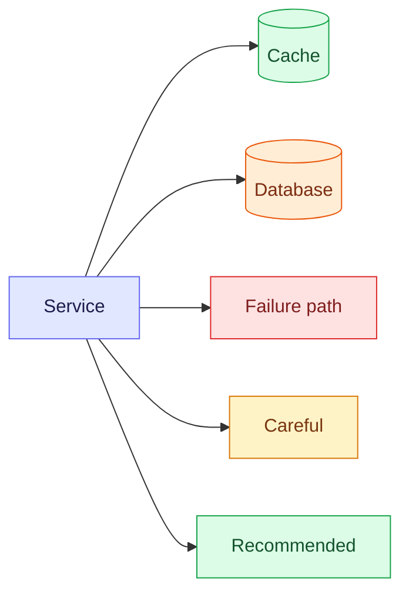

# Writing notes that people remember

Notes in `content/notes/**.md` render at `/notebook/<path>` through a custom
pipeline (`lib/notes.ts`), live from disk — save the file and refresh, no build.

**The bar:** a note should teach the topic to someone who has 10 minutes before
an interview, and still make sense to them in 6 months. That means **picture
first, then words**, and **active recall** built in. A wall of bullets is a
failed note even if every bullet is correct.

**The reference example** is [`content/notes/system-design/caching.md`](../../../system-design/caching.md).
Read it before writing a new note — match its structure and density.
A copy-paste skeleton is in [`template.md`](template.md).

---

## 1. Files and naming

1. **Folder = sidebar section**, filename = URL. `system-design/caching.md` → `/notebook/system-design/caching`.
   Numeric prefixes order a series: `02-persistence/03-flyway-migrations.md`.
2. **Names:** letters, digits, `-`, `_` only — anything else is stripped from the URL.
3. **First line is exactly one `# Title`.** It becomes the page header, sidebar label and
   search title; it is removed from the body (don't repeat it). Be specific:
   `# Caching — Patterns, Pitfalls & Spring Boot`, not `# Caching`.
4. **Existing file?** Read it first. Keep what's correct, restructure the rest. Never
   silently drop the author's content.
5. Folders/files starting with `.` (like this `.claude/`) are hidden from the Notebook.

## 2. Required skeleton

Every concept note follows this order. Skip a section only if it genuinely doesn't apply.

| # | Section | What goes in it |
|---|---|---|
| 1 | `# Title` + 1–2 sentence **hook** | The one-line idea that frames everything ("A cache trades freshness for speed…") |
| 2 | `> [!TIP]` **TL;DR** | 3 bullets = the 30-second interview answer. Bold the key terms. |
| 3 | `## … at a glance` | A **mindmap** of the whole topic (orientation before detail) |
| 4 | `## Mental model` | A **colour-coded flowchart** of the moving parts + 1 paragraph |
| 5 | `## How it works` | A **sequence diagram** (`autonumber`, `alt`/`opt`, `Note`) of the core flow |
| 6 | `## … compared` | A **comparison table**: options × (how / trade-off / risk / use when) |
| 7 | `## Choosing …` | A **decision-tree flowchart** (`flowchart TD`, diamonds for questions) |
| 8 | `## In Spring Boot` / `## In code` | Minimal real code + config, explained by the proxy/container mechanism |
| 9 | `## Failure modes` / `## Pitfalls` | `> [!WARNING]` / `> [!CAUTION]` callouts + a symptom → fix table |
| 10 | `## Interview questions` | 3–6 `<details>` cards (question visible, answer hidden) |
| 11 | `## Key takeaways` | 4–6 row table: *Remember* \| *Because* |
| 12 | `**Related:**` | Links to sibling notes (`/notebook/…`) |

Short "how-to" or reference notes can use a subset (hook, TL;DR, steps, code, pitfalls),
but **every note gets at least one diagram and a TL;DR**.

## 3. Picking the right diagram

| You're explaining… | Use | Why it works |
|---|---|---|
| The whole topic / its sub-areas | `mindmap` | Orientation; shows scope at a glance |
| Components and what talks to what | `flowchart LR` + `classDef` colours | Spatial memory: "the cache sits beside the DB" |
| A request / call over time | `sequenceDiagram` + `autonumber` | Numbered steps are easy to recall in order |
| "Which option should I pick?" | `flowchart TD` with `{diamond}` questions | Turns a table into a decision you can re-derive |
| Lifecycle / states (bean, thread, order) | `stateDiagram-v2` | Shows legal transitions explicitly |
| Data model | `erDiagram` / `classDiagram` | Relationships + cardinality |
| Evolution / history / phases | `timeline` | Ordered events |
| Two-axis trade-off (cost vs latency…) | `quadrantChart` | Positions options relative to each other |
| Cloud / infra boxes with real logos | `architecture-beta` + `logos:` / `mdi:` icons | Recognisable icons |
| Freeform illustration (ByteByteGo-style) | ` ```excalidraw ` scene (see §6) | Hand-drawn layout Mermaid can't do |

Rules: **one idea per diagram**, ≤ ~12 nodes (split otherwise), labels ≤ 4–5 words,
and always add a sentence after the diagram saying what to notice.

**Write for a phone first** — a lot of these notes get read on one (~350px of width):

- **Sequence diagrams: ≤ 4 participants**, short aliases (`participant S as Service`, not the full
  class name). A 5th participant roughly doubles the width and forces sideways scrolling.
- **Flowcharts: prefer `flowchart TD`.** `LR` pipelines are flipped to top-to-bottom on phones
  automatically, but a diagram that is *wide in both* (many parallel branches) still scrolls. Keep
  ≤ 3 nodes side by side.
- Long labels wrap on phones, but a label with no spaces (`org.springframework…AutoConfiguration`)
  can't; shorten it or put the full name in the paragraph below.
- Mindmaps: ≤ 4 branches with ≤ 3 leaves each; they're the widest diagram type.
- Don't put a diagram inside a `<details>` block: Mermaid can't draw into a collapsed element.

What readers get automatically: diagrams render at a readable size and scroll sideways when wider
than the screen, tapping one opens a full-screen view with pinch-zoom, and the phone's Back
gesture closes it.

## 4. Mermaid styling recipes

Diagrams render with a polished "neo" look and an indigo theme that follows the
site's light/dark mode. Every diagram is click-to-expand with zoom/pan.

**Semantic colours — use these exact `classDef`s** (light fills + dark text are
readable in every site theme):



Use colour to **mean** something (green = recommended, red = failure, orange = data
store), never as decoration. Shapes: `[(db)]` cylinder, `([actor])` stadium,
`{question}` diamond, `{{event}}` hexagon, `subgraph` for a boundary/phase.
Edge labels number the flow: `-->|1 · lookup|`. Use `-.->` for async/optional,
`==>` for the hot/critical path. `<br/>` breaks long labels.

**Sequence diagrams:** always `autonumber`; alias long names (`participant S as Spring service`);
`alt`/`else` for branches, `opt` for optional, `loop` for retries; one `Note over A,B:` for the
key rule. Solid `->>` = call, dashed `-->>` = return.

**Mindmaps:** root in `((double parens))`, 3–5 branches, 2–4 leaves each, leaves ≤ 3 words.

## 5. Text, tables, callouts, code

- **Bold** the 1–3 terms per paragraph a reader should remember. Paragraphs ≤ 4 lines.
- **Tables** for anything with 2+ options × 2+ attributes. Use ✅ / ⚠️ sparingly for the verdict column.
- **Callouts** (`> [!TYPE]`, first line is the marker):
  - `[!TIP]` — the TL;DR box and genuine shortcuts. Max one TL;DR per note.
  - `[!IMPORTANT]` — a rule that changes the outcome if missed.
  - `[!WARNING]` — a trap that bites under specific conditions (self-invocation, N+1…).
  - `[!CAUTION]` — data loss / destructive / production-breaking.
  - `[!NOTE]` — background aside. Use rarely.
  Start each callout's body with a **bold one-line rule**, then the why.
- **Code:** always tag the language (`java`, `yaml`, `sql`, `bash`, `ts`, `json`, `properties`)
  — it drives highlighting and the header label; blocks get a Copy button. Show the
  **minimum** that proves the point; comment the one non-obvious line. Real, compiling
  code — no `foo`/`bar`, no `// ...` in the middle of the important part.
- **Math** (KaTeX): inline `$O(\log n)$`, block `$$ … $$`. Use it for costs and formulas
  (hit ratio, complexity, latency) and then plug real numbers in.
- **Interview questions** — raw HTML `<details>` renders as a self-quiz card. Leave a blank
  line after `</summary>` so the answer is parsed as markdown:

```markdown
<details>
<summary>Why delete the key on write instead of updating it?</summary>

Two writers can interleave so the older value lands last and sticks until the TTL.
Deleting is idempotent; the next read loads the committed row.
</details>
```

  **Write scenario questions, not definitions.** Each question gives a concrete setup (a
  request, a code shape, a symptom, an error message) and asks what happens and why, the way
  interviewers probe understanding. Each answer names the **mechanism** (the exact class,
  exception, or lifecycle step) and ends with the fix. 5–8 per note; answers 2–6 sentences or
  a short list.

  | ❌ Definition (don't) | ✅ Scenario (do) |
  |---|---|
  | What is the DispatcherServlet? | Walk me through what happens between Tomcat receiving `POST /messages` and your method running. |
  | `@RequestParam` vs `@PathVariable`? | `GET /orders/abc` hits a `long id` path variable. What status, and does your method run? |
  | Is a singleton thread-safe? | A teammate stores `currentUserId` in a `@Service` field; under load users see each other's data. Explain. |

  Never mark an answer *(verified)* unless the note's own content records that it was reproduced.
  Inside `<summary>`, write generics as `List&lt;T&gt;` (raw `<` is read as an HTML tag).

## 6. Excalidraw (freeform illustrations)

For a hand-drawn panel Mermaid can't lay out, embed a real Excalidraw scene:
draw at excalidraw.com → menu → **Save to disk** → paste the `.excalidraw` file's JSON:

````markdown
```excalidraw
{"elements":[…],"appState":{}}
```
````

**Never hand-write or invent this JSON** (each element needs ~25 exact fields). If the user
hasn't given you an export, use Mermaid instead or ask them to draw it.

## 7. Before you finish — checklist

- [ ] `# Title` is specific; hook sentence + `[!TIP]` TL;DR present
- [ ] ≥ 1 diagram (concept notes: mindmap + mental model + one flow/decision diagram)
- [ ] Every diagram has a sentence after it saying what to notice
- [ ] Colour classes come from §4 and mean something
- [ ] Phone-friendly diagrams (§3): ≤ 4 sequence participants, `flowchart TD`, no unbreakable long labels
- [ ] At least one comparison or symptom→fix table
- [ ] Code blocks are language-tagged, minimal, real
- [ ] Pitfalls are `[!WARNING]`/`[!CAUTION]` callouts with a bold first line
- [ ] 3–6 `<details>` interview questions; key-takeaways table; related links
- [ ] Facts double-checked (versions, property names, annotations) — never guess an API
- [ ] Open `/notebook/<path>` (or the editor preview) and confirm every diagram renders —
      a Mermaid syntax error shows the raw source instead of a picture
