```mermaid
architecture-beta
    service db(logos:aws-rds)[Database]
    service server(logos:aws-ec2)[Server]
    server:R -- L:db
```

# Creating notes in this repo

Notes live under `content/notes/**.md` and render at `/notebook/<path>` through
a custom pipeline (see `lib/notes.ts`) — not plain markdown. They render live
from disk on every request: write the file and it's visible immediately, no
build or restart needed.

## Procedure

1. **Choose the path.** Folder = category shown in the Notebook sidebar;
   filename (no extension) = the last URL segment.
   `content/notes/system-design/caching.md` → `/notebook/system-design/caching`.
2. **Name it safely.** Folder and file names: letters, digits, `-`, `_` only.
   No spaces, no other punctuation — anything else gets silently stripped when
   the slug is resolved, which breaks links.
3. **Start the file with exactly one `# Title` line.** This is parsed out as
   the display title everywhere (tree, breadcrumbs, search index). Don't rely
   on the filename — if the H1 is missing, the filename is humanized as a weak
   fallback.
4. **Write the body** using the syntax reference below. Prefer a diagram or a
   callout over a wall of prose wherever one actually clarifies something —
   that's the point of this pipeline existing.
5. If the target file already exists, read it first and preserve what's still
   correct; don't blindly overwrite a human-authored note.

## Syntax reference

**Alert callouts** — blockquote, first line is one of five markers (case-insensitive):

```markdown
> [!NOTE]
> Background info, not urgent.

> [!TIP]
> A shortcut or best practice.

> [!IMPORTANT]
> Easy to miss, changes the outcome.

> [!WARNING]
> Will bite you under some condition.

> [!CAUTION]
> Destructive or hard to reverse.
```

**Code — syntax highlighted (Shiki, theme `github-dark`).** Tag the fence with
a real language id (`java`, `ts`, `python`, `sql`, `bash`, `yaml`, `json`, …);
an unrecognized or missing tag just renders as plain text, never breaks:

````markdown
```java
public record OrderDto(Long id, BigDecimal total) {}
```
````

**Math (KaTeX).** Inline `$...$`, block `$$...$$`. No whitespace touching the
inner side of either `$` — `$5 and $10` (plain currency) is correctly never
treated as math; `$O(\log n)$` is.

```markdown
Binary search is $O(\log n)$.

$$
T(n) = 2T(n/2) + O(n)
$$
```

**Diagrams (Mermaid).** Fence with ` ```mermaid `. Flowchart, sequence, class,
state, and ER diagrams all work as standard Mermaid syntax. For a boxes/icons
cloud-architecture diagram (the "Eraser-style" look), use `architecture-beta`
with `logos:` or `mdi:` icon names — these two icon packs are preregistered:

````markdown

````

Reach for a diagram over prose when describing: a request/call flow (sequence),
a data model (ER/class), a state machine, or a system's components (architecture).

**Plain markdown** — tables, `**bold**`, `[links](url)`, images, nested lists —
standard GFM, nothing special required.

## Full human-facing version

`content/notes/README.md` has the same reference with a complete worked
example end to end — read it if you want more context before writing.
