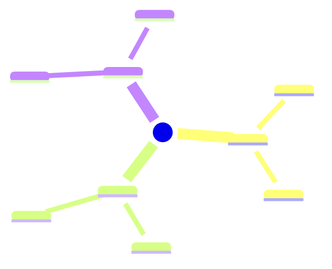
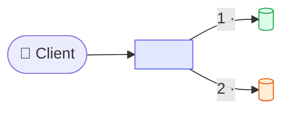
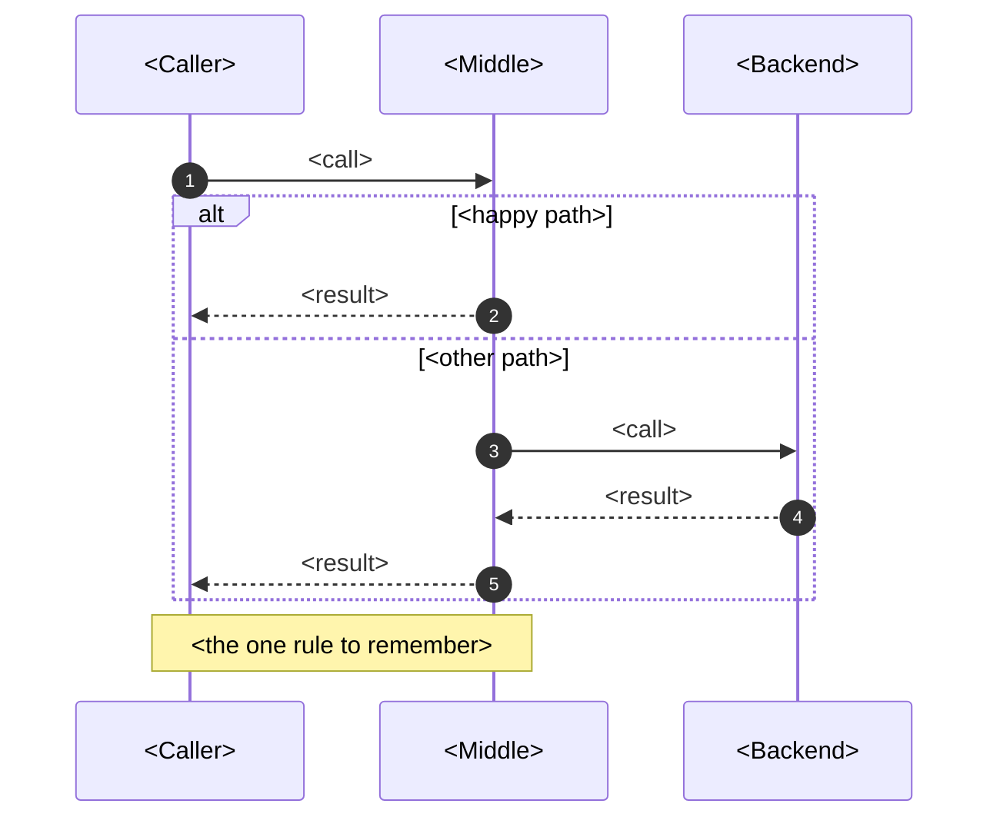
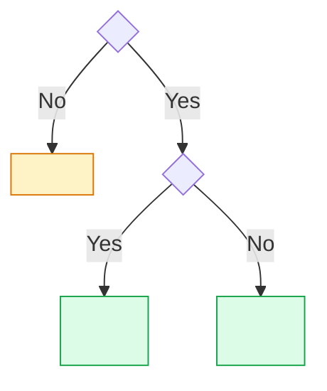

# <Topic> — <what angle: patterns / internals / pitfalls>

<One or two sentences: the single idea that frames the whole topic.>

> [!TIP]
> **TL;DR: the 30-second interview answer**
> - <Default choice / core definition, with the **key term** bolded>
> - <The hard part or main trade-off>
> - <How it shows up in Spring Boot / your stack>

## <Topic> at a glance



## Mental model



<One paragraph: what to notice in the picture.>

## How it works



## <Options> compared

| Option | How it works | Trade-off | Risk | Use when |
|---|---|---|---|---|
| **<A>** | | | | ✅ <default case> |
| **<B>** | | | | |

## Choosing <an option>



## In Spring Boot

<One sentence on the mechanism: which proxy / bean / auto-configuration does the work.>

```java
// minimal, real, compiling example; comment only the non-obvious line
```

```yaml
# the config that matters
```

> [!WARNING]
> **<The trap, as a rule.>** <Why it happens and how to avoid it.>

## Failure modes

| Problem | Symptom | Fix |
|---|---|---|
| **<A>** | | |
| **<B>** | | |

## Interview questions

<details>
<summary><Why … / What breaks if …?></summary>

<2–4 sentence answer.>
</details>

<details>
<summary><Compare X and Y: when would you pick each?></summary>

<2–4 sentence answer.>
</details>

<details>
<summary><How would you fix / debug …?></summary>

<2–4 sentence answer.>
</details>

## Key takeaways

| Remember | Because |
|---|---|
| <rule> | <reason> |
| <rule> | <reason> |

**Related:** [<Sibling note>](/notebook/<path>)
