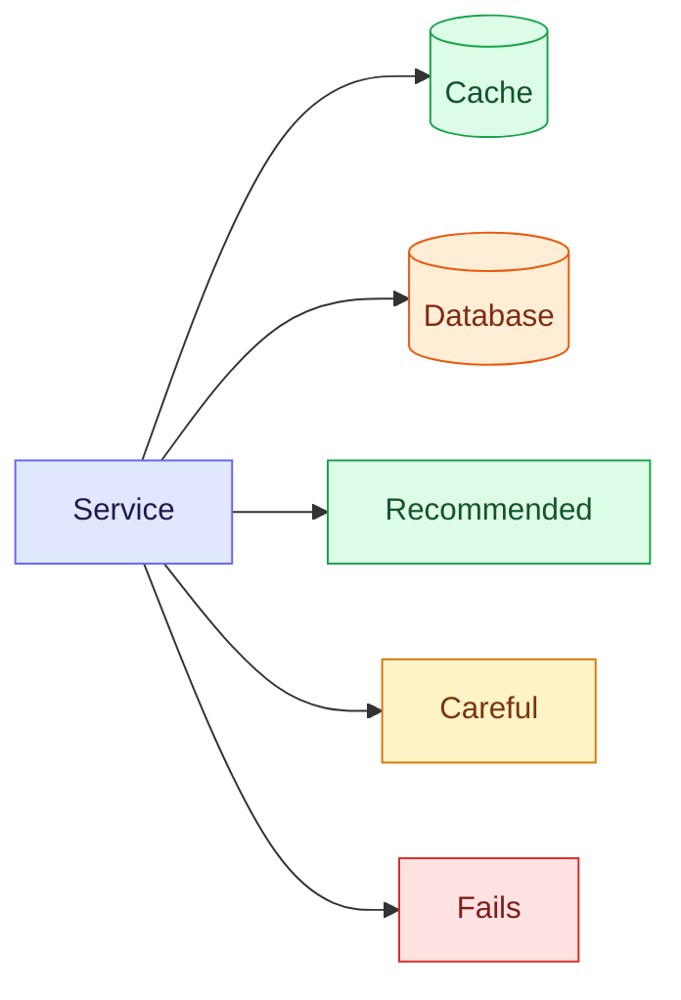

# How notes work

Every `.md` file in this folder is a page at `/notebook/<path>`, rendered live from
disk (no build step). Rendering supports diagrams, highlighted code, math, callouts
and self-quiz cards, so a note can look like an illustrated study guide, not a text dump.

**See a finished example:** [Caching — Patterns, Pitfalls & Spring Boot](/notebook/system-design/caching)
(`system-design/caching.md`). Start new notes from `.claude/skills/notes/template.md`.

## Live updates

An open page updates itself when a note changes on disk, whether you saved it in an editor or an AI wrote it.
Only the blocks that changed are redrawn (they flash once), so your scroll position, open quiz cards and
unchanged diagrams stay as they were. The **Live** pill at the top of a note shows the connection, and **Follow**
scrolls to each edit. Notes in `whiteboard/` are live design boards:
[How the whiteboard works](/notebook/whiteboard/how-it-works).

## Files

- **Folder = sidebar section**, filename = URL: `system-design/caching.md` → `/notebook/system-design/caching`.
  Number a series to order it: `02-persistence/03-flyway.md`.
- Names use letters, digits, `-`, `_` only.
- **Line 1 is `# Title`.** It becomes the page header, sidebar label and search title.
  The page header adds reading time, section count and last-updated date automatically.
- Folders/files starting with `.` are hidden from the Notebook (that's how `.claude/` stays out of the list).

## The note standard (why notes look the way they do)

A note should teach the topic in ~10 minutes and still make sense months later.
Two principles drive everything:

1. **Picture first.** A diagram you can redraw from memory beats ten bullets.
2. **Active recall.** End with questions you answer *before* revealing the answer.

So a concept note follows this order:

| Section | Gives you |
|---|---|
| Title + one-line hook | The framing idea |
| `[!TIP]` **TL;DR** | The 30-second interview answer |
| **Mindmap** "at a glance" | Scope of the topic |
| **Flowchart** "mental model" | Where the parts sit, colour-coded |
| **Sequence diagram** "how it works" | The flow, numbered step by step |
| **Comparison table** | Options × trade-offs |
| **Decision tree** | Which option to pick, as questions |
| Code + config | The real Spring/Java usage |
| `[!WARNING]` pitfalls + symptom→fix table | What breaks in production |
| **Interview questions** (click to reveal) | Self-test |
| Key takeaways table | What to remember and why |

## Feature reference

### Diagrams (Mermaid)
Fence with ` ```mermaid `. Diagrams render with a clean rounded "neo" style themed to
match the site (light/dark aware). **Every diagram has an expand button**: it opens a
full-screen view with scroll-to-zoom, drag-to-pan and `+` / `-` / `0` keys.

Useful types: `mindmap`, `flowchart LR/TD`, `sequenceDiagram`, `stateDiagram-v2`,
`erDiagram`, `classDiagram`, `timeline`, `quadrantChart`, and `architecture-beta`
with `logos:` / `mdi:` icons (e.g. `logos:aws-rds`).

Colour nodes by **meaning** with these classes. They're readable in every theme:



### Callouts
A blockquote whose first line is a marker. Start the body with a bold one-line rule.

```markdown
> [!TIP]
> **TL;DR** — the short answer.

> [!WARNING]
> **Self-invocation skips the proxy.** Call the method from another bean.
```

Markers: `[!NOTE]` aside · `[!TIP]` TL;DR / shortcut · `[!IMPORTANT]` rule that changes
the outcome · `[!WARNING]` trap · `[!CAUTION]` data loss / destructive.

### Interview questions (self-quiz cards)

```markdown
<details>
<summary>Why delete the cache key on write instead of updating it?</summary>

Answer in 2–4 sentences. (Keep the blank line after </summary>.)
</details>
```

### Code
Tag the language (` ```java `, `yaml`, `sql`, `bash`, `ts`…). Blocks get syntax colours,
a language label and a **Copy** button.

### Math (KaTeX)
Inline `$O(\log n)$`, block `$$ … $$`. `$5 and $10` stays plain text.

### Hand-drawn illustrations (Excalidraw)
Put **Mermaid** in an ` ```excalidraw ` fence and it is drawn as a hand-drawn sketch (flowcharts and
sequence diagrams become real shapes). Or draw at [excalidraw.com](https://excalidraw.com) → menu →
**Save to disk** and paste the `.excalidraw` file's JSON into the fence. Renders read-only,
expandable, and updates live when the note changes. Scene JSON must come from a real export, never typed by hand.
Several diagrams (Mermaid, plain shapes, exported drawings) can share one canvas as a board:
see [Several diagrams on one canvas](/notebook/notebook-features#several-diagrams-on-one-canvas) in Notebook Features.

### Everything else
Tables (rounded, zebra rows), links, images, lists: standard GitHub-flavoured markdown.
Headings `##`/`###` feed the "On this page" sidebar and get `#` anchor links.

## For AI agents

Run `/notes` (`.claude/skills/notes/SKILL.md`). It has the full standard, the
diagram-picker table, styling recipes and a pre-publish checklist.
