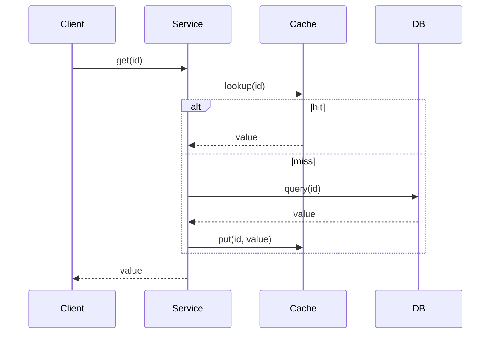

```mermaid
architecture-beta
    service db(logos:aws-rds)[Database]
    service server(logos:aws-ec2)[Server]
    server:R -- L:db
```

# How notes work

This folder is the Notebook's content. Every `.md` file here becomes a page at
`/notebook/<path>`, rendered through a pipeline that supports syntax-highlighted
code, math, Mermaid diagrams, and GitHub-style alert callouts — not just plain
markdown.

## Creating a note

1. **Pick a folder = category.** Top-level files show under "Notebook"; a
   subfolder (e.g. `system-design/`) becomes a section. Nest as deep as you like.
2. **Filename = URL slug.** `system-design/caching.md` → `/notebook/system-design/caching`.
   Use only letters, digits, `-`, `_` — no spaces, no other punctuation (anything
   else is stripped when resolving the file).
3. **First line must be `# Title`.** That's what's shown everywhere (tree,
   breadcrumbs, search) — not the filename. If you omit it, the filename is
   humanized as a fallback title, so always include it.
4. **Write markdown.** GFM is on: tables, lists, links, images, blockquotes.

```
content/notes/
  welcome.md                        -> /notebook
  system-design/
    caching.md                      -> /notebook/system-design/caching
  data-structures/
    two-pointers.md                 -> /notebook/data-structures/two-pointers
```

No build step needed — notes render live from disk on every request, whether
you edit them through the in-app ✎ editor or write the file directly.

## Example: a complete note

````markdown
# Caching Strategies

> [!TIP]
> Cache-aside is the default choice unless you specifically need write-through
> consistency guarantees.

Cache-aside: the app reads from cache first, falls back to the DB on a miss,
then populates the cache. Eviction is usually LRU, with $O(1)$ average lookup.

```java
@Cacheable(value = "products", key = "#id")
public Product findById(Long id) {
    return repo.findById(id).orElseThrow();
}
```



> [!WARNING]
> `@Cacheable` does nothing when called from within the same class — Spring's
> proxy never intercepts self-invocation.
````

## Feature reference

### Alert callouts
GitHub syntax — a blockquote whose first line is one of five markers:

```markdown
> [!NOTE]
> Background info.

> [!TIP]
> A shortcut or best practice.

> [!IMPORTANT]
> Easy to miss, changes the outcome.

> [!WARNING]
> Will bite you under some condition.

> [!CAUTION]
> Destructive / hard to reverse.
```

### Code — syntax highlighted (Shiki)
Fence with a language tag; anything Shiki recognizes gets real token colors
(`java`, `ts`, `python`, `sql`, `bash`, `yaml`, …). No tag = plain text.

````markdown
```java
public record OrderDto(Long id, BigDecimal total) {}
```
````

### Math (KaTeX)
Inline `$...$`, block `$$...$$`. No space right after the opening `$` or right
before the closing one — `$5 and $10` is correctly left alone as plain text.

```markdown
Binary search is $O(\log n)$.

$$
T(n) = 2T(n/2) + O(n)
$$
```

### Diagrams (Mermaid)
Fence with ` ```mermaid `. Flowchart, sequence, class, state, ER diagrams all
work. For boxes-and-icons cloud/architecture diagrams, use `architecture-beta`
with `logos:` or `mdi:` icon names (e.g. `logos:aws-lambda`, `mdi:harddisk`):

````markdown

````

### Plain markdown — unchanged
Tables, `**bold**`, `[links](url)`, images, nested lists — standard GFM, no
special syntax needed.

## Agent note

If you're an AI editing this folder: see `.claude/skills/notes/SKILL.md` for
the condensed, procedural version of this guide (triggered by `/notes`).
