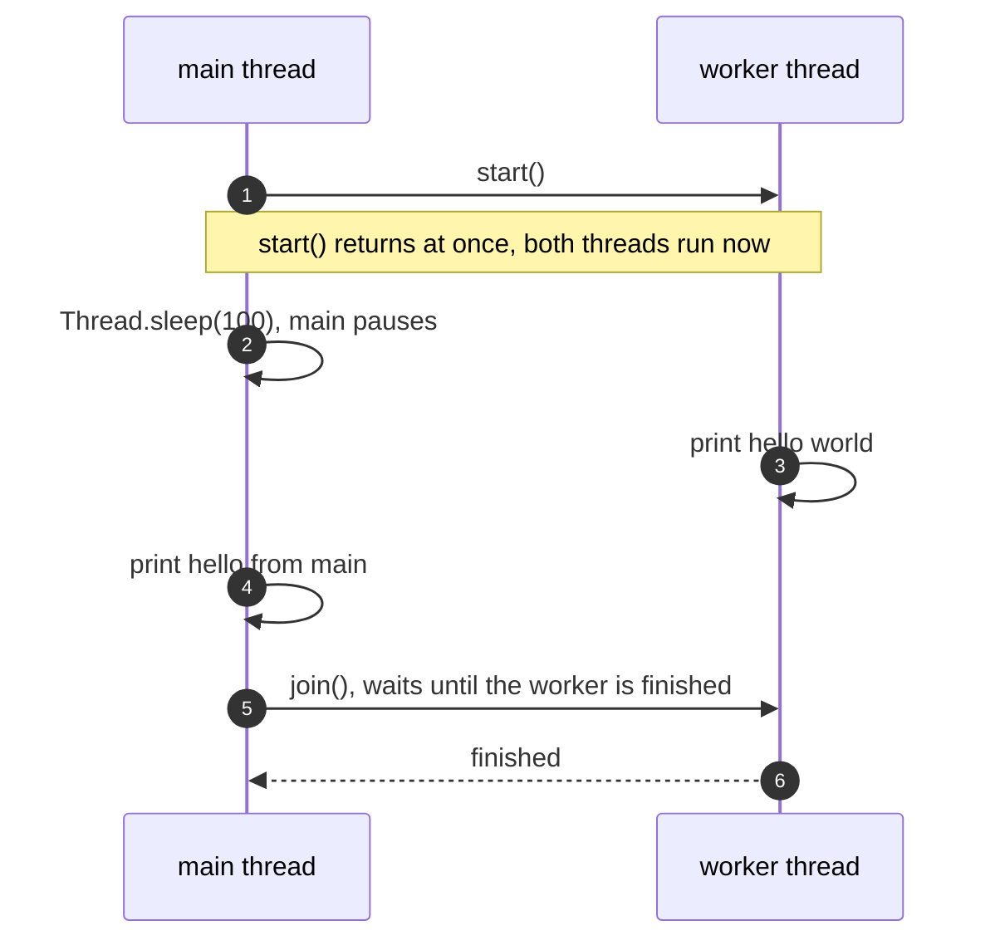

# 01. Threads: create, start, join and sleep

A thread is a second line of execution inside your program. Four calls are enough to use one: `new Thread`, `start()`, `join()` and `Thread.sleep()`. Using them also shows the first surprise of concurrency: the order of the lines printed by two threads is decided by timing, not by the order of your code.

> [!TIP]
> - **`new Thread(task)`** only creates a thread. **`start()`** launches it and returns at once. **`join()`** makes the caller wait until the thread has finished.
> - **`Thread.sleep(ms)`** pauses only the thread that calls it.
> - **The order between two threads is not guaranteed.** In the experiment below `main` printed first in 20 of 20 runs. After a 100 ms sleep was added to `main`, the worker printed first in 10 of 10 runs. Timing decided both.

## What happens, step by step



After step 1 two threads run at the same time. While `main` sleeps for 100 ms, the worker prints. Then `main` prints, and `join()` returns as soon as the worker has finished, which here it already has.

## The experiment

`src/lab/shared/Hello.java`, written by you and run with `java Hello.java`. That is the JDK's single-file mode: it compiles and runs one file, so there is no build and no package.

```java
import java.util.*;
public class Hello {
  public static void main(String args[]) throws Exception{
    Thread t = new Thread(()->{
      System.out.println("hello world");
    });
    t.start();
    Thread.sleep(100);
    System.out.println("hello from main");
    t.join();
  }
}
```

**Version 1: without the `Thread.sleep(100);` line.** I ran it 20 times and counted which line came first *(verified)*:

```text
     20 hello from main
```

`start()` has to ask the operating system for a new thread and get it running, and that takes a moment. `main` is already running, so it prints at once.

**Version 2: with `Thread.sleep(100);` as above.** I ran it 10 times *(verified)*:

```text
     10 hello world
```

Now `main` pauses for 100 ms, and the worker needs far less than that to print its line.

> [!IMPORTANT]
> **Neither order is guaranteed.** Java promises only that each thread runs its own lines in order. Which thread prints first is up to timing, and `sleep` only makes one order very likely. Two threads that depend on timing like this are how race conditions start (see the next note).

## What each call does

| Call | What it does |
|---|---|
| `new Thread(() -> { ... })` | Creates a thread. The lambda is the work it will run. Nothing runs yet. |
| `t.start()` | Launches the thread and returns immediately. `main` carries on. |
| `Thread.sleep(100)` | Pauses the thread that calls it for 100 ms. Here that is `main`, not the worker. |
| `t.join()` | The caller waits until `t` has finished. |
| `throws Exception` | `join()` and `sleep()` can throw a checked exception (`InterruptedException`), so `main` must declare or handle it. What it means comes in a later chapter. |

## join: where you put it matters

The first version of `Hello` called `t.join()` straight after `t.start()`. `main` then waited before doing anything else, so the two threads never ran together. The thread did the work, but the program could have called the task directly.

`JoinDemo.java` in the same folder shows what `join()` waits for. Its worker sleeps for one second. The output of one run *(verified)*:

```text
main:   start() returned after 5 ms
worker: finished after 1024 ms
main:   join() returned after 1025 ms
```

`start()` came back after 5 ms, so `main` did not wait. `join()` came back after 1025 ms, so it waited for the worker.

> [!WARNING]
> **Without `join()`, the caller reads results the workers have not produced yet.** `join()` goes after you have started everything and finished your own work, not directly after `start()`.

## Interview questions

<details>
<summary>main starts a worker and prints on the next line. In 20 runs main printed first every time. Can you rely on that order?</summary>

No. Java guarantees only the order inside one thread. `main` won here because starting a thread takes time, and adding `Thread.sleep(100)` to `main` flipped the result to the worker first in 10 of 10 runs. Code that depends on such timing is a race. If the order matters, make one thread wait for the other, for example with `join()`.
</details>

<details>
<summary>A teammate writes t.start() and then t.join() on the next line. What does that gain over running the task directly?</summary>

Almost nothing for speed. `main` waits for the worker straight away, so the two never overlap. Threads only help when the caller does other work between `start()` and `join()`, or starts several workers before joining any of them.
</details>

<details>
<summary>A worker calls Thread.sleep(1000). Does main pause for that second too?</summary>

No. `sleep` pauses only the thread that calls it. In `JoinDemo`, `main` printed after 5 ms while the worker slept. `main` only waited when it called `join()`.
</details>

## Key takeaways

| Remember | Because |
|---|---|
| `new Thread` does not run anything | Only `start()` launches the thread |
| `start()` returns at once | It took 5 ms for a task that runs for 1 second |
| `join()` waits for the thread | It returned after 1025 ms, the length of the task |
| `join()` right after `start()` removes the overlap | `main` waits before it does anything |
| The order between threads is timing, not code order | `main` first 20 of 20, then the worker first 10 of 10 |

**Related:** [Concurrency handbook](/notebook/concurrency/overview) · **Next:** [Race conditions](/notebook/concurrency/01-foundations/02-race-condition)
