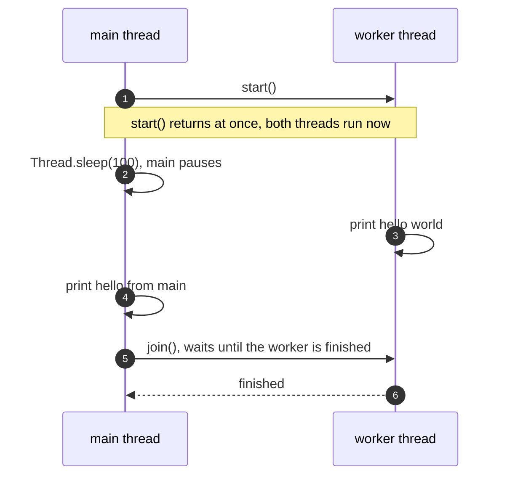

# 01. Threads: create, start, join and sleep

A thread is a second line of execution inside a program. Four calls are enough to use one: `new Thread`, `start()`, `join()` and `Thread.sleep()`. Using them also shows the first surprise of concurrency: the order of the lines printed by two threads is decided by timing, not by the order of the code.

> [!TIP]
> - **`new Thread(task)`** only creates a thread. **`start()`** launches it and returns at once. **`join()`** makes the caller wait until the thread has finished.
> - **`Thread.sleep(ms)`** pauses only the thread that calls it.
> - **The order between two threads is not guaranteed.** Without a pause, `main` usually prints first, because starting a thread takes time. With a 100 ms sleep in `main`, the worker usually prints first. Timing decides both.

## What happens, step by step



After step 1 two threads run at the same time. While `main` sleeps for 100 ms, the worker prints. Then `main` prints, and `join()` returns as soon as the worker has finished, which here it already has.

## Example

Run with `java Hello.java`. That is the JDK's single-file mode: it compiles and runs one file, so there is no build and no package.

```java
public class Hello {

  public static void main(String[] args) throws Exception {
    Thread t = new Thread(() -> {
      System.out.println("hello world");
    });
    t.start();
    Thread.sleep(100);
    System.out.println("hello from main");
    t.join();
  }
}
```

Example output:

```text
hello world
hello from main
```

Without the `Thread.sleep(100);` line the two lines usually come out the other way round: `start()` has to ask the operating system for a new thread and get it running, which takes a moment, and `main` is already running, so it prints first. With the sleep, `main` pauses for 100 ms and the worker needs far less than that to print its line.

> [!IMPORTANT]
> **Neither order is guaranteed.** Java promises only that each thread runs its own lines in order. Which thread prints first is up to timing, and `sleep` only makes one order very likely. Code that depends on timing like this is how race conditions start (see the next note).

## What each call does

| Call | What it does |
|---|---|
| `new Thread(() -> { ... })` | Creates a thread. The lambda is the work it will run. Nothing runs yet. |
| `t.start()` | Launches the thread and returns immediately. The caller carries on. |
| `Thread.sleep(100)` | Pauses the thread that calls it for 100 ms. |
| `t.join()` | The caller waits until `t` has finished. |
| `throws Exception` | `join()` and `sleep()` can throw a checked exception (`InterruptedException`), so the calling method must declare or handle it. See [Interrupts](/notebook/concurrency/01-foundations/19-interrupts). |

## join: where it goes matters

`t.join()` straight after `t.start()` makes the caller wait before it does anything else, so the two threads never run together. The work is done on another thread, but the program behaves as if it had called the task directly.

`join()` belongs after everything has been started and the caller has finished its own work. A worker that sleeps for one second shows what each call waits for:

```text
main:   start() returned after 5 ms
worker: finished after 1024 ms
main:   join() returned after 1025 ms
```

`start()` came back after 5 ms, so the caller did not wait. `join()` came back after about 1 second, so it waited for the worker.

> [!WARNING]
> **Without `join()`, the caller reads results the workers have not produced yet.** Start every worker first, do the caller's own work, then `join()` each one.

## Interview questions

<details>
<summary>main starts a worker and prints on the next line, and main prints first on every run. Can that order be relied on?</summary>

No. Java guarantees only the order inside one thread. `main` wins because starting a thread takes time, and adding `Thread.sleep(100)` to `main` flips the result so the worker prints first. Code that depends on such timing is a race. If the order matters, make one thread wait for the other, for example with `join()`.
</details>

<details>
<summary>A teammate writes t.start() and then t.join() on the next line. What does that gain over running the task directly?</summary>

Almost nothing for speed. The caller waits for the worker straight away, so the two never overlap. Threads only help when the caller does other work between `start()` and `join()`, or starts several workers before joining any of them.
</details>

<details>
<summary>A worker calls Thread.sleep(1000). Does main pause for that second too?</summary>

No. `sleep` pauses only the thread that calls it. `main` carries on straight after `start()` and only waits when it calls `join()`.
</details>

## Key takeaways

| Remember | Because |
|---|---|
| `new Thread` does not run anything | Only `start()` launches the thread |
| `start()` returns at once | It returns in a few milliseconds even for a task that runs for a second |
| `join()` waits for the thread | It returns after about as long as the task takes |
| `join()` right after `start()` removes the overlap | The caller waits before it does anything else |
| The order between threads is timing, not code order | A sleep on one side changes which line prints first |

**Related:** [Concurrency handbook](/notebook/concurrency/overview) · **Next:** [Race conditions](/notebook/concurrency/01-foundations/02-race-condition)
