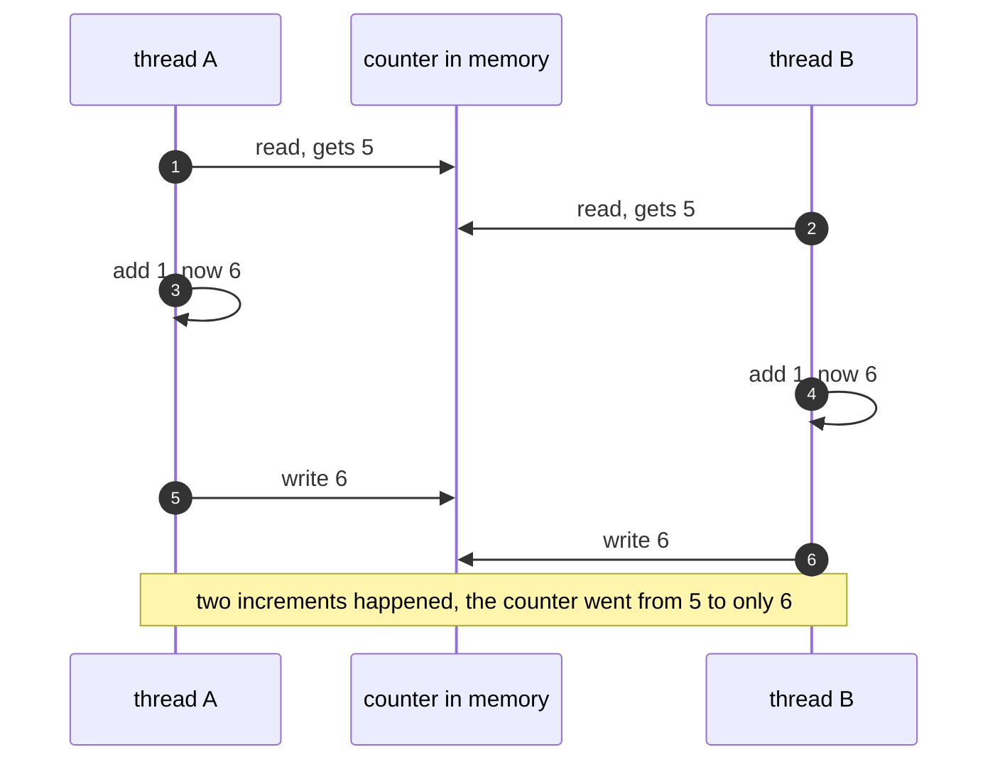

# 02. Race condition: why counter++ loses updates

When two threads change the same variable at the same time, some of the changes vanish. That bug is a **race condition**. A counter that two threads increment reproduces it, and the bytecode shows why it happens.

> [!TIP]
> - **`counter++` looks like one step but is three:** read the value, add 1, write it back.
> - **Two threads can read the same value.** Both write the same result and one increment is lost (a **lost update**).
> - **The result changes from run to run.** A run can also be correct by luck, so one correct run proves nothing.

## What goes wrong



Both threads read 5 before either wrote. Each added 1 to its own copy, so both wrote 6. One increment disappeared.

## Example

Two threads each add 1 to a shared `static int` 100,000 times. The right answer is 200,000. The demo file `02-race-condition/RaceDemo.java` runs the same experiment with 8 threads.

```java
public class Counter {

  static int counter = 0;

  public static void main(String[] args) throws Exception {
    int numberOfThreads = 2, maxCounter = 100_000;
    Thread[] t = new Thread[numberOfThreads];
    for (int i = 0; i < numberOfThreads; i++) {
      t[i] = new Thread(() -> {
        for (int j = 0; j < maxCounter; j++) {
          counter++;
        }
      });
      t[i].start();
    }
    for (int i = 0; i < numberOfThreads; i++) {
      t[i].join();
    }
    System.out.println(counter);
  }
}
```

Both threads are started first, and only then does `main` call `join()` on each, so the two overlap. Example output of ten runs, one result per line:

```text
200000
124163
161730
154642
114405
111754
107016
123885
137435
108330
```

Most runs are wrong and no two wrong answers are the same. The one correct run proves nothing: the code is just as broken in that run.

## Why: counter++ is three steps

`javap -c` prints the bytecode the compiler produced. For a method whose only line is `counter++` on a static field:

```text
  static void inc();
    Code:
       0: getstatic     #7                  // Field counter:I
       3: iconst_1
       4: iadd
       5: putstatic     #7                  // Field counter:I
       8: return
```

| Instruction | What it does |
|---|---|
| `getstatic` | **Read** the field `counter` |
| `iconst_1` and `iadd` | **Add** 1 to the value that was read |
| `putstatic` | **Write** the result back to `counter` |

Another thread can run between any two of these steps. That is the gap the race lives in.

## Vocabulary

| Term | Meaning |
|---|---|
| Shared mutable state | A variable that more than one thread can change |
| Race condition | The result depends on which thread happens to run first |
| Lost update | Two threads write based on the same old value, so one write is wasted |
| Atomic | An operation that no other thread can see half done. `counter++` is not atomic. |

> [!WARNING]
> **One correct run does not mean the code is thread-safe.** A race only shows when the bad interleaving happens, so a single run can pass by luck. Test with many runs, more threads and more iterations.

## Interview questions

<details>
<summary>Two threads each run total++ 1000 times on a shared int. 2000 is expected and 1634 is printed. Explain.</summary>

`total++` is three steps: read, add one, write. When both threads read the same value before either writes, both write the same result and one increment is lost. The shortfall is the number of lost updates, and it changes from run to run. The fix is to make the increment atomic or let only one thread at a time run it.
</details>

<details>
<summary>A teammate runs the two-thread counter once, sees 200000 and says it is thread-safe. What is the answer?</summary>

One run proves nothing. The counter is wrong in most runs and right only when the threads happen not to interleave badly. Run it many times, with more threads and more iterations, before trusting a result.
</details>

<details>
<summary>The counter gives a different wrong answer on every run. Why not the same one?</summary>

The operating system decides when each thread runs, so the three steps of the two threads interleave differently each time. A result that changes between runs with no change in the code is a strong sign of a race.
</details>

## Key takeaways

| Remember | Because |
|---|---|
| `counter++` is read, add, write | Bytecode shows `getstatic`, `iadd`, `putstatic` |
| A lost update needs two threads reading the same old value | Both write the same new value |
| A race gives different results on different runs | The interleaving changes every time |
| One correct run proves nothing | The bad interleaving may simply not have happened |

**Related:** [Concurrency handbook](/notebook/concurrency/overview) · **Previous:** [Threads: create, start, join and sleep](/notebook/concurrency/01-foundations/01-threads-first-steps)
