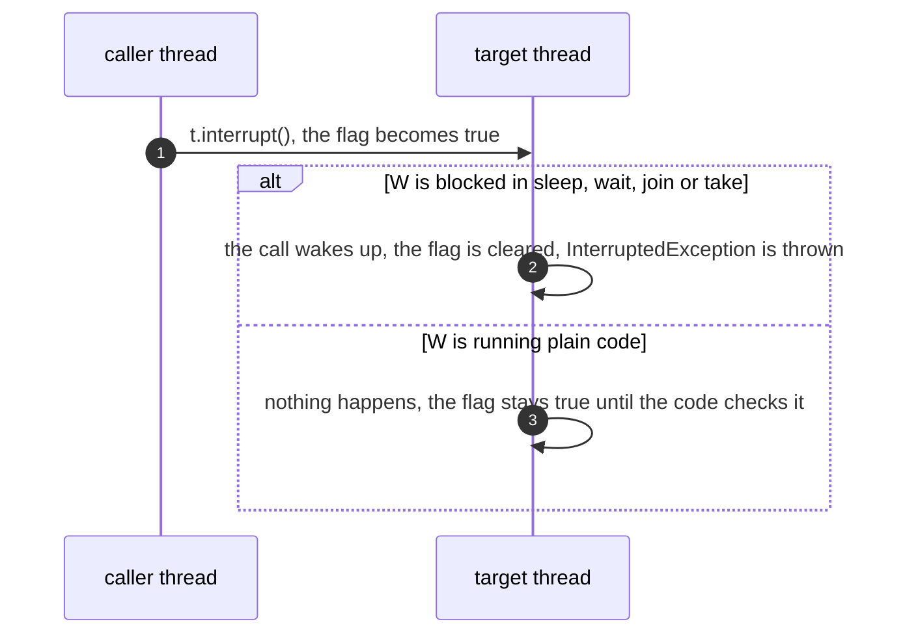

# 19. Interrupts: asking a thread to stop

`t.interrupt()` is a request, not a command. It sets a flag on the thread `t`, and the thread decides whether and when to stop. A thread that is waiting in `sleep`, `join`, `wait` or `queue.take()` is also woken at once with an `InterruptedException`.

> [!TIP]
> - **`interrupt()` is a soft stop.** It sets the thread's interrupt flag and never forces the thread to stop.
> - **A blocked thread wakes with `InterruptedException`, and the flag is cleared at the moment the exception is thrown.** A thread running plain code sees the flag only if it checks `isInterrupted()`.
> - **Never swallow `InterruptedException`.** Stop the work (`return` or `break`), or set the flag again with `Thread.currentThread().interrupt()`.

## What happens when a thread is interrupted



The exception is thrown inside the target thread, at the blocking call, and never at an arbitrary line of running code.

## Why it is a request

Java has `Thread.stop()`, which is deprecated because it can stop a thread in the middle of an update, with a lock held and data half-written. Stopping is therefore cooperative: the caller asks, and the thread stops at a safe point, after it has finished the current item, released its locks and closed its resources.

## Example 1: interrupting a sleeping thread

```java
Thread worker = new Thread(() -> {
  try {
    System.out.println("worker: sleeping for 10 seconds");
    Thread.sleep(10_000);
    System.out.println("worker: woke up normally");
  } catch (InterruptedException e) {
    System.out.println("worker: interrupted, flag now = " + Thread.currentThread().isInterrupted());
  }
});
long begin = System.currentTimeMillis();
worker.start();
Thread.sleep(500);
worker.interrupt();
worker.join();
System.out.println("main: worker ended after " + (System.currentTimeMillis() - begin) + " ms");
```

Output:

```text
worker: sleeping for 10 seconds
worker: interrupted, flag now = false
main: worker ended after 508 ms
```

The sleep ends after about 500 ms instead of 10 seconds, and the flag is `false` inside the `catch` block, because throwing the exception cleared it.

## Example 2: interrupting a running loop

```java
Thread busy = new Thread(() -> {
  long count = 0;
  while (!Thread.currentThread().isInterrupted()) {
    count++;
  }
  System.out.println("busy: stopped, flag = " + Thread.currentThread().isInterrupted());
});
busy.start();
Thread.sleep(500);
busy.interrupt();
busy.join();
```

Output:

```text
busy: stopped, flag = true
```

No blocking call is involved, so no exception is thrown. The flag is set, and the loop stops only because its condition checks the flag. A loop without that check ignores the interrupt and runs until its work is done.

## What an interrupt does to different code

| The target thread is | Effect of `interrupt()` |
|---|---|
| Waiting in `sleep`, `join`, `wait`, `queue.take()` | The call ends at once with `InterruptedException`, and the flag is cleared |
| Running a loop or calculation that never checks the flag | Nothing visible: the flag becomes true and the thread carries on to the end |
| Running a loop that checks `isInterrupted()` | The loop can stop at its next check |
| Not blocked now, but calls a blocking method later | That call throws `InterruptedException` immediately, because the flag is already set |

## Pitfall: swallowing the interrupt

```java
Thread stubborn = new Thread(() -> {
  while (!Thread.currentThread().isInterrupted()) {
    try {
      Thread.sleep(200);
    } catch (InterruptedException e) {
      // empty: the flag was cleared when the exception was thrown
    }
  }
  System.out.println("stubborn: stopped");
});
```

Interrupting this thread never stops it. The thread is almost always inside `sleep(200)`, so the interrupt makes the sleep throw, and the throw clears the flag. The empty `catch` ignores the exception, the loop condition sees `false`, and the loop continues. The request to stop is lost, and a `join()` on this thread without a timeout waits forever.

A `catch` block has three correct ways to deal with the exception:

| Choice | Effect |
|---|---|
| `return;` | Leaves the method at once |
| `break;` | Leaves the loop |
| `Thread.currentThread().interrupt();` | Sets the flag again, so the loop condition (or any later code) sees the request |

With the last line added to the `catch` block, the same thread stops:

```java
    } catch (InterruptedException e) {
      Thread.currentThread().interrupt();     // set the flag again
    }
```

Output:

```text
stubborn: stopped
stubborn still alive after 1 s: false
```

> [!WARNING]
> **Do not leave a `catch (InterruptedException e)` block empty.** The exception is the only trace of the stop request. In a `Runnable` that cannot rethrow it, set the flag again with `Thread.currentThread().interrupt()`, or stop the work.

## The methods

| Call | What it does |
|---|---|
| `t.interrupt()` | Sets the flag of thread `t`, and wakes `t` if it is blocked in an interruptible call |
| `t.isInterrupted()` | Returns the flag of `t` and leaves it unchanged |
| `Thread.interrupted()` | A static method that returns the flag of the current thread and clears it |
| `InterruptedException` | The checked exception thrown by blocking calls that were interrupted. It clears the flag. |

## Where it is used

| Use | How |
|---|---|
| `pool.shutdownNow()` | Interrupts the worker threads, so workers waiting on the queue wake up and exit |
| `future.cancel(true)` | Interrupts the thread that is running the task |
| Timeouts | A watcher interrupts a task that runs too long |

In every case the task has to cooperate: stop on `InterruptedException`, or check `isInterrupted()` inside a long loop, once per iteration or once per chunk of work.

## Interview questions

<details>
<summary>A thread runs a long calculation with no blocking calls, and another thread calls interrupt() on it. Is an InterruptedException thrown?</summary>

No. `InterruptedException` is thrown only by blocking methods such as `sleep`, `wait`, `join` and `take`, inside the interrupted thread. For a thread running plain code, `interrupt()` only sets the flag, and the thread carries on until its work is finished or until its own code checks `isInterrupted()`.
</details>

<details>
<summary>A worker runs while (!Thread.currentThread().isInterrupted()) { try { Thread.sleep(200); } catch (InterruptedException e) { } }. Interrupting it never stops it. Why, and what is the fix?</summary>

The interrupt arrives while the thread is in `sleep`, which throws `InterruptedException` and clears the flag. The empty `catch` ignores it, so the loop condition sees `false` and continues. Fix it by leaving the loop in the `catch` (`break` or `return`), or by calling `Thread.currentThread().interrupt()` there to set the flag again.
</details>

<details>
<summary>A Runnable calls Thread.sleep and cannot declare InterruptedException. What should the catch block do?</summary>

Restore the flag with `Thread.currentThread().interrupt()` and then return from the task, so the code that owns the thread, such as a thread pool, can see that a stop was requested. Swallowing the exception hides the request.
</details>

<details>
<summary>How does future.cancel(true) stop a running task?</summary>

It interrupts the thread that is running the task. The task stops only if it cooperates: a blocking call throws `InterruptedException` and the task lets it end the work, or a long loop checks `isInterrupted()`. A task that ignores interrupts keeps running even though the future reports it as cancelled.
</details>

<details>
<summary>What is the difference between isInterrupted() and Thread.interrupted()?</summary>

`isInterrupted()` is an instance method that reads the flag and leaves it as it is. `Thread.interrupted()` is a static method that reads the flag of the current thread and clears it. Using the static one in a loop condition consumes the request after the first check.
</details>

<details>
<summary>Why does Java not simply kill a thread from outside?</summary>

A thread killed at an arbitrary point can leave shared data half-updated and locks held, which corrupts the program. `Thread.stop()` was deprecated for that reason. The interrupt flag lets the thread stop at a safe point and clean up.
</details>

## Key takeaways

| Remember | Because |
|---|---|
| `interrupt()` is a soft stop | It sets a flag, and the thread decides whether to stop |
| Blocking calls throw `InterruptedException` | `sleep`, `wait`, `join` and `take` wake up and throw inside the target thread |
| Throwing the exception clears the flag | By the time the `catch` block runs, the flag is already `false` |
| Plain running code is not touched | Only an explicit `isInterrupted()` check sees the flag |
| Never swallow the exception | An empty `catch` loses the stop request |
| `shutdownNow()` and `cancel(true)` use interrupts | The task must cooperate for them to work |

**Related:** [Concurrency handbook](/notebook/concurrency/overview) · **Previous:** [ForkJoin](/notebook/concurrency/06-parallelism/18-fork-join)
