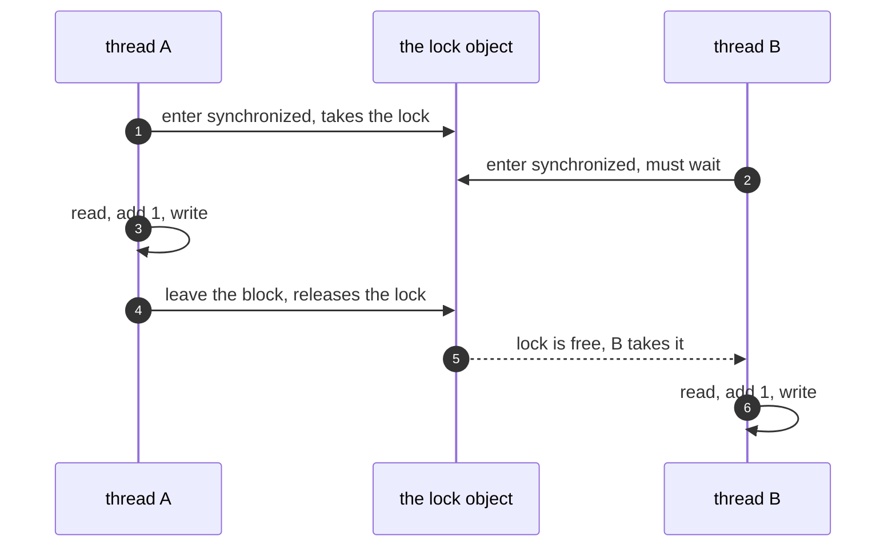

# 03. synchronized: one thread at a time

`synchronized` is Java's built-in way to let only one thread at a time run a piece of code. It fixes the lost updates from the previous chapter by making the three steps of `counter++` run as one unit.

> [!TIP]
> - **`synchronized (lock) { ... }`** is a block that only one thread at a time can be inside. A thread must hold the lock to enter, and any other thread waits at the door.
> - **Threads exclude each other only if they use the same lock object.** That is why the lock is one shared `static final` object. With a separate lock per thread, 10 of 10 runs were wrong.
> - **Result:** the two-thread counter printed 200000 in 10 of 10 runs, against 1 of 10 without it.

## What happens, step by step



While A holds the lock, B cannot start its read-add-write, so B can never read a value that A is halfway through changing. The three steps of one thread now happen as one unit.

## The experiment

`src/lab/shared/Counter.java`, the counter from the previous chapter with two changes: a lock object, and `counter++` inside a `synchronized` block.

```java
import java.util.*;
public class Counter {
  static int counter=0;
  static final Object lock = new Object();
  public static void main(String args[]) throws Exception{
    int numberOfThreads = 2, maxCounter = 1_00_000;
    Thread[] t = new Thread[2];
    for(int i=0;i<numberOfThreads;i++){
      t[i] = new Thread(()->{
        for(int j=0;j<maxCounter;j++){
          synchronized (lock){
            counter++;
          }
        }
      });
      t[i].start();
    }
    for(int i=0;i<numberOfThreads;i++){
      t[i].join();
    }
    System.out.print(counter);
  }
}
```

I ran it 10 times, one result per line *(verified)*:

```text
200000
200000
200000
200000
200000
200000
200000
200000
200000
200000
```

Without the lock the same program gave one correct result in 10 runs and nine different wrong ones.

## Break it: a different lock for each thread

The rule says the threads must share the lock. To see it fail, the `static final` lock field was removed and `Object lock = new Object();` was put inside the thread's lambda, so each thread takes a lock of its own. The `synchronized` block itself is unchanged:

```java
      t[i] = new Thread(()->{
        Object lock = new Object();
        for(int j=0;j<maxCounter;j++){
          synchronized (lock){
            counter++;
          }
        }
      });
```

Ten runs *(verified)*:

```text
189782
199215
169049
166220
164019
172354
162869
163648
166336
163552
```

All ten are wrong. Each thread locks an object that only it uses, so neither thread ever waits for the other and the read-add-write steps overlap exactly as they did without any lock. `synchronized` did not fail: it only keeps out threads that want the same lock, and here nothing was shared.

## Why the lock is a separate object

Every Java object has a lock built in, and `synchronized (x)` means "take the lock of `x`". That is why `synchronized` needs an object.

| Question | Answer |
|---|---|
| Why not lock on `counter`? | It is an `int`, a primitive, and primitives have no lock. |
| Why `static`? | There must be one lock shared by every thread. The threads here all run code of the same class, so a static field is one object for all of them. |
| Why `final`? | The field must never point to a different object, or two threads could end up locking different things. |
| Could it be another object? | Yes. `synchronized (Counter.class)` would also work here, and so would `this` in non-static code. A private lock object is preferred because no outside code can take it. I did not run those variants. |

## synchronized on a method: the lock is `this`

Inside a class you can mark a whole method `synchronized` instead of writing a block. The lock is then the object the method is called on, `this`, so no lock field is needed. This is `SafeCounter`, written by you. One instance is shared by both threads, so both threads take the same lock:

```java
import java.util.*;
public class Counter {
  public static void main(String args[]) throws Exception{
    int numberOfThreads = 2, maxCounter = 1_00_000;
    SafeCounter sc = new SafeCounter();
    Thread[] t = new Thread[2];
    for(int i=0;i<numberOfThreads;i++){
      t[i] = new Thread(()->{
        for(int j=0;j<maxCounter;j++){
          sc.increment();
        }
      });
      t[i].start();
    }
    for(int i=0;i<numberOfThreads;i++){
      t[i].join();
    }
    System.out.print(sc.get());
  }
}
class SafeCounter{
  private int counter  =0;
  public synchronized int get(){
    return this.counter;
  }
  public synchronized void increment(){
    counter+=1;
  }
}
```

Ten runs *(verified)*: all ten printed `200000`.

A `synchronized` method is shorthand for a block on `this`, so `increment()` behaves like `public void increment() { synchronized (this) { counter += 1; } }`. That equivalence comes from the Java language specification and was not run separately here.

`get()` and `increment()` are both `synchronized`, so they use the same lock: while one thread is inside one of them, no other thread can be inside the other on the same object. Why `get()` also needs the lock is the topic of the next chapter.

## One object, one lock: two methods and two objects

`Room.java`, run by you. It has two `synchronized` methods that each take one second. The same two calls run first on one `Room`, then on two different `Room` objects, and each case prints the total time. `room::a` is a method reference, shorthand for `() -> room.a()`.

```java
public class Room {

    public synchronized void a() {
        System.out.println("enter a");
        pause(1000);
        System.out.println("leave a");
    }

    public synchronized void b() {
        System.out.println("enter b");
        pause(1000);
        System.out.println("leave b");
    }

    static void pause(long millis) {
        try {
            Thread.sleep(millis);
        } catch (InterruptedException e) {
            Thread.currentThread().interrupt();
        }
    }

    // starts one thread for each task, waits for both, and prints how long that took
    static void run(Runnable first, Runnable second) throws InterruptedException {
        long begin = System.currentTimeMillis();
        Thread t1 = new Thread(first);
        Thread t2 = new Thread(second);
        t1.start();
        t2.start();
        t1.join();
        t2.join();
        System.out.println("total: " + (System.currentTimeMillis() - begin) + " ms");
    }

    public static void main(String[] args) throws Exception {
        System.out.println("--- one Room, two threads ---");
        Room room = new Room();
        run(room::a, room::b);               // room::a means "call a() on room"

        System.out.println("--- two Rooms, one thread each ---");
        Room roomOne = new Room();
        Room roomTwo = new Room();
        run(roomOne::a, roomTwo::b);
    }
}
```

Output of one run *(verified)*:

```text
--- one Room, two threads ---
enter a
leave a
enter b
leave b
total: 2020 ms
--- two Rooms, one thread each ---
enter a
enter b
leave b
leave a
total: 1007 ms
```

| Case | What the output shows | Why |
|---|---|---|
| One `Room` | `leave a` came before `enter b`, total about 2 seconds | `a()` and `b()` both lock on the same `room`, so `b()` waited for `a()` to release it |
| Two `Room` objects | both `enter` lines came before any `leave`, total about 1 second | Two objects have two locks, so nothing waited |

> [!IMPORTANT]
> **A lock belongs to an object, not to a method.** All `synchronized` instance methods of one object share that object's single lock. Different objects have different locks. This does not mean only one thread can touch the object: it means only one thread at a time can be inside synchronized code that uses that lock. A method that is not marked `synchronized` is not stopped by the lock. `Room` has no such method, so I checked this in a separate scratch file: while one thread held the lock inside a `synchronized` method, another thread called a plain method on the same object and it ran straight away *(verified)*.

## What the lock does and does not give you

| Term | Meaning |
|---|---|
| Lock (monitor) | The built-in lock every object has |
| Critical section | The code inside the `synchronized` block, the part only one thread may run at a time |
| Acquire and release | Entering the block takes the lock, leaving it gives the lock back |
| Mutual exclusion | Two threads can never be inside blocks that use the same lock at the same moment |

## Interview questions

<details>
<summary>After adding synchronized the counter printed 200000 in all 10 runs. Is it now proven thread-safe by those runs?</summary>

The runs are evidence, not the proof. The guarantee comes from the lock: only one thread at a time can run the read, add and write steps, so no update can be lost. The runs matter because the same program without the lock gave 1 correct result in 10.
</details>

<details>
<summary>Two threads must exclude each other around counter++. What must be true of the object they synchronize on?</summary>

It must be the same object for both threads. A lock only keeps out threads that try to take that same lock. A `static final` field gives one shared object. When each thread was given its own lock, all 10 runs were wrong (between 162869 and 199215).
</details>

<details>
<summary>A teammate says synchronized makes a program sequential, so threads are useless. Is that right?</summary>

Only the code inside the synchronized block is one thread at a time. Anything outside it still runs in parallel. In this counter the whole loop body is inside the block, so there is almost nothing left to run in parallel, which is why a lock should cover as little code as possible. I did not measure the cost here.
</details>

<details>
<summary>A class has two synchronized methods, a() and b(). Thread 1 is inside a(). Can thread 2 enter b() on the same object? On a different object?</summary>

On the same object, no: both methods lock on `this`, so thread 2 waits until thread 1 leaves `a()`. On a different object, yes, because that object has its own lock. In the experiment, two calls of one second each took 2020 ms on one `Room` and 1007 ms on two `Room` objects.
</details>

## Key takeaways

| Remember | Because |
|---|---|
| `synchronized (lock) { ... }` lets one thread in at a time | The others wait until the lock is released |
| The lock is an object, and every object has one | A primitive like `int` cannot be a lock |
| Threads must share the same lock object | A lock only keeps out threads that want that same lock |
| The counter went from 1 of 10 correct to 10 of 10 | The three steps now run as one unit |
| A different lock per thread protects nothing | All 10 runs were wrong when each thread had its own lock |
| A `synchronized` method locks on `this` | `SafeCounter` shared by two threads gave 200000 in 10 of 10 runs |
| Same object means same lock, different objects mean different locks | Two one-second calls took 2020 ms on one `Room` and 1007 ms on two |

**Related:** [Concurrency handbook](/notebook/concurrency/overview) · **Previous:** [Race condition](/notebook/concurrency/01-foundations/02-race-condition)
