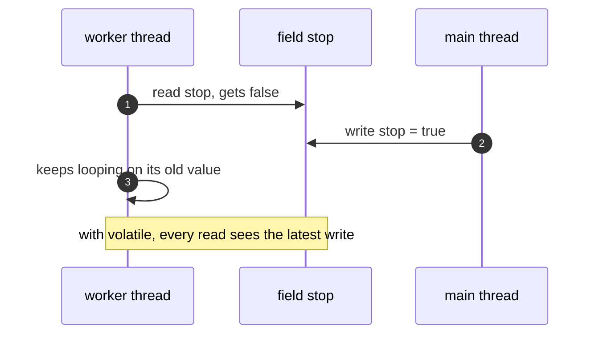

# 04. volatile: making a change visible to other threads

Locking fixes lost updates. A different bug is a thread that never sees a change another thread made. `volatile` fixes that for a field.

> [!TIP]
> - **Visibility problem:** one thread writes a field, and another thread keeps using its old value. A worker looping on `while (!stop)` may never notice `stop = true`.
> - **`volatile` on the field** makes every read see the latest write from any thread.
> - **This is not the lost-update bug.** Nothing is lost: one thread simply never sees the new value.
> - **`volatile` does not fix lost updates.** A `volatile` counter with `counter++` is still wrong, because `counter++` is still read, add, write.

## What goes wrong



The worker read `false` once and never asked again. `main` changed the field, but nothing forced the worker to look at the new value.

## Example

The worker loops until `stop` becomes true, and `main` sets it after one second. `join(3000)` waits at most 3 seconds for the worker, and `System.exit(0)` ends the whole program even if the worker is still looping. This is the version with `volatile`:

```java
public class Visibility {

  static volatile boolean stop = false;

  public static void main(String[] args) throws Exception {
    Thread t = new Thread(() -> {
      int loops = 0;
      while (!stop) {
        loops += 1;
      }
      System.out.println("worker: saw stop");
    });
    t.start();
    Thread.sleep(1000);
    stop = true;
    System.out.println("main: set stop = " + stop);
    t.join(3000);
    System.exit(0);
  }
}
```

| Version | What is printed | How long it takes |
|---|---|---|
| `static boolean stop` (no `volatile`) | only `main: set stop = true` | The full `join(3000)` timeout: 1 second of sleep plus 3 seconds of waiting |
| `static volatile boolean stop` | `worker: saw stop`, then `main: set stop = true` | About 1 second: the worker stops as soon as `main` writes |

Without `volatile` the worker never prints, and the program only ends because of the `join` timeout and `System.exit(0)`.

## Why it happens

A thread does not have to re-read a field from main memory every time. It may keep a copy in a CPU cache or a register, and in a tight loop like this the JIT compiler can read the field once before the loop and reuse the value. Java promises that one thread sees another's write only when something forces it, such as `volatile` or a lock.

| Word | Meaning |
|---|---|
| Visibility | Whether a change made by one thread can be seen by another thread |
| `volatile` | A field marker: every read sees the latest write, and writes are not kept back in a thread's private copy |

> [!WARNING]
> **A missing `volatile` fails silently.** Nothing crashes. The program just waits, and it would wait forever without the `System.exit(0)`. The same code can pass on one machine and hang on another.

## volatile does not make counter++ atomic

The first racy counter with one change: `volatile` on the field.

```java
public class VolatileCounter {

  static volatile int counter = 0;

  public static void main(String[] args) throws Exception {
    int numberOfThreads = 2, maxCounter = 100_000;
    Thread[] t = new Thread[numberOfThreads];
    for (int i = 0; i < numberOfThreads; i++) {
      t[i] = new Thread(() -> {
        for (int j = 0; j < maxCounter; j++) {
          counter += 1;
        }
      });
      t[i].start();
    }
    for (int i = 0; i < numberOfThreads; i++) {
      t[i].join();
    }
    System.out.println(counter);
  }
}
```

Example output of ten runs, one result per line:

```text
151703
123591
119439
137142
144378
154747
136201
122986
121476
123108
```

All are wrong, and the right answer is 200000. `volatile` guarantees that a read sees the latest write, but `counter += 1` is still three steps: read, add, write. Two threads can read the same value before either writes, and one update is lost. Visibility does not turn the three steps into one.

| Tool | Other threads see the change | `counter++` is safe |
|---|---|---|
| Plain field | No guarantee | No |
| `volatile` | Yes | No |
| `synchronized` | Yes | Yes |

Use `volatile` for a flag that one thread writes and others read, where the new value does not depend on the old one, like `stop`. A step that reads and then changes the value needs a lock or an atomic class.

## Where else this applies

`synchronized` also gives visibility: what a thread wrote before leaving a synchronized block is seen by the next thread that takes the same lock. That is a Java memory model rule. It is why `get()` in `SafeCounter` is `synchronized` too: without it, a reader is not guaranteed to see the latest count.

## Interview questions

<details>
<summary>A worker loops on while (!stop) and main sets stop = true after a second, but the worker never ends. What is the bug and the smallest fix?</summary>

It is a visibility bug: the worker keeps using an old value of `stop`, and Java does not promise it will see `main`'s write. Declaring the field `volatile` fixes it, because every read then sees the latest write.
</details>

<details>
<summary>In one program the counter is wrong because updates are lost, and in another the worker never stops. Which problem is each?</summary>

The counter is the lost-update (atomicity) problem: two threads read the same value and one write overwrites the other. The worker is the visibility problem: nothing is lost, but one thread never sees the other's write.
</details>

<details>
<summary>SafeCounter has synchronized increment() and synchronized get(). A teammate removes synchronized from get() because reading an int is harmless. What can go wrong?</summary>

The reader may see an old value, because a read without the lock is not guaranteed to see the latest write. It is the same visibility problem as the stop flag. The fix is to keep `get()` synchronized.
</details>

<details>
<summary>A teammate makes the counter field volatile and removes synchronized from increment(), saying volatile makes it thread-safe. Is that right?</summary>

No. `volatile` gives visibility but not atomicity, and `counter++` is still read, add, write. Two threads incrementing a `volatile` counter lose updates and end well below the expected total. Keep the lock, or use an atomic class.
</details>

## Key takeaways

| Remember | Because |
|---|---|
| Another thread may never see a write | A worker can loop forever on its old copy of `stop` |
| `volatile` makes reads see the latest write | The worker then stops as soon as `main` writes |
| Visibility and lost updates are different bugs | Nothing is lost in the flag example |
| A missing `volatile` hangs quietly | No error, just a loop that never ends |
| `volatile` does not make `counter++` safe | The three steps can still interleave |

**Related:** [Concurrency handbook](/notebook/concurrency/overview) · **Previous:** [synchronized](/notebook/concurrency/02-shared-state/03-synchronized)
