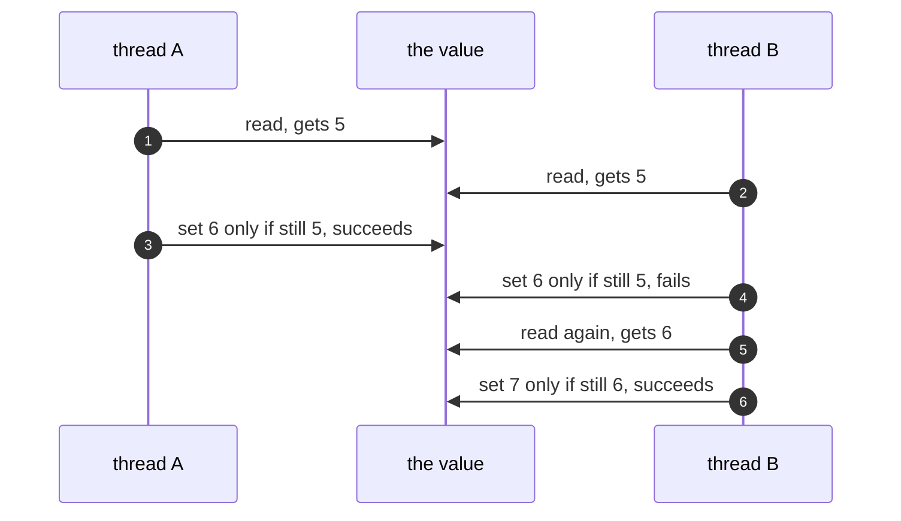

# 05. Atomics and CAS: thread-safe counters without a lock

An atomic class makes one operation, such as "add 1", happen as a single unbreakable step without taking a lock. It does this with a retry loop around one CPU instruction called compare-and-swap.

> [!TIP]
> - **`AtomicInteger.incrementAndGet()`** is a thread-safe `counter++`. The two-thread counter printed 200000 in 10 of 10 runs, with no `synchronized` and no `volatile`.
> - **How:** read the value, then ask the CPU "set it to the new value only if it is still the old one". If another thread changed it, retry. This is **CAS** (compare-and-swap).
> - **It is optimistic.** It assumes no conflict and retries on one, where `synchronized` makes others wait first.

## What happens, step by step



Both threads read 5, but only one wins the swap. The loser's check fails, so it reads the new value and tries again. No update is lost.

## The experiment

`src/lab/shared/AtomicCounter.java`, written by you. `AtomicInteger` is in `java.util.concurrent.atomic`. Two threads each call `incrementAndGet()` 100,000 times.

```java
import java.util.concurrent.atomic.AtomicInteger;
public class AtomicCounter {
  static AtomicInteger ai = new AtomicInteger();
  public static void main(String args[]) throws Exception{
    int numberOfThreads = 2, maxCounter = 1_00_000;
    Thread[] t = new Thread[2];
    for(int i=0;i<numberOfThreads;i++){
      t[i] = new Thread(()->{
        for(int j=0;j<maxCounter;j++){
          ai.incrementAndGet();
        }
      });
      t[i].start();
    }
    for(int i=0;i<numberOfThreads;i++){
      t[i].join();
    }
    System.out.print(ai.get());
  }

}
```

Ten runs, one result per line *(verified)*: all ten printed `200000`.

## How it works: the JDK source

Read from the `src.zip` of JDK 17.0.20 *(verified)*:

```java
public final int incrementAndGet() {
    return U.getAndAddInt(this, VALUE, 1) + 1;          // AtomicInteger
}

public final int getAndAddInt(Object o, long offset, int delta) {
    int v;
    do {
        v = getIntVolatile(o, offset);                   // 1. read the current value
    } while (!weakCompareAndSetInt(o, offset, v, v + delta));   // 2. try to swap, retry if it fails
    return v;
}
```

The loop reads the value into `v`, then calls compare-and-swap: "set the field to `v + delta` only if it still holds `v`". The CPU does that check and write as one step nothing can interrupt. If the swap fails, someone changed the field in between, so the loop runs again with a fresh read. I did not look at the machine code the JVM generates.

The earlier racy counter wrote its result without checking anything, which is how an update got lost. CAS adds that check at the moment of the write.

## The same idea as a version column

| Database update with a version column | CAS |
|---|---|
| `UPDATE ... WHERE id = 1 AND version = 5` | Set the new value only if the field is still 5 |
| 1 row changed: you won | The swap succeeds |
| 0 rows changed: someone beat you, re-read and retry | The swap fails, the loop reads again and retries |

JPA's `@Version` is the same pattern. The difference is that CAS compares the value itself, not a separate version number. If a value goes 5 to 6 and back to 5 between your read and your swap, CAS cannot tell. That is the ABA problem, and Java has `AtomicStampedReference` for it. I did not run that here.

## The three tools so far

| Tool | Others see the change | `counter++` is safe | Do others wait |
|---|---|---|---|
| `volatile` | Yes | No, 10 of 10 runs wrong | No |
| `synchronized` | Yes (Java rule, not run) | Yes, 10 of 10 runs right | Yes, the other thread waits at the lock |
| `AtomicInteger` | Yes (documented, not run) | Yes, 10 of 10 runs right | No, a failed swap retries |

> [!WARNING]
> **Atomics protect one variable, not a rule between two.** If two values must always stay consistent, for example two balances that add up to 100, updating them with two separate atomic calls leaves a moment in between that another thread can see. That needs one lock around both. This is the Java rule, and I did not run it here. I also did not measure how atomics behave when many threads fight over one variable.

## Interview questions

<details>
<summary>AtomicInteger.incrementAndGet() takes no lock, yet two threads never lose an update. How?</summary>

It runs a compare-and-swap loop: read the value, then ask the CPU to set value plus one only if the field still holds what was read. If another thread got in first, the swap fails and the loop retries with a fresh value. The source of `getAndAddInt` shows exactly this loop, and the two-thread counter gave 200000 in 10 of 10 runs.
</details>

<details>
<summary>Two balances must always add up to 100. A transfer does a.decrementAndGet() and then b.incrementAndGet(). Is it safe?</summary>

No. Each call is atomic, but the pair is not, so another thread can read the balances between the two calls and see a total of 99. Use one lock around both updates. I did not run this case.
</details>

<details>
<summary>How is a compare-and-swap similar to an optimistic update with a version column, and where does it differ?</summary>

Both say "write only if nothing changed since I read", and both retry when the check fails. A version column compares a counter that goes up on every change. CAS compares the value itself, so it cannot notice a value that changed and came back (the ABA problem).
</details>

## Key takeaways

| Remember | Because |
|---|---|
| Atomic classes make one operation indivisible | `incrementAndGet()` gave 200000 in 10 of 10 runs |
| CAS is read, compare, swap, retry | `getAndAddInt` is a loop around `weakCompareAndSetInt` |
| It is optimistic, not blocking | A failed swap retries instead of waiting |
| It works for one variable only | A rule across two variables needs a lock |

**Related:** [Concurrency handbook](/notebook/concurrency/overview) · **Previous:** [volatile](/notebook/concurrency/02-shared-state/04-volatile-and-visibility)
