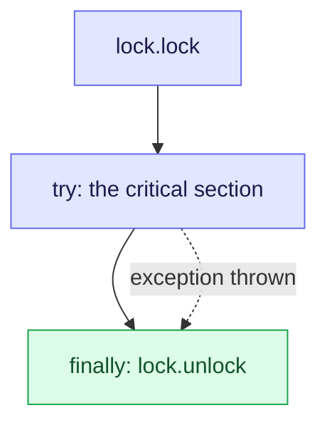

# 06. ReentrantLock: a lock you take and release yourself

`synchronized` takes and releases its lock for you. `ReentrantLock` is a lock object where you do both yourself. That is more work, and the next experiments show what the extra control buys.

> [!TIP]
> - **`lock.lock()`** takes the lock and **`lock.unlock()`** releases it. Put `lock()` before the `try` and `unlock()` in `finally`, so the lock is released even if the code throws.
> - **Same guarantee as `synchronized`:** only one thread at a time runs the code between them. The two-thread counter printed 200000 in 10 of 10 runs.
> - **The price is discipline:** a `ReentrantLock` that is never unlocked blocks every other thread.

## The pattern



The `finally` block runs on both paths: when the critical section finishes normally and when it throws. That is why `unlock()` belongs there.

## The experiment

`06-reentrantlock/LockCounter.java`, written by you. It is the two-thread counter again, now guarded by a `ReentrantLock` from `java.util.concurrent.locks`.

```java
import java.util.concurrent.locks.ReentrantLock;

public class LockCounter {
  static final ReentrantLock lock = new ReentrantLock();
  static int counter = 0;

  public static void main(String args[]) throws Exception{
    int numberOfThreads = 2, maxCounter = 1_00_000;
    Thread[] t = new Thread[2];
    for(int i=0;i<numberOfThreads;i++){
      t[i] = new Thread(()->{
        for(int j=0;j<maxCounter;j++){
          lock.lock();
          try{
            counter+=1;
          }finally{
            lock.unlock();
          }
        }
      });
      t[i].start();
    }
    for(int i=0;i<numberOfThreads;i++){
      t[i].join();
    }
    System.out.print(counter);
  }
}
```

Ten runs, one result per line *(verified)*: all ten printed `200000`.

## synchronized and ReentrantLock side by side

| | `synchronized` | `ReentrantLock` |
|---|---|---|
| Taking the lock | Automatic when the block or method starts | You call `lock.lock()` |
| Releasing the lock | Automatic when the block or method ends, even on an exception | You call `lock.unlock()`, in `finally` |
| Result in the counter | 200000 in 10 of 10 runs | 200000 in 10 of 10 runs |
| Waiting for a busy lock | Waits until it is free, no way to give up (Java rule, not run) | `lock()` waits too, but `tryLock(500, TimeUnit.MILLISECONDS)` can give up after 500 ms |

> [!WARNING]
> **Always unlock in a `finally` block.** If the code between `lock()` and `unlock()` throws and `unlock()` is not in `finally`, the lock is never released and every thread that wants it waits forever. The experiment below shows it: a lock that was never released made the program hang.

## Break it: never unlock

`ForgottenUnlock.java`, written by you: the same counter, but the `finally` block is empty, so the lock is never released.

```java
import java.util.concurrent.locks.ReentrantLock;

public class ForgottenUnlock {

  static final ReentrantLock lock = new ReentrantLock();
  static int counter = 0;

  public static void main(String args[]) throws Exception{
    int numberOfThreads = 2, maxCounter = 1_00_000;
    Thread[] t = new Thread[2];
    for(int i=0;i<numberOfThreads;i++){
      t[i] = new Thread(()->{
        for(int j=0;j<maxCounter;j++){
          lock.lock();
          try{
            counter+=1;
          }finally{
          }
        }
      });
      t[i].start();
    }
    for(int i=0;i<numberOfThreads;i++){
      t[i].join(2000);                                   // wait at most 2 seconds for each thread
      System.out.println("thread " + i + " still alive: " + t[i].isAlive());
    }
    System.out.println("counter = " + counter + ", lock still locked: " + lock.isLocked());
    System.exit(0);                                      // ends the program even though a thread is stuck
  }
}
```

The first version ended with a plain `t[i].join()` and `System.out.print(counter)`. It never finished and printed nothing: I ran it with a 5-second limit and it was still running *(verified)*. The version above waits at most 2 seconds for each thread, then exits, so the stuck thread can be seen. One run *(verified)*:

```text
thread 0 still alive: false
thread 1 still alive: true
counter = 100000, lock still locked: true
```

Across 6 runs the stuck thread was thread 1 five times and thread 0 once, so which thread wins the lock first is a race too. Here is what happened:

1. One of the two threads got the lock first and never released it. Only that thread ever ran its loop, which is why `counter` ended at exactly 100000 and not 200000.
2. That thread could still lock again on every loop turn without waiting for itself. A lock that lets the same thread take it again is called **reentrant**, which is where the name comes from. A scratch run confirmed it *(verified)*: one thread called `lock()` three times and `getHoldCount()` returned 3.
3. The other thread waited in `lock()` forever, because the first thread ended still holding the lock.
4. `main` waited in `join()` for that second thread forever.

```text
same thread locked 3 times, hold count = 3
other thread: lock held by it? false, is locked at all? true
```

The second line is the other thread looking at the lock: it does not hold it, but the lock is still locked. Nothing prints an error. The program just stops moving.

| Term | Meaning |
|---|---|
| Reentrant | The thread that holds the lock can take it again without blocking. Each `lock()` needs its own `unlock()`. |
| Hold count | How many times the current owner has taken the lock |

## tryLock: give up instead of waiting forever

`lock.tryLock(500, TimeUnit.MILLISECONDS)` waits at most 500 ms for the lock. It returns `true` if it got the lock and `false` if the time ran out. `TimeUnit.MILLISECONDS` is just the unit of the 500. A `synchronized` block has no way to give up, which is a Java rule I did not run.

`06-reentrantlock/TryLockDemo.java`: thread A holds the lock for 2 seconds, and `main` tries to take it twice, once while A holds it and once after A is finished.

```java
import java.util.concurrent.TimeUnit;
import java.util.concurrent.locks.ReentrantLock;

public class TryLockDemo {

  static final ReentrantLock lock = new ReentrantLock();

  public static void main(String args[]) throws Exception {
    Thread a = new Thread(() -> {
      lock.lock();
      try {
        System.out.println("A: got the lock, working for 2 seconds");
        Thread.sleep(2000);
      } catch (InterruptedException e) {
        Thread.currentThread().interrupt();
      } finally {
        lock.unlock();
        System.out.println("A: released the lock");
      }
    });
    a.start();
    Thread.sleep(200);                       // let A take the lock first

    tryOnce("main, first try  (A still holds the lock)");
    a.join();
    tryOnce("main, second try (A is finished)");
  }

  // waits at most 500 ms for the lock, and says what happened
  static void tryOnce(String label) throws InterruptedException {
    long begin = System.currentTimeMillis();
    if (lock.tryLock(500, TimeUnit.MILLISECONDS)) {
      try {
        System.out.println(label + ": got the lock after " + (System.currentTimeMillis() - begin) + " ms");
      } finally {
        lock.unlock();
      }
    } else {
      System.out.println(label + ": gave up after " + (System.currentTimeMillis() - begin) + " ms, no lock");
    }
  }
}
```

Output of one run *(verified, the same shape in 3 of 3 runs)*:

```text
A: got the lock, working for 2 seconds
main, first try  (A still holds the lock): gave up after 505 ms, no lock
A: released the lock
main, second try (A is finished): got the lock after 0 ms
```

The first try waited about 500 ms (505, 514 and 513 ms in the three runs), got `false`, and took the `else` branch instead of waiting for the full 2 seconds. The second try found the lock free and got it at once. Only the `true` branch calls `unlock()`, because it is the only one that holds the lock.

> [!WARNING]
> **Check the result of `tryLock`.** It does not throw when it times out, it returns `false`. In an earlier attempt the return value was ignored and the code continued as if it held the lock: the thread that had timed out still ran `counter += 1`, and the counter ended at 100003 instead of 100000 *(verified, 2 of 2 runs)*. Those three increments ran without any protection.

## Interview questions

<details>
<summary>Why must unlock() be in a finally block when you use a ReentrantLock?</summary>

If the code in between throws an exception, a `unlock()` placed after it never runs, so the lock stays held and every other thread that calls `lock()` waits forever. `finally` runs on both the normal path and the exception path. In the experiment above, a lock that was never released left the second thread and `main` waiting forever.
</details>

<details>
<summary>The same counter gave 200000 with synchronized, with AtomicInteger and with ReentrantLock. What does each do to a second thread that arrives while the first one is working?</summary>

With `synchronized` and with `ReentrantLock` the second thread waits at the lock until the first one releases it. The Room experiment showed this for `synchronized`: 2020 ms for two one-second calls on one object. With `AtomicInteger` the second thread does not wait: its compare-and-swap fails and it retries with a fresh value.
</details>

<details>
<summary>What does the ReentrantLock version need that the synchronized version does not?</summary>

An explicit `lock.lock()` and a `lock.unlock()` in a `finally` block. `synchronized` releases the lock automatically when the block ends, even if it throws. With `ReentrantLock` you carry that responsibility yourself.
</details>

<details>
<summary>A thread calls lock.tryLock(500, TimeUnit.MILLISECONDS) and carries on without looking at the result. What goes wrong?</summary>

`tryLock` returns `false` when the time runs out, and the code then runs as if it held the lock. In the experiment, the thread that timed out still executed `counter += 1`, and the counter ended at 100003 instead of 100000: three increments with no protection. The fix is to run the protected code only inside `if (lock.tryLock(...))` and to unlock in `finally` in that branch.
</details>

<details>
<summary>When would you choose tryLock with a timeout over a plain lock() call?</summary>

When waiting forever is worse than failing: a request that must answer within a deadline, or a thread that should give up and retry instead of sitting behind a lock that never frees. In the experiment `main` gave up after about 500 ms while the lock was held for 2 seconds. This is a design reason, not something the experiment measured.
</details>

## Key takeaways

| Remember | Because |
|---|---|
| `lock()` before `try`, `unlock()` in `finally` | The lock must be released on every path |
| It gives the same exclusion as `synchronized` | The counter printed 200000 in 10 of 10 runs |
| You release the lock yourself | `synchronized` does it automatically |
| A lock that is never released hangs the program | `ForgottenUnlock` was still running after 5 seconds and printed nothing |
| The owner can lock again | `getHoldCount()` was 3 after three `lock()` calls from one thread |
| `tryLock` can give up after a timeout | `main` gave up after about 500 ms while the lock was held for 2 s |
| Always check what `tryLock` returns | Ignoring it let a thread run unprotected: 100003 instead of 100000 |

**Related:** [Concurrency handbook](/notebook/concurrency/overview) · **Previous:** [Atomics and CAS](/notebook/concurrency/02-shared-state/05-atomics-and-cas)
