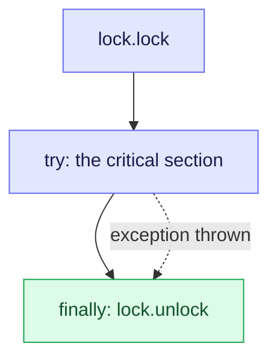

# 06. ReentrantLock: a lock taken and released by hand

`synchronized` takes and releases its lock automatically. `ReentrantLock` is a lock object where the code does both. That is more work, and it buys extra control: a lock attempt with a timeout, and a lock that can be inspected.

> [!TIP]
> - **`lock.lock()`** takes the lock and **`lock.unlock()`** releases it. Put `lock()` before the `try` and `unlock()` in `finally`, so the lock is released even if the code throws.
> - **Same guarantee as `synchronized`:** only one thread at a time runs the code between them.
> - **The price is discipline:** a `ReentrantLock` that is never unlocked blocks every other thread.

## The pattern



The `finally` block runs on both paths: when the critical section finishes normally and when it throws. That is why `unlock()` belongs there.

## Example

The two-thread counter guarded by a `ReentrantLock` from `java.util.concurrent.locks`. The result is always 200000.

```java
import java.util.concurrent.locks.ReentrantLock;

public class LockCounter {

  static final ReentrantLock lock = new ReentrantLock();
  static int counter = 0;

  public static void main(String[] args) throws Exception {
    int numberOfThreads = 2, maxCounter = 100_000;
    Thread[] t = new Thread[numberOfThreads];
    for (int i = 0; i < numberOfThreads; i++) {
      t[i] = new Thread(() -> {
        for (int j = 0; j < maxCounter; j++) {
          lock.lock();
          try {
            counter += 1;
          } finally {
            lock.unlock();
          }
        }
      });
      t[i].start();
    }
    for (int i = 0; i < numberOfThreads; i++) {
      t[i].join();
    }
    System.out.println(counter);
  }
}
```

## synchronized and ReentrantLock side by side

| | `synchronized` | `ReentrantLock` |
|---|---|---|
| Taking the lock | Automatic when the block or method starts | `lock.lock()` |
| Releasing the lock | Automatic when the block or method ends, even on an exception | `lock.unlock()`, in `finally` |
| Waiting for a busy lock | Waits until it is free, no way to give up | `lock()` waits too, but `tryLock(500, TimeUnit.MILLISECONDS)` can give up after 500 ms |
| Inspecting the lock | Not possible | `isLocked()`, `getHoldCount()`, `isHeldByCurrentThread()` |

> [!WARNING]
> **Always unlock in a `finally` block.** If the code between `lock()` and `unlock()` throws and `unlock()` is not in `finally`, the lock is never released and every thread that wants it waits forever.

## Pitfall: a lock that is never released

The same counter with an empty `finally` block, so the lock is never released:

```java
import java.util.concurrent.locks.ReentrantLock;

public class ForgottenUnlock {

  static final ReentrantLock lock = new ReentrantLock();
  static int counter = 0;

  public static void main(String[] args) throws Exception {
    int numberOfThreads = 2, maxCounter = 100_000;
    Thread[] t = new Thread[numberOfThreads];
    for (int i = 0; i < numberOfThreads; i++) {
      t[i] = new Thread(() -> {
        for (int j = 0; j < maxCounter; j++) {
          lock.lock();
          try {
            counter += 1;
          } finally {
            // unlock() is missing
          }
        }
      });
      t[i].start();
    }
    for (int i = 0; i < numberOfThreads; i++) {
      t[i].join(2000);                                   // wait at most 2 seconds for each thread
      System.out.println("thread " + i + " still alive: " + t[i].isAlive());
    }
    System.out.println("counter = " + counter + ", lock still locked: " + lock.isLocked());
    System.exit(0);                                      // ends the program even though a thread is stuck
  }
}
```

With a plain `t[i].join()` the program never finishes and prints nothing. The version above waits at most 2 seconds per thread so the stuck thread can be seen. Example output:

```text
thread 0 still alive: false
thread 1 still alive: true
counter = 100000, lock still locked: true
```

Which thread gets stuck varies from run to run, because which thread takes the lock first is a race. What happens:

1. One of the two threads gets the lock first and never releases it. Only that thread ever runs its loop, which is why `counter` ends at exactly 100000 and not 200000.
2. That thread can lock again on every loop turn without waiting for itself. A lock that lets the same thread take it again is called **reentrant**, which is where the name comes from. `getHoldCount()` returns how many times the owner holds it.
3. The other thread waits in `lock()` forever, because the first thread ended still holding the lock.
4. `main` waits in `join()` for that second thread forever.

Nothing prints an error. The program just stops moving.

| Term | Meaning |
|---|---|
| Reentrant | The thread that holds the lock can take it again without blocking. Each `lock()` needs its own `unlock()`. |
| Hold count | How many times the current owner has taken the lock |

## tryLock: give up instead of waiting forever

`lock.tryLock(500, TimeUnit.MILLISECONDS)` waits at most 500 ms for the lock. It returns `true` if it got the lock and `false` if the time ran out. `TimeUnit.MILLISECONDS` is the unit of the 500. A `synchronized` block has no way to give up.

In the demo, thread A holds the lock for 2 seconds, and `main` tries to take it twice, once while A holds it and once after A is finished:

```java
import java.util.concurrent.TimeUnit;
import java.util.concurrent.locks.ReentrantLock;

public class TryLockDemo {

  static final ReentrantLock lock = new ReentrantLock();

  public static void main(String[] args) throws Exception {
    Thread a = new Thread(() -> {
      lock.lock();
      try {
        System.out.println("A: got the lock, working for 2 seconds");
        Thread.sleep(2000);
      } catch (InterruptedException e) {
        Thread.currentThread().interrupt();
      } finally {
        lock.unlock();
        System.out.println("A: released the lock");
      }
    });
    a.start();
    Thread.sleep(200);                       // let A take the lock first

    tryOnce("main, first try  (A still holds the lock)");
    a.join();
    tryOnce("main, second try (A is finished)");
  }

  // waits at most 500 ms for the lock, and says what happened
  static void tryOnce(String label) throws InterruptedException {
    long begin = System.currentTimeMillis();
    if (lock.tryLock(500, TimeUnit.MILLISECONDS)) {
      try {
        System.out.println(label + ": got the lock after " + (System.currentTimeMillis() - begin) + " ms");
      } finally {
        lock.unlock();
      }
    } else {
      System.out.println(label + ": gave up after " + (System.currentTimeMillis() - begin) + " ms, no lock");
    }
  }
}
```

Example output:

```text
A: got the lock, working for 2 seconds
main, first try  (A still holds the lock): gave up after 505 ms, no lock
A: released the lock
main, second try (A is finished): got the lock after 0 ms
```

The first try waits about 500 ms, gets `false`, and takes the `else` branch instead of waiting for the full 2 seconds. The second try finds the lock free and gets it at once. Only the `true` branch calls `unlock()`, because it is the only one that holds the lock.

> [!WARNING]
> **Check the result of `tryLock`.** It does not throw when it times out, it returns `false`. Code that ignores the result carries on as if it held the lock, so a thread that timed out still runs the protected code without protection. In a counter this shows as a total slightly off from the expected value, because those increments race. Run the protected code only inside `if (lock.tryLock(...))`.

## Interview questions

<details>
<summary>Why must unlock() be in a finally block when a ReentrantLock is used?</summary>

If the code in between throws an exception, an `unlock()` placed after it never runs, so the lock stays held and every other thread that calls `lock()` waits forever. `finally` runs on both the normal path and the exception path.
</details>

<details>
<summary>A counter is made thread-safe with synchronized, with AtomicInteger and with ReentrantLock. What does each do to a second thread that arrives while the first one is working?</summary>

With `synchronized` and with `ReentrantLock` the second thread waits at the lock until the first one releases it. With `AtomicInteger` the second thread does not wait: its compare-and-swap fails and it retries with a fresh value.
</details>

<details>
<summary>What does the ReentrantLock version need that the synchronized version does not?</summary>

An explicit `lock.lock()` and a `lock.unlock()` in a `finally` block. `synchronized` releases the lock automatically when the block ends, even if it throws. With `ReentrantLock` the code carries that responsibility.
</details>

<details>
<summary>A thread calls lock.tryLock(500, TimeUnit.MILLISECONDS) and carries on without looking at the result. What goes wrong?</summary>

`tryLock` returns `false` when the time runs out, and the code then runs as if it held the lock. The thread that timed out executes the protected code without any protection, so its updates race with the real holder's. The fix is to run the protected code only inside `if (lock.tryLock(...))` and to unlock in `finally` in that branch.
</details>

<details>
<summary>When is tryLock with a timeout better than a plain lock() call?</summary>

When waiting forever is worse than failing: a request that must answer within a deadline, or a thread that should give up and retry instead of sitting behind a lock that never frees. It also helps break deadlocks, because a thread that cannot get its second lock in time can release the first and retry.
</details>

## Key takeaways

| Remember | Because |
|---|---|
| `lock()` before `try`, `unlock()` in `finally` | The lock must be released on every path |
| It gives the same exclusion as `synchronized` | Only one thread at a time runs the critical section |
| The code releases the lock, not the language | `synchronized` does it automatically |
| A lock that is never released hangs the program | Every other thread waits in `lock()` forever, with no error |
| The owner can lock again | `getHoldCount()` counts the nested locks, and each needs an `unlock()` |
| `tryLock` can give up after a timeout | It returns `false` instead of waiting |
| Always check what `tryLock` returns | Ignoring it runs protected code unprotected |

**Related:** [Concurrency handbook](/notebook/concurrency/overview) · **Previous:** [Atomics and CAS](/notebook/concurrency/02-shared-state/05-atomics-and-cas)
