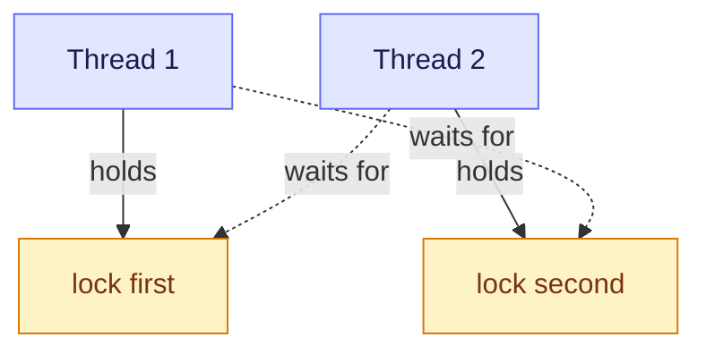

# 07. Deadlock: two threads waiting for each other forever

A deadlock is when threads wait for locks that are held by each other, so none of them can ever continue. The program does not crash and prints no error. It just stops moving.

> [!TIP]
> - **The shape:** thread 1 holds lock `first` and wants `second`. Thread 2 holds `second` and wants `first`. Each waits for the other forever.
> - **Evidence:** after `join(3000)` both threads were still alive in 3 of 3 runs, with no exception and no output.
> - **It depends on timing.** With a 200 ms pause between the two locks it happened every time. Without the pause, 10 of 10 runs finished normally, but the bug was still in the code.

## What goes wrong



Follow the arrows: thread 1 waits for `second`, which thread 2 holds, and thread 2 waits for `first`, which thread 1 holds. That cycle is the deadlock.

## The experiment

`07-deadlock/DeadlockDemo.java`, written by you. The two threads take the same two locks in opposite order. The `sleep(200)` gives each thread time to take its first lock before it asks for the second. `join(3000)` and `System.exit(0)` make sure the program ends even though the threads are stuck.

```java
public class DeadlockDemo {
  public static void main(String args[]) throws Exception {
    Object first = new Object(), second = new Object();
    Thread t1 = new Thread(() -> {
      try {
        synchronized (first) {
          Thread.sleep(200);
          synchronized (second) {
            System.out.print("T1 done");
          }
        }
      } catch (Exception e) {
        System.out.println("Something happened at T1");
      }
    });
    Thread t2 = new Thread(() -> {
      try {
        synchronized (second) {
          Thread.sleep(200);
          synchronized (first) {
            System.out.println("T2 done");
          }
        }
      } catch (Exception e) {
        System.out.println("Something happened at T2");
      }
    });
    t1.start();
    t2.start();

    t1.join(3000);
    t2.join(3000);
    System.out.println("T1 is alive: " + t1.isAlive());
    System.out.println("T2 is alive: " + t2.isAlive());
    System.exit(0);
  }
}
```

Output, the same in 3 of 3 runs *(verified)*:

```text
T1 is alive: true
T2 is alive: true
```

Neither `T1 done` nor `T2 done` was printed, and both threads were still alive after 3 seconds each.

## The four conditions

A deadlock needs all four of these at once. They are the standard textbook conditions, matched here to the demo:

| Condition | In the demo |
|---|---|
| Mutual exclusion | `synchronized` lets only one thread own each lock |
| Hold and wait | Each thread keeps its first lock while it waits for the second |
| No preemption | Nothing can take a lock away from the thread that holds it |
| Circular wait | Thread 1 waits for thread 2's lock and thread 2 waits for thread 1's |

Break any one of the four and the deadlock cannot happen.

## Why the sleep matters

I ran a copy of the demo without the two `Thread.sleep(200)` lines 10 times *(verified)*:

```text
10 of 10 runs: T1 doneT2 done, T1 is alive: false, T2 is alive: false
```

All ten finished. Starting a thread takes a moment, so most likely thread 1 finished both of its locks before thread 2 even started, and the two never overlapped. The sleep forces the overlap. This is the same lesson as the counter race: timing can hide a bug, and the code is wrong either way.

> [!WARNING]
> **A deadlock can pass every test and still be in the code.** Without the pause, 10 of 10 runs finished. The lock order is still opposite in the two threads, so under the right timing in production they will wait for each other forever, with no error message to point at it.

## The fix: take the locks in the same order

Thread 2 was changed to take `first` and then `second`, like thread 1. Only its two `synchronized` lines changed:

```java
    Thread t2 = new Thread(() -> {
      try {
        synchronized (first) {              // was: synchronized (second)
          Thread.sleep(200);
          synchronized (second) {           // was: synchronized (first)
            System.out.println("T2 done");
          }
        }
      } catch (Exception e) {
        System.out.println("Something happened at T2");
      }
    });
```

Five runs, the same output every time *(verified)*:

```text
T1 doneT2 done
T1 is alive: false
T2 is alive: false
```

Now both threads ask for `first` first. Whichever gets it holds it, takes `second`, finishes and releases both. The other thread waits at `first` and then goes through. Nobody ever holds `second` while waiting for `first`, so the cycle cannot form. This breaks the circular wait condition.

> [!IMPORTANT]
> **Give every lock a place in one global order and always take them in that order.** The order has to be the same in every thread and every method that takes more than one of these locks, including code written far apart.

## Interview questions

<details>
<summary>A service stops responding. The CPU is idle, no exception was logged, and two threads are alive but not progressing. Thread 1 holds lock A and wants B, thread 2 holds B and wants A. What is this?</summary>

A deadlock: a cycle of threads each waiting for a lock held by the next. In the experiment both threads were still alive after `join(3000)` and nothing was printed, which is how a deadlock looks from the outside. A thread dump is the usual way to confirm it; I did not run that yet.
</details>

<details>
<summary>A teammate says the deadlock in the demo will go away if you remove the sleep. Is that true?</summary>

It will seem to. Without the sleep, 10 of 10 runs finished normally, because the two threads rarely overlap. The two threads still take the locks in opposite order, so a different timing can still deadlock them. Removing the timing does not remove the cycle.
</details>

<details>
<summary>Which of the four deadlock conditions would you break to fix the demo, and how?</summary>

The practical choice is circular wait: make both threads take `first` and then `second`, in the same order, so a cycle cannot form. With that change 5 of 5 runs finished and both threads were done. Another option is to give up on the second lock after a timeout with `tryLock`, which I have not run for this case.
</details>

## Key takeaways

| Remember | Because |
|---|---|
| A deadlock is a cycle of waiting | Thread 1 waits for `second`, thread 2 waits for `first` |
| It makes no noise | Both threads stayed alive and nothing was printed |
| It needs all four conditions | Remove one and it cannot happen |
| Timing can hide it | 10 of 10 runs passed without the sleep |
| The same lock order everywhere prevents it | With both threads taking `first` then `second`, 5 of 5 runs finished |

**Related:** [Concurrency handbook](/notebook/concurrency/overview) · **Previous:** [ReentrantLock](/notebook/concurrency/03-coordination/06-reentrantlock)
