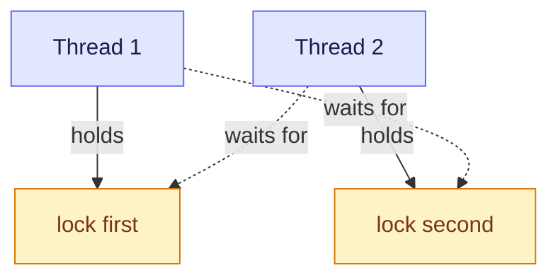

# 07. Deadlock: two threads waiting for each other forever

A deadlock is when threads wait for locks that are held by each other, so none of them can ever continue. The program does not crash and prints no error. It just stops moving.

> [!TIP]
> - **The shape:** thread 1 holds lock `first` and wants `second`. Thread 2 holds `second` and wants `first`. Each waits for the other forever.
> - **From the outside:** both threads stay alive, the CPU is idle, and there is no exception and no output.
> - **It depends on timing.** If the two threads rarely overlap, the code can pass every test and still deadlock in production.
> - **The usual fix:** take the locks in the same order in every thread.

## What goes wrong



Follow the arrows: thread 1 waits for `second`, which thread 2 holds, and thread 2 waits for `first`, which thread 1 holds. That cycle is the deadlock.

## Example

Two threads take the same two locks in opposite order. The `sleep(200)` gives each thread time to take its first lock before it asks for the second. `join(3000)` and `System.exit(0)` make sure the demo ends even though the threads are stuck.

```java
public class DeadlockDemo {

  public static void main(String[] args) throws Exception {
    Object first = new Object(), second = new Object();
    Thread t1 = new Thread(() -> {
      try {
        synchronized (first) {
          Thread.sleep(200);
          synchronized (second) {
            System.out.println("T1 done");
          }
        }
      } catch (Exception e) {
        System.out.println("Something happened at T1");
      }
    });
    Thread t2 = new Thread(() -> {
      try {
        synchronized (second) {
          Thread.sleep(200);
          synchronized (first) {
            System.out.println("T2 done");
          }
        }
      } catch (Exception e) {
        System.out.println("Something happened at T2");
      }
    });
    t1.start();
    t2.start();

    t1.join(3000);
    t2.join(3000);
    System.out.println("T1 is alive: " + t1.isAlive());
    System.out.println("T2 is alive: " + t2.isAlive());
    System.exit(0);
  }
}
```

Output:

```text
T1 is alive: true
T2 is alive: true
```

Neither `T1 done` nor `T2 done` is printed, and both threads are still alive after 3 seconds each.

## The four conditions

A deadlock needs all four of these at once. They are the standard textbook conditions, matched here to the demo:

| Condition | In the demo |
|---|---|
| Mutual exclusion | `synchronized` lets only one thread own each lock |
| Hold and wait | Each thread keeps its first lock while it waits for the second |
| No preemption | Nothing can take a lock away from the thread that holds it |
| Circular wait | Thread 1 waits for thread 2's lock and thread 2 waits for thread 1's |

Break any one of the four and the deadlock cannot happen.

## Why the sleep matters

Without the two `Thread.sleep(200)` lines the demo normally finishes and prints `T1 doneT2 done`. Starting a thread takes a moment, so thread 1 usually takes both of its locks and finishes before thread 2 even starts, and the two never overlap. The sleep forces the overlap. This is the same lesson as the counter race: timing can hide a bug, and the code is wrong either way.

> [!WARNING]
> **A deadlock can pass every test and still be in the code.** The lock order is still opposite in the two threads, so under the right timing in production they wait for each other forever, with no error message to point at it.

## The fix: take the locks in the same order

Thread 2 takes `first` and then `second`, like thread 1. Only its two `synchronized` lines change:

```java
    Thread t2 = new Thread(() -> {
      try {
        synchronized (first) {              // was: synchronized (second)
          Thread.sleep(200);
          synchronized (second) {           // was: synchronized (first)
            System.out.println("T2 done");
          }
        }
      } catch (Exception e) {
        System.out.println("Something happened at T2");
      }
    });
```

Output:

```text
T1 doneT2 done
T1 is alive: false
T2 is alive: false
```

Now both threads ask for `first` first. Whichever gets it holds it, takes `second`, finishes and releases both. The other thread waits at `first` and then goes through. Nobody ever holds `second` while waiting for `first`, so the cycle cannot form. This breaks the circular wait condition.

> [!IMPORTANT]
> **Give every lock a place in one global order and always take them in that order.** The order has to be the same in every thread and every method that takes more than one of these locks, including code written far apart.

## Other ways out

| Way | How it helps |
|---|---|
| `tryLock` with a timeout | A thread that cannot get its second lock in time releases the first and retries, which breaks hold and wait |
| One lock instead of two | No second lock to wait for, at the cost of less parallelism |
| A thread dump (`jstack`) | Does not prevent a deadlock, but reports "Found one Java-level deadlock" and names the threads and locks involved |

## Interview questions

<details>
<summary>A service stops responding. The CPU is idle, no exception was logged, and two threads are alive but not progressing. Thread 1 holds lock A and wants B, thread 2 holds B and wants A. What is this?</summary>

A deadlock: a cycle of threads each waiting for a lock held by the next. From the outside both threads stay alive and nothing is printed. A thread dump is the usual way to confirm it, because the JVM detects Java-level lock cycles and reports them.
</details>

<details>
<summary>A teammate says the deadlock in the demo will go away if the sleep is removed. Is that true?</summary>

It will seem to. Without the sleep the two threads rarely overlap, so the demo normally finishes. The two threads still take the locks in opposite order, so a different timing can still deadlock them. Removing the timing does not remove the cycle.
</details>

<details>
<summary>Which of the four deadlock conditions would be broken to fix the demo, and how?</summary>

The practical choice is circular wait: make both threads take `first` and then `second`, in the same order, so a cycle cannot form. Another option is to give up on the second lock after a timeout with `tryLock` and retry, which breaks hold and wait.
</details>

## Key takeaways

| Remember | Because |
|---|---|
| A deadlock is a cycle of waiting | Thread 1 waits for `second`, thread 2 waits for `first` |
| It makes no noise | Both threads stay alive and nothing is printed |
| It needs all four conditions | Remove one and it cannot happen |
| Timing can hide it | Without the overlap the demo passes every time |
| The same lock order everywhere prevents it | Nobody holds `second` while waiting for `first` |

**Related:** [Concurrency handbook](/notebook/concurrency/overview) · **Previous:** [ReentrantLock](/notebook/concurrency/03-coordination/06-reentrantlock)
