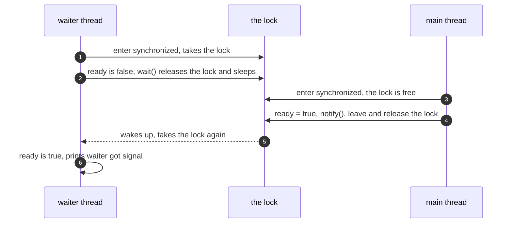

# 08. wait and notify: a thread waits for a signal

Locks stop threads from overlapping. `wait()` and `notify()` do something else: they let one thread sleep until another thread says "something changed".

> [!TIP]
> - **`lock.wait()`** releases the lock and puts the thread to sleep until another thread calls **`lock.notify()`** on the same object. Both calls go inside `synchronized (lock)`.
> - **Check the condition in a `while` loop,** and change the condition before you call `notify()`.
> - **Do not wait for the notified thread while you still hold the lock.** A `join()` inside the `synchronized` block hung the program, even though `ready` was already `volatile`.

## What happens, step by step



The waiter gives the lock away when it calls `wait()`, which is what lets `main` get in. After `notify()` the waiter does not continue at once: it must take the lock again first, and that only works once `main` has left the block.

## The experiment

`08-wait-and-notify/WaitNotifyDemo.java`, written by you. The waiter waits until `ready` is true. After one second `main` sets `ready` and notifies.

```java
public class WaitNotifyDemo {
  static final Object lock = new Object();
  static volatile boolean ready = false;

  public static void main(String args[]) throws Exception {
    Thread waiter = new Thread(() -> {
      try {
        synchronized (lock) {
          while (!ready) {
            lock.wait();
          }
          System.out.println("waiter got signal");
        }
      } catch (Exception e) {
        System.out.println(e.getMessage());
      }
    });
    waiter.start();
    Thread.sleep(1000);
    synchronized (lock) {
      ready = true;
      lock.notify();
    }
    waiter.join();                      // outside the synchronized block, so main no longer holds the lock
    System.out.println("Main: done");
  }
}
```

Output, the same in 3 of 3 runs *(verified)*:

```text
waiter got signal
Main: done
```

## The hang: join() inside the synchronized block

The first version of the file had `waiter.join()` and the final print inside the `synchronized (lock)` block:

```java
    synchronized (lock) {
      ready = true;
      lock.notify();
      waiter.join();          // main still holds the lock here
      System.out.println("Main: done");
    }
```

It never finished: I ran it with a 5-second limit and it was still running *(verified)*, with `ready` already `volatile`, so it was not a visibility problem. What happened:

1. `main` set `ready` and called `notify()`, which woke the waiter.
2. `wait()` can only return after the thread has taken the lock again. `main` still held the lock.
3. `main` was in `join()`, waiting for the waiter to finish.
4. The waiter was waiting for the lock that `main` holds, and `main` was waiting for the waiter. This is the same circular wait as in the deadlock chapter.

Moving `join()` after the block fixed it, as in the code above.

## A one-slot buffer: producer and consumer

The classic use of `wait()` and `notify()` is a producer that hands items to a consumer through a shared buffer. `Slot` holds one item: `put` waits while the slot is full, and `take` waits while it is empty. Each one calls `notifyAll()` after it changes the slot. Inside a `synchronized` method the lock is `this`, so `wait()` and `notifyAll()` need no prefix. `notifyAll()` wakes every waiting thread, which matters because producers and consumers wait on the same lock for different conditions.

`08-wait-and-notify/SlotDemo.java`: `Slot` is yours, and the `main` method was written for it.

```java
public class SlotDemo {

  public static void main(String args[]) throws Exception {
    Slot slot = new Slot();

    Thread producer = new Thread(() -> {
      try {
        for (int i = 1; i <= 5; i++) {
          slot.put(i);
          System.out.println("produced " + i);
        }
      } catch (Exception e) {
        System.out.println("producer failed: " + e);
      }
    });

    Thread consumer = new Thread(() -> {
      try {
        for (int i = 1; i <= 5; i++) {
          int v = slot.take();
          System.out.println("consumed " + v);
        }
      } catch (Exception e) {
        System.out.println("consumer failed: " + e);
      }
    });

    producer.start();
    consumer.start();
    producer.join();
    consumer.join();
    System.out.println("done");
  }
}
class Slot{
  private Integer value = null;
  public synchronized void put(int v) throws Exception{
    while (value!=null) {
      wait();
    }
    value = v;
    notifyAll();
  }
  synchronized int take() throws Exception{
    while (value==null) {
      wait();
    }
    int taken = value;
    value = null;
    notifyAll();
    return taken;
  }
}
```

Three runs, with the lines joined by `|` *(verified)*:

```text
produced 1|produced 2|consumed 1|consumed 2|produced 3|consumed 3|produced 4|produced 5|consumed 4|consumed 5|done
consumed 1|produced 1|produced 2|produced 3|consumed 2|produced 4|consumed 3|consumed 4|produced 5|consumed 5|done
consumed 1|produced 1|produced 2|produced 3|consumed 2|produced 4|consumed 3|consumed 4|consumed 5|produced 5|done
```

The consumer received 1, 2, 3, 4, 5 in order in every run, and the program finished. The printed lines look shuffled because each `println` runs after `put` or `take` has returned, outside the lock, so a thread can print late. The slot itself only ever holds one item, so every `put` had to wait for the previous `take`.

Two bugs in the first version of `Slot` were fixed before it ran:

| Bug | Effect | Fix |
|---|---|---|
| `put` was declared `int` but returned nothing | The file did not compile | Declare it `void` |
| `take` set `value = null` and then returned `value` | It would always return `null`, which crashes when unboxed to `int` | Copy the value to a local first: `int taken = value;` |

## notify versus notifyAll

Several threads can wait on the same lock. `notify()` wakes **one** of them, chosen by the JVM, and the others keep waiting. `notifyAll()` wakes **all** of them. Each woken thread takes the lock in turn, re-checks its `while` condition, and either continues or waits again.

A scratch demo: two waiters, A and B, wait for `ready`. `main` sets it and wakes them, first with `notify()` and then with `notifyAll()`. At the end it interrupts any thread that is still waiting so the program can exit.

```java
public class NotifyVsNotifyAll {
  static final Object lock = new Object();
  static boolean ready = false;

  static Thread waiter(String name) {
    return new Thread(() -> {
      try {
        synchronized (lock) {
          while (!ready) {
            lock.wait();
          }
          System.out.println("  " + name + " woke up");
        }
      } catch (InterruptedException e) {
        System.out.println("  " + name + " was still waiting and had to be interrupted");
      }
    }, name);
  }

  static void run(boolean all) throws Exception {
    ready = false;
    Thread a = waiter("A");
    Thread b = waiter("B");
    a.start();
    b.start();
    Thread.sleep(300);                         // let both threads start waiting
    System.out.println(all ? "main calls notifyAll()" : "main calls notify()");
    synchronized (lock) {
      ready = true;
      if (all) {
        lock.notifyAll();
      } else {
        lock.notify();
      }
    }
    a.join(1000);
    b.join(1000);
    System.out.println("  after 1 s: A alive = " + a.isAlive() + ", B alive = " + b.isAlive());
    a.interrupt();                             // clean up a thread that is still waiting
    b.interrupt();
    a.join();
    b.join();
  }

  public static void main(String[] args) throws Exception {
    run(false);
    run(true);
  }
}
```

Output of the first run, and the second run was identical *(verified)*:

```text
main calls notify()
  A woke up
  after 1 s: A alive = false, B alive = true
  B was still waiting and had to be interrupted
main calls notifyAll()
  A woke up
  B woke up
  after 1 s: A alive = false, B alive = false
```

With `notify()` only A woke up. B stayed waiting even though `ready` was already `true`, because nobody was going to wake it, and the demo had to interrupt it. With `notifyAll()` both woke up. Which thread `notify()` picks is up to the JVM. It was A both times here, but you must not rely on that.

| | `notify()` | `notifyAll()` |
|---|---|---|
| Wakes | One waiting thread, chosen by the JVM | Every waiting thread |
| Fine when | All waiters are the same kind and one change lets exactly one of them go on | Different threads wait for different conditions on the same lock, or you are not sure |
| Risk | The thread it picks may not be the one that can continue, and the others stay stuck, as B did | The extra threads wake up, re-check their condition and go back to waiting (documented, not measured) |

When in doubt use `notifyAll()`. The `while` loop around `wait()` makes the extra wake-ups harmless.

## Can you choose which thread wakes?

Not with `wait()` and `notify()`. Every thread waits in one shared waiting room, and `notify()` picks any one of them. You cannot give it a priority. There are other ways to get the order you want:

| Way | How it works | Status |
|---|---|---|
| `notifyAll()` plus a turn check | Everyone wakes, and each thread re-checks `while (!myTurn)`. Only the right one continues and the rest wait again. It works with plain `synchronized`. | Documented, not run here |
| One `Condition` per priority | With a `ReentrantLock` you can have several waiting rooms, and you decide which room to signal | Verified below |
| A fair lock, `new ReentrantLock(true)` | The longest-waiting thread gets the lock first, which is first-in first-out, not priority | Documented, not run here |
| `PriorityBlockingQueue` | Orders the work items by priority instead of ordering threads | Documented, covered in a later chapter |
| `Thread.setPriority` | Does not help: it is only a hint to the operating system's scheduler and does not change which waiter `notify()` wakes | Documented, not run here |

A **`Condition`** is a waiting room that belongs to a `ReentrantLock`. `await()` is `wait()` for that room, and `signal()` wakes one thread from that room. The demo below (a scratch file) has two rooms, `high` and `low`. Two low-priority threads wait first, then one high-priority thread. `main` hands out one permit at a time and chooses which room to signal. `awaitUninterruptibly()` is `await()` without the checked exception.

```java
import java.util.concurrent.locks.Condition;
import java.util.concurrent.locks.ReentrantLock;

public class PriorityWake {
  static final ReentrantLock lock = new ReentrantLock();
  static final Condition high = lock.newCondition();    // a waiting room for high priority threads
  static final Condition low = lock.newCondition();     // a waiting room for low priority threads
  static int permits = 0;                               // how many threads may go on

  static Thread waiter(String name, Condition room) {
    return new Thread(() -> {
      lock.lock();
      try {
        while (permits == 0) {
          room.awaitUninterruptibly();                  // like wait(), but in a room of our choice
        }
        permits--;
        System.out.println(name + " woke up");
      } finally {
        lock.unlock();
      }
    }, name);
  }

  // hands out one permit and wakes one thread from the chosen room
  static void give(Condition room) {
    lock.lock();
    try {
      permits++;
      room.signal();
    } finally {
      lock.unlock();
    }
  }

  public static void main(String[] args) throws Exception {
    Thread low1 = waiter("low-1", low);
    Thread low2 = waiter("low-2", low);
    Thread high1 = waiter("high-1", high);
    low1.start();
    Thread.sleep(100);
    low2.start();
    Thread.sleep(100);
    high1.start();                                      // the last one to start waiting
    Thread.sleep(200);

    System.out.println("main signals the high room");
    give(high);
    Thread.sleep(200);
    System.out.println("main signals the low room");
    give(low);
    Thread.sleep(200);
    System.out.println("main signals the low room again");
    give(low);
    low1.join();
    low2.join();
    high1.join();
  }
}
```

Output, the same in 3 of 3 runs *(verified)*:

```text
main signals the high room
high-1 woke up
main signals the low room
low-1 woke up
main signals the low room again
low-2 woke up
```

`high-1` woke first although it started waiting last, because `main` chose to signal its room. Inside the low room, `low-1`, which had waited longest, woke before `low-2`. That first-in first-out order inside one room was observed here. I did not find it promised in the `Condition` interface, so do not build on it.

## The rules

| Rule | Why |
|---|---|
| Call `wait()` and `notify()` inside `synchronized` on the same object | Otherwise they throw `IllegalMonitorStateException` (documented, not run here) |
| `wait()` releases the lock | `main` entered the same synchronized block while the waiter was inside it, and the program finished |
| A woken thread must take the lock again before it continues | It cannot run while the notifier still holds the lock, as the hang showed |
| Use `while`, not `if`, around `wait()` | The thread re-checks the condition after waking, and a wake-up can happen without a `notify()` (documented, not run here) |
| `notify()` wakes one waiting thread, `notifyAll()` wakes all of them | With two waiters, `notify()` woke only one and left the other stuck, `notifyAll()` woke both (verified above) |

> [!WARNING]
> **Never block while holding the lock a woken thread needs.** Calling `join()`, or any call that waits for the thread you just notified, inside the `synchronized` block hangs the program quietly.

## Interview questions

<details>
<summary>A waiter thread never continues after main calls notify(), although the flag is volatile and already true. main calls waiter.join() inside the synchronized block that sets the flag. Why does it hang?</summary>

After `notify()` the waiter has to take the lock again before `wait()` returns, but `main` still holds it while it sits in `join()`. `main` waits for the waiter and the waiter waits for the lock, so neither moves. It is not a visibility problem: `ready` was already `volatile`. The fix is to leave the `synchronized` block before calling `join()`, and the program then printed both lines in 3 of 3 runs.
</details>

<details>
<summary>The waiter is inside synchronized (lock) when main also enters synchronized (lock). How can main get in?</summary>

The waiter called `wait()`, and `wait()` releases the lock while the thread sleeps. That is the difference from `Thread.sleep()` inside a synchronized block, which keeps the lock. In the experiment `main` got in after one second and the program finished normally.
</details>

<details>
<summary>Why is the condition checked with while (!ready) and not if (!ready)?</summary>

After waking, the thread must check the condition again because it may no longer hold, and a thread can also wake without a `notify()`. A `while` loop sends it back to `wait()` in that case. This is the documented behaviour, and I did not run a case that fails with `if`.
</details>

<details>
<summary>The Slot output shows "produced 2" before "consumed 1", although the slot holds only one item. Is the buffer broken?</summary>

No. The `println` calls run after `put` and `take` have returned, outside the lock, so a thread can print late. The values themselves were consumed in the order 1 to 5 in all 3 runs, and `put(2)` could only happen after `take()` had emptied the slot.
</details>

<details>
<summary>Why do put and take call notifyAll() and not notify()?</summary>

Producers and consumers wait on the same lock for different conditions. A `notify()` wakes one thread chosen by the JVM, which could be a thread of the wrong kind, and then the signal is wasted. `notifyAll()` wakes all of them and each re-checks its own condition in its `while` loop. With one producer and one consumer both would work. In the notify versus notifyAll experiment, `notify()` woke only one of two waiting threads and left the other stuck.
</details>

<details>
<summary>Two threads wait for the same flag. main sets the flag and calls notify(). One thread continues and the other never does. Why, and what is the fix?</summary>

`notify()` wakes only one waiting thread, and the other one stays in `wait()` with nobody left to wake it, even though the flag is already true. In the experiment B was still alive after 1 second and had to be interrupted. Call `notifyAll()` so every waiter wakes up and re-checks its condition: with it both threads woke up.
</details>

<details>
<summary>Waiters of two priorities share one lock, and you need the high priority ones woken first. notify() picks any thread. What can you do?</summary>

With `wait()` and `notify()` you cannot choose. Use a `ReentrantLock` with one `Condition` per priority and signal the high room first. In the experiment `high-1` woke first although it started waiting last. The alternatives are `notifyAll()` with a "my turn" check in each thread's `while` loop, or ordering the work in a `PriorityBlockingQueue`. `Thread.setPriority` does not help: it is only a hint to the scheduler.
</details>

## Key takeaways

| Remember | Because |
|---|---|
| `wait()` releases the lock, `notify()` wakes a waiter | `main` could enter the block while the waiter slept |
| The woken thread must re-take the lock | It cannot continue while the notifier still holds it |
| `join()` inside the lock hangs | The first version was still running after 5 seconds |
| `volatile` was not the cause | `ready` was already `volatile` in the version that hung |
| A producer and a consumer coordinate with `while` + `wait()` + `notifyAll()` | `Slot` delivered 1 to 5 in order in 3 of 3 runs |
| Save a value before you clear the field | `value = null; return value;` would always return `null` |
| `notify()` wakes one waiter, `notifyAll()` wakes all | With two waiters, `notify()` left B stuck and `notifyAll()` woke both |
| You cannot pick the thread with `notify()`, but you can pick the room with `Condition` | `main` signalled the high room and `high-1` woke first |

**Related:** [Concurrency handbook](/notebook/concurrency/overview) · **Previous:** [Deadlock](/notebook/concurrency/03-coordination/07-deadlock)
