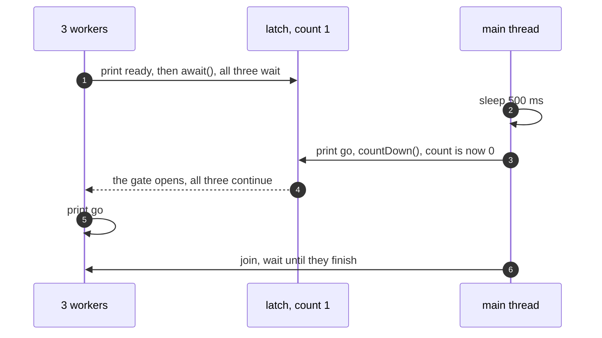

# 14. CountDownLatch: wait for N events, or hold everyone at a gate

A `CountDownLatch` is a counter that starts at some number N. Threads call `countDown()` to subtract 1, and any thread that calls `await()` waits until the counter reaches 0. It is a one-time signal: "N things have finished" or "start now".

> [!TIP]
> - **`countDown()`** subtracts 1. **`await()`** blocks until the count is 0. Once it is 0 it stays 0 and cannot be reset.
> - **Two uses.** Wait for N tasks to finish: the waiter is released after the slowest task, not after the sum of all of them. Or a start gate with a count of 1: all workers wait, then one `countDown()` releases them together.
> - **Put `join()` after `countDown()`.** Calling `join()` on workers that wait for a latch opened later hangs the program.

## The start gate, step by step



The three workers do not need to know about each other or about `main`. They only wait on the latch, and `main` decides when to open it.

## Use 1: wait for N tasks

Three pool tasks sleep 300, 600 and 900 ms, and each calls `countDown()`. `latch.getCount()` returns the current count. A pool's tasks cannot be joined, because the code does not hold their threads, so `await()` is how `main` waits for them.

```java
import java.util.concurrent.CountDownLatch;
import java.util.concurrent.ExecutorService;
import java.util.concurrent.Executors;

public class LatchExample {

  public static void main(String[] args) throws Exception {
    ExecutorService pool = Executors.newFixedThreadPool(3);
    CountDownLatch latch = new CountDownLatch(3);          // the count starts at 3
    long begin = System.currentTimeMillis();

    for (int i = 1; i <= 3; i++) {
      int taskId = i;
      pool.submit(() -> {
        try {
          Thread.sleep(taskId * 300);                      // task 1 takes 300 ms, task 2 600 ms, task 3 900 ms
        } catch (InterruptedException e) {
          Thread.currentThread().interrupt();
        }
        System.out.println("task " + taskId + " done, count before countDown = " + latch.getCount());
        latch.countDown();                                 // the count goes down by 1
      });
    }

    System.out.println("main: waiting, count = " + latch.getCount());
    latch.await();                                         // blocks here until the count reaches 0
    System.out.println("main: released after " + (System.currentTimeMillis() - begin) + " ms, count = " + latch.getCount());
    pool.shutdown();
  }
}
```

Example output:

```text
main: waiting, count = 3
task 1 done, count before countDown = 3
task 2 done, count before countDown = 2
task 3 done, count before countDown = 1
main: released after 908 ms, count = 0
```

The count goes 3, 2, 1, 0 as the tasks finish. `main` is released after about 900 ms, the time of the slowest task, because the three tasks run at the same time.

## Use 2: a start gate

With a count of 1, every worker waits at the gate, and one `countDown()` lets them all through at once.

```java
import java.util.concurrent.CountDownLatch;

public class LatchDemo {

  public static void main(String[] args) throws Exception {
    CountDownLatch latch = new CountDownLatch(1);
    int numberOfThreads = 3;
    Thread[] threads = new Thread[numberOfThreads];
    for (int i = 0; i < threads.length; i++) {
      int keyId = i;
      threads[i] = new Thread(() -> {
        try {
          System.out.println("worker " + keyId + " ready");
          latch.await();
          System.out.println("worker " + keyId + " go");
        } catch (Exception e) {
          System.out.println(e.getMessage());
        }
      });
    }
    for (int i = 0; i < threads.length; i++) {
      threads[i].start();
    }
    Thread.sleep(500);
    System.out.println("main: go!");
    latch.countDown();
    for (int i = 0; i < threads.length; i++) {
      threads[i].join();
    }
  }
}
```

Example output:

```text
worker 1 ready
worker 2 ready
worker 0 ready
main: go!
worker 1 go
worker 2 go
worker 0 go
```

No worker prints `go` before `main: go!`. The order among the workers changes from run to run.

## Pitfall: join() before countDown()

```java
    for (int i = 0; i < threads.length; i++) {
      threads[i].join();            // main waits here for the workers...
    }
    Thread.sleep(500);
    latch.countDown();              // ...so this is never reached
```

The program never finishes. `main` waits in `join()` for the workers, and the workers wait in `await()` for the `countDown()` that `main` has not reached. Each waits for the other, the same circular wait as in the deadlock chapter. Move the `join` loop after `countDown()`.

## A latch versus wait and notifyAll

For a start gate the effect looks the same, because a latch is close to "a flag plus `wait()` and `notifyAll()`", already written. The difference is what happens to a thread that arrives after the signal:

```java
// A: a latch remembers that it was opened
CountDownLatch latch = new CountDownLatch(1);
latch.countDown();                          // opened before anyone arrives
// a thread that calls latch.await() now

// B: notifyAll() with nobody waiting is forgotten
synchronized (lock) {
  lock.notifyAll();                         // nobody is waiting yet, so the signal is lost
}
// a thread that calls lock.wait() now
```

Example output:

```text
A: latch, the late thread passed at once
A: late thread still alive after 1 s = false
B: late thread still alive after 1 s = true
B: was still waiting and had to be interrupted
```

| | `CountDownLatch` | `wait()` and `notifyAll()` |
|---|---|---|
| A thread that arrives after the signal | Passes at once, the latch stays open | Waits forever, unless a `ready` flag is kept and checked in a `while` loop |
| Counting N events | Yes, the count | No, the counter has to be written |
| What is written | `await()` and `countDown()` | `synchronized`, a flag and a `while` loop |
| Can it signal repeatedly | No, it opens once | Yes |

## Where a latch is used

A latch fits one-time events. Repeating events, such as a stream of notifications, fit `wait` and `notify`, a `Condition` or a `BlockingQueue`.

| Use | Example |
|---|---|
| Tests: start gate | The rate-limiter demo `Main.java`: `ready = new CountDownLatch(threads)` waits until all 64 threads are in place, and `go = new CountDownLatch(1)` releases them together |
| Tests: wait for async work | Waiting until a message listener has received a message |
| Startup gate | Wait until the cache warm-up, config load and connection checks have all finished before accepting traffic |
| Fan-out and fan-in | A scheduled job splits work across N workers and waits for all of them before marking the run complete |

## Interview questions

<details>
<summary>main calls join() on three workers that are all waiting on a latch, and only afterwards calls countDown(). The program never ends. Why?</summary>

`main` waits for the workers to finish, and the workers wait for the latch that `main` opens after the `join`. That is a circular wait, the same shape as a deadlock. Call `countDown()` first and then `join()`.
</details>

<details>
<summary>What does a CountDownLatch give for a start gate that wait() and notifyAll() do not?</summary>

It remembers that it was opened. A thread that calls `await()` after the `countDown()` passes at once. A thread that calls `wait()` after a `notifyAll()` with nobody waiting waits forever, because the signal was lost. With `wait` and `notifyAll` a flag checked in a `while` loop is needed to get the same safety.
</details>

<details>
<summary>A scheduled job splits its work across 4 pool tasks and must mark the run finished only when all 4 are done. How is it done with a latch?</summary>

Create `new CountDownLatch(4)`, have each task call `countDown()` when it finishes (in a `finally` block, so a failing task still counts), and call `await()` in the job before marking the run complete. A pool's tasks cannot be joined, which is why the latch is used.
</details>

<details>
<summary>Can the same CountDownLatch be used for a second batch of tasks?</summary>

No. Once the count reaches 0 it stays 0, so every later `await()` returns at once. For a second batch a new latch is created. If the batches repeat, `CyclicBarrier` is the reusable alternative.
</details>

## Key takeaways

| Remember | Because |
|---|---|
| A latch is a counter that threads wait on | `await()` blocks until the count is 0 |
| It waits for the slowest event, not the sum | Tasks of 300, 600 and 900 ms release the waiter after about 900 ms |
| Count 1 makes a start gate | All workers continue together after one `countDown()` |
| `join()` after `countDown()` | The other order is a circular wait |
| A latch remembers, a bare `notifyAll()` does not | A late thread passes the latch and waits forever on `notifyAll()` |
| Use it for one-time events | It cannot be reset |

**Related:** [Concurrency handbook](/notebook/concurrency/overview) · **Previous:** [ConcurrentHashMap](/notebook/concurrency/04-collections-and-queues/13-concurrent-collections)
