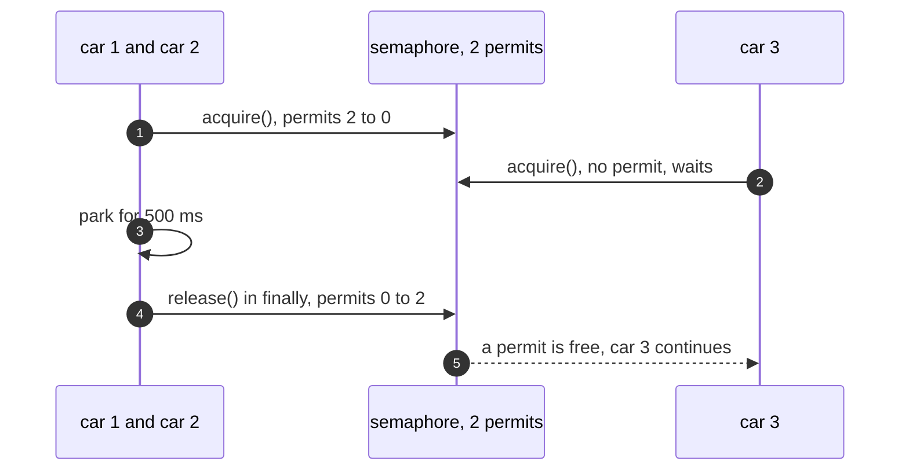

# 15. Semaphore: limit how many threads run at once

A `Semaphore` holds N permits. A thread takes a permit before entering a section and gives it back when it leaves, so at most N threads are inside at the same time. It protects a limited resource: a parking lot with 2 slots, a pool of 10 DB connections, an API that allows 5 calls at once.

> [!TIP]
> - **`acquire()`** takes a permit or waits until one is free. **`release()`** gives one back. At most N threads are between the two.
> - **`tryAcquire()`** never waits and answers `true` or `false`. **`tryAcquire(timeout, unit)`** waits up to the timeout and then answers. Call `release()` only when a permit was obtained.
> - **A semaphore has no owner.** `release()` from a thread that never acquired adds a permit: 3 stray releases turn 2 permits into 5.

## Waiting: acquire()



Car 3 does not fail. It waits in `acquire()` until a permit comes back. Five cars, 2 permits and a 500 ms park:

```java
import java.util.concurrent.Semaphore;

public class ParkingLot {

  public static void main(String[] args) throws Exception {
    Semaphore slots = new Semaphore(2);
    long begin = System.currentTimeMillis();
    Thread[] cars = new Thread[5];
    for (int i = 0; i < cars.length; i++) {
      int id = i + 1;
      cars[i] = new Thread(() -> {
        try {
          slots.acquire();                                 // waits here if both permits are taken
          try {
            System.out.println("car " + id + " parked at " + (System.currentTimeMillis() - begin) + " ms");
            Thread.sleep(500);
          } finally {
            slots.release();                               // always give the permit back
          }
        } catch (InterruptedException e) {
          Thread.currentThread().interrupt();
        }
      });
      cars[i].start();
    }
    for (Thread car : cars) {
      car.join();
    }
    System.out.println("done after " + (System.currentTimeMillis() - begin) + " ms, permits = " + slots.availablePermits());
  }
}
```

Example output:

```text
car 1 parked at 2 ms
car 2 parked at 2 ms
car 4 parked at 524 ms
car 3 parked at 524 ms
car 5 parked at 1024 ms
done after 1530 ms, permits = 2
```

Two cars at once, then two, then one: 5 cars in 3 waves of 500 ms. All permits are back at the end (`permits = 2`). Which cars share a wave changes from run to run.

## Not waiting: tryAcquire()

5 car threads, 2 permits. A car that cannot get a permit is turned away at once.

```java
if (slots.tryAcquire()) {
  try {
    System.out.println("car " + id + " parked at " + (System.currentTimeMillis() - begin));
    Thread.sleep(500);
  } finally {
    slots.release();                               // inside the if: only a thread that got a permit gives one back
  }
} else {
  System.out.println("NO threads are free to run the task");
}
```

Example output:

```text
NO threads are free to run the task
NO threads are free to run the task
NO threads are free to run the task
car 3 parked at 2
car 0 parked at 2
```

Exactly 2 cars park and 3 are turned away, because the 5 threads start within a few milliseconds and the 2 parked cars hold their permits for 500 ms.

## Pitfall: releasing a permit that was never taken

> [!WARNING]
> **Put `release()` only on the path that acquired.** A `try/catch/finally` around the whole `if/else`, with `release()` in the `finally`, makes the turned-away threads release permits they never took.

```java
// wrong: release() runs for every thread, including the ones whose tryAcquire() returned false
try {
  if (slots.tryAcquire()) {
    System.out.println("car " + id + " parked");
    Thread.sleep(500);
  } else {
    System.out.println("turned away");
  }
} finally {
  slots.release();
}
```

A semaphore does not remember who took a permit, so it accepts those releases and its permit count grows. A later `tryAcquire()` then succeeds although 2 cars are already parked, and the example above shows 3 cars parked with only 2 permits. A direct check of the mechanism: 3 `release()` calls on a fresh `Semaphore(2)`, with no `acquire()`, give `availablePermits() = 5`.

A lock behaves differently: `unlock()` from a thread that does not hold the lock throws `IllegalMonitorStateException`. The semaphore stays silent, so the mistake only shows as a broken limit.

## A timeout in the middle: tryAcquire(timeout, unit)

`tryAcquire(300, TimeUnit.MILLISECONDS)` waits up to 300 ms for a permit, then answers `false`. If a permit comes back earlier, it returns `true` at that moment.

```text
timeout 300 ms, nobody releases: false after 313 ms
timeout 1000 ms, released after 100 ms: true after 109 ms
```

With nobody releasing, the call gives up after the timeout. When a permit comes back after 100 ms, it returns `true` as soon as the permit arrives, not after the full 1000 ms. The same rule holds: `release()` only after `true`.

| Call | When all permits are taken | In a server |
|---|---|---|
| `acquire()` | Waits as long as it takes | Back-pressure: requests queue up and latency grows |
| `tryAcquire()` | Returns `false` at once | Load shedding: answer 429 or 503 and keep latency flat |
| `tryAcquire(timeout, unit)` | Waits up to the timeout, then `false` | Queue for a short time, then shed |

## Semaphore, lock, latch and pool

| | Lets in | Owner | Permits come back | Use it for |
|---|---|---|---|---|
| `ReentrantLock` | 1 thread | Yes, the holder | `unlock()` by the same thread | Protecting shared state |
| `Semaphore(N)` | N threads | No | `release()` by any thread | Limiting concurrent use of a resource |
| `CountDownLatch(N)` | Nobody until the count is 0, then everybody | No | Never, one-shot | Waiting for N events or a start signal |
| Thread pool | Runs N tasks at once | Not applicable | Not applicable | Limiting how many threads exist |

A semaphore is not a thread pool. It limits how many threads may be inside one section at a time, and the threads can come from anywhere. It also limits **concurrency, not rate**: `Semaphore(5)` allows 5 calls at the same moment, not 5 per second, because 5 fast calls can finish and 5 more can start within the same second. A per-second limit is a rate limiter.

## Where a semaphore is used

| Use | Example |
|---|---|
| Bulkhead | At most 10 concurrent calls to a slow downstream service, so it cannot use up all request threads |
| Resource pool | A pool of N connections or N parking slots: `acquire()` to take one, `release()` to return it |
| Bounded work | At most 4 files uploading or downloading at once |

## Interview questions

<details>
<summary>A Semaphore(2) guards a section, yet a log shows 3 threads inside at once. The code uses tryAcquire() and a finally block that calls release(). What went wrong?</summary>

The `finally` wraps the whole `if/else`, so threads whose `tryAcquire()` returned `false` also call `release()`. The semaphore has no owner and accepts it, so the permit count grows beyond 2 and a later `tryAcquire()` succeeds when it should not. Move `try/finally` inside the `if (tryAcquire())` branch so only a thread that got a permit returns one.
</details>

<details>
<summary>An endpoint calls a payment API that allows 10 concurrent calls. Which is used: acquire(), tryAcquire() or tryAcquire(timeout, unit)?</summary>

It depends on what a waiting request costs. `acquire()` queues every request, which keeps them all but lets latency and the number of waiting threads grow without a limit. `tryAcquire()` answers at once, so the endpoint returns 429 or 503 and latency stays flat. `tryAcquire(timeout, unit)` is the usual choice: wait briefly for a permit, then shed. In every case release only after a permit was obtained, in a `finally`.
</details>

<details>
<summary>Someone says Semaphore(5) lets 5 requests per second through. Is that right?</summary>

No. It lets 5 threads be inside the section at the same time. If each call takes 10 ms, hundreds of calls pass per second through 5 permits. To limit calls per second a rate limiter is needed, such as a token bucket or a sliding window, not a semaphore.
</details>

<details>
<summary>What is the difference between Semaphore(1) and a ReentrantLock?</summary>

A lock has an owner: only the thread that holds it can unlock it, and the same thread can lock it again (reentrancy). A `Semaphore(1)` has no owner, so any thread can call `release()`, and the permit is not reentrant: a thread that calls `acquire()` twice on a `Semaphore(1)` blocks itself. A lock protects state, and a semaphore fits when permits are handed from one thread to another or when N is greater than 1.
</details>

<details>
<summary>A method acquires a permit, then throws an exception before it reaches release(). What happens to the semaphore over time?</summary>

The permit is never returned, so every such failure loses one permit for good. After N failures all permits are gone and every later `acquire()` waits forever, even though nothing is using the resource. This is why `release()` goes in a `finally` block right after the acquire.
</details>

## Key takeaways

| Remember | Because |
|---|---|
| A semaphore is N permits | At most N threads between `acquire()` and `release()` |
| `acquire()` waits, `tryAcquire()` does not | 5 cars with 2 permits wait in 3 waves, while the no-wait version turns 3 away |
| `release()` in a `finally`, only after getting a permit | A stray `release()` raises the limit |
| There is no owner | 3 stray releases give 5 permits from 2 |
| It limits concurrency, not rate | Permits are in use at the same moment, not per second |
| Use a timeout to wait briefly and then shed | It returns `false` after the timeout, or `true` as soon as a permit comes back |

**Related:** [Concurrency handbook](/notebook/concurrency/overview) · **Previous:** [CountDownLatch](/notebook/concurrency/03-coordination/14-countdownlatch)
