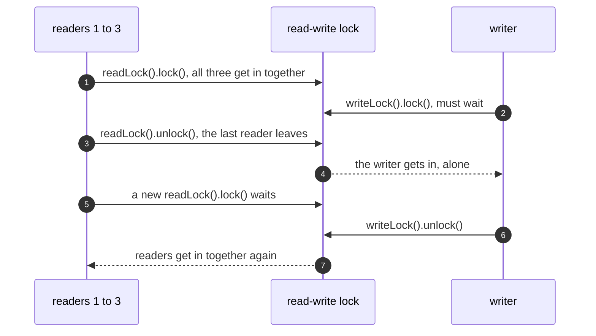

# 16. ReadWriteLock: many readers or one writer

A `ReentrantReadWriteLock` is one object that hands out two locks. The read lock is shared: any number of threads can hold it at once. The write lock is exclusive: one thread holds it, and nobody else holds either lock at that moment. It fits data that is read far more often than it is written.

> [!TIP]
> - **Readers share, a writer is alone.** `rw.readLock()` lets many threads in together. `rw.writeLock()` waits for every reader and every other writer, then works alone.
> - **A reader waits only for a writer that holds the write lock.** It never waits for other readers.
> - **No upgrade.** A thread that holds the read lock and asks for the write lock waits for itself forever. Release the read lock first. Going the other way, from write to read, is allowed.

## What happens, step by step



Readers do not exclude each other, so they overlap. The writer excludes everyone, so it has to wait for the readers to leave, and readers that arrive meanwhile have to wait for the writer.

## Who waits for whom

| Thread asks for | Waits for |
|---|---|
| Read lock | Only a writer that holds the write lock. Not other readers. |
| Write lock | Every reader that holds the read lock, and any other writer |

In the default non-fair mode, a new reader can also queue behind a writer that is already waiting, instead of joining the readers that are inside. This stops a steady stream of readers from starving the writer. `new ReentrantReadWriteLock(true)` makes the lock fair, with first-in first-out ordering.

## Example

Three reader threads each hold the lock for 500 ms. The demo file is `16-read-write-lock/RwDemo.java`. The pattern for each lock is `lock()` before the `try` and `unlock()` in `finally`, as with a `ReentrantLock`:

```java
ReentrantReadWriteLock rw = new ReentrantReadWriteLock();

// a reader
rw.readLock().lock();
try {
  System.out.println("reader " + id + " in");
  Thread.sleep(500);
} finally {
  rw.readLock().unlock();
}

// the writer
rw.writeLock().lock();
try {
  System.out.println("writer in");
  Thread.sleep(500);
} finally {
  rw.writeLock().unlock();
}
```

Example results for the same 3 readers:

| Case | Total time | What it shows |
|---|---|---|
| Plain `ReentrantLock` | about 1500 ms | The readers go one by one: 3 × 500 ms |
| Read lock | about 500 ms | All 3 readers are inside at the same time |
| 3 readers, then a writer 50 ms later | about 1000 ms | The writer gets in only after the readers leave: 500 ms plus 500 ms |
| A writer holding the lock for 5 s, then 3 readers 50 ms later | about 5500 ms | The readers wait for the whole 5 s, then all 3 get in together |

In the last case `writer in` is printed first, and the three `reader in` lines follow about 5 seconds later, within a few milliseconds of each other.

## Typical use: a read-heavy cache

```java
import java.util.HashMap;
import java.util.Map;
import java.util.concurrent.locks.ReentrantReadWriteLock;

class Cache {

  private final Map<String, String> data = new HashMap<>();
  private final ReentrantReadWriteLock rw = new ReentrantReadWriteLock();

  String get(String key) {
    rw.readLock().lock();
    try {
      return data.get(key);
    } finally {
      rw.readLock().unlock();
    }
  }

  void put(String key, String value) {
    rw.writeLock().lock();
    try {
      data.put(key, value);
    } finally {
      rw.writeLock().unlock();
    }
  }
}
```

Many threads can call `get` at the same time. A `put` waits for them to finish and blocks them while it writes. The plain `HashMap` is safe here because every access goes through the lock.

> [!WARNING]
> **A "read" that changes state is a write.** An LRU cache `get` moves the entry to the front of the recency list, and a hit counter changes on every read. Under a read lock, two readers would change that shared state at the same time. Use the write lock, or one ordinary lock, for those operations.

## Pitfall: upgrading a read lock to a write lock

```java
rw.readLock().lock();
try {
  if (!data.containsKey(key)) {
    rw.writeLock().lock();     // waits for all readers to leave, including this thread: never returns
    try {
      data.put(key, load(key));
    } finally {
      rw.writeLock().unlock();
    }
  }
} finally {
  rw.readLock().unlock();
}
```

The write lock waits for every reader to release, and this thread is one of those readers, so it waits for itself. Nothing is printed and the thread never continues. The fix is to release the read lock, take the write lock, and check the condition again, because another writer may have got in between:

```java
rw.readLock().lock();
String value = data.get(key);
rw.readLock().unlock();
if (value == null) {
  rw.writeLock().lock();
  try {
    value = data.get(key);               // check again under the write lock
    if (value == null) {
      value = load(key);
      data.put(key, value);
    }
  } finally {
    rw.writeLock().unlock();
  }
}
```

The reverse is allowed. A thread that holds the write lock can take the read lock, release the write lock, and keep reading: this is called **downgrading**.

## Other rules

| Rule | Detail |
|---|---|
| Reentrant | A thread that holds a lock can take it again. Each `lock()` needs its own `unlock()`. |
| Conditions | Only the write lock supports `newCondition()`. The read lock throws `UnsupportedOperationException`. |
| Not always faster | The gain depends on how long a read takes and how many operations are reads. For very short reads on a map, `ConcurrentHashMap` is simpler and usually enough. |

## Interview questions

<details>
<summary>Three threads each read shared data for 500 ms. With a plain ReentrantLock they take about 1500 ms. How long with a ReentrantReadWriteLock read lock, and why?</summary>

About 500 ms. The read lock is shared, so all three threads hold it at the same time and their 500 ms periods overlap. A plain lock allows one thread at a time, so the periods add up.
</details>

<details>
<summary>Three readers are inside and a writer asks for the write lock. What happens to the writer, and to readers that arrive afterwards?</summary>

The writer waits until all three readers release the read lock, then it works alone. Readers that arrive while the writer holds the lock wait for it to finish, and then they enter together. In the default non-fair mode a reader that arrives while the writer is only waiting can also queue behind it, so readers cannot starve the writer.
</details>

<details>
<summary>A thread holds the read lock, finds the cache entry missing, and calls writeLock().lock() to insert it. The request hangs and nothing is logged. Why, and what is the fix?</summary>

A read lock cannot be upgraded. The write lock waits for all readers to release, and the calling thread is itself one of them, so it waits for itself. Release the read lock, take the write lock, and check the condition again before inserting, because another thread may have inserted the entry in between.
</details>

<details>
<summary>A teammate protects an LRU cache with a ReentrantReadWriteLock and uses the read lock for get(). What is wrong?</summary>

`get` on an LRU cache changes the recency order, so it modifies shared state. Two readers can then reorder the list at the same time, which corrupts it. Every operation that changes state needs the write lock, so for an LRU cache one ordinary lock is simpler.
</details>

<details>
<summary>A service reads a configuration map 99% of the time and updates it rarely. Is a ReentrantReadWriteLock the right choice?</summary>

It works, because reads run in parallel and an update is rare. But the gain depends on how long a read takes: for very short reads, a `ConcurrentHashMap` is simpler and often enough, and the lock adds its own bookkeeping. The read-write lock fits best when a read takes long enough for the overlap to matter, or when several fields must be read as one consistent snapshot.
</details>

## Key takeaways

| Remember | Because |
|---|---|
| Readers share, a writer is alone | The read lock is shared and the write lock is exclusive |
| A reader waits only for a writer that holds the lock | Readers never block each other |
| A writer waits for all readers and other writers | It needs the lock to itself |
| `unlock()` in `finally`, for both locks | An unreleased lock blocks every thread that wants it |
| No upgrade from read to write | The thread waits for its own read lock to be released |
| A read that changes state is a write | An LRU `get` reorders the list |

**Related:** [Concurrency handbook](/notebook/concurrency/overview) · **Previous:** [Semaphore](/notebook/concurrency/03-coordination/15-semaphore)
