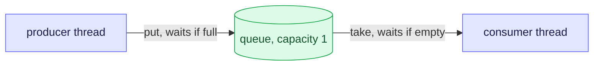

# 09. BlockingQueue: producer-consumer without wait and notify

A blocking queue is a queue that makes threads wait: `put` waits when the queue is full, and `take` waits when it is empty. It is the one-slot buffer from the previous chapter, already written and tested.

> [!TIP]
> - **`ArrayBlockingQueue.put(x)`** waits while the queue is full. **`take()`** waits while it is empty. No `wait()` and no `notify()` is written.
> - **Inside it is the same pattern as a hand-written buffer:** a lock, a `while` loop around a wait, and a signal after every change. The JDK 17 source shows a `ReentrantLock` with two `Condition` objects.
> - **The producer and consumer code stays the same** as with the hand-written buffer. Only the buffer changes.

## What the queue does



The queue sits between the two threads and does all the waiting. Neither thread needs to know about the other.

## Example

The producer-consumer demo from the previous chapter with the hand-written `Slot` replaced by an `ArrayBlockingQueue` of capacity 1. `BlockingQueue` is the interface and `ArrayBlockingQueue` is a queue backed by a fixed-size array, both in `java.util.concurrent`.

```java
import java.util.concurrent.ArrayBlockingQueue;
import java.util.concurrent.BlockingQueue;

public class QueueDemo {

  public static void main(String[] args) throws Exception {
    BlockingQueue<Integer> queue = new ArrayBlockingQueue<>(1);

    Thread producer = new Thread(() -> {
      try {
        for (int i = 1; i <= 5; i++) {
          queue.put(i);
          System.out.println("produced " + i);
        }
      } catch (Exception e) {
        System.out.println("producer failed: " + e);
      }
    });

    Thread consumer = new Thread(() -> {
      try {
        for (int i = 1; i <= 5; i++) {
          int v = queue.take();
          System.out.println("consumed " + v);
        }
      } catch (Exception e) {
        System.out.println("consumer failed: " + e);
      }
    });

    producer.start();
    consumer.start();
    producer.join();
    consumer.join();
    System.out.println("done");
  }
}
```

Example output of three runs, with the lines joined by `|`:

```text
consumed 1|produced 1|consumed 2|produced 2|produced 3|consumed 3|produced 4|consumed 4|consumed 5|produced 5|done
produced 1|produced 2|consumed 1|consumed 2|produced 3|produced 4|consumed 3|consumed 4|produced 5|consumed 5|done
produced 1|consumed 1|produced 2|produced 3|consumed 2|consumed 3|produced 4|produced 5|consumed 4|consumed 5|done
```

The values come out as 1 to 5 in order every time. The print lines are shuffled because each `println` runs after the call has returned, outside the queue's lock.

## Where wait and notify went: the JDK source

From the JDK 17 source of `ArrayBlockingQueue`:

```java
// the fields
final ReentrantLock lock;
private final Condition notEmpty;
private final Condition notFull;

public void put(E e) throws InterruptedException {
    Objects.requireNonNull(e);
    final ReentrantLock lock = this.lock;
    lock.lockInterruptibly();
    try {
        while (count == items.length)
            notFull.await();
        enqueue(e);
    } finally {
        lock.unlock();
    }
}

public E take() throws InterruptedException {
    final ReentrantLock lock = this.lock;
    lock.lockInterruptibly();
    try {
        while (count == 0)
            notEmpty.await();
        return dequeue();
    } finally {
        lock.unlock();
    }
}

private void enqueue(E e) {
    final Object[] items = this.items;
    items[putIndex] = e;
    if (++putIndex == items.length) putIndex = 0;
    count++;
    notEmpty.signal();
}
```

It is the hand-written one-slot buffer with a different lock:

| | One-slot buffer (`Slot`) | `ArrayBlockingQueue` |
|---|---|---|
| Lock | `synchronized` on `this` | a `ReentrantLock` |
| Waiting | `while (value != null) wait();` | `while (count == items.length) notFull.await();` |
| Waking | `notifyAll()` | `notEmpty.signal()` after adding an item |
| Capacity | 1 | chosen when the queue is created |
| Written and tested by | the application | the JDK |

A **`Condition`** is a waiting room that belongs to a `ReentrantLock`. `await()` releases the lock and sleeps, like `wait()`. `signal()` wakes one waiter, like `notify()`. A lock can have several conditions. This queue has two: `notFull`, where producers wait, and `notEmpty`, where consumers wait. That is why it can use `signal()`: `enqueue` signals `notEmpty`, so the thread it wakes is a consumer. With `wait` and `notify` all waiters share one room, which is why the one-slot buffer needed `notifyAll()`.

## Interview questions

<details>
<summary>A hand-written wait/notifyAll buffer is replaced with ArrayBlockingQueue(1) and the output is the same. Where did the wait and notify go?</summary>

Inside the queue. The JDK 17 source of `put` and `take` shows a `ReentrantLock`, a `while` loop around `notFull.await()` or `notEmpty.await()`, and a `signal()` after every change. It is the same structure as the hand-written buffer, with `Condition` instead of `wait()` and `notify()`.
</details>

<details>
<summary>The hand-written buffer needed notifyAll(), but ArrayBlockingQueue calls signal() on one condition. Why is that safe?</summary>

`ArrayBlockingQueue` has two conditions, so producers and consumers wait in different rooms. `enqueue` signals `notEmpty`, which only consumers wait on, so the woken thread is always the right kind. With `wait` and `notify` there is one waiting room for everyone, so a `notify()` could wake the wrong kind of thread.
</details>

<details>
<summary>Why use a BlockingQueue in real code instead of a hand-written wait/notify buffer?</summary>

Hand-written buffers are easy to get wrong: a lost wake-up, an `if` instead of a `while`, a value cleared before it is returned, or a `join()` inside the lock that hangs the program. The queue is already written, tested and used everywhere.
</details>

## Key takeaways

| Remember | Because |
|---|---|
| `put` waits when full, `take` waits when empty | The queue does the waiting for both threads |
| It is a hand-written buffer with a lock and two conditions | `put` is `while (full) notFull.await()` in the source |
| A `Condition` is a waiting room tied to a `ReentrantLock` | `await()` and `signal()` are `wait()` and `notify()` for it |
| Two conditions mean `signal()` is enough | Producers and consumers wait in different rooms |

**Related:** [Concurrency handbook](/notebook/concurrency/overview) · **Previous:** [wait and notify](/notebook/concurrency/03-coordination/08-wait-and-notify)
