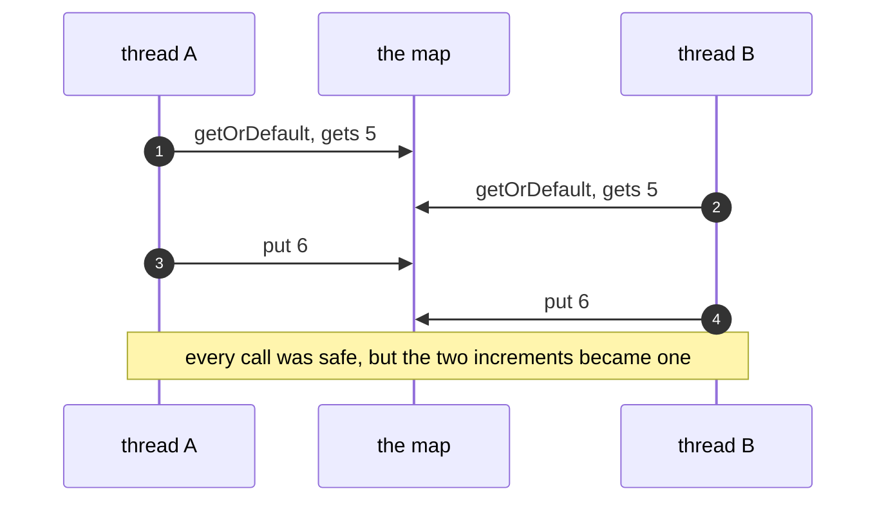

# 13. ConcurrentHashMap: every call is safe, a sequence of calls is not

`ConcurrentHashMap` lets many threads use one map at the same time, and each single call on it is thread-safe. But a read followed by a write, made of separate calls, is still a race. The fix is to ask the map to do the whole update in one call.

> [!TIP]
> - **Each call is safe, the sequence is not.** `map.put("hits", map.getOrDefault("hits", 0) + 1)` is three steps (read, add 1, put), so two threads lose updates.
> - **`map.merge("hits", 1, Integer::sum)` is one call.** It does the whole update atomically.
> - **Use the compound calls:** `merge`, `compute`, `computeIfAbsent` and `putIfAbsent` do a read-modify-write atomically on a `ConcurrentHashMap`.

## What goes wrong



This is the lost update from the counter chapter, with a thread-safe map underneath. The map keeps its own data intact, but it cannot know that two separate calls belong together.

## Example

Part 1 does the update as three separate steps. Part 2 clears the map and does it with `merge`, which stores `1` if the key is missing and otherwise adds `1` to the value. Each part uses 2 threads and 100,000 updates per thread, so the right answer is 200000.

```java
import java.util.concurrent.ConcurrentHashMap;

public class MapCounter {

  public static void main(String[] args) throws Exception {
    ConcurrentHashMap<String, Integer> map = new ConcurrentHashMap<>();
    int numberOfRuns = 100_000;

    Thread t1 = new Thread(() -> {
      for (int i = 0; i < numberOfRuns; i++) {
        map.put("hits", map.getOrDefault("hits", 0) + 1);
      }
    });
    Thread t2 = new Thread(() -> {
      for (int i = 0; i < numberOfRuns; i++) {
        map.put("hits", map.getOrDefault("hits", 0) + 1);
      }
    });
    t1.start();
    t2.start();
    t1.join();
    t2.join();
    System.out.println("After put with getOrDefault: " + map.get("hits"));

    map.clear();
    Thread t3 = new Thread(() -> {
      for (int i = 0; i < numberOfRuns; i++) {
        map.merge("hits", 1, Integer::sum);
      }
    });
    Thread t4 = new Thread(() -> {
      for (int i = 0; i < numberOfRuns; i++) {
        map.merge("hits", 1, Integer::sum);
      }
    });
    t3.start();
    t4.start();
    t3.join();
    t4.join();
    System.out.println("After merge: " + map.get("hits"));
  }
}
```

Example output of five runs:

| Run | Part 1: `put` with `getOrDefault` | Part 2: `merge` |
|---|---|---|
| 1 | 138794 | 200000 |
| 2 | 121415 | 200000 |
| 3 | 143593 | 200000 |
| 4 | 119938 | 200000 |
| 5 | 108789 | 200000 |

Part 1 is wrong in every run, with a different number each time. Part 2 is always right.

## Why merge is atomic

Key lines of `ConcurrentHashMap.merge` in the JDK 17 source:

```java
public V merge(K key, V value, BiFunction<? super V, ? super V, ? extends V> remappingFunction) {
    ...
    if (casTabAt(tab, i, null, new Node<K,V>(h, key, value))) {   // empty bucket: one compare-and-swap
    ...
    synchronized (f) {                                            // otherwise lock the bucket's first node
        ...
        val = remappingFunction.apply(e.val, value);              // the update runs while the bucket is locked
```

The map does not lock the whole table. An empty bucket is filled with a compare-and-swap, as in the atomics chapter. Otherwise it locks only the first node of that one bucket, and runs the function while holding it. Two threads updating the same key meet at the same lock, and the read, the add and the write happen as one step. Updates to keys in different buckets can go on in parallel.

| Call | What it does in one atomic step |
|---|---|
| `merge(key, value, function)` | Stores `value` if the key is missing, otherwise stores `function(old, value)` |
| `putIfAbsent(key, value)` | Puts the value only if the key is missing |
| `computeIfAbsent(key, function)` | Computes and stores a value only if the key is missing |
| `compute(key, function)` | Recomputes the value from the old one |

> [!WARNING]
> **A thread-safe collection does not make a sequence of calls safe.** `containsKey` followed by `put`, or `get` followed by `put`, leaves a gap that another thread can use. Use one compound call instead. The function passed to `merge` or `compute` runs while the bucket is locked, as the source shows, so keep it short and do not call slow code from it.

## Interview questions

<details>
<summary>Two threads count hits with map.put(key, map.getOrDefault(key, 0) + 1) on a ConcurrentHashMap. The total is too low although the map is thread-safe. Why, and what is the fix?</summary>

Each call is safe, but the three steps together (read, add 1, put) are not one step, so two threads can read the same value and one update is lost. Use `map.merge(key, 1, Integer::sum)`, which does the update as one atomic call.
</details>

<details>
<summary>How does ConcurrentHashMap.merge stay atomic without one lock around the whole map?</summary>

The JDK 17 source shows two paths. If the bucket is empty it inserts the node with one compare-and-swap. Otherwise it takes `synchronized (f)` on the first node of that bucket and runs the remapping function inside it. So only threads that touch the same bucket wait for each other.
</details>

<details>
<summary>A teammate writes if (!map.containsKey(key)) map.put(key, value) on a ConcurrentHashMap. What is wrong, and which call replaces it?</summary>

It is a check-then-act sequence, the same shape as a lazy-initialisation race: two threads can both see the key missing and both put. `putIfAbsent`, or `computeIfAbsent` when the value is expensive to create, does the check and the put as one call.
</details>

## Key takeaways

| Remember | Because |
|---|---|
| A thread-safe map makes single calls safe | The map's own data stays intact |
| A read followed by a write is still a race | Another thread can run between the two calls |
| Use `merge`, `compute` or `putIfAbsent` | Each does the read-modify-write as one atomic call |
| `merge` locks one bucket, not the map | The source shows `casTabAt` and `synchronized (f)` |

**Related:** [Concurrency handbook](/notebook/concurrency/overview) · **Previous:** [ThreadPoolExecutor](/notebook/concurrency/05-executors-and-async/12-thread-pool-executor)
