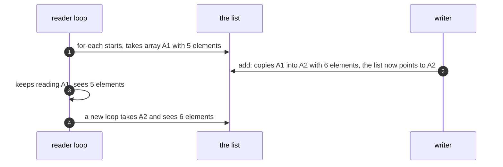

# 21. Thread-safe lists: synchronizedList and CopyOnWriteArrayList

A plain `ArrayList` loses elements when two threads add to it at the same time. Two ready-made fixes exist, and they behave very differently while another thread changes the list. `Collections.synchronizedList` takes a lock on every call. `CopyOnWriteArrayList` copies its array on every write, so readers work on a snapshot.

> [!TIP]
> - **`Collections.synchronizedList(list)`** makes each single call safe, but a loop over it is many calls. A thread that adds during the loop makes the iterator throw `ConcurrentModificationException`.
> - **`CopyOnWriteArrayList`** copies the whole array on every write. A for-each loop keeps reading the array it started with, so it never throws, and it never sees later changes. It suits lists that are read often and changed rarely.
> - **A sequence of calls is never safe by itself.** An index loop, or `contains` followed by `add`, leaves a gap between two calls. Use one compound call, a snapshot, or one lock around the whole sequence.

## What a plain ArrayList does

Two threads each add 100,000 numbers to a shared list. The right size is 200000.

```java
static void fill(List<Integer> list) throws Exception {
  Thread t1 = new Thread(() -> { for (int i = 0; i < 100_000; i++) list.add(i); });
  Thread t2 = new Thread(() -> { for (int i = 0; i < 100_000; i++) list.add(i); });
  t1.start();
  t2.start();
  t1.join();
  t2.join();
}
```

| List | Final size |
|---|---|
| `new ArrayList<>()` | Well below 200000, for example 118307 to 131284 |
| `Collections.synchronizedList(new ArrayList<>())` | Exactly 200000 |

`add` on an `ArrayList` reads the size, writes the element and increases the size as separate steps, so two threads overwrite each other's element, the same lost update as in the counter chapter. It can also throw an `ArrayIndexOutOfBoundsException` while the internal array grows. The synchronized wrapper holds one lock for every call, so no update is lost.

## Iterating while another thread adds

One thread adds 1000 elements, one every millisecond, while another iterates a 5-element list with a for-each loop.

```java
static void iterateWhileAdding(String name, List<Integer> list) throws Exception {
  Thread adder = new Thread(() -> {
    for (int i = 0; i < 1000; i++) { list.add(i); pause(1); }
  });
  adder.start();
  int seen = 0;
  try {
    for (int x : list) { seen++; pause(5); }
    System.out.println(name + ": iteration finished, saw " + seen + " elements");
  } catch (ConcurrentModificationException e) {
    System.out.println(name + ": iteration failed after " + seen + " elements: " + e);
  }
  adder.join();
  System.out.println(name + ": size at the end = " + list.size());
}
```

Example output:

```text
synchronizedList: iteration failed after 1 elements: java.util.ConcurrentModificationException
synchronizedList: size at the end = 1005
copyOnWrite: iteration finished, saw 5 elements
copyOnWrite: size at the end = 1005
```

Each call on the synchronized list is safe, but the iterator is a different object that checks the list's modification count on every step. The adder changed the list, so the next step failed. The copy-on-write list finished the loop and saw only the 5 elements it started with, while the list grew to 1005.

## How CopyOnWriteArrayList works



The list holds one reference to an array. A write takes a lock, copies the array, changes the copy and switches the reference to it in one step. A loop takes the current reference once, when it starts, and walks that array. Nothing ever changes an array a loop holds, so the loop needs no lock and never sees a half-changed list. Arrays that no loop holds any more are garbage collected.

The loop does not copy the list when it starts. It only takes the reference, which is cheap. The copying happens on every write, so each `add` or `remove` costs time proportional to the size of the list.

## Removing elements

On `[1, 2, 3, 4, 5]`, with another thread removing 1, 2 and 3 while a for-each loop reads:

```text
reader: reads 1
remover: removed 1, list is now [2, 3, 4, 5]
reader: reads 2
remover: removed 2, list is now [3, 4, 5]
reader: reads 3
remover: removed 3, list is now [4, 5]
reader: reads 4
reader: reads 5
reader: a new loop would see [4, 5]
```

The loop still reads the removed elements, because it reads its own array. Other cases:

| What is done | Result on `CopyOnWriteArrayList` |
|---|---|
| The loop itself calls `list.remove(x)` | The loop is not affected and still visits every original element. The list loses the element. |
| The loop calls `iterator.remove()` | `UnsupportedOperationException`: the iterator is read-only |
| The same loop on a plain `ArrayList` | `ConcurrentModificationException`, even in a single thread |

To remove while looping, call `list.remove(x)` on the list, or use `list.removeIf(...)`, which does the whole removal as one write.

## Pitfall: an index loop has no snapshot

```java
for (int i = 0; i < list.size(); i++) {
  System.out.println(list.get(i));
}
```

Every `size()` and `get(i)` reads the current array, so this loop sees additions made while it runs (one run counted 305 elements, against 5 for a for-each), and it breaks when elements are removed. Removing an element shifts the later ones to the left. On `[1, 2, 3, 4, 5]`, with another thread removing `1` and later `5`:

```text
reader: get(0) = 1   (list size is 5)
remover: removed 1, list is now [2, 3, 4, 5]
reader: get(1) = 3   (list size is 4)
reader: get(2) = 4   (list size is 4)
remover: removed 5, list is now [2, 3, 4]
reader: failed java.lang.ArrayIndexOutOfBoundsException: Index 3 out of bounds for length 3
```

| Problem | Cause |
|---|---|
| Element 2 was never read | Removing `1` shifted `3` into index 1 |
| `ArrayIndexOutOfBoundsException` | The check `3 < list.size()` passed, then `5` was removed, and `get(3)` ran on an array of length 3. The window is small, so it shows only in some runs. |

> [!WARNING]
> **Use for-each, not an index loop, on a list another thread changes.** If indexes are needed, loop over a private copy: `new ArrayList<>(list)`.

## Pitfall: check-then-act

```java
if (!names.contains("alice")) {
  names.add("alice");
}
```

`contains` and `add` are each safe, but another thread can add `alice` between them. With 8 threads running this on a `CopyOnWriteArrayList`, `alice` ended up in the list 8 times. `names.addIfAbsent("alice")`, which does the check and the add as one step, left exactly 1.

## Three ways to make a sequence safe

| Way | Example |
|---|---|
| A compound method of the class | `addIfAbsent`, `removeIf`, `ConcurrentHashMap.merge` |
| A snapshot | A for-each loop on a copy-on-write list, or a loop over `new ArrayList<>(list)` |
| One lock around the whole sequence | `synchronized (list) { ... }` around a loop over a `Collections.synchronizedList`. Every other piece of code that touches the list must use the same lock. |

The Javadoc of `Collections.synchronizedList` requires manual synchronization on the list while iterating over it.

## Choosing a list

| | `ArrayList` | `synchronizedList` | `CopyOnWriteArrayList` |
|---|---|---|---|
| Safe for concurrent `add` | No | Yes | Yes |
| Iteration while another thread changes the list | `ConcurrentModificationException` | `ConcurrentModificationException`, unless locked by hand | Safe, on a snapshot |
| Cost of a write | Cheap | Cheap, one lock | Copies the whole array |
| Cost of a read | Cheap | One lock per call | No lock |
| Fits | One thread only | Short lists that are written often | Lists read often and changed rarely, such as a list of listeners |

> [!NOTE]
> **Copy-on-write is wrong for a list that is written often or is large.** Every write copies the whole array, so a list with thousands of elements and frequent updates spends its time copying.

## Interview questions

<details>
<summary>A list of event listeners is walked on every event, and a listener is added or removed a few times a day. Which list is used, and why?</summary>

`CopyOnWriteArrayList`. Every event walks the list, so reads dominate, and reads need no lock. A rare add or remove copies the array once. A loop that is in progress keeps its snapshot, so a listener that unregisters during an event does not break the loop. With `synchronizedList`, the walk would need a lock for its whole duration, which blocks writers, or it would throw `ConcurrentModificationException`.
</details>

<details>
<summary>A thread iterates a Collections.synchronizedList while another thread adds to it, and the loop throws ConcurrentModificationException. The list is synchronized. Why does it still fail?</summary>

Each call on the list takes the lock, but the iterator is a separate object that compares the list's modification count on every step. Between two steps of the loop the lock is free, so the other thread adds an element and the next step fails. The Javadoc requires wrapping the whole loop in `synchronized (list) { ... }`, or using a copy-on-write list.
</details>

<details>
<summary>A for-each loop over a CopyOnWriteArrayList reads an element that another thread has already removed. Is that a bug?</summary>

No, it follows from the design. The loop reads the array it took when it started, and removals create a new array. The loop can therefore see elements that are already gone, and miss elements added later. Code that needs the latest state must take a new snapshot, for example by starting a new loop.
</details>

<details>
<summary>A thread loops with for (int i = 0; i &lt; list.size(); i++) list.get(i) over a CopyOnWriteArrayList that another thread removes elements from. What can go wrong?</summary>

An index loop has no snapshot: each call reads the current array. A removal shifts later elements left, so the loop skips an element, and the list can shrink between `size()` and `get(i)`, which throws `ArrayIndexOutOfBoundsException`. Use a for-each loop, or loop over a private copy.
</details>

<details>
<summary>Eight threads run if (!list.contains(x)) list.add(x) on a CopyOnWriteArrayList and the list ends up with x eight times. Why, and what is the fix?</summary>

`contains` and `add` are each thread-safe, but the pair is not one step. All eight threads can see that `x` is missing before any of them adds it. `addIfAbsent(x)` does the check and the add as a single operation.
</details>

<details>
<summary>Why is CopyOnWriteArrayList a poor choice for a large list that is updated every second?</summary>

Every write copies the whole array, so the cost of an update grows with the size of the list, and the old arrays create work for the garbage collector. A list that is written often needs a structure that updates in place, such as a synchronized list or a concurrent queue, depending on the use.
</details>

## Key takeaways

| Remember | Because |
|---|---|
| A plain `ArrayList` loses elements under concurrent adds | The read-then-write steps interleave |
| `synchronizedList` makes single calls safe, not loops | The iterator fails when the list changes between two steps |
| `CopyOnWriteArrayList` reads a snapshot | A write copies the array and switches the reference |
| A snapshot can be out of date | A loop can read elements that are already removed |
| Writes copy the whole array | It fits read-heavy, rarely changed lists |
| An index loop has no snapshot | Removals shift indexes and shrink the list under the loop |
| A sequence of calls needs one protected unit | A compound method, a snapshot, or one lock around all of it |

**Related:** [Concurrency handbook](/notebook/concurrency/overview) · **Previous:** [ScheduledExecutorService](/notebook/concurrency/05-executors-and-async/20-scheduled-executor)
