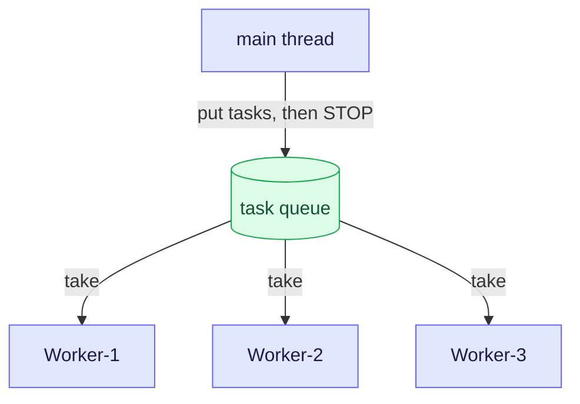

# 10. A thread pool from scratch: workers and a task queue

A thread pool is a fixed group of worker threads that take tasks from a blocking queue. Building one by hand shows exactly what a library pool does, in about 40 lines.

> [!TIP]
> - **The parts:** a `BlockingQueue` of tasks, and N worker threads that loop: `take()` a task, run it, take the next.
> - **The workers are reused.** 3 threads can run any number of tasks, and each task runs exactly once.
> - **Stopping:** put one special `STOP` task per worker on the queue (a poison pill). A worker that takes it leaves its loop.

## How it fits together



`main` only puts tasks on the queue. Whichever worker is free takes the next one. A worker with nothing to do waits inside `take()`, as in the previous chapter.

## Example

A pool of 3 workers runs 10 tasks that each sleep 300 ms.

```java
import java.util.concurrent.ArrayBlockingQueue;
import java.util.concurrent.BlockingQueue;

public class MiniPool {

  static final Runnable STOP = () -> {
  };

  public static void main(String[] args) {
    int queueSize = 10;
    BlockingQueue<Runnable> queue = new ArrayBlockingQueue<>(queueSize);
    int maxThreads = 3;
    Thread[] threads = new Thread[maxThreads];
    for (int i = 0; i < maxThreads; i++) {
      threads[i] = new Thread(() -> {
        while (true) {
          try {
            Runnable task = queue.take();
            if (task == STOP) {
              break;
            }
            task.run();
          } catch (Exception e) {
            System.out.println(e.getMessage());
          }
        }
      });
      threads[i].setName("Worker-" + (i + 1));
      threads[i].start();
    }
    int numberOfTasks = 10;
    for (int i = 0; i < numberOfTasks; i++) {
      int taskId = i;                       // a copy that never changes, so the lambda may use it
      try {
        queue.put(() -> {
          try {
            System.out.println("Task " + taskId + " on " + Thread.currentThread().getName());
            Thread.sleep(300);
          } catch (Exception e) {
            System.out.println(e.getMessage());
          }
        });
      } catch (Exception e) {
        System.out.println(e.getMessage());
      }
    }
    for (int i = 0; i < maxThreads; i++) {
      try {
        queue.put(STOP);
      } catch (Exception e) {
        System.out.println(e.getMessage());
      }
    }
    for (int i = 0; i < maxThreads; i++) {
      try {
        threads[i].join();
      } catch (Exception e) {
        System.out.println(e.getMessage());
      }
    }
    System.out.println("main ends");
  }
}
```

Example output of one run:

```text
Task 2 on Worker-2
Task 0 on Worker-1
Task 1 on Worker-3
Task 3 on Worker-2
Task 4 on Worker-3
Task 5 on Worker-1
Task 6 on Worker-2
Task 7 on Worker-1
Task 8 on Worker-3
Task 9 on Worker-2
main ends
```

Every task runs once on one of the three workers, and `main ends` comes last. Which worker takes which task changes from run to run.

## What each part does

| Part | Job |
|---|---|
| `ArrayBlockingQueue` of capacity 10 | Holds tasks that are waiting. `put` waits if it is full, and `take` waits while it is empty, as in the previous chapter. |
| The worker loop `take`, run, repeat | One thread runs many tasks one after another, so threads are reused. |
| `STOP` | A special task. A worker that takes it compares with `==` and leaves the loop. One is needed per worker, because each worker consumes exactly one. |
| `join` on every worker | `main` waits until all workers have ended before it prints `main ends`. |

> [!WARNING]
> **A lambda can only use local variables that never change.** Using the loop variable `i` inside the task does not compile: `local variables referenced from a lambda expression must be final or effectively final`. `i` changes on every turn of the loop. The fix is `int taskId = i;` inside the loop, a fresh copy per task that the lambda can use.

> [!NOTE]
> **String concatenation runs left to right.** `"Worker-" + i + 1` builds `Worker-01`, `Worker-11` and so on, because `1` is appended as text after `i`. Use `"Worker-" + (i + 1)`.

## Interview questions

<details>
<summary>The pool has 3 workers and only one STOP is put on the queue. What happens?</summary>

Each worker consumes one `STOP` and leaves its loop, so one `STOP` ends only one worker. The other two stay inside `queue.take()` waiting for more tasks, and `join()` on them never returns, so the program hangs. That is why there is one `STOP` per worker.
</details>

<details>
<summary>Tasks are built in a for loop and the compiler says local variables referenced from a lambda expression must be final or effectively final. Why, and how is it fixed?</summary>

The loop variable `i` changes on every turn, and a lambda may only capture variables that are never changed after they are set. Copy it into a new variable inside the loop, `int taskId = i;`, and use that.
</details>

<details>
<summary>10 tasks go to 3 workers. Which worker runs task 5?</summary>

It is not fixed: whichever worker is free takes the next task off the queue, and it differs from run to run. A design must not depend on which worker runs which task.
</details>

## Key takeaways

| Remember | Because |
|---|---|
| A pool is workers plus a blocking queue | Three threads run any number of tasks |
| Workers loop on `take()` | They wait in `take()` when there is no task |
| One `STOP` per worker ends the pool | Each worker consumes exactly one |
| Which worker runs which task is not fixed | Whichever worker is free takes the next task |
| Lambdas capture only unchanging variables | `int taskId = i;` gives each task its own copy |

**Related:** [Concurrency handbook](/notebook/concurrency/overview) · **Previous:** [BlockingQueue](/notebook/concurrency/04-collections-and-queues/09-blocking-queues)
