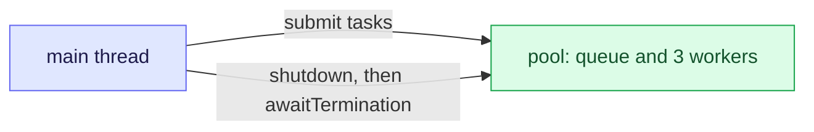

# 11. ExecutorService: a ready-made thread pool

`Executors.newFixedThreadPool(3)` gives you what you built by hand in the previous chapter: a task queue and 3 reusable worker threads. You submit tasks and shut the pool down when you are finished.

> [!TIP]
> - **`pool.submit(task)`** puts a task on the pool's queue. A free worker runs it. The workers are named `pool-1-thread-1`, `pool-1-thread-2` and so on.
> - **Always call `pool.shutdown()`.** Without it the worker threads wait for more tasks forever and the program never ends (it was still running after 5 seconds).
> - **`pool.awaitTermination(10, TimeUnit.SECONDS)`** waits up to 10 seconds for the queued tasks to finish.

## The life of a pool



`main` hands tasks to the pool and never starts a worker itself. `shutdown()` tells the pool to accept no more tasks. Tasks already on the queue still run.

## The experiment

`src/lab/shared/ExecutorDemo.java`, written by you. `ExecutorService` is the pool interface, `Executors` makes pools, and `TimeUnit` is the unit for a timeout, all in `java.util.concurrent`.

```java
import java.util.concurrent.ExecutorService;
import java.util.concurrent.Executors;
import java.util.concurrent.TimeUnit;

public class ExecutorDemo {
  public static void main(String args[]) {
    int maxNumberOfThreads = 3;
    ExecutorService pool = Executors.newFixedThreadPool(maxNumberOfThreads);
    int numberOfTasks = 10;
    for (int i = 0; i < numberOfTasks; i++) {
      int taskId = i;
      pool.submit(() -> {
        System.out.println("Task " + taskId + " on " + Thread.currentThread().getName());
      });
    }
    pool.shutdown();
    try {
      pool.awaitTermination(10, TimeUnit.SECONDS);
    } catch (Exception e) {
      System.out.println("Exception while await termination");
    }
  }
}
```

Two runs *(verified)*:

```text
Task 2 on pool-1-thread-3         Task 0 on pool-1-thread-1
Task 3 on pool-1-thread-3         Task 3 on pool-1-thread-1
Task 4 on pool-1-thread-3         Task 4 on pool-1-thread-1
Task 5 on pool-1-thread-3         Task 5 on pool-1-thread-1
Task 6 on pool-1-thread-3         Task 6 on pool-1-thread-1
Task 7 on pool-1-thread-3         Task 7 on pool-1-thread-1
Task 8 on pool-1-thread-3         Task 8 on pool-1-thread-1
Task 9 on pool-1-thread-3         Task 9 on pool-1-thread-1
Task 1 on pool-1-thread-2         Task 2 on pool-1-thread-3
Task 0 on pool-1-thread-1         Task 1 on pool-1-thread-2
```

The left column is the first run and the right column is the second. In each run one worker ran 8 of the 10 tasks. The tasks only print a line, so they finish almost instantly. A worker that finishes a task takes the next one off the queue before the other workers have even started.

## Longer tasks spread out

I ran a copy where each task also sleeps for 300 ms, as a real task that does work would *(verified in a scratch file)*:

```java
      pool.submit(() -> {
        System.out.println("Task " + taskId + " on " + Thread.currentThread().getName());
        try { Thread.sleep(300); } catch (InterruptedException e) { Thread.currentThread().interrupt(); }
      });
```

One of the two runs, sorted by task number:

```text
Task 0 on pool-1-thread-1
Task 1 on pool-1-thread-2
Task 2 on pool-1-thread-3
Task 3 on pool-1-thread-1
Task 4 on pool-1-thread-2
Task 5 on pool-1-thread-3
Task 6 on pool-1-thread-2
Task 7 on pool-1-thread-1
Task 8 on pool-1-thread-3
Task 9 on pool-1-thread-2
done
```

The workers shared the 10 tasks as 3, 4 and 3 in both runs, because each task kept its worker busy long enough for the others to take the next ones. The `done` line is printed after `awaitTermination` returns.

## Without shutdown()

I ran a copy without `shutdown()` and without `awaitTermination` *(verified in a scratch file)*. It submitted 3 tasks and printed `main ends here`:

```text
main: all tasks submitted, main ends here
Task 1 on pool-1-thread-2
Task 2 on pool-1-thread-3
Task 0 on pool-1-thread-1
exit code: 124 (still running, stopped after 5 seconds)
```

All three tasks finished and `main` had ended, yet the program kept running. The three workers were still alive, waiting on the queue for more tasks.

> [!WARNING]
> **A pool that is never shut down keeps your program alive.** Call `shutdown()` when you are done submitting, then `awaitTermination` if you need to wait for the tasks.

| Call | What it does |
|---|---|
| `Executors.newFixedThreadPool(3)` | Makes a pool with 3 worker threads and a task queue |
| `pool.submit(task)` | Queues the task for a worker |
| `pool.shutdown()` | Accepts no new tasks. Tasks already queued still run. It returns at once. |
| `pool.awaitTermination(10, TimeUnit.SECONDS)` | Waits up to 10 seconds for the queued tasks to finish (documented behaviour, the order of the `done` line was not checked separately) |

## Getting a result back: Callable and Future

A `Runnable` returns nothing. A **`Callable`** is a task that returns a value and may throw a checked exception. When you `submit` a lambda that returns a value, the pool treats it as a `Callable` and gives you a **`Future`**: a handle for a result that is not ready yet. `future.get()` waits until the task has finished and returns its result.

`src/lab/shared/FutureDemo.java`. Three tasks each sleep for 500 ms and return the square of a number. The first version of the file had `Executor.newFixedThreadPool`, which does not exist: the factory methods are in the class `Executors`, with an `s`.

```java
import java.util.ArrayList;
import java.util.List;
import java.util.concurrent.ExecutorService;
import java.util.concurrent.Executors;
import java.util.concurrent.Future;

public class FutureDemo {
  public static void main(String args[]) throws Exception {
    ExecutorService pool = Executors.newFixedThreadPool(3);
    List<Future<Integer>> futures = new ArrayList<>();

    long begin = System.currentTimeMillis();
    for (int i = 1; i <= 3; i++) {
      int n = i;
      // the lambda returns a value, so submit treats it as a Callable and gives back a Future
      Future<Integer> future = pool.submit(() -> {
        Thread.sleep(500);
        return n * n;
      });
      futures.add(future);
    }
    System.out.println("all 3 submitted after " + (System.currentTimeMillis() - begin) + " ms");

    for (Future<Integer> future : futures) {
      int result = future.get();            // waits here until this task has finished
      System.out.println("result " + result + " after " + (System.currentTimeMillis() - begin) + " ms");
    }
    System.out.println("total " + (System.currentTimeMillis() - begin) + " ms");
    pool.shutdown();
  }
}
```

Output of one run *(verified, a second run gave the same shape)*:

```text
all 3 submitted after 1 ms
result 1 after 510 ms
result 4 after 513 ms
result 9 after 513 ms
total 513 ms
```

| Line | What it shows |
|---|---|
| `all 3 submitted after 1 ms` | `submit` returns at once. `main` did not wait for any task. |
| `result 1 after 510 ms` | The first `get()` waited until the first task finished, about 500 ms. |
| `result 4` and `result 9` at 513 ms | Those tasks had already finished, so `get()` returned straight away. |
| `total 513 ms` | The three tasks ran at the same time. One after another they would have taken about 1500 ms. |

> [!WARNING]
> **`get()` blocks the thread that calls it.** Call it only after you have submitted all the work. If you called `get()` right after each `submit`, the tasks would run one after another and you would lose the speed-up.

## When a task throws

`src/lab/shared/FailingTask.java`. Two tasks throw `IllegalStateException("boom")`. The first one's `Future` is ignored, and the second one's `get()` is called inside a `try` that catches `ExecutionException`.

```java
import java.util.concurrent.ExecutionException;
import java.util.concurrent.ExecutorService;
import java.util.concurrent.Executors;
import java.util.concurrent.Future;

public class FailingTask {
  public static void main(String args[]) throws Exception {
    ExecutorService pool = Executors.newFixedThreadPool(1);

    // case 1: the task throws, and we ignore the Future
    pool.submit(() -> {
      throw new IllegalStateException("boom");
    });
    System.out.println("case 1: submitted");

    Thread.sleep(500);                       // give the task time to run and fail

    // case 2: the task throws, and we keep the Future and call get()
    Future<?> future = pool.submit(() -> {
      throw new IllegalStateException("boom");
    });
    try {
      future.get();
      System.out.println("case 2: get() returned normally");
    } catch (ExecutionException e) {
      System.out.println("case 2: get() threw ExecutionException, cause = " + e.getCause());
    }

    pool.shutdown();
  }
}
```

Output, the same in 2 of 2 runs *(verified)*:

```text
case 1: submitted
case 2: get() threw ExecutionException, cause = java.lang.IllegalStateException: boom
```

In case 1 nothing at all was printed about the failure: no stack trace and no error. `submit` catches the exception and stores it inside the `Future`. In case 2, `get()` re-throws it wrapped in an **`ExecutionException`**, and `e.getCause()` is the real exception.

## execute() behaves differently

I ran a scratch copy that uses `pool.execute(...)` instead of `submit(...)` for the same failing task *(verified)*:

```text
Exception in thread "pool-1-thread-1" java.lang.IllegalStateException: boom
	at ExecuteFails.lambda$main$0(ExecuteFails.java:8)
	at java.base/java.util.concurrent.ThreadPoolExecutor.runWorker(ThreadPoolExecutor.java:1136)
	at java.base/java.util.concurrent.ThreadPoolExecutor$Worker.run(ThreadPoolExecutor.java:635)
	at java.base/java.lang.Thread.run(Thread.java:840)
main: still running after execute()
```

`execute` has no `Future`, so the exception reaches the worker thread's uncaught-exception handler and the stack trace is printed, as with a plain `Thread`. `main` carried on.

| Call | Returns | A task that throws |
|---|---|---|
| `pool.submit(task)` | a `Future` | The exception is stored in the `Future`. Nothing is printed unless you call `get()`. |
| `pool.execute(task)` | nothing | The stack trace is printed on the console |

> [!WARNING]
> **A failure inside a `submit` task is silent unless you call `get()`.** If you never look at the `Future`, the work failed and nothing tells you. Either call `get()` and handle `ExecutionException`, or catch exceptions inside the task and log them.

## Interview questions

<details>
<summary>main submits 3 tasks, prints "main ends here" and every task has finished, but the process keeps running. Why?</summary>

The pool was never shut down. Its 3 worker threads stay alive waiting on the queue for more tasks, so the JVM cannot exit. In the experiment the program was still running after 5 seconds. Call `shutdown()` after the last `submit`.
</details>

<details>
<summary>You submit 10 quick tasks to a pool of 3 and one thread ran 8 of them. Is the pool broken?</summary>

No. A worker that finishes a quick task takes the next one before the other workers have started, so one worker can end up with most of them. When each task slept for 300 ms they spread as 3, 4 and 3 in both runs. Do not rely on an even split of short tasks.
</details>

<details>
<summary>What is the difference between shutdown() and awaitTermination()?</summary>

`shutdown()` returns at once and only tells the pool to accept no new tasks. `awaitTermination(10, TimeUnit.SECONDS)` blocks the caller for up to 10 seconds, until the queued tasks have finished or the time runs out. You normally call `shutdown()` first and then `awaitTermination`.
</details>

<details>
<summary>Three tasks each take 500 ms and each returns a value. You submit them all, then call get() on each Future. How long does the whole thing take?</summary>

About 500 ms, not 1500 ms. `submit` returns at once and the three tasks run at the same time on three workers. The first `get()` waits about 500 ms, and the other two results are already there. The experiment printed a total of 513 ms.
</details>

<details>
<summary>What does submit() return when the lambda returns a value, and what does get() do?</summary>

A `Future`, a handle for a result that is not ready yet. `get()` blocks the calling thread until the task has finished and then returns the result. In the experiment the first `get()` waited about 510 ms, and the later ones returned at once.
</details>

<details>
<summary>A task submitted with pool.submit() throws an exception, but nothing appears in the logs and the program carries on. Where did the exception go, and how do you see it?</summary>

`submit` catches it and stores it in the returned `Future`. Calling `get()` re-throws it wrapped in an `ExecutionException`, and `getCause()` returns the real exception. In the experiment the ignored `Future` produced no output at all, while `get()` printed `cause = java.lang.IllegalStateException: boom`.
</details>

<details>
<summary>The same failing task is run with execute() instead of submit(). What is different?</summary>

`execute` returns no `Future`, so the exception reaches the worker thread's uncaught-exception handler and the stack trace is printed to the console as `Exception in thread "pool-1-thread-1" ...`. `main` kept running. With `submit` the same failure was silent.
</details>

## Key takeaways

| Remember | Because |
|---|---|
| A fixed pool is a queue and reusable workers | It is your `MiniPool` as a ready-made class |
| `shutdown()` is not optional | Without it the program was still running after 5 seconds |
| Worker names are `pool-1-thread-N` | They appeared in every run |
| Short tasks do not spread evenly | One worker ran 8 of 10 in both runs |
| `submit` of a value-returning task gives a `Future` | `get()` waits for the result |
| Submit everything first, then call `get()` | Three 500 ms tasks took 513 ms in total, not about 1500 ms |
| `submit` hides a task's exception in the `Future` | Case 1 printed nothing, and `get()` threw `ExecutionException` |
| `execute` prints the stack trace | There is no `Future`, so the worker's handler reports it |

**Related:** [Concurrency handbook](/notebook/concurrency/overview) · **Previous:** [A thread pool from scratch](/notebook/concurrency/05-executors-and-async/10-thread-pool-from-scratch)
