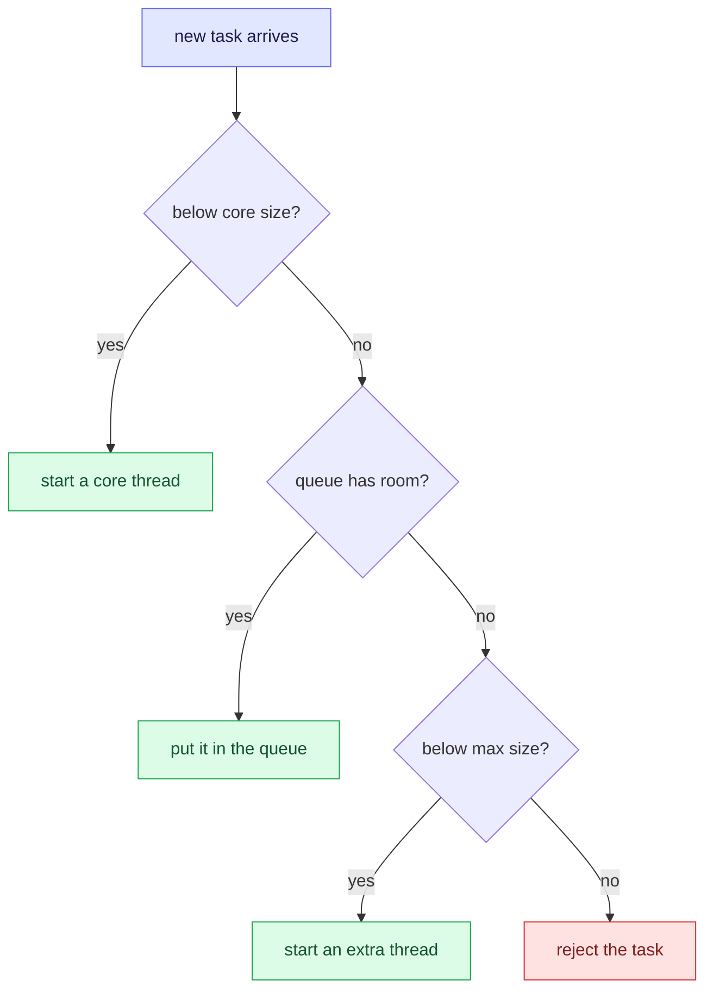

# 12. ThreadPoolExecutor: core threads, queue, max threads and rejection

`ThreadPoolExecutor` is the class behind every pool from `Executors`. Its constructor takes the settings that decide what happens to each new task: run it, queue it, start another thread for it, or reject it. The order of those four steps is a classic interview question.

> [!TIP]
> - **The order for each new task:** (1) fewer than the core number of threads running? Start a new thread. (2) Otherwise, does the queue have room? Queue it. (3) Otherwise, fewer than the maximum number of threads? Start an extra thread. (4) Otherwise, reject it.
> - **The queue comes before the extra threads.** With 2 core threads, 4 maximum and a queue of 2, tasks 4 and 5 start on new threads while tasks 2 and 3 are still waiting in the queue.
> - **`newFixedThreadPool` never grows and never rejects,** because its queue has no limit.

## The decision for every new task



Read it top to bottom for one task. The queue is checked before the pool is allowed to grow past its core size.

## Example

The pool has 2 core threads, at most 4 threads, a keep-alive of 10 seconds, and a queue that holds 2 tasks. Eight tasks that each take 2 seconds are submitted at once.

```java
import java.util.concurrent.ArrayBlockingQueue;
import java.util.concurrent.ThreadPoolExecutor;
import java.util.concurrent.TimeUnit;

public class PoolLimits {

  public static void main(String[] args) {
    ThreadPoolExecutor pool = new ThreadPoolExecutor(2, 4, 10, TimeUnit.SECONDS, new ArrayBlockingQueue<>(2));
    for (int i = 0; i < 8; i++) {
      int taskId = i;
      try {
        pool.submit(() -> {
          try {
            System.err.println("task " + taskId + " started on " + Thread.currentThread().getName());
            Thread.sleep(2000);
          } catch (Exception e) {
            System.err.println(e.getMessage());
          }
        });
      } catch (Exception e) {
        System.err.println("Task " + taskId + " rejected");
      }
    }
    System.err.println("poolSize: " + pool.getPoolSize() + ", queueSize: " + pool.getQueue().size());
    pool.shutdown();
  }
}
```

Example output:

```text
Task 6 rejected
Task 7 rejected
poolSize: 4, queueSize: 2
task 5 started on pool-1-thread-4
task 0 started on pool-1-thread-1
task 1 started on pool-1-thread-2
task 4 started on pool-1-thread-3
task 2 started on pool-1-thread-4
task 3 started on pool-1-thread-2
```

| Tasks | What the pool did | Evidence in the output |
|---|---|---|
| 0 and 1 | Started the 2 core threads | `task 0` on `pool-1-thread-1`, `task 1` on `pool-1-thread-2` |
| 2 and 3 | Put them in the queue, which holds 2 | `queueSize: 2` right after the loop. They started later, on whichever thread freed up first. |
| 4 and 5 | The queue was full, so it started extra threads | `task 4` on `pool-1-thread-3` and `task 5` on `pool-1-thread-4`, started at once. `poolSize: 4`. |
| 6 and 7 | Both limits were reached, so it rejected them | `Task 6 rejected`, `Task 7 rejected` |

Tasks 4 and 5 were submitted after tasks 2 and 3, yet they start first. The queued tasks wait about 2 seconds for a thread to free up.

## The same order in the JDK source

`ThreadPoolExecutor.execute` in the JDK 17 source, comments removed:

```java
public void execute(Runnable command) {
    if (command == null)
        throw new NullPointerException();
    int c = ctl.get();
    if (workerCountOf(c) < corePoolSize) {
        if (addWorker(command, true))        // 1. below core size: new core thread
            return;
        c = ctl.get();
    }
    if (isRunning(c) && workQueue.offer(command)) {   // 2. queue has room: queue it
        int recheck = ctl.get();
        if (! isRunning(recheck) && remove(command))
            reject(command);
        else if (workerCountOf(recheck) == 0)
            addWorker(null, false);
    }
    else if (!addWorker(command, false))     // 3. below max size: extra thread, otherwise...
        reject(command);                     // 4. reject
}
```

`submit` ends up in `execute`. The queue's `offer` is tried before `addWorker(command, false)`, which is the call that creates a thread above the core size.

## The ready-made pools

Also from the JDK source:

```java
public static ExecutorService newFixedThreadPool(int nThreads) {
    return new ThreadPoolExecutor(nThreads, nThreads,
                                  0L, TimeUnit.MILLISECONDS,
                                  new LinkedBlockingQueue<Runnable>());
}

public static ExecutorService newCachedThreadPool() {
    return new ThreadPoolExecutor(0, Integer.MAX_VALUE,
                                  60L, TimeUnit.SECONDS,
                                  new SynchronousQueue<Runnable>());
}
```

| Pool | Core and max threads | Queue | What it means |
|---|---|---|---|
| `newFixedThreadPool(n)` | n and n | `LinkedBlockingQueue` with no capacity given | Never grows past n. The queue has no practical limit, so it never fills and nothing is rejected: tasks pile up. |
| `newCachedThreadPool()` | 0 and `Integer.MAX_VALUE` | `SynchronousQueue`, which holds no tasks | A task that finds no idle thread gets a new thread, so under heavy load the number of threads is not capped. |

> [!WARNING]
> **A pool with an unbounded queue hides overload.** The fixed pool accepts every task and queues it, so a flood of work grows memory instead of failing fast. Build a `ThreadPoolExecutor` with a bounded queue when a limit is wanted, and a decision about what to do when it is reached.

Other settings of the constructor:

| Setting | Meaning |
|---|---|
| keep-alive time (10 seconds above) | How long a thread above the core size may sit idle before it is removed |
| Rejection policy | The default throws `RejectedExecutionException`. `CallerRunsPolicy`, `DiscardPolicy` and `DiscardOldestPolicy` are the alternatives. |

## Interview questions

<details>
<summary>A pool has 2 core threads, a maximum of 4 and a queue of 2. Eight tasks that each take 2 seconds are submitted. Which run now, which wait, which are rejected?</summary>

Tasks 0 and 1 run on the core threads. Tasks 2 and 3 go into the queue. Tasks 4 and 5 start on two extra threads, because the queue is full and the pool is below its maximum of 4. Tasks 6 and 7 are rejected. Right after the loop `poolSize` is 4 and `queueSize` is 2.
</details>

<details>
<summary>Tasks 4 and 5 were submitted after tasks 2 and 3, yet they started first. Why?</summary>

The pool tries the queue before it creates a thread above the core size. In `execute`, `workQueue.offer(command)` comes first and `addWorker(command, false)` only runs when the queue is full. Tasks 2 and 3 filled the queue, so tasks 4 and 5 got new threads and started at once, while 2 and 3 waited for a thread to free up.
</details>

<details>
<summary>A service uses Executors.newFixedThreadPool(10) and under a traffic spike its memory climbs until it fails. What is the likely cause and the change?</summary>

The fixed pool is built on a `LinkedBlockingQueue` with no capacity, so every extra task waits in the queue and the pool never rejects anything. Build a `ThreadPoolExecutor` with a bounded queue and a rejection policy, so overload fails fast or slows the caller.
</details>

## Key takeaways

| Remember | Because |
|---|---|
| Core threads, then the queue, then extra threads, then rejection | The source of `execute` tries `addWorker`, then `offer`, then `addWorker` again, then `reject` |
| The queue is used before the pool grows | Tasks 4 and 5 start on new threads while 2 and 3 wait in the queue |
| 2 core, 4 max and a queue of 2 hold 6 tasks | The 7th and 8th are rejected |
| `newFixedThreadPool` has an unbounded queue | It is built with `new LinkedBlockingQueue<Runnable>()` |
| `newCachedThreadPool` has no thread limit | Its maximum is `Integer.MAX_VALUE` |

**Related:** [Concurrency handbook](/notebook/concurrency/overview) · **Previous:** [ExecutorService](/notebook/concurrency/05-executors-and-async/11-executor-service)
