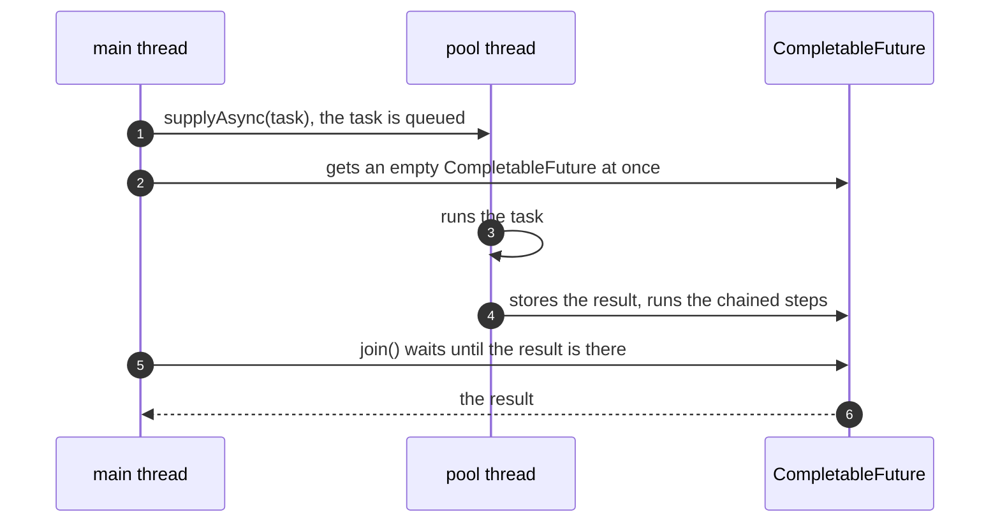

# 17. CompletableFuture: chain async steps instead of blocking on each

A `CompletableFuture` is a `Future` that accepts follow-up steps. `supplyAsync` starts a task on a pool thread and returns at once with an empty result holder. `thenApply`, `thenCombine` and `exceptionally` describe what happens when the result arrives, and `join()` waits for it.

> [!TIP]
> - **`supplyAsync(task)`** runs the task on a pool thread (by default the shared `ForkJoinPool.commonPool()`) and returns a `CompletableFuture` immediately.
> - **Chain steps with `thenApply`** (transform the result), **`thenCombine`** (merge two independent futures) and **`exceptionally`** (turn a failure into a value). Each step runs when its input is ready, and no thread waits in between.
> - **`join()` blocks** until the result is there, like `Future.get()` but with unchecked exceptions. Only the last call in a chain needs to block, and a service can skip it by returning the future.

## What happens, step by step



`supplyAsync` returns before the task has run, so the calling thread is free to start more tasks. The empty `CompletableFuture` is filled by the pool thread when the task ends.

## Run in the background, then join

`supplyAsync` takes a `Supplier`, a lambda that returns a value and cannot throw checked exceptions. That is why the sleep is wrapped in a small helper.

```java
import java.util.concurrent.CompletableFuture;

public class CfDemo {

  static void pause(long ms) {
    try {
      Thread.sleep(ms);
    } catch (InterruptedException e) {
    }
  }

  public static void main(String[] args) throws Exception {
    long begin = System.currentTimeMillis();
    CompletableFuture<Integer> price = CompletableFuture.supplyAsync(() -> {
      System.out.println("price runs on " + Thread.currentThread().getName());
      pause(500);
      return 100;
    });
    System.out.println("main continues after " + (System.currentTimeMillis() - begin) + " ms");
    int result = price.join();
    System.out.println("price = " + result + " after " + (System.currentTimeMillis() - begin) + " ms");
  }
}
```

Example output:

```text
main continues after 2 ms
price runs on ForkJoinPool.commonPool-worker-1
price = 100 after 541 ms
```

The caller continues after a few milliseconds, the task runs on a `commonPool` worker, and `join()` returns when the task finishes. The first two lines can swap places.

## Chain steps: thenApply

`thenApply(fn)` runs `fn` on the result when it is ready and returns a new `CompletableFuture` for the transformed value.

```java
CompletableFuture<String> label = CompletableFuture
    .supplyAsync(() -> { pause(300); return 100; })
    .thenApply(p -> p * 2)
    .thenApply(p -> "total: " + p);
System.out.println(label.join());
```

Output:

```text
total: 200
```

The caller does not wait between the steps. It describes the plan and waits once, at `label.join()`.

## Two tasks in parallel: thenCombine

`a.thenCombine(b, fn)` waits for two independent futures and calls `fn(resultA, resultB)`.

```java
long begin = System.currentTimeMillis();
CompletableFuture<Integer> a = CompletableFuture.supplyAsync(() -> { pause(500); return 100; });
CompletableFuture<Integer> b = CompletableFuture.supplyAsync(() -> { pause(500); return 18; });
CompletableFuture<Integer> total = a.thenCombine(b, (x, y) -> x + y);
System.out.println("total = " + total.join() + " after " + (System.currentTimeMillis() - begin) + " ms");
```

Output:

```text
total = 118 after 515 ms
```

Both tasks sleep 500 ms and run at the same time, so the total is about 500 ms and not 1000 ms. For more than two futures, `CompletableFuture.allOf(a, b, c)` returns a future that completes when all of them have.

## A failing task: exceptionally

```java
CompletableFuture<Integer> broken = CompletableFuture.supplyAsync(() -> {
  throw new IllegalStateException("boom");
});
int safe = broken.exceptionally(e -> {
  System.out.println("handler got: " + e);
  return -1;
}).join();
System.out.println("safe = " + safe);
```

Output:

```text
handler got: java.util.concurrent.CompletionException: java.lang.IllegalStateException: boom
safe = -1
```

An exception thrown inside a stage is stored in the future, wrapped in a **`CompletionException`**. `exceptionally` receives that wrapper and returns a replacement value. Without a handler, `join()` throws the same `CompletionException`. `get()` throws a checked `ExecutionException` instead.

## The main calls

| Call | What it does |
|---|---|
| `supplyAsync(supplier)` | Runs a task that returns a value on a pool thread |
| `runAsync(runnable)` | The same for a task that returns nothing |
| `supplyAsync(supplier, executor)` | Runs the task on a chosen pool instead of the default one |
| `thenApply(fn)` | Transforms the result when it is ready |
| `thenCombine(other, fn)` | Merges two independent futures |
| `allOf(f1, f2, ...)` | Completes when every future has completed |
| `exceptionally(fn)` | Replaces a failure with a value |
| `join()` | Waits for the result, throws an unchecked `CompletionException` on failure |
| `get()` | Waits for the result, throws a checked `ExecutionException` on failure |

## What it gives over a plain Future

| | `Future` | `CompletableFuture` |
|---|---|---|
| Run a task in the background | Yes, with `pool.submit` | Yes, with `supplyAsync` |
| Do something when the result is ready | No: call `get()` and wait | Yes: `thenApply`, `thenAccept` and others register the step |
| Merge two results | Wait on both with `get()`, then merge | `thenCombine` |
| Handle a failure inside the chain | `try/catch` around `get()` | `exceptionally` |
| Choose the pool | The pool that made the `Future` | `supplyAsync(task, executor)` |

The speed-up from running independent calls at the same time is the same with plain futures. The gain is composition: steps run when their input is ready, without a thread waiting in the middle.

## The default pool and its limit

Without an executor argument, tasks run on `ForkJoinPool.commonPool()`, a shared pool of about CPU count minus 1 threads. With 6 CPUs it has 5 threads. Twelve tasks that each sleep 500 ms:

```text
task 1 to 5   finished at about 520 ms    (worker-1 to worker-5)
task 6 to 10  finished at about 1040 ms   (the same 5 workers again)
task 11, 12   finished at about 1545 ms
```

When more tasks arrive than there are threads, the extra tasks wait in a queue without a size limit. Nothing is rejected and nothing fails: the tasks start later. On a machine where the common pool would have 1 thread or fewer, `CompletableFuture` starts a new thread for every task instead.

The shared pool can be resized with the JVM flag `-Djava.util.concurrent.ForkJoinPool.common.parallelism=N`. For blocking work such as HTTP or database calls, a pool of the right size passed as the second argument is the better choice:

```java
ExecutorService ioPool = Executors.newFixedThreadPool(20);
CompletableFuture<String> user = CompletableFuture.supplyAsync(() -> userClient.fetch(id), ioPool);
```

## How it works inside

From the JDK 17 source:

| Part | What happens |
|---|---|
| Fields | `result` is null until the future completes. `stack` holds the actions waiting for the result. |
| `supplyAsync` | Creates an empty `CompletableFuture`, submits an `AsyncSupply` task to the executor and returns the future |
| The pool thread | Runs the supplier, stores the result, then `postComplete()` runs the waiting actions |
| `thenApply` | If `result` is already set, the function runs at once in the calling thread. Otherwise it is pushed on `stack` and the new future is returned. |
| `join()` | Pushes a waiter holding the current thread on `stack` and parks the thread with `LockSupport.park`. Completion wakes it. |

A chained step therefore runs on the thread that completed the previous stage, or on the caller if that stage had already completed. The `...Async` variants such as `thenApplyAsync` run the step on a pool thread instead.

## Where it is used

| Use | Example |
|---|---|
| Parallel calls | An endpoint calls the user, order and price services at the same time and merges the answers |
| Background work | Sending an email or writing an audit record without making the request wait |
| Spring | `@Async` methods can return a `CompletableFuture`, and controllers can return one so the request thread is released |
| Async clients | `HttpClient.sendAsync` returns a `CompletableFuture` |

## Pitfalls

> [!WARNING]
> **A shared pool plus blocking calls stalls everything.** Slow HTTP or database calls can occupy all the threads of the common pool, and every other `CompletableFuture`, parallel stream and ForkJoin job in the application waits behind them. Pass a dedicated executor for blocking work.

> [!WARNING]
> **A failure in a fire-and-forget task is silent.** If nobody calls `join()` and no `exceptionally` is attached, the exception stays inside the future and nothing is printed. Attach a handler that records the failure for a retry. A task that is still running when the application restarts is lost, so work that must not be lost needs to be saved first, for example in an outbox table.

> [!WARNING]
> **Pool threads are daemon threads.** If `main` ends while a task is still running and nobody joins it, the JVM exits and the task is cut off: its output never appears.

## Interview questions

<details>
<summary>An endpoint needs data from three services, 300 ms each. How long does it take sequentially, and with CompletableFuture?</summary>

About 900 ms sequentially. With three `supplyAsync` calls combined by `thenCombine` or `allOf`, the calls overlap and the request waits about as long as the slowest call, around 300 ms. The request thread still blocks once at `join()`, but for the slowest call and not for the sum.
</details>

<details>
<summary>Does calling join() on the request thread cancel the advantage of CompletableFuture?</summary>

No. The advantage is that the independent calls run at the same time, and that holds even if the caller blocks once at the end. What `join()` does not do is free the request thread while it waits. To free it, return the `CompletableFuture` from the controller instead of joining, and the framework completes the response when the future completes.
</details>

<details>
<summary>An application runs 100 blocking HTTP calls with supplyAsync and everything else that uses CompletableFuture gets slow. Why, and what is the change?</summary>

The default executor is the shared common pool, which has about CPU count minus 1 threads. The blocking calls occupy all of them, so every other task waits in the unbounded queue. Pass a dedicated, bounded executor as the second argument of `supplyAsync` for blocking work.
</details>

<details>
<summary>A task sent with runAsync to send an email throws an exception. The log shows nothing. Where did the error go?</summary>

The exception is stored in the returned future, and nobody asked for it. Attach `exceptionally` or `whenComplete` to log it or save the email for a scheduled retry. Without that, the failure is silent.
</details>

<details>
<summary>What is the difference between join() and get()?</summary>

Both wait for the result. `get()` throws checked exceptions (`ExecutionException`, `InterruptedException`). `join()` throws an unchecked `CompletionException`, which is why it is easier to use inside lambdas and chains. In both cases the original exception is the cause.
</details>

<details>
<summary>A program calls supplyAsync, prints "main ends" and exits, and the task's output never appears. Why?</summary>

The default pool uses daemon threads. When `main` ends and no non-daemon thread is left, the JVM exits and the running task is cut off. Join the future, or use an executor whose threads keep the application alive.
</details>

## Key takeaways

| Remember | Because |
|---|---|
| `supplyAsync` returns at once | The task runs on a pool thread and fills the future later |
| `thenApply` and `thenCombine` register steps | They run when the input is ready, with no thread waiting in between |
| `join()` is the blocking call | Only the last call in a chain needs it |
| The default pool is small and shared | About CPU count minus 1 threads, with an unbounded queue |
| Use an executor for blocking work | A slow call in the common pool delays every other user of it |
| Errors are stored, not thrown | `exceptionally` handles them, and `join()` rethrows them as `CompletionException` |

**Related:** [Concurrency handbook](/notebook/concurrency/overview) · **Previous:** [ReadWriteLock](/notebook/concurrency/03-coordination/16-readwritelock)
