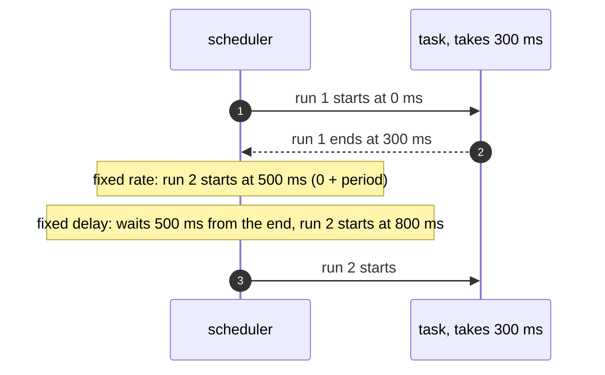

# 20. ScheduledExecutorService: run a task later or repeatedly

A `ScheduledExecutorService` is a thread pool that starts tasks after a delay or on a repeating schedule, like a cron job inside the program. It is the plain-Java version of what Spring's `@Scheduled` does.

> [!TIP]
> - **Three calls:** `schedule` runs a task once after a delay. `scheduleAtFixedRate` repeats it with a fixed **start-to-start** period. `scheduleWithFixedDelay` repeats it with a fixed pause between the **end** of one run and the start of the next.
> - **Runs of one task never overlap.** A run that takes longer than the period makes the next run start late, as soon as it ends.
> - **A periodic task that throws is silently stopped.** Catch exceptions inside the task. Also call `shutdown()`, or the JVM never exits.

## Fixed rate and fixed delay



With a 300 ms task and a 500 ms interval, fixed rate starts a run every 500 ms, and fixed delay starts one every 800 ms. Fixed rate fixes the rhythm of the starts, and fixed delay fixes the rest between runs.

## Example

`Executors.newScheduledThreadPool(2)` makes a pool with 2 threads. Each call returns a `ScheduledFuture`, a `Future` that can also cancel future runs with `cancel(false)`. The `begin` clock keeps running across the four parts, so the gaps between lines are what matter.

```java
import java.util.concurrent.Executors;
import java.util.concurrent.ScheduledExecutorService;
import java.util.concurrent.ScheduledFuture;
import java.util.concurrent.TimeUnit;

public class SchedDemo {

  static void pause(long ms) {
    try {
      Thread.sleep(ms);
    } catch (InterruptedException e) {
    }
  }

  public static void main(String[] args) throws Exception {
    ScheduledExecutorService scheduler = Executors.newScheduledThreadPool(2);
    long begin = System.currentTimeMillis();

    System.out.println("part 1: run once after a delay");
    scheduler.schedule(() -> System.out.println("one-shot ran at " + (System.currentTimeMillis() - begin) + " ms"), 1, TimeUnit.SECONDS);
    Thread.sleep(1200);

    System.out.println("part 2: fixed rate");
    ScheduledFuture<?> rate = scheduler.scheduleAtFixedRate(() -> {
      System.out.println("rate run started at " + (System.currentTimeMillis() - begin) + " ms");
      pause(300);
    }, 0, 500, TimeUnit.MILLISECONDS);
    Thread.sleep(2200);
    rate.cancel(false);

    System.out.println("part 3: fixed delay");
    ScheduledFuture<?> delay = scheduler.scheduleWithFixedDelay(() -> {
      System.out.println("delay run started at " + (System.currentTimeMillis() - begin) + " ms");
      pause(300);
    }, 0, 500, TimeUnit.MILLISECONDS);
    Thread.sleep(2200);
    delay.cancel(false);

    System.out.println("part 4: a task that throws");
    ScheduledFuture<?> failing = scheduler.scheduleAtFixedRate(() -> {
      System.out.println("failing task ran at " + (System.currentTimeMillis() - begin) + " ms");
      throw new IllegalStateException("boom");
    }, 0, 300, TimeUnit.MILLISECONDS);
    Thread.sleep(1000);
    System.out.println("failing task done = " + failing.isDone());

    scheduler.shutdown();
  }
}
```

Example output:

```text
part 1: run once after a delay
one-shot ran at 1010 ms
part 2: fixed rate
rate run started at 1215 ms
rate run started at 1716 ms
rate run started at 2230 ms
rate run started at 2730 ms
rate run started at 3230 ms
part 3: fixed delay
delay run started at 3418 ms
delay run started at 4244 ms
delay run started at 5070 ms
part 4: a task that throws
failing task ran at 5630 ms
failing task done = true
```

| Part | What the output shows |
|---|---|
| 1 | The one-shot task ran after about 1 second |
| 2 | Fixed rate: starts about 500 ms apart, although each run takes 300 ms |
| 3 | Fixed delay: starts about 825 ms apart, which is the 300 ms run plus the 500 ms pause |
| 4 | The failing task ran once and never again. No stack trace was printed, and the future reports itself as done. |

## No overlap, even when a run is slow

A periodic task never runs concurrently with its own previous run. With a fixed rate of 500 ms and a task that takes 800 ms, in a pool of 4 threads:

```text
slow run started at 3 ms,    ended at 819 ms
slow run started at 832 ms,  ended at 1645 ms
slow run started at 1645 ms, ended at 2454 ms
slow run started at 2456 ms, ended at 3266 ms
```

Each run starts only after the previous one has ended, although the pool had spare threads. The period was missed, so the starts are late. Two different scheduled tasks can still run at the same time on different pool threads. With a pool of 1 thread they queue behind each other.

## Fixed rate versus fixed delay

| | `scheduleAtFixedRate` | `scheduleWithFixedDelay` |
|---|---|---|
| The interval is counted | From the start of one run to the start of the next | From the end of one run to the start of the next |
| Task shorter than the interval | Starts exactly one period after the previous start | Starts the pause after the previous end, so the starts drift apart by the run time |
| Task longer than the interval | The next run starts late, as soon as the previous one ends | The next run starts the pause after the end |
| Use it for | A steady rhythm: a heartbeat, a metrics sample every 10 s | Work where a rest between runs matters: polling, cleanup, retries |

Spring's `@Scheduled(fixedRate = ...)` and `@Scheduled(fixedDelay = ...)` mirror these two calls.

## The main calls

| Call | What it does |
|---|---|
| `schedule(task, 1, TimeUnit.SECONDS)` | Runs the task once after the delay |
| `scheduleAtFixedRate(task, initialDelay, period, unit)` | Repeats with a fixed start-to-start period |
| `scheduleWithFixedDelay(task, initialDelay, delay, unit)` | Repeats with a fixed pause after each run ends |
| `future.cancel(false)` | Stops future runs, and lets a run that is in progress finish |
| `future.cancel(true)` | Also interrupts a run that is in progress (see the interrupts chapter) |
| `scheduler.shutdown()` | Cancels periodic tasks. One-shot delayed tasks that are still pending are run first. |

## Pitfalls

> [!WARNING]
> **A periodic task that throws is never run again, and nothing is printed.** The exception is stored in the `ScheduledFuture`, the future becomes done, and the schedule stops. Catch exceptions inside the task body, log them, and let the next run try again.

```java
scheduler.scheduleWithFixedDelay(() -> {
  try {
    refreshCache();
  } catch (Exception e) {
    log.warn("refresh failed, will retry on the next run", e);
  }
}, 0, 30, TimeUnit.SECONDS);
```

> [!WARNING]
> **Shut the scheduler down.** The pool's threads are not daemon threads, so a `main` that returns while the scheduler is alive leaves the JVM running forever. Call `scheduler.shutdown()` when the work is done.

> [!NOTE]
> **Size the pool for the slowest task.** A scheduler with 1 thread runs every task one after another, so one slow task delays all the others. Use a pool large enough for the tasks that can run at the same time.

## Where it is used

| Use | Example |
|---|---|
| Periodic refresh | Reload a cache or configuration every 30 seconds |
| Heartbeat or polling | Send a heartbeat every 5 seconds, or poll a queue or a table for new work |
| Retry later | A failed email is saved, and a scheduled job retries it on its next run |
| Timeouts | Schedule a cancel for a task that runs too long |

## Interview questions

<details>
<summary>A job runs every 10 seconds and takes 3 seconds. Does scheduleAtFixedRate(job, 0, 10, SECONDS) start runs 10 seconds apart, or 13?</summary>

10 seconds apart. Fixed rate counts from the start of one run to the start of the next, so the run finishes after 3 seconds and the scheduler waits 7 more. With `scheduleWithFixedDelay` the starts would be 13 seconds apart, because the 10-second pause begins when the run ends.
</details>

<details>
<summary>A fixed-rate job with a 1-second period sometimes takes 2 seconds. Do two runs overlap?</summary>

No. Runs of the same periodic task never execute concurrently. The slow run delays the next one, which starts as soon as the slow run has ended. A faster pool does not change that. If overlapping is wanted, the work has to be handed to a separate executor from inside the task.
</details>

<details>
<summary>A scheduled cache refresh worked for days and then silently stopped refreshing, with nothing in the logs. What happened?</summary>

One run threw an exception. The exception is stored in the `ScheduledFuture`, and a periodic task that throws is not run again, with no stack trace printed. Wrap the task body in `try/catch`, log the failure and let the next run try again.
</details>

<details>
<summary>A program schedules a task, main returns, and the JVM never exits. Why?</summary>

The pool's worker threads are not daemon threads and stay alive waiting for work. Call `shutdown()`. By default it cancels periodic tasks and runs pending one-shot delayed tasks before the pool terminates.
</details>

<details>
<summary>What is the difference between cancel(false) and cancel(true) on a ScheduledFuture?</summary>

Both stop future runs. `cancel(false)` lets a run that is already in progress finish. `cancel(true)` also interrupts the thread running it, so the task has to check the interrupt flag or handle `InterruptedException` to stop early.
</details>

## Key takeaways

| Remember | Because |
|---|---|
| `schedule` runs once, the other two repeat | The pool starts tasks after a delay or on a schedule |
| Fixed rate is start-to-start, fixed delay is end-to-start | A 300 ms task with a 500 ms interval gives starts 500 ms apart, or 800 ms apart |
| A periodic task never overlaps itself | A slow run makes the next one start late |
| A throwing periodic task stops silently | The exception is stored in the future and nothing is printed |
| Catch exceptions inside the task | It is the only way the schedule survives a failure |
| Call `shutdown()` | The worker threads keep the JVM alive |

**Related:** [Concurrency handbook](/notebook/concurrency/overview) · **Previous:** [Interrupts](/notebook/concurrency/01-foundations/19-interrupts)
