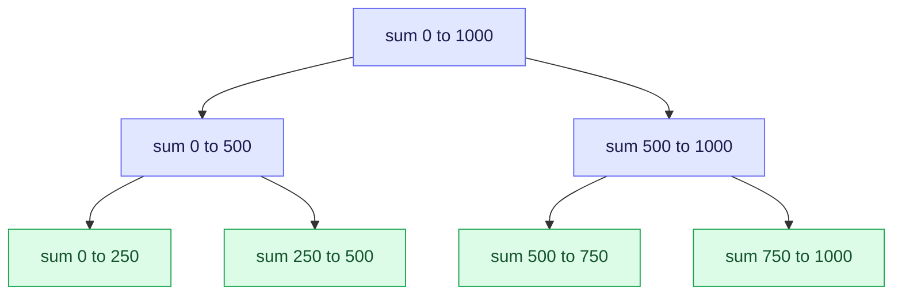

# 18. ForkJoin: split a big job, run the pieces on all cores, add the answers

A `ForkJoinPool` runs tasks that split themselves into smaller tasks. A big CPU-bound job is cut in halves until the pieces are small, the small pieces run in parallel on all cores, and their answers are combined on the way back.

> [!TIP]
> - **`fork()`** starts a subtask in the pool without waiting. **`join()`** waits for its result. **`compute()`** is where a task either splits itself or does a small piece directly.
> - **`RecursiveTask<V>`** returns a value. **`RecursiveAction`** returns nothing. A task is started with `pool.invoke(task)`.
> - **It fits CPU-bound divide and conquer:** sums, merge sort, independent subtrees. It does not fit work that waits on I/O, tiny inputs, or pieces that depend on each other.

## How a task splits



With a threshold of 250, a range larger than the threshold is split in two, and a range at or below it is added up directly (the green pieces). The four green pieces can run on four cores at the same time, and their sums are added back up the tree.

## Example: summing a billion numbers

`SumTask` adds the numbers from `from` (included) to `to` (excluded). The `main` method compares a plain loop with the fork/join version.

```java
import java.util.concurrent.ForkJoinPool;
import java.util.concurrent.RecursiveTask;
import java.util.concurrent.atomic.AtomicInteger;

public class FjDemo {

  public static void main(String[] args) throws Exception {
    long n = 1_000_000_000L;
    long begin = System.currentTimeMillis();
    long sum = 0;
    for (long i = 0; i < n; i++) {
      sum += i;
    }
    System.out.println("loop: " + sum + " in " + (System.currentTimeMillis() - begin) + " ms");

    begin = System.currentTimeMillis();
    long fj = new ForkJoinPool().invoke(new SumTask(0, n));
    System.out.println("fork/join: " + fj + " in " + (System.currentTimeMillis() - begin) + " ms");
    System.out.println("pieces: " + SumTask.leaves.get());
  }
}

class SumTask extends RecursiveTask<Long> {

  static final int THRESHOLD = 1_000_000;
  static final AtomicInteger leaves = new AtomicInteger();   // counts the small pieces
  final long from, to;

  SumTask(long from, long to) {
    this.from = from;
    this.to = to;
  }

  protected Long compute() {
    if (to - from <= THRESHOLD) {          // small enough: add them up here
      leaves.incrementAndGet();
      long sum = 0;
      for (long i = from; i < to; i++) {
        sum += i;
      }
      return sum;
    }
    long mid = (from + to) / 2;            // too big: split in two
    SumTask left = new SumTask(from, mid);
    SumTask right = new SumTask(mid, to);
    left.fork();                           // the left half runs in the pool
    long rightSum = right.compute();       // this thread does the right half itself
    return left.join() + rightSum;         // then waits for the left half
  }
}
```

Example output on a machine with 6 CPUs:

```text
loop: 499999999500000000 in 361 ms
fork/join: 499999999500000000 in 87 ms
pieces: 1024
```

Both give the same sum. Fork/join took about a quarter of the time of the single loop. The timings vary between runs and machines. The 1024 pieces come from halving 1 billion ten times, until each piece is under the threshold of 1 million.

## What each part does

| Part | Job |
|---|---|
| `compute()` | The task's work: return the answer directly when the piece is small, otherwise split |
| `left.fork()` | Hands the subtask to the pool and returns at once |
| `right.compute()` | Runs the other subtask in the current thread |
| `left.join()` | Waits for the forked subtask and returns its result |
| `pool.invoke(task)` | Runs the top-level task in the pool and returns its result |
| `THRESHOLD` | The size at which a piece is computed directly instead of split |

## Why one half is computed in the current thread

After `left.fork()`, the current thread has nothing to do but wait. Calling `right.compute()` keeps it working on the other half while a pool thread takes the left half. Forking both halves and then joining both would leave the current thread idle and queue one more task for no gain. The usual pattern is: fork one subtask, compute the other, then join the forked one.

## RecursiveTask and RecursiveAction

```java
class SumTask  extends RecursiveTask<Long> { protected Long compute() { ... return sum; } }
class FillTask extends RecursiveAction     { protected void compute() { ... } }
```

The type in `RecursiveTask<V>` is whatever the task returns: `Integer`, `String`, `List<String>`. It is `Long` and not `long` because generics cannot use primitive types. `RecursiveAction` is for tasks with no result, for example one that changes an array in place, and its `join()` only waits. Both extend `ForkJoinTask`, which is the type the pool runs. They are called recursive because `compute()` creates smaller tasks of its own kind.

## The threshold

| Threshold | Effect |
|---|---|
| Too small | Many tiny tasks. Creating and queuing each one costs more than adding a few numbers, so the job can get slower than the plain loop. |
| Too large | Too few pieces to spread over the cores, so some cores sit idle |

With 1 billion numbers and a threshold of 1 million there are 1024 pieces, plenty for a 6-core machine. The right value depends on the work per element, so it is tuned by measuring.

## The pool and work stealing

| Pool | Size |
|---|---|
| `new ForkJoinPool()` | One thread per CPU |
| `ForkJoinPool.commonPool()` | CPU count minus 1 threads (5 on a 6-CPU machine), shared by the whole JVM |

Each worker thread has its own queue of forked tasks. A worker that runs out of work takes tasks from another worker's queue. This is **work stealing**, and it balances the load when some pieces take longer than others.

The common pool is also the pool behind `list.parallelStream()`, `Arrays.parallelSort` and the default executor of `CompletableFuture`.

## Where it fits

| Problem | Fits? | Why |
|---|---|---|
| Sum, max or count over a big array | Yes | Each half is independent and combining is cheap |
| Merge sort, quick sort | Yes | Each half sorts on its own, then the halves are merged. `Arrays.parallelSort` does this. |
| DFS over a big tree, for example folder sizes | Yes, if the subtrees are independent | Each subtree becomes a task |
| Image processing, matrix multiplication | Yes | Split by rows or blocks |
| Binary search | No | Each step discards one half, so there are no two halves to run in parallel |
| BFS, or graph search with a shared visited set | Awkward | The threads contend for the shared set, which needs locks |
| Work that waits on I/O (HTTP, database) | No | The pool has about one thread per CPU, and waiting threads waste them |
| Small inputs | No | The cost of splitting is larger than the gain |

## Pitfalls

> [!WARNING]
> **Do not block inside ForkJoin tasks.** The pool is sized for CPU work. Tasks that wait on a network or database call hold their thread without using the CPU, and everything else on the same pool, including parallel streams and `CompletableFuture` tasks, queues behind them.

> [!WARNING]
> **Pieces must be independent.** Tasks that write to shared mutable state need locks or atomics, and the contention cancels the speed-up. Let each piece return its own result and combine the results in `join()`.

## Interview questions

<details>
<summary>Why does compute() fork one half and compute the other itself, instead of forking both?</summary>

After forking, the current thread would only wait for the results. Computing one half itself keeps that thread busy while a pool thread takes the other half, and it creates one task fewer. The forked half is joined last.
</details>

<details>
<summary>Can binary search on a sorted array be sped up with ForkJoin?</summary>

No. Each step throws away one half of the range, so there are never two halves to search in parallel, and the work is only about log n steps. Fork/join fits problems where both halves must be processed, such as summing, counting or sorting.
</details>

<details>
<summary>A sum over 1 billion numbers uses a threshold of 1. What happens?</summary>

The task splits all the way down to single numbers, so it creates about as many tasks as there are numbers. Creating, queueing and joining each task costs far more than adding one number, so the job runs slower than a plain loop and uses a lot of memory. The threshold must be large enough that a piece does real work.
</details>

<details>
<summary>What is the difference between RecursiveTask and RecursiveAction?</summary>

`RecursiveTask<V>` returns a value of type `V` from `compute()` and `join()`. `RecursiveAction` returns nothing, and `join()` only waits. Use the action for in-place work, such as filling or sorting an array range.
</details>

<details>
<summary>What is work stealing, and what problem does it solve?</summary>

Each worker thread keeps its own queue of forked tasks. When a worker's queue is empty, it takes a task from another worker's queue. Pieces rarely take equal time, so without stealing some threads would finish early and sit idle while others still had work.
</details>

<details>
<summary>A service uses list.parallelStream() for a heavy computation, and under load unrelated CompletableFuture calls get slow. Why?</summary>

Parallel streams run on the common ForkJoin pool, which is also the default executor of `CompletableFuture`. It has about CPU count minus 1 threads, so a heavy stream occupies them and other tasks queue behind it. Run heavy or blocking work on a dedicated executor instead.
</details>

## Key takeaways

| Remember | Because |
|---|---|
| Fork/join is divide and conquer on all cores | A big job is halved until the pieces are small, and the answers are added back |
| Fork one half, compute the other, then join | The current thread stays busy instead of waiting |
| `RecursiveTask` returns a value, `RecursiveAction` does not | The type parameter is the result type |
| The threshold balances overhead against parallelism | Too small means tiny tasks, too large leaves cores idle |
| Work stealing balances uneven pieces | Idle workers take tasks from busy workers' queues |
| It is for CPU-bound, independent pieces | Blocking calls and shared state remove the benefit |

**Related:** [Concurrency handbook](/notebook/concurrency/overview) · **Previous:** [CompletableFuture](/notebook/concurrency/05-executors-and-async/17-completablefuture)
