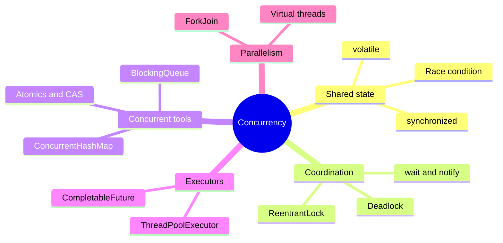

# 1. Concurrency roadmap: from Thread to virtual threads

Concurrency means several pieces of code making progress at the same time. Starting a second thread is easy. Almost every bug comes from one thing: **two threads touching the same data**.

> [!TIP]
> - **What this is:** a hands-on lab. The code lives in `playground/lld-practice/concurrency-lab`, one small example per idea, and each note here records what was run and what it showed.
> - **The path:** five stages, from `Thread` and `synchronized` up to thread pools, ForkJoin and virtual threads. Every Java method is explained the first time it appears.
> - **The goal:** in an LLD round, pick the right tool to make a design thread-safe and say why. `synchronized` everywhere is one tool, not the only one.

## The five stages at a glance



Stage 1 is the problem (shared data breaks). Stages 2 and 3 are the tools that fix it. Stages 4 and 5 are how real programs run many tasks.

## Topics in order

| # | Topic | In plain words | Status |
|---|---|---|---|
| 1 | Threads: start and join | Run code on a second line of execution, and wait for it to finish | example run, see [note 2](/notebook/concurrency/threads-start-join) |
| 2 | Race condition | Two threads change one variable and some changes are lost | example run, see [note 3](/notebook/concurrency/race-condition) |
| 3 | synchronized | Let only one thread at a time run a block of code | next |
| 4 | volatile | Make sure other threads see a change | not started |
| 5 | wait and notify | A thread sleeps until another thread says something changed | not started |
| 6 | ReentrantLock and Condition | A lock you control by hand, with the same waiting ability | not started |
| 7 | Deadlock | Two threads each hold what the other needs, and both wait forever | not started |
| 8 | Atomics and CAS | Thread-safe counters without a lock | not started |
| 9 | ConcurrentHashMap | A map that many threads can use at once | not started |
| 10 | BlockingQueue | A queue where producers wait when it is full and consumers wait when it is empty | not started |
| 11 | ThreadPoolExecutor | A group of reusable threads that runs the tasks you submit | not started |
| 12 | CompletableFuture | Run tasks in the background and combine their results | not started |
| 13 | ForkJoin | Split a big task into pieces, run them in parallel, join the results | not started |
| 14 | Virtual threads | Lightweight threads managed by the JVM instead of the operating system (JDK 21) | not started |

A topic is ticked as done only when it was run and you can explain it back in your own words. Nothing is ticked yet.

## How each topic runs

1. I show one small runnable example and the output I got.
2. I explain the one new idea in it, and every new method the first time it appears.
3. You write your own version in the lab folder.
4. I compile it, run it and review it.
5. The result goes into the note for that topic. Anything marked *(verified)* was actually run.

## Run the lab

The code is in `playground/lld-practice/concurrency-lab`, with one folder per chapter, named like the chapter's note (`03-synchronized`, `08-wait-and-notify`, and so on). Every example is one file with no package and no build. From that folder, in Git Bash or PowerShell:

```bash
java 01-threads-first-steps/Hello.java
```

Change the path to run another example. A new chapter gets its folder when its first file arrives. Virtual threads need JDK 21 and this machine has JDK 17, so those examples will run in a throwaway Docker container. That setup is not done yet.

**Related:** [Threads: start and join](/notebook/concurrency/threads-start-join) · [Race condition](/notebook/concurrency/race-condition) · [LLD session 1: rate limiter](/notebook/lld/session-1-rate-limiter)
