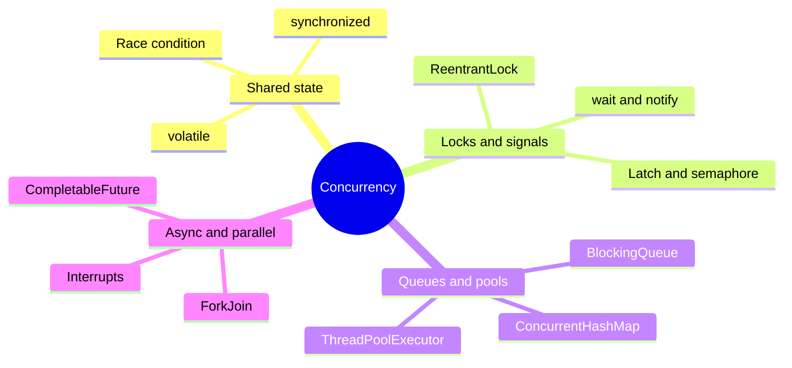

# 1. Concurrency handbook: from Thread to thread-safe design

Concurrency means several pieces of code making progress at the same time. Starting a second thread is easy. Almost every bug comes from one thing: **two threads touching the same data**. This handbook goes from a single `Thread` to locks, queues, pools and the rest of `java.util.concurrent`, one small runnable example per idea.

> [!TIP]
> - **Shape of every chapter:** the problem, a runnable example with its output, the mechanism (often the JDK source), the pitfalls, interview questions and a key-takeaways table.
> - **Reading order:** chapters are numbered in the order they build on each other. Shared state comes first, then the tools that fix it, then pools and async code.
> - **The goal:** in an LLD round, pick the right tool to make a design thread-safe and say why. `synchronized` everywhere is one tool, not the only one.

## The areas at a glance



Shared state is the problem. Locks and signals, atomics and concurrent collections are the tools that fix it. Queues, pools and async code are how real programs run many tasks.

## Chapters

| # | Chapter | In plain words |
|---|---|---|
| 01 | [Threads: create, start, join and sleep](/notebook/concurrency/01-foundations/01-threads-first-steps) | Run code on a second line of execution, and wait for it to finish |
| 02 | [Race condition](/notebook/concurrency/01-foundations/02-race-condition) | Two threads change one variable and some changes are lost |
| 03 | [synchronized](/notebook/concurrency/02-shared-state/03-synchronized) | Let only one thread at a time run a block of code |
| 04 | [volatile](/notebook/concurrency/02-shared-state/04-volatile-and-visibility) | Make sure other threads see a change |
| 05 | [Atomics and CAS](/notebook/concurrency/02-shared-state/05-atomics-and-cas) | Thread-safe counters without a lock |
| 06 | [ReentrantLock](/notebook/concurrency/03-coordination/06-reentrantlock) | A lock taken and released by hand, with a timeout option |
| 07 | [Deadlock](/notebook/concurrency/03-coordination/07-deadlock) | Two threads each hold what the other needs, and both wait forever |
| 08 | [wait and notify](/notebook/concurrency/03-coordination/08-wait-and-notify) | A thread sleeps until another thread says something changed |
| 09 | [BlockingQueue](/notebook/concurrency/04-collections-and-queues/09-blocking-queues) | A queue where producers wait when it is full and consumers wait when it is empty |
| 10 | [A thread pool from scratch](/notebook/concurrency/05-executors-and-async/10-thread-pool-from-scratch) | Workers that take tasks from a queue |
| 11 | [ExecutorService](/notebook/concurrency/05-executors-and-async/11-executor-service) | A ready-made pool, plus Future and failing tasks |
| 12 | [ThreadPoolExecutor](/notebook/concurrency/05-executors-and-async/12-thread-pool-executor) | Core threads, queue, max threads and rejection |
| 13 | [ConcurrentHashMap](/notebook/concurrency/04-collections-and-queues/13-concurrent-collections) | A map that many threads can use at once |
| 14 | [CountDownLatch](/notebook/concurrency/03-coordination/14-countdownlatch) | Wait for N events, or hold everyone at a gate |
| 15 | [Semaphore](/notebook/concurrency/03-coordination/15-semaphore) | Limit how many threads use a resource at once |
| 16 | [ReadWriteLock](/notebook/concurrency/03-coordination/16-readwritelock) | Many readers share the lock, a writer is alone |
| 17 | [CompletableFuture](/notebook/concurrency/05-executors-and-async/17-completablefuture) | Run tasks in the background and chain or combine their results |
| 18 | [ForkJoin](/notebook/concurrency/06-parallelism/18-fork-join) | Split a big CPU job into pieces, run them on all cores, add the answers |
| 19 | [Interrupts](/notebook/concurrency/01-foundations/19-interrupts) | Ask a thread to stop: a soft request, and what `InterruptedException` means |
| 20 | [ScheduledExecutorService](/notebook/concurrency/05-executors-and-async/20-scheduled-executor) | Run a task after a delay or on a repeating schedule |
| 21 | [Thread-safe lists](/notebook/concurrency/04-collections-and-queues/21-thread-safe-lists) | `synchronizedList` versus `CopyOnWriteArrayList`, and why a loop of calls is not safe |

Planned next: the other blocking queues (`LinkedBlockingQueue`, `PriorityBlockingQueue`, `DelayQueue`), immutability and `ThreadLocal`, thread-safe class design for LLD (rate limiter, LRU cache), and reading thread dumps.

## Which tool for which problem

| Problem | Tool | Chapter |
|---|---|---|
| Two threads update one counter | `AtomicInteger`, or `synchronized` | 05, 03 |
| A flag written by one thread and read by another | `volatile` | 04 |
| Several variables must change together | `synchronized` or `ReentrantLock` | 03, 06 |
| Give up on a lock after a timeout | `ReentrantLock.tryLock(timeout, unit)` | 06 |
| Wait until a condition becomes true | `wait()` and `notifyAll()`, a `Condition`, or a `BlockingQueue` | 08, 09 |
| Hand work from producers to consumers | `BlockingQueue` | 09 |
| Run many tasks on a limited number of threads | `ThreadPoolExecutor` | 12 |
| Many threads update one map | `ConcurrentHashMap.merge` and the other compound calls | 13 |
| Wait for N tasks, or release many threads at once | `CountDownLatch` | 14 |
| Limit concurrent access to a resource | `Semaphore` | 15 |
| Data that is read much more often than it is written | `ReentrantReadWriteLock` | 16 |
| Call several services at the same time and merge the answers | `CompletableFuture` with `thenCombine` or `allOf` | 17 |
| Split a big CPU-bound job across all cores | `ForkJoinPool` with `RecursiveTask` | 18 |
| Ask a running thread or task to stop | `interrupt()`, with the task checking the flag or handling `InterruptedException` | 19 |
| Run a task after a delay or on a repeating schedule | `ScheduledExecutorService`: `scheduleAtFixedRate` or `scheduleWithFixedDelay` | 20 |
| A list read by many threads and changed rarely | `CopyOnWriteArrayList`, iterated with for-each | 21 |
| Check then add to a shared list | `CopyOnWriteArrayList.addIfAbsent`, not `contains` followed by `add` | 21 |

## Run the lab

The code is in `playground/lld-practice/concurrency-lab`, with one folder per chapter, named like the chapter's note (`03-synchronized`, `08-wait-and-notify`, and so on). Every example is one file with no package and no build. From that folder, in Git Bash or PowerShell:

```bash
java 01-threads-first-steps/Hello.java
```

Change the path to run another example.

**Related:** [LLD session 1: rate limiter](/notebook/lld/session-1-rate-limiter)
