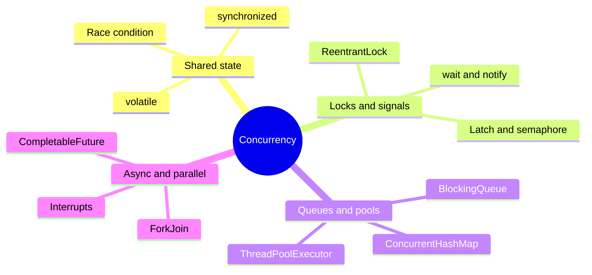

# 1. Concurrency handbook: from Thread to thread-safe design

Concurrency means several pieces of code making progress at the same time. Starting a second thread is easy. Almost every bug comes from one thing: **two threads touching the same data**. This handbook goes from a single `Thread` to locks, queues, pools and the rest of `java.util.concurrent`, one small runnable example per idea.

> [!TIP]
> - **Shape of every chapter:** the problem, a runnable example with its output, the mechanism (often the JDK source), the pitfalls, interview questions and a key-takeaways table.
> - **Reading order:** chapters are numbered in the order they build on each other. Shared state comes first, then the tools that fix it, then pools and async code.
> - **The goal:** in an LLD round, pick the right tool to make a design thread-safe and say why. `synchronized` everywhere is one tool, not the only one.

## The areas at a glance



Shared state is the problem. Locks and signals, atomics and concurrent collections are the tools that fix it. Queues, pools and async code are how real programs run many tasks.

## Chapters

| # | Chapter | In plain words |
|---|---|---|
| 01 | [Threads: create, start, join and sleep](/notebook/concurrency/01-foundations/01-threads-first-steps) | Run code on a second line of execution, and wait for it to finish |
| 02 | [Race condition](/notebook/concurrency/01-foundations/02-race-condition) | Two threads change one variable and some changes are lost |
| 03 | [synchronized](/notebook/concurrency/02-shared-state/03-synchronized) | Let only one thread at a time run a block of code |
| 04 | [volatile](/notebook/concurrency/02-shared-state/04-volatile-and-visibility) | Make sure other threads see a change |
| 05 | [Atomics and CAS](/notebook/concurrency/02-shared-state/05-atomics-and-cas) | Thread-safe counters without a lock |
| 06 | [ReentrantLock](/notebook/concurrency/03-coordination/06-reentrantlock) | A lock taken and released by hand, with a timeout option |
| 07 | [Deadlock](/notebook/concurrency/03-coordination/07-deadlock) | Two threads each hold what the other needs, and both wait forever |
| 08 | [wait and notify](/notebook/concurrency/03-coordination/08-wait-and-notify) | A thread sleeps until another thread says something changed |
| 09 | [BlockingQueue](/notebook/concurrency/04-collections-and-queues/09-blocking-queues) | A queue where producers wait when it is full and consumers wait when it is empty |
| 10 | [A thread pool from scratch](/notebook/concurrency/05-executors-and-async/10-thread-pool-from-scratch) | Workers that take tasks from a queue |
| 11 | [ExecutorService](/notebook/concurrency/05-executors-and-async/11-executor-service) | A ready-made pool, plus Future and failing tasks |
| 12 | [ThreadPoolExecutor](/notebook/concurrency/05-executors-and-async/12-thread-pool-executor) | Core threads, queue, max threads and rejection |
| 13 | [ConcurrentHashMap](/notebook/concurrency/04-collections-and-queues/13-concurrent-collections) | A map that many threads can use at once |
| 14 | [CountDownLatch](/notebook/concurrency/03-coordination/14-countdownlatch) | Wait for N events, or hold everyone at a gate |
| 15 | [Semaphore](/notebook/concurrency/03-coordination/15-semaphore) | Limit how many threads use a resource at once |
| 16 | [ReadWriteLock](/notebook/concurrency/03-coordination/16-readwritelock) | Many readers share the lock, a writer is alone |
| 17 | [CompletableFuture](/notebook/concurrency/05-executors-and-async/17-completablefuture) | Run tasks in the background and chain or combine their results |
| 18 | [ForkJoin](/notebook/concurrency/06-parallelism/18-fork-join) | Split a big CPU job into pieces, run them on all cores, add the answers |
| 19 | [Interrupts](/notebook/concurrency/01-foundations/19-interrupts) | Ask a thread to stop: a soft request, and what `InterruptedException` means |
| 20 | [ScheduledExecutorService](/notebook/concurrency/05-executors-and-async/20-scheduled-executor) | Run a task after a delay or on a repeating schedule |
| 21 | [Thread-safe lists](/notebook/concurrency/04-collections-and-queues/21-thread-safe-lists) | `synchronizedList` versus `CopyOnWriteArrayList`, and why a loop of calls is not safe |

Not covered in this handbook: virtual threads, the other blocking queues (`LinkedBlockingQueue`, `PriorityBlockingQueue`, `DelayQueue`), immutability and `ThreadLocal`, thread-safe class design for LLD (rate limiter, LRU cache), and reading thread dumps.

## Which tool for which problem

| Problem | Tool | Chapter |
|---|---|---|
| Two threads update one counter | `AtomicInteger`, or `synchronized` | 05, 03 |
| A flag written by one thread and read by another | `volatile` | 04 |
| Several variables must change together | `synchronized` or `ReentrantLock` | 03, 06 |
| Give up on a lock after a timeout | `ReentrantLock.tryLock(timeout, unit)` | 06 |
| Wait until a condition becomes true | `wait()` and `notifyAll()`, a `Condition`, or a `BlockingQueue` | 08, 09 |
| Hand work from producers to consumers | `BlockingQueue` | 09 |
| Run many tasks on a limited number of threads | `ThreadPoolExecutor` | 12 |
| Many threads update one map | `ConcurrentHashMap.merge` and the other compound calls | 13 |
| Wait for N tasks, or release many threads at once | `CountDownLatch` | 14 |
| Limit concurrent access to a resource | `Semaphore` | 15 |
| Data that is read much more often than it is written | `ReentrantReadWriteLock` | 16 |
| Call several services at the same time and merge the answers | `CompletableFuture` with `thenCombine` or `allOf` | 17 |
| Split a big CPU-bound job across all cores | `ForkJoinPool` with `RecursiveTask` | 18 |
| Ask a running thread or task to stop | `interrupt()`, with the task checking the flag or handling `InterruptedException` | 19 |
| Run a task after a delay or on a repeating schedule | `ScheduledExecutorService`: `scheduleAtFixedRate` or `scheduleWithFixedDelay` | 20 |
| A list read by many threads and changed rarely | `CopyOnWriteArrayList`, iterated with for-each | 21 |
| Check then add to a shared list | `CopyOnWriteArrayList.addIfAbsent`, not `contains` followed by `add` | 21 |

## Terms and terminology

One table per area. The last column is the chapter that explains the term.

### Threads and shared state

| Term | Meaning | Ch. |
|---|---|---|
| thread | A separate line of execution inside a program | [01][c01] |
| `start()` | Launches a thread and returns at once | [01][c01] |
| `join()` | The caller waits until the thread has finished | [01][c01] |
| `Thread.sleep(ms)` | Pauses only the thread that calls it | [01][c01] |
| single-file mode | `java File.java` compiles and runs one file, with no build and no package | [01][c01] |
| shared mutable state | A variable that more than one thread can change | [02][c02] |
| race condition | The result depends on which thread happens to run first | [02][c02] |
| lost update | Two threads write from the same old value, so one write vanishes | [02][c02] |
| read-modify-write | A change made of separate steps, such as `counter++` (read, add, write) | [02][c02] |
| atomic operation | An operation that no other thread can see half done | [02][c02] |
| lock (monitor) | The built-in lock that every Java object has | [03][c03] |
| `synchronized` | Lets one thread at a time run a block or method for a given lock | [03][c03] |
| critical section | The code that only one thread may run at a time | [03][c03] |
| mutual exclusion | Two threads are never inside code guarded by the same lock at the same moment | [03][c03] |
| acquire and release | Entering the block takes the lock, leaving it gives the lock back | [03][c03] |
| visibility | Whether a change made by one thread can be seen by another | [04][c04] |
| `volatile` | Every read sees the latest write. It does not make `counter++` atomic. | [04][c04] |
| atomic class (`AtomicInteger`) | A thread-safe variable with operations such as `incrementAndGet()` | [05][c05] |
| CAS (compare-and-swap) | Set a new value only if the field still holds the old one, otherwise retry | [05][c05] |
| optimistic approach | Assume there is no conflict and retry when there was one | [05][c05] |
| ABA problem | A value changes from A to B and back to A, and CAS cannot notice | [05][c05] |

### Locks and signals

| Term | Meaning | Ch. |
|---|---|---|
| `ReentrantLock` | A lock object: `lock()` before the `try`, `unlock()` in `finally` | [06][c06] |
| reentrant | The thread that holds the lock can take it again. Each `lock()` needs an `unlock()`. | [06][c06] |
| hold count | How many times the current owner holds a reentrant lock | [06][c06] |
| `tryLock(timeout, unit)` | Waits for the lock up to the timeout and returns `true` or `false` | [06][c06] |
| deadlock | Threads wait for locks held by each other, and none can continue | [07][c07] |
| hold and wait | A thread keeps one lock while it waits for another | [07][c07] |
| no preemption | A lock cannot be taken away from the thread that holds it | [07][c07] |
| circular wait | A cycle of threads, each waiting for a lock held by the next | [07][c07] |
| lock ordering | Take several locks in the same order everywhere, so a cycle cannot form | [07][c07] |
| `wait()` | Releases the lock and sleeps until another thread notifies | [08][c08] |
| `notify()` and `notifyAll()` | Wake one waiting thread, or all of them | [08][c08] |
| spurious wake-up | A thread wakes without a `notify`. This is why `wait()` sits in a `while` loop. | [08][c08] |
| producer-consumer | One side produces items and the other consumes them through a shared buffer | [08][c08] |
| `Condition` | A waiting room that belongs to a `ReentrantLock`, with `await()` and `signal()` | [08][c08] |
| `CountDownLatch` | A counter that threads wait on. It opens once, when the count reaches 0. | [14][c14] |
| start gate | A latch with count 1 that releases many threads together | [14][c14] |
| `Semaphore` and permit | N permits, so at most N threads are inside. It has no owner. | [15][c15] |
| `acquire()` and `tryAcquire()` | Wait for a permit, or get `true` or `false` at once | [15][c15] |
| back-pressure | Callers wait when the resource is full, and latency grows | [15][c15] |
| load shedding | Callers are refused at once when the resource is full | [15][c15] |
| bulkhead | A limit on concurrent calls to one dependency, so it cannot use every thread | [15][c15] |
| concurrency versus rate | Calls at the same moment versus calls per second. A semaphore limits only the first. | [15][c15] |
| `ReentrantReadWriteLock` | A pair of locks: a shared read lock and an exclusive write lock | [16][c16] |
| upgrade and downgrade | Read to write waits for itself forever. Write to read is allowed. | [16][c16] |
| starvation | A thread never gets the lock because others keep taking it | [16][c16] |

### Queues, pools and executors

| Term | Meaning | Ch. |
|---|---|---|
| `BlockingQueue` | A queue where `put` waits when it is full and `take` waits when it is empty | [09][c09] |
| `ArrayBlockingQueue` | A blocking queue with a fixed capacity, backed by an array | [09][c09] |
| thread pool | A fixed group of reusable worker threads that take tasks from a queue | [10][c10] |
| poison pill | A special task that tells a worker to stop, one per worker | [10][c10] |
| effectively final | A local variable that never changes, so a lambda may use it | [10][c10] |
| `ExecutorService` and `Executors` | The pool interface and the class that makes ready-made pools | [11][c11] |
| `submit` and `execute` | Queue a task. `submit` returns a `Future`, `execute` returns nothing. | [11][c11] |
| `shutdown()` and `awaitTermination()` | Stop accepting tasks, then wait for the queued ones to finish | [11][c11] |
| `Callable` | A task that returns a value and may throw a checked exception | [11][c11] |
| `Future` and `get()` | A handle for a result that is not ready yet. `get()` blocks until it is. | [11][c11] |
| `ExecutionException` | Wraps the exception of a failed task when `get()` is called | [11][c11] |
| `ThreadPoolExecutor` | The class behind the pools: core size, queue, max size and rejection | [12][c12] |
| core size and max size | The threads kept alive, and the most threads the pool may start | [12][c12] |
| keep-alive time | How long an extra idle thread lives before it is removed | [12][c12] |
| rejection policy | What happens to a task when the threads and the queue are full | [12][c12] |
| unbounded queue | A queue with no size limit. Overload piles up instead of failing. | [12][c12] |
| `LinkedBlockingQueue` and `SynchronousQueue` | The queues behind the fixed pool and the cached pool | [12][c12] |
| `ConcurrentHashMap` | A map that many threads can use at once. Each single call is safe. | [13][c13] |
| compound operation | One call that does a read-modify-write: `merge`, `compute`, `putIfAbsent` | [13][c13] |
| check-then-act | Check a condition, then act on it. As two separate calls it is unsafe. | [13][c13] |
| `ScheduledExecutorService` | A pool that runs tasks after a delay or on a repeating schedule | [20][c20] |
| fixed rate | Repeat with a fixed start-to-start period. Runs of one task never overlap. | [20][c20] |
| fixed delay | Repeat with a fixed pause between the end of one run and the start of the next | [20][c20] |
| `ScheduledFuture` | The handle of a scheduled task. `cancel(false)` stops future runs. | [20][c20] |

### Async, parallel and cancellation

| Term | Meaning | Ch. |
|---|---|---|
| `CompletableFuture` | A `Future` that accepts follow-up steps | [17][c17] |
| `supplyAsync` and `runAsync` | Run a task on a pool thread, with or without a result | [17][c17] |
| `thenApply` | Transform the result when it is ready | [17][c17] |
| `thenCombine` and `allOf` | Merge two futures, or wait for many | [17][c17] |
| `exceptionally` | Replace a failure with a value | [17][c17] |
| `CompletionException` | The wrapper around an exception inside a `CompletableFuture` | [17][c17] |
| `join()` versus `get()` | Both wait. `join()` throws unchecked exceptions, `get()` throws checked ones. | [17][c17] |
| common pool | The shared default pool, `ForkJoinPool.commonPool()`, with CPU count minus 1 threads | [17][c17], [18][c18] |
| daemon thread | A thread that does not keep the JVM alive | [17][c17] |
| fire-and-forget | Start work and never wait for the result. Its errors are silent unless handled. | [17][c17] |
| divide and conquer | Split a job into independent halves, solve each, combine the answers | [18][c18] |
| `fork()` and `join()` | Start a subtask in the pool, and wait for its result | [18][c18] |
| `RecursiveTask` and `RecursiveAction` | A fork/join task with a result, and one without | [18][c18] |
| threshold | The size below which a piece is computed directly instead of split | [18][c18] |
| work stealing | An idle worker takes tasks from the queue of a busy worker | [18][c18] |
| parallel stream | A stream that runs on the common fork/join pool | [18][c18] |
| interrupt flag | A flag on a thread, set by `interrupt()`, that asks it to stop | [19][c19] |
| `InterruptedException` | Thrown by a blocking call that was interrupted. It clears the flag. | [19][c19] |
| cooperative cancellation | The thread decides when to stop. Nothing is forced. | [19][c19] |
| `isInterrupted()` and `Thread.interrupted()` | Read the flag, and read and clear the flag | [19][c19] |
| `shutdownNow()` and `cancel(true)` | Stop running tasks by interrupting their threads | [19][c19] |

### Collections

| Term | Meaning | Ch. |
|---|---|---|
| `Collections.synchronizedList` | A wrapper that takes a lock on every call. A loop over it is not protected. | [21][c21] |
| `CopyOnWriteArrayList` | A list that copies its array on every write, so readers use a snapshot | [21][c21] |
| `ConcurrentModificationException` | Thrown by a fail-fast iterator that sees the list change during a loop | [21][c21] |
| snapshot | The version of the data that a loop holds from its start | [21][c21] |
| `addIfAbsent` and `removeIf` | Compound operations that check and change a copy-on-write list in one step | [21][c21] |
| index loop | A `get(i)` loop has no snapshot. It sees changes and can skip elements or fail. | [21][c21] |

[c01]: /notebook/concurrency/01-foundations/01-threads-first-steps
[c02]: /notebook/concurrency/01-foundations/02-race-condition
[c03]: /notebook/concurrency/02-shared-state/03-synchronized
[c04]: /notebook/concurrency/02-shared-state/04-volatile-and-visibility
[c05]: /notebook/concurrency/02-shared-state/05-atomics-and-cas
[c06]: /notebook/concurrency/03-coordination/06-reentrantlock
[c07]: /notebook/concurrency/03-coordination/07-deadlock
[c08]: /notebook/concurrency/03-coordination/08-wait-and-notify
[c09]: /notebook/concurrency/04-collections-and-queues/09-blocking-queues
[c10]: /notebook/concurrency/05-executors-and-async/10-thread-pool-from-scratch
[c11]: /notebook/concurrency/05-executors-and-async/11-executor-service
[c12]: /notebook/concurrency/05-executors-and-async/12-thread-pool-executor
[c13]: /notebook/concurrency/04-collections-and-queues/13-concurrent-collections
[c14]: /notebook/concurrency/03-coordination/14-countdownlatch
[c15]: /notebook/concurrency/03-coordination/15-semaphore
[c16]: /notebook/concurrency/03-coordination/16-readwritelock
[c17]: /notebook/concurrency/05-executors-and-async/17-completablefuture
[c18]: /notebook/concurrency/06-parallelism/18-fork-join
[c19]: /notebook/concurrency/01-foundations/19-interrupts
[c20]: /notebook/concurrency/05-executors-and-async/20-scheduled-executor
[c21]: /notebook/concurrency/04-collections-and-queues/21-thread-safe-lists

## Run the lab

The code is in `playground/lld-practice/concurrency-lab`, with one folder per chapter, named like the chapter's note (`03-synchronized`, `08-wait-and-notify`, and so on). Every example is one file with no package and no build. From that folder, in Git Bash or PowerShell:

```bash
java 01-threads-first-steps/Hello.java
```

Change the path to run another example.

**Related:** [LLD session 1: rate limiter](/notebook/system-design/practice/lld/rate-limiter)
