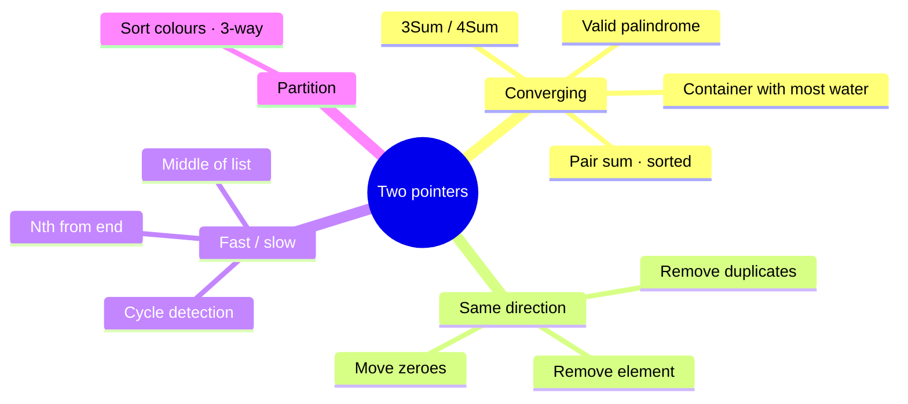
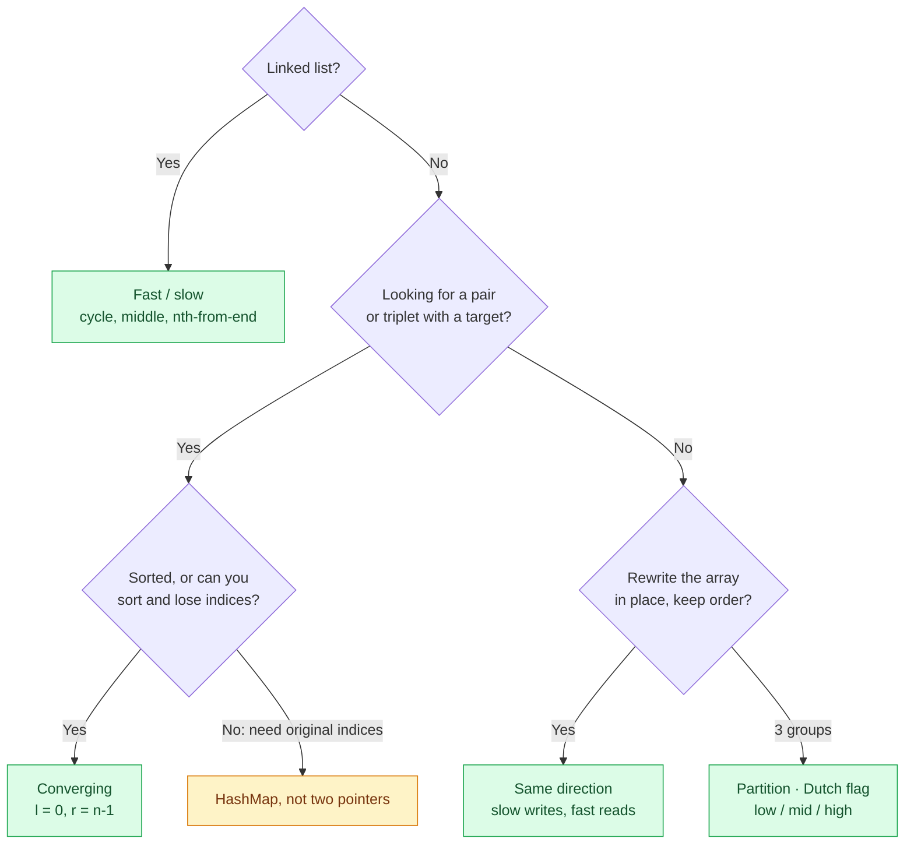
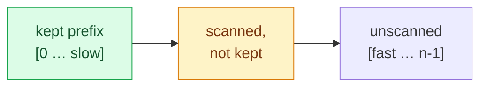

# Two Pointers — Converging, Same-Direction & Fast/Slow

Two indices walk the input so that **every step permanently rules something out**.
That turns an $O(n^2)$ "try every pair" search into a single $O(n)$ pass.

> [!TIP]
> **TL;DR: the 30-second interview answer**
> - **Sorted array + find a pair/triplet** → **converging** pointers from both ends; move the one that can improve the sum.
> - **Filter / dedupe / move elements in place** → **same direction**: `slow` = next write slot, `fast` = scanner.
> - **Linked list cycle or middle** → **fast/slow** (Floyd): fast moves 2, slow moves 1.

## The pattern at a glance



## Which variant?



## Converging: why it's correct

On a sorted array, if `a[l] + a[r] < target` then `a[l]` paired with **anything** at or
left of `r` is also too small, so `a[l]` can't be in any answer and `l++` throws it away.
The symmetric argument discards `a[r]` when the sum is too big.

Trace for `a = [1, 3, 4, 6, 8, 11]`, `target = 10`:

| Step | l | r | a[l] + a[r] | Decision |
|---|---|---|---|---|
| 1 | 0 | 5 | 1 + 11 = 12 | too big → `r--` |
| 2 | 0 | 4 | 1 + 8 = 9 | too small → `l++` |
| 3 | 1 | 4 | 3 + 8 = 11 | too big → `r--` |
| 4 | 1 | 3 | 3 + 6 = 9 | too small → `l++` |
| 5 | 2 | 3 | 4 + 6 = 10 | ✅ return `[2, 3]` |

Each step removes one index, so there are at most $n - 1$ steps: $O(n)$ time, $O(1)$ space.

```java
int[] pairWithSum(int[] a, int target) {
    int l = 0, r = a.length - 1;
    while (l < r) {                       // l < r: a pair needs two distinct elements
        int sum = a[l] + a[r];
        if (sum == target) return new int[]{l, r};
        if (sum < target) l++; else r--;
    }
    return new int[0];
}
```

### Extending to 3Sum

Fix one anchor `i`, then run converging pointers on the rest. Sorting costs
$O(n \log n)$, the loops $O(n^2)$.

```java
List<List<Integer>> threeSum(int[] a) {
    Arrays.sort(a);
    List<List<Integer>> out = new ArrayList<>();
    for (int i = 0; i < a.length - 2; i++) {
        if (i > 0 && a[i] == a[i - 1]) continue;       // skip duplicate anchors
        int l = i + 1, r = a.length - 1;
        while (l < r) {
            int sum = a[i] + a[l] + a[r];
            if (sum == 0) {
                out.add(List.of(a[i], a[l], a[r]));
                while (l < r && a[l] == a[l + 1]) l++; // skip duplicate seconds
                while (l < r && a[r] == a[r - 1]) r--; // skip duplicate thirds
                l++;
                r--;
            } else if (sum < 0) l++;
            else r--;
        }
    }
    return out;
}
```

## Same direction: slow writes, fast reads



Invariant: everything in `[0 … slow]` is the answer so far. `fast` finds the next element
worth keeping and copies it to `slow + 1`.

```java
int removeDuplicates(int[] a) {          // a is sorted
    if (a.length == 0) return 0;
    int slow = 0;                         // index of the last kept element
    for (int fast = 1; fast < a.length; fast++) {
        if (a[fast] != a[slow]) a[++slow] = a[fast];
    }
    return slow + 1;                      // length of the deduped prefix
}
```

## Fast / slow on a linked list (Floyd)

If there is a cycle, the fast pointer gains one node per step on the slow one inside the
loop, so they **must** meet. If `fast` reaches `null`, there is no cycle.

```java
boolean hasCycle(ListNode head) {
    ListNode slow = head, fast = head;
    while (fast != null && fast.next != null) {
        slow = slow.next;
        fast = fast.next.next;
        if (slow == fast) return true;
    }
    return false;
}
```

When the loop ends without a cycle, `slow` is at the **middle** of the list. That's the
same trick used for "middle of linked list".

## Pitfalls

> [!WARNING]
> **Converging needs sorted input.** On unsorted data, sorting destroys the original
> indices. Classic Two Sum asking for *indices* is a `HashMap` problem, $O(n)$ in one pass.

> [!WARNING]
> **3Sum without the duplicate skips returns repeated triplets.** Skip equal anchors
> *and* equal `l`/`r` values after recording a match.

| Trap | Symptom | Fix |
|---|---|---|
| `while (l <= r)` for pairs | Pairs an element with itself | Use `l < r` |
| Not moving both pointers after a match | Infinite loop | `l++; r--;` after recording |
| `int` sum of large values | Overflow gives wrong comparisons | Use `long sum` |
| Fast/slow guarding only `fast.next.next` | `NullPointerException` | Guard `fast != null && fast.next != null` |

## Practice set

| Variant | Problems (LeetCode #) |
|---|---|
| Converging | 167 Two Sum II · 15 3Sum · 11 Container With Most Water · 125 Valid Palindrome |
| Same direction | 26 Remove Duplicates · 283 Move Zeroes · 27 Remove Element |
| Partition | 75 Sort Colors |
| Fast / slow | 141 Linked List Cycle · 876 Middle of the Linked List · 19 Remove Nth Node From End |

## Interview questions

<details>
<summary>Why is it safe to discard a[l] when the sum is too small?</summary>

The array is sorted, so every element at or before `r` is ≤ `a[r]`. If even the largest
partner `a[r]` gives a sum below the target, no partner can, so `a[l]` is in no valid pair.
</details>

<details>
<summary>Two Sum on an unsorted array, return indices: two pointers or hash map?</summary>

Hash map. Sorting costs $O(n \log n)$ and loses the original indices. One pass storing
`value → index` and checking `target - x` is $O(n)$.
</details>

<details>
<summary>How does Floyd's algorithm find where the cycle starts?</summary>

After `slow` and `fast` meet, reset one pointer to `head` and move both one step at a
time. They meet again exactly at the cycle's entry node, because the distance from the head
to the entry equals the distance from the meeting point to the entry, going round the loop.
</details>

<details>
<summary>What's the complexity of 3Sum with two pointers?</summary>

$O(n^2)$ time (an $O(n \log n)$ sort plus $n$ converging passes of $O(n)$) and $O(1)$ extra
space besides the output.
</details>

## Key takeaways

| Remember | Because |
|---|---|
| Each pointer move must rule out an option | That's what makes it $O(n)$ |
| Converging = sorted + target | Sortedness justifies discarding an end |
| Same direction = `slow` writes, `fast` reads | In-place, keeps relative order |
| Unsorted + need indices → hash map | Sorting loses them |
| Skip duplicates at every level in k-Sum | Otherwise repeated tuples |
