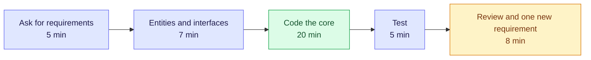
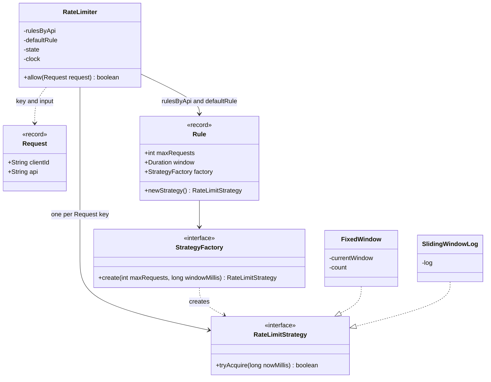

# 1. LLD session 1: Rate limiter

A 45-minute low-level design drill: you get a one-line problem, ask for the requirements yourself, then design, code and test it in plain Java.

> [!TIP]
> - **The problem:** design and implement an in-memory rate limiter that a service calls before it handles each request.
> - **How it runs:** you ask me for requirements one question at a time, as you would ask an interviewer. I answer only what you ask.
> - **Where the code goes:** `playground/lld-practice/rate-limiter/`, plain Java 17, tested with a `Main`.

## The problem

> Design a rate limiter for an API. Before handling a request, the service asks the limiter whether the request is allowed.

That is the whole spec. Everything else (who is limited, by what rule, how it behaves under load) is for you to ask.

## The 45 minutes



The code step gets the most time. If requirements or design run long, cut the tests down, not the code.

| Step | Minutes | What you do |
|---|---|---|
| Requirements | 5 | Ask me questions. Write each answer under "Requirements I gathered" below. |
| Entities and interfaces | 7 | Name the classes and the interfaces, and say which pattern fits and why. |
| Code the core | 20 | Write the classes in `playground/lld-practice/rate-limiter/`. One class at a time. |
| Test | 5 | A `Main` that shows the happy path and two edge cases. |
| Review | 8 | I review the design, then I give you one new requirement and we see how much code changes. |

## How to run your code

From the project folder, with the JDK 17 on your machine:

```bash
cd playground/lld-practice/rate-limiter
javac -d out *.java
java -cp out Main
```

## Checklist

- [x] **1** Requirements asked and written down below
- [ ] **2** Classes and interfaces listed, with the pattern and the reason
- [ ] **3** Core code runs
- [ ] **4** `Main` shows the happy path and two edge cases
- [ ] **5** Review done, and the new requirement tried

## Requirements I gathered

- **Input:** a client id as a string. The limiter does not care whether the service built it from an IP address, an API key or a user id, so there is no IP handling.
- **Output:** `allow(request)` returns true or false at once. No queueing, no blocking, no exception for "limited".
- **Algorithms:** fixed window is required, sliding window is optional, and a new algorithm later must not change the callers.
- **Rules per API:** each API has its own rule (algorithm, maximum requests, window length). You pushed for this twice, so the scope was widened from "one rule per client". The counter is kept per client and API.
- **Configuration:** set when the limiter starts, with a default rule for an API that is not listed. No changes while it runs.
- **Scope:** in memory, inside one JVM (from the problem statement).
- **Not asked, so not specified:** concurrency, testing with time, and memory for idle clients. The design below covers the first two. Idle-client cleanup is left as a known gap.

## Design

This design was produced independently by a fresh agent that was given only the problem and the clarified requirements. It is plain Java 17, with the clock as a plain `LongSupplier`.

### Classes and interfaces

Seven types, two of them tiny interfaces. Nothing else is needed.

| Type | Kind | Responsibility, and why it exists |
|---|---|---|
| `Request` | record | `(clientId, api)`. Value object. It also serves as the map key (records give correct `equals` and `hashCode`, with no `"client:api"` string-concatenation collisions). Rejects null fields. |
| `RateLimiter` | final class | The only entry point, `allow(Request)`. Picks the rule, finds or creates the state for that `(client, api)`, delegates, and supplies the time. It knows nothing about any concrete algorithm. |
| `Rule` | record | Immutable config for one API: `maxRequests`, `Duration window`, `StrategyFactory`. Validates `max > 0` and `window > 0` at startup. Has `newStrategy()`. Exists so config is data, not code scattered in the limiter. |
| `StrategyFactory` | functional interface | `create(int maxRequests, long windowMillis)` returns a fresh `RateLimitStrategy`. A rule names its algorithm as `FixedWindow::new`. Adding token bucket means a new class and a new constructor reference, with no edit to `RateLimiter` or callers. |
| `RateLimitStrategy` | interface | `boolean tryAcquire(long nowMillis)`. One instance holds the state of exactly one `(client, api)` pair. This is the algorithm seam. |
| `FixedWindow` | class | Required algorithm: counter plus window id. |
| `SlidingWindowLog` | class | Optional algorithm: exact, stores timestamps in a deque. |

Not classes, on purpose:

- The clock is a plain `LongSupplier` (epoch millis). Production passes `System::currentTimeMillis`. Tests pass `now::get` backed by an `AtomicLong`, so no sleeping.
- No `Key` class (`Request` is the key). No builder, no `Algorithm` enum, no config object.

### Class diagram



Fields of `RateLimiter`: `Map<String,Rule> rulesByApi` (immutable copy), `Rule defaultRule`, `ConcurrentHashMap<Request,RateLimitStrategy> state`, `LongSupplier clock`.

### Flow of `allow(request)`

```java
public boolean allow(Request r) {
    Rule rule = rulesByApi.getOrDefault(r.api(), defaultRule);               // 1
    RateLimitStrategy s = state.computeIfAbsent(r, k -> rule.newStrategy()); // 2
    return s.tryAcquire(clock.getAsLong());                                  // 3
}
```

1. Resolve the rule by the exact API string. A missing API falls back to the default rule.
2. Get the strategy for this `(clientId, api)`. If absent, create it from the rule's factory. Because the key includes the client and the API, budgets are isolated both ways.
3. Read the time and ask the strategy. It checks and consumes in one step, then returns true or false. A rejected request does not consume budget.

`FixedWindow.tryAcquire(now)`, all inside `synchronized`:

```java
long w = now / windowMillis;
if (w > currentWindow) { currentWindow = w; count = 0; }   // new window: reset
if (count >= max) return false;
count++; return true;
```

`SlidingWindowLog.tryAcquire(now)`, all inside `synchronized`:

```java
long cutoff = now - windowMillis;
while (!log.isEmpty() && log.peekFirst() <= cutoff) log.pollFirst(); // expire
if (log.size() >= max) return false;
log.addLast(now); return true;
```

Test example for `max=3, window=1000`: t=0, 1, 2 give true; t=3 to 999 give false; t=1000 gives true.

### Design patterns and the force each answers

| Pattern | Where | Force |
|---|---|---|
| Strategy | `RateLimitStrategy` with `FixedWindow` and `SlidingWindowLog` | The algorithm varies per API and will grow (token bucket). The core must depend only on the interface. |
| Factory (as a functional interface, not a class hierarchy) | `StrategyFactory` held by `Rule` | Rules are shared immutable config, but strategies are stateful and needed one per key, created lazily. The core must make fresh instances without naming a concrete class. |
| Constructor injection of the clock | `RateLimiter(rules, default, LongSupplier)` | Time must be controllable in tests. This is a technique, not a GoF pattern. |

Deliberately not used:

- **Singleton:** the limiter is created once at startup and injected, and a singleton would hurt tests.
- **Builder:** only three constructor inputs.
- **Decorator, Observer, Chain of Responsibility:** no force asks for them.
- **Abstract factory:** there is only one product family.

Adding token bucket later:

- Write `TokenBucket implements RateLimitStrategy`.
- Configure `new Rule(100, Duration.ofMinutes(1), TokenBucket::new)`.
- Callers and `RateLimiter` are untouched.

### Concurrency approach

- **The limit is enforced by a per-key lock.** Each strategy's `tryAcquire` is `synchronized`. The compound action (window rollover, check `count < max`, increment) runs in one critical section, so two threads can never both take the last permit. The same applies to the sliding log (evict, size check, add).
- **Locks are per `(client, api)`, never global.** Different keys do not contend. Only same-key callers serialize, and the critical section is a few instructions (the sliding log is amortized O(1) eviction).
- **`ConcurrentHashMap.computeIfAbsent` is atomic per key.** The mapping function runs at most once per key, so all threads for the same key share one strategy instance. Without this, two threads could each create a counter and double the budget. The mapping function only allocates an object and does not touch the map, so it is safe.
- **The rules map is copied** with `Map.copyOf` in the constructor and is read-only afterwards, so it is safely published through `final` fields with no lock.
- **Visibility** is covered by the monitor's happens-before. Strategy fields need no `volatile`.
- **No deadlock risk:** one lock at a time, no nested locks, no callbacks while holding one.
- **Test:** N threads (for example 64) on one key, with a fixed fake clock and a start latch. Assert that exactly `max` calls return true. Also test two clients and two APIs in isolation, and window rollover by advancing the `AtomicLong`.

Rejected alternatives:

- `AtomicInteger.incrementAndGet()` then rollback is racy around the window reset.
- A CAS loop on an immutable state record works and is lock-free, but it is more code for no visible gain in a 20-minute exercise.

### Trade-offs and known gaps

- **Memory leak:** entries in `state` are never removed. Unbounded client ids or API strings grow the map forever. Fix: a periodic sweep removing strategies whose window has fully passed (add `isIdle(now)` to the interface), or Caffeine `expireAfterAccess`. Removing an expired entry is safe, because its count no longer matters.
- **One bucket per distinct API string:** the default rule creates one bucket per distinct API string. Callers should pass a route template (`/users/{id}`), not the raw URL.
- **Fixed window burst:** it allows up to 2x max across a window boundary. That is its known weakness, which is why the sliding window exists.
- **Sliding log memory:** `SlidingWindowLog` is exact but costs O(max) memory per key. A sliding-window counter (previous and current count, weighted) is O(1) memory but approximate.
- **Time read before the lock:** a strategy can occasionally see timestamps slightly out of order (a few ms). This never over-grants: `FixedWindow` only resets on a larger window id, and the sliding log only evicts from the head, so it can only be conservative.
- **Wall-clock jumps (NTP):** the fixed window tolerates a backward jump (no reset, so no extra grants). A monotonic source (`System.nanoTime() / 1_000_000`) would be safer in production.
- **Hot key:** it serializes on one monitor. That is fine for a single JVM.
- **Boolean only:** there is no retry-after or remaining-quota, and adding it would change callers.
- **Not covered:** no hot reload of rules, no path patterns, no metrics (as agreed).
- **`Request` as the key:** if it ever gains fields that should not be part of the key (cost, timestamp), introduce a separate `Key`.
- **Token bucket parameters:** via `(max, window)` it maps to capacity = max and refill = max/window. Richer parameters (burst different from rate) would need a richer `Rule`.

### Assumptions

- `allow()` consumes one permit when it returns true. Rejected calls consume nothing.
- Fixed windows are aligned to the epoch (`now / windowMillis`), not to the first request.
- Sliding window: a request exactly `window` ms old no longer counts (`timestamp <= now - window` is evicted).
- Time is epoch millis from a `LongSupplier`. It is non-negative and treated as non-decreasing. Minimum window is 1 ms.
- `maxRequests >= 1`, `window > 0`, and a non-null default rule are required. Violations throw `IllegalArgumentException` or NPE at construction, not in `allow()`.
- A null `Request` or a null field is a programming error and throws NPE. This is not the "limited" case, which always returns false.
- API matching is an exact string match. An empty client id is a valid key.
- A rule's algorithm is chosen in code by a factory reference, not by a string or enum from a config file. Config parsing is out of scope.
- Rules are fixed at construction, so a strategy can keep the parameters it was created with.


## What the new requirement changed

_Filled in during the review._

**Related:** [LLD patterns: the map](/notebook/system-design/pattern/lld/overview) · [Strategy](/notebook/system-design/pattern/lld/strategy)
