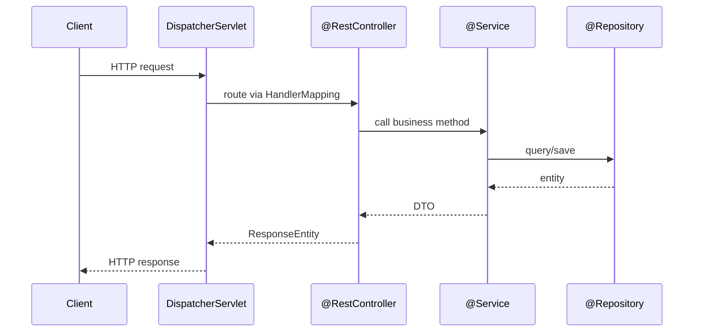

# Notebook Features

Reference for everything the Notebook renderer now supports.

## Alert callouts

> [!NOTE]
> Plain informational aside — background context you want visible but not urgent.

> [!TIP]
> A shortcut or best practice, e.g. prefer constructor injection over `@Autowired` field injection.

> [!IMPORTANT]
> A detail that changes the outcome if missed — e.g. `@Transactional` only proxies public methods on the Spring-managed bean.

> [!WARNING]
> Something that will bite you under specific conditions.

> [!CAUTION]
> Destructive or hard-to-reverse — use sparingly.

## Syntax-highlighted code (Shiki)

```java
@Service
public class OrderService {
    private final OrderRepository repo;

    public OrderService(OrderRepository repo) { // constructor injection
        this.repo = repo;
    }

    @Transactional
    public Order place(OrderRequest req) {
        return repo.save(Order.from(req));
    }
}
```

## Math (KaTeX)

Inline: the amortized cost of `ArrayList.add` is $O(1)$, worst case $O(n)$ on resize.

Block:

$$
T(n) = 2T(n/2) + O(n) \implies T(n) = O(n \log n)
$$

## Diagrams (Mermaid)

Sequence diagram — a typical Spring MVC request:



Cloud architecture (icon packs: `logos`, `mdi`):

```mermaid
architecture-beta
    group api(logos:aws-lambda)[API]

    service db(logos:aws-rds)[Database] in api
    service server(logos:aws-ec2)[Server] in api
    service disk(mdi:harddisk)[Storage] in api

    server:L -- R:db
    server:B -- T:disk
```



Mermaid diagrams render in Mermaid's rounded **"neo" look**, themed to the site.
Click a diagram or its ⤢ button to open it full-screen with zoom and pan.

## Hand-drawn illustrations (Excalidraw)

For freeform, ByteByteGo-style visual panels — not auto-laid-out flowcharts —
draw at [excalidraw.com](https://excalidraw.com), then **File → Save to disk**
and paste the downloaded `.excalidraw` file's JSON into a ` ```excalidraw ` fence:

```excalidraw
{"elements":[{"id":"r1","type":"rectangle","x":80,"y":120,"width":200,"height":90,"angle":0,"strokeColor":"#1e1e1e","backgroundColor":"#a5d8ff","fillStyle":"hachure","strokeWidth":2,"strokeStyle":"solid","roughness":1,"opacity":100,"groupIds":[],"frameId":null,"roundness":{"type":3},"seed":1,"version":1,"versionNonce":1,"isDeleted":false,"boundElements":null,"updated":1,"link":null,"locked":false},{"id":"t1","type":"text","x":120,"y":150,"width":120,"height":30,"angle":0,"strokeColor":"#1e1e1e","backgroundColor":"transparent","fillStyle":"hachure","strokeWidth":2,"strokeStyle":"solid","roughness":1,"opacity":100,"groupIds":[],"frameId":null,"roundness":null,"seed":2,"version":1,"versionNonce":2,"isDeleted":false,"boundElements":null,"updated":1,"link":null,"locked":false,"text":"Client","fontSize":24,"fontFamily":1,"textAlign":"center","verticalAlign":"middle","baseline":20,"containerId":null,"originalText":"Client","lineHeight":1.25},{"id":"r2","type":"rectangle","x":460,"y":120,"width":200,"height":90,"angle":0,"strokeColor":"#1e1e1e","backgroundColor":"#b2f2bb","fillStyle":"hachure","strokeWidth":2,"strokeStyle":"solid","roughness":1,"opacity":100,"groupIds":[],"frameId":null,"roundness":{"type":3},"seed":3,"version":1,"versionNonce":3,"isDeleted":false,"boundElements":null,"updated":1,"link":null,"locked":false},{"id":"t2","type":"text","x":500,"y":150,"width":120,"height":30,"angle":0,"strokeColor":"#1e1e1e","backgroundColor":"transparent","fillStyle":"hachure","strokeWidth":2,"strokeStyle":"solid","roughness":1,"opacity":100,"groupIds":[],"frameId":null,"roundness":null,"seed":4,"version":1,"versionNonce":4,"isDeleted":false,"boundElements":null,"updated":1,"link":null,"locked":false,"text":"Server","fontSize":24,"fontFamily":1,"textAlign":"center","verticalAlign":"middle","baseline":20,"containerId":null,"originalText":"Server","lineHeight":1.25},{"id":"a1","type":"arrow","x":280,"y":165,"width":180,"height":0,"angle":0,"strokeColor":"#1e1e1e","backgroundColor":"transparent","fillStyle":"hachure","strokeWidth":2,"strokeStyle":"solid","roughness":1,"opacity":100,"groupIds":[],"frameId":null,"roundness":{"type":2},"seed":5,"version":1,"versionNonce":5,"isDeleted":false,"boundElements":null,"updated":1,"link":null,"locked":false,"points":[[0,0],[180,0]],"lastCommittedPoint":null,"startBinding":null,"endBinding":null,"startArrowhead":null,"endArrowhead":"arrow"}],"appState":{}}
```

## Tables, links, images — unchanged (GFM)

| Feature | Library | Status |
|---|---|---|
| Code highlight | Shiki | ✅ |
| Math | KaTeX | ✅ |
| Diagrams | Mermaid (neo look, zoomable) | ✅ |
| Illustrations | Excalidraw | ✅ |
| Callouts | custom | ✅ |
