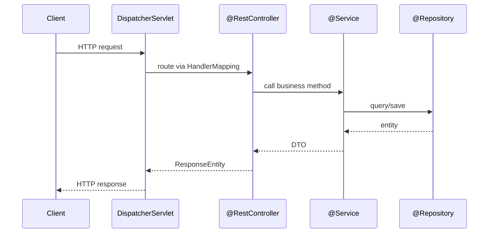

# Notebook Features

Reference for everything the Notebook renderer now supports.

## Alert callouts

> [!NOTE]
> Plain informational aside — background context you want visible but not urgent.

> [!TIP]
> A shortcut or best practice, e.g. prefer constructor injection over `@Autowired` field injection.

> [!IMPORTANT]
> A detail that changes the outcome if missed — e.g. `@Transactional` only proxies public methods on the Spring-managed bean.

> [!WARNING]
> Something that will bite you under specific conditions.

> [!CAUTION]
> Destructive or hard-to-reverse — use sparingly.

## Syntax-highlighted code (Shiki)

```java
@Service
public class OrderService {
    private final OrderRepository repo;

    public OrderService(OrderRepository repo) { // constructor injection
        this.repo = repo;
    }

    @Transactional
    public Order place(OrderRequest req) {
        return repo.save(Order.from(req));
    }
}
```

## Math (KaTeX)

Inline: the amortized cost of `ArrayList.add` is $O(1)$, worst case $O(n)$ on resize.

Block:

$$
T(n) = 2T(n/2) + O(n) \implies T(n) = O(n \log n)
$$

## Diagrams (Mermaid)

Sequence diagram — a typical Spring MVC request:



Cloud architecture (icon packs: `logos`, `mdi`):

```mermaid
architecture-beta
    group api(logos:aws-lambda)[API]

    service db(logos:aws-rds)[Database] in api
    service server(logos:aws-ec2)[Server] in api
    service disk(mdi:harddisk)[Storage] in api

    server:L -- R:db
    server:B -- T:disk
```



## Tables, links, images — unchanged (GFM)

| Feature | Library | Status |
|---|---|---|
| Code highlight | Shiki | ✅ |
| Math | KaTeX | ✅ |
| Diagrams | Mermaid | ✅ |
| Callouts | custom | ✅ |
