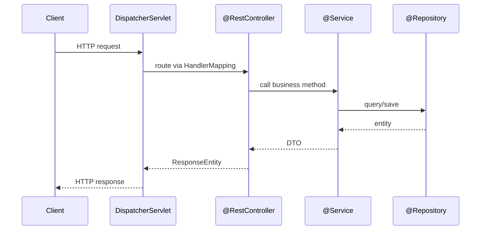
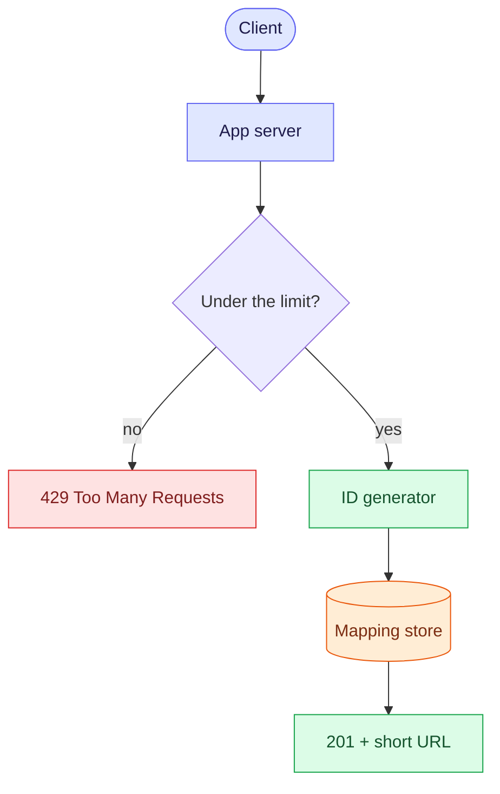
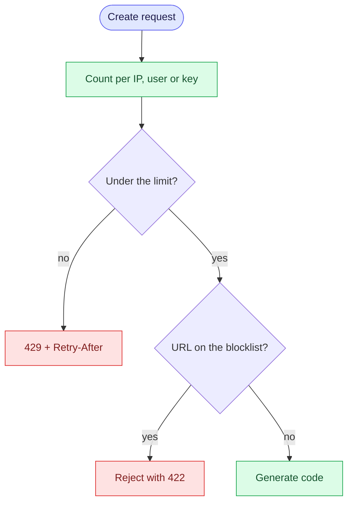
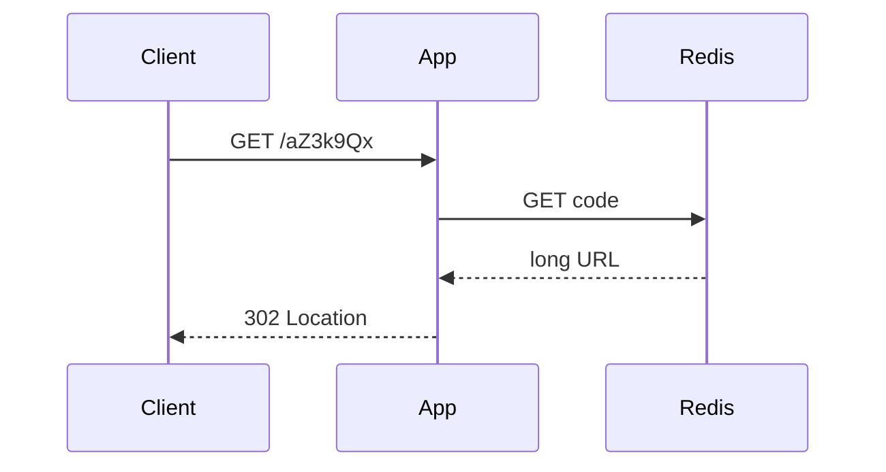
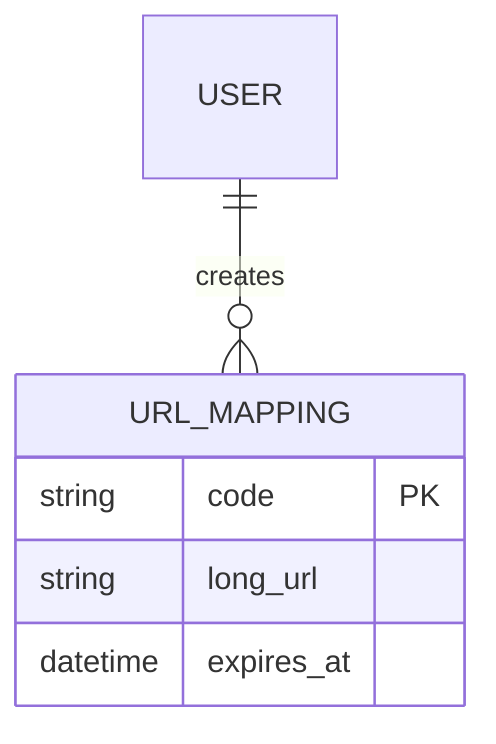
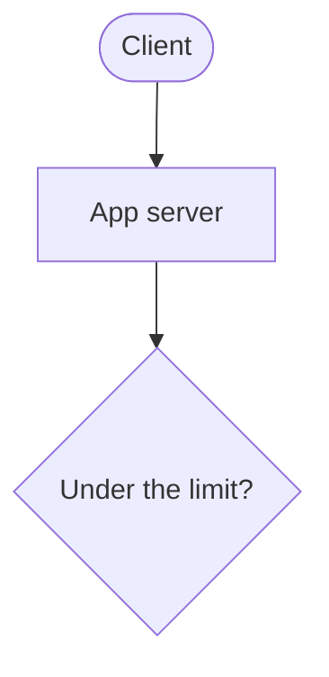
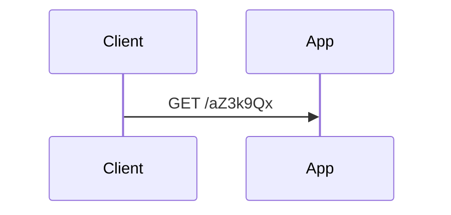

# Notebook Features

Reference for everything the Notebook renderer now supports.

## Alert callouts

> [!NOTE]
> Plain informational aside — background context you want visible but not urgent.

> [!TIP]
> A shortcut or best practice, e.g. prefer constructor injection over `@Autowired` field injection.

> [!IMPORTANT]
> A detail that changes the outcome if missed — e.g. `@Transactional` only proxies public methods on the Spring-managed bean.

> [!WARNING]
> Something that will bite you under specific conditions.

> [!CAUTION]
> Destructive or hard-to-reverse — use sparingly.

## Syntax-highlighted code (Shiki)

```java
@Service
public class OrderService {
    private final OrderRepository repo;

    public OrderService(OrderRepository repo) { // constructor injection
        this.repo = repo;
    }

    @Transactional
    public Order place(OrderRequest req) {
        return repo.save(Order.from(req));
    }
}
```

## Math (KaTeX)

Inline: the amortized cost of `ArrayList.add` is $O(1)$, worst case $O(n)$ on resize.

Block:

$$
T(n) = 2T(n/2) + O(n) \implies T(n) = O(n \log n)
$$

## Diagrams (Mermaid)

Sequence diagram — a typical Spring MVC request:



Cloud architecture (icon packs: `logos`, `mdi`):

```mermaid
architecture-beta
    group api(logos:aws-lambda)[API]

    service db(logos:aws-rds)[Database] in api
    service server(logos:aws-ec2)[Server] in api
    service disk(mdi:harddisk)[Storage] in api

    server:L -- R:db
    server:B -- T:disk
```



Mermaid diagrams render in Mermaid's rounded **"neo" look**, themed to the site.
Click a diagram or its ⤢ button to open it full-screen with zoom and pan.

## Hand-drawn illustrations (Excalidraw)

For freeform, ByteByteGo-style visual panels — not auto-laid-out flowcharts —
draw at [excalidraw.com](https://excalidraw.com), then **File → Save to disk**
and paste the downloaded `.excalidraw` file's JSON into a ` ```excalidraw ` fence:

```excalidraw
{"elements":[{"id":"r1","type":"rectangle","x":80,"y":120,"width":200,"height":90,"angle":0,"strokeColor":"#1e1e1e","backgroundColor":"#a5d8ff","fillStyle":"hachure","strokeWidth":2,"strokeStyle":"solid","roughness":1,"opacity":100,"groupIds":[],"frameId":null,"roundness":{"type":3},"seed":1,"version":1,"versionNonce":1,"isDeleted":false,"boundElements":null,"updated":1,"link":null,"locked":false},{"id":"t1","type":"text","x":120,"y":150,"width":120,"height":30,"angle":0,"strokeColor":"#1e1e1e","backgroundColor":"transparent","fillStyle":"hachure","strokeWidth":2,"strokeStyle":"solid","roughness":1,"opacity":100,"groupIds":[],"frameId":null,"roundness":null,"seed":2,"version":1,"versionNonce":2,"isDeleted":false,"boundElements":null,"updated":1,"link":null,"locked":false,"text":"Client","fontSize":24,"fontFamily":1,"textAlign":"center","verticalAlign":"middle","baseline":20,"containerId":null,"originalText":"Client","lineHeight":1.25},{"id":"r2","type":"rectangle","x":460,"y":120,"width":200,"height":90,"angle":0,"strokeColor":"#1e1e1e","backgroundColor":"#b2f2bb","fillStyle":"hachure","strokeWidth":2,"strokeStyle":"solid","roughness":1,"opacity":100,"groupIds":[],"frameId":null,"roundness":{"type":3},"seed":3,"version":1,"versionNonce":3,"isDeleted":false,"boundElements":null,"updated":1,"link":null,"locked":false},{"id":"t2","type":"text","x":500,"y":150,"width":120,"height":30,"angle":0,"strokeColor":"#1e1e1e","backgroundColor":"transparent","fillStyle":"hachure","strokeWidth":2,"strokeStyle":"solid","roughness":1,"opacity":100,"groupIds":[],"frameId":null,"roundness":null,"seed":4,"version":1,"versionNonce":4,"isDeleted":false,"boundElements":null,"updated":1,"link":null,"locked":false,"text":"Server","fontSize":24,"fontFamily":1,"textAlign":"center","verticalAlign":"middle","baseline":20,"containerId":null,"originalText":"Server","lineHeight":1.25},{"id":"a1","type":"arrow","x":280,"y":165,"width":180,"height":0,"angle":0,"strokeColor":"#1e1e1e","backgroundColor":"transparent","fillStyle":"hachure","strokeWidth":2,"strokeStyle":"solid","roughness":1,"opacity":100,"groupIds":[],"frameId":null,"roundness":{"type":2},"seed":5,"version":1,"versionNonce":5,"isDeleted":false,"boundElements":null,"updated":1,"link":null,"locked":false,"points":[[0,0],[180,0]],"lastCommittedPoint":null,"startBinding":null,"endBinding":null,"startArrowhead":null,"endArrowhead":"arrow"}],"appState":{}}
```

### Or write Mermaid inside the fence

If the body of an ` ```excalidraw ` fence is Mermaid instead of JSON, it is converted to a hand-drawn
sketch. Flowcharts and sequence diagrams become real Excalidraw shapes and `classDef` colours carry over;
other diagram types are drawn as a picture of the Mermaid output.

````markdown
```excalidraw
flowchart TD
    U([You talk]):::you --> N[AI edits the note]:::app --> V[Your tab redraws]:::good
```
````

```excalidraw
flowchart TD
    U([You talk]):::you --> N[AI edits the note]:::app --> V[Your tab redraws]:::good
    classDef you  fill:#fef3c7,stroke:#d97706,color:#78350f
    classDef app  fill:#e0e7ff,stroke:#6366f1,color:#1e1b4b
    classDef good fill:#dcfce7,stroke:#16a34a,color:#14532d
```
### Several diagrams on one canvas

A design is usually several pictures that belong together. Put them on **one** Excalidraw canvas by nesting fences inside a four-backtick `excalidraw` fence, one nested fence per part. The canvas pans, zooms and opens full screen as a single unit.

````excalidraw
layout: grid 3
gap: 90







```scene title="Anatomy of a short link"
{"elements":[{"id":"b-scheme","type":"rectangle","x":40,"y":70,"width":190,"height":80,"angle":0,"strokeColor":"#1e1e1e","backgroundColor":"#e9ecef","fillStyle":"hachure","strokeWidth":2,"strokeStyle":"solid","roughness":1,"opacity":100,"groupIds":[],"frameId":null,"roundness":{"type":3},"seed":101,"version":1,"versionNonce":101,"isDeleted":false,"boundElements":null,"updated":1,"link":null,"locked":false},{"id":"b-domain","type":"rectangle","x":250,"y":70,"width":190,"height":80,"angle":0,"strokeColor":"#1e1e1e","backgroundColor":"#a5d8ff","fillStyle":"hachure","strokeWidth":2,"strokeStyle":"solid","roughness":1,"opacity":100,"groupIds":[],"frameId":null,"roundness":{"type":3},"seed":102,"version":1,"versionNonce":102,"isDeleted":false,"boundElements":null,"updated":1,"link":null,"locked":false},{"id":"b-slash","type":"rectangle","x":460,"y":70,"width":70,"height":80,"angle":0,"strokeColor":"#1e1e1e","backgroundColor":"#e9ecef","fillStyle":"hachure","strokeWidth":2,"strokeStyle":"solid","roughness":1,"opacity":100,"groupIds":[],"frameId":null,"roundness":{"type":3},"seed":103,"version":1,"versionNonce":103,"isDeleted":false,"boundElements":null,"updated":1,"link":null,"locked":false},{"id":"b-code","type":"rectangle","x":550,"y":70,"width":290,"height":80,"angle":0,"strokeColor":"#1e1e1e","backgroundColor":"#b2f2bb","fillStyle":"hachure","strokeWidth":3,"strokeStyle":"solid","roughness":1,"opacity":100,"groupIds":[],"frameId":null,"roundness":{"type":3},"seed":104,"version":1,"versionNonce":104,"isDeleted":false,"boundElements":null,"updated":1,"link":null,"locked":false},{"id":"t-scheme","type":"text","x":40,"y":91,"width":190,"height":38,"angle":0,"strokeColor":"#1e1e1e","backgroundColor":"transparent","fillStyle":"hachure","strokeWidth":2,"strokeStyle":"solid","roughness":1,"opacity":100,"groupIds":[],"frameId":null,"roundness":null,"seed":105,"version":1,"versionNonce":105,"isDeleted":false,"boundElements":null,"updated":1,"link":null,"locked":false,"text":"https://","originalText":"https://","fontSize":30,"fontFamily":1,"textAlign":"center","verticalAlign":"top","baseline":24,"containerId":null,"lineHeight":1.25},{"id":"t-domain","type":"text","x":250,"y":91,"width":190,"height":38,"angle":0,"strokeColor":"#1e1e1e","backgroundColor":"transparent","fillStyle":"hachure","strokeWidth":2,"strokeStyle":"solid","roughness":1,"opacity":100,"groupIds":[],"frameId":null,"roundness":null,"seed":106,"version":1,"versionNonce":106,"isDeleted":false,"boundElements":null,"updated":1,"link":null,"locked":false,"text":"sho.rt","originalText":"sho.rt","fontSize":30,"fontFamily":1,"textAlign":"center","verticalAlign":"top","baseline":24,"containerId":null,"lineHeight":1.25},{"id":"t-slash","type":"text","x":460,"y":91,"width":70,"height":38,"angle":0,"strokeColor":"#1e1e1e","backgroundColor":"transparent","fillStyle":"hachure","strokeWidth":2,"strokeStyle":"solid","roughness":1,"opacity":100,"groupIds":[],"frameId":null,"roundness":null,"seed":107,"version":1,"versionNonce":107,"isDeleted":false,"boundElements":null,"updated":1,"link":null,"locked":false,"text":"/","originalText":"/","fontSize":30,"fontFamily":1,"textAlign":"center","verticalAlign":"top","baseline":24,"containerId":null,"lineHeight":1.25},{"id":"t-code","type":"text","x":550,"y":89,"width":290,"height":43,"angle":0,"strokeColor":"#1e1e1e","backgroundColor":"transparent","fillStyle":"hachure","strokeWidth":2,"strokeStyle":"solid","roughness":1,"opacity":100,"groupIds":[],"frameId":null,"roundness":null,"seed":108,"version":1,"versionNonce":108,"isDeleted":false,"boundElements":null,"updated":1,"link":null,"locked":false,"text":"aZ3k9Qx","originalText":"aZ3k9Qx","fontSize":34,"fontFamily":1,"textAlign":"center","verticalAlign":"top","baseline":27,"containerId":null,"lineHeight":1.25},{"id":"n-scheme","type":"text","x":40,"y":215,"width":190,"height":28,"angle":0,"strokeColor":"#495057","backgroundColor":"transparent","fillStyle":"hachure","strokeWidth":2,"strokeStyle":"solid","roughness":1,"opacity":100,"groupIds":[],"frameId":null,"roundness":null,"seed":109,"version":1,"versionNonce":109,"isDeleted":false,"boundElements":null,"updated":1,"link":null,"locked":false,"text":"scheme","originalText":"scheme","fontSize":22,"fontFamily":1,"textAlign":"center","verticalAlign":"top","baseline":18,"containerId":null,"lineHeight":1.25},{"id":"n-domain","type":"text","x":250,"y":215,"width":190,"height":28,"angle":0,"strokeColor":"#495057","backgroundColor":"transparent","fillStyle":"hachure","strokeWidth":2,"strokeStyle":"solid","roughness":1,"opacity":100,"groupIds":[],"frameId":null,"roundness":null,"seed":110,"version":1,"versionNonce":110,"isDeleted":false,"boundElements":null,"updated":1,"link":null,"locked":false,"text":"our domain","originalText":"our domain","fontSize":22,"fontFamily":1,"textAlign":"center","verticalAlign":"top","baseline":18,"containerId":null,"lineHeight":1.25},{"id":"n-code","type":"text","x":550,"y":215,"width":290,"height":28,"angle":0,"strokeColor":"#495057","backgroundColor":"transparent","fillStyle":"hachure","strokeWidth":2,"strokeStyle":"solid","roughness":1,"opacity":100,"groupIds":[],"frameId":null,"roundness":null,"seed":111,"version":1,"versionNonce":111,"isDeleted":false,"boundElements":null,"updated":1,"link":null,"locked":false,"text":"7 base62 characters","originalText":"7 base62 characters","fontSize":22,"fontFamily":1,"textAlign":"center","verticalAlign":"top","baseline":18,"containerId":null,"lineHeight":1.25},{"id":"a-scheme","type":"arrow","x":135,"y":205,"width":0,"height":0,"angle":0,"strokeColor":"#868e96","backgroundColor":"transparent","fillStyle":"hachure","strokeWidth":2,"strokeStyle":"solid","roughness":1,"opacity":100,"groupIds":[],"frameId":null,"roundness":{"type":2},"seed":112,"version":1,"versionNonce":112,"isDeleted":false,"boundElements":null,"updated":1,"link":null,"locked":false,"points":[[0,0],[0,-45]],"lastCommittedPoint":null,"startBinding":null,"endBinding":null,"startArrowhead":null,"endArrowhead":"arrow"},{"id":"a-domain","type":"arrow","x":345,"y":205,"width":0,"height":0,"angle":0,"strokeColor":"#868e96","backgroundColor":"transparent","fillStyle":"hachure","strokeWidth":2,"strokeStyle":"solid","roughness":1,"opacity":100,"groupIds":[],"frameId":null,"roundness":{"type":2},"seed":113,"version":1,"versionNonce":113,"isDeleted":false,"boundElements":null,"updated":1,"link":null,"locked":false,"points":[[0,0],[0,-45]],"lastCommittedPoint":null,"startBinding":null,"endBinding":null,"startArrowhead":null,"endArrowhead":"arrow"},{"id":"a-code","type":"arrow","x":695,"y":205,"width":0,"height":0,"angle":0,"strokeColor":"#868e96","backgroundColor":"transparent","fillStyle":"hachure","strokeWidth":2,"strokeStyle":"solid","roughness":1,"opacity":100,"groupIds":[],"frameId":null,"roundness":{"type":2},"seed":114,"version":1,"versionNonce":114,"isDeleted":false,"boundElements":null,"updated":1,"link":null,"locked":false,"points":[[0,0],[0,-45]],"lastCommittedPoint":null,"startBinding":null,"endBinding":null,"startArrowhead":null,"endArrowhead":"arrow"},{"id":"a-lookup","type":"arrow","x":695,"y":255,"width":0,"height":0,"angle":0,"strokeColor":"#1e1e1e","backgroundColor":"transparent","fillStyle":"hachure","strokeWidth":2,"strokeStyle":"solid","roughness":1,"opacity":100,"groupIds":[],"frameId":null,"roundness":{"type":2},"seed":115,"version":1,"versionNonce":115,"isDeleted":false,"boundElements":null,"updated":1,"link":null,"locked":false,"points":[[0,0],[0,65]],"lastCommittedPoint":null,"startBinding":null,"endBinding":null,"startArrowhead":null,"endArrowhead":"arrow"},{"id":"n-lookup","type":"text","x":712,"y":276,"width":130,"height":25,"angle":0,"strokeColor":"#495057","backgroundColor":"transparent","fillStyle":"hachure","strokeWidth":2,"strokeStyle":"solid","roughness":1,"opacity":100,"groupIds":[],"frameId":null,"roundness":null,"seed":116,"version":1,"versionNonce":116,"isDeleted":false,"boundElements":null,"updated":1,"link":null,"locked":false,"text":"lookup key","originalText":"lookup key","fontSize":20,"fontFamily":1,"textAlign":"left","verticalAlign":"top","baseline":16,"containerId":null,"lineHeight":1.25},{"id":"o-redis","type":"ellipse","x":595,"y":325,"width":200,"height":95,"angle":0,"strokeColor":"#1e1e1e","backgroundColor":"#96f2d7","fillStyle":"hachure","strokeWidth":2,"strokeStyle":"solid","roughness":1,"opacity":100,"groupIds":[],"frameId":null,"roundness":null,"seed":117,"version":1,"versionNonce":117,"isDeleted":false,"boundElements":null,"updated":1,"link":null,"locked":false},{"id":"t-redis","type":"text","x":595,"y":356,"width":200,"height":33,"angle":0,"strokeColor":"#1e1e1e","backgroundColor":"transparent","fillStyle":"hachure","strokeWidth":2,"strokeStyle":"solid","roughness":1,"opacity":100,"groupIds":[],"frameId":null,"roundness":null,"seed":118,"version":1,"versionNonce":118,"isDeleted":false,"boundElements":null,"updated":1,"link":null,"locked":false,"text":"Redis cache","originalText":"Redis cache","fontSize":26,"fontFamily":1,"textAlign":"center","verticalAlign":"top","baseline":21,"containerId":null,"lineHeight":1.25},{"id":"b-redirect","type":"rectangle","x":40,"y":330,"width":330,"height":85,"angle":0,"strokeColor":"#1e1e1e","backgroundColor":"#d0bfff","fillStyle":"hachure","strokeWidth":2,"strokeStyle":"solid","roughness":1,"opacity":100,"groupIds":[],"frameId":null,"roundness":{"type":3},"seed":119,"version":1,"versionNonce":119,"isDeleted":false,"boundElements":null,"updated":1,"link":null,"locked":false},{"id":"t-redirect","type":"text","x":40,"y":355,"width":330,"height":35,"angle":0,"strokeColor":"#1e1e1e","backgroundColor":"transparent","fillStyle":"hachure","strokeWidth":2,"strokeStyle":"solid","roughness":1,"opacity":100,"groupIds":[],"frameId":null,"roundness":null,"seed":120,"version":1,"versionNonce":120,"isDeleted":false,"boundElements":null,"updated":1,"link":null,"locked":false,"text":"302 + Location","originalText":"302 + Location","fontSize":28,"fontFamily":1,"textAlign":"center","verticalAlign":"top","baseline":22,"containerId":null,"lineHeight":1.25},{"id":"a-hit","type":"arrow","x":590,"y":372,"width":0,"height":0,"angle":0,"strokeColor":"#2f9e44","backgroundColor":"transparent","fillStyle":"hachure","strokeWidth":2,"strokeStyle":"solid","roughness":1,"opacity":100,"groupIds":[],"frameId":null,"roundness":{"type":2},"seed":121,"version":1,"versionNonce":121,"isDeleted":false,"boundElements":null,"updated":1,"link":null,"locked":false,"points":[[0,0],[-215,0]],"lastCommittedPoint":null,"startBinding":null,"endBinding":null,"startArrowhead":null,"endArrowhead":"arrow"},{"id":"n-hit","type":"text","x":395,"y":340,"width":190,"height":25,"angle":0,"strokeColor":"#2f9e44","backgroundColor":"transparent","fillStyle":"hachure","strokeWidth":2,"strokeStyle":"solid","roughness":1,"opacity":100,"groupIds":[],"frameId":null,"roundness":null,"seed":122,"version":1,"versionNonce":122,"isDeleted":false,"boundElements":null,"updated":1,"link":null,"locked":false,"text":"hit: long URL","originalText":"hit: long URL","fontSize":20,"fontFamily":1,"textAlign":"center","verticalAlign":"top","baseline":16,"containerId":null,"lineHeight":1.25},{"id":"a-miss","type":"arrow","x":695,"y":425,"width":0,"height":0,"angle":0,"strokeColor":"#e03131","backgroundColor":"transparent","fillStyle":"hachure","strokeWidth":2,"strokeStyle":"solid","roughness":1,"opacity":100,"groupIds":[],"frameId":null,"roundness":{"type":2},"seed":123,"version":1,"versionNonce":123,"isDeleted":false,"boundElements":null,"updated":1,"link":null,"locked":false,"points":[[0,0],[0,55]],"lastCommittedPoint":null,"startBinding":null,"endBinding":null,"startArrowhead":null,"endArrowhead":"arrow"},{"id":"n-miss","type":"text","x":712,"y":440,"width":80,"height":25,"angle":0,"strokeColor":"#e03131","backgroundColor":"transparent","fillStyle":"hachure","strokeWidth":2,"strokeStyle":"solid","roughness":1,"opacity":100,"groupIds":[],"frameId":null,"roundness":null,"seed":124,"version":1,"versionNonce":124,"isDeleted":false,"boundElements":null,"updated":1,"link":null,"locked":false,"text":"miss","originalText":"miss","fontSize":20,"fontFamily":1,"textAlign":"left","verticalAlign":"top","baseline":16,"containerId":null,"lineHeight":1.25},{"id":"b-store","type":"rectangle","x":520,"y":485,"width":350,"height":80,"angle":0,"strokeColor":"#1e1e1e","backgroundColor":"#ffd8a8","fillStyle":"hachure","strokeWidth":2,"strokeStyle":"solid","roughness":1,"opacity":100,"groupIds":[],"frameId":null,"roundness":{"type":3},"seed":125,"version":1,"versionNonce":125,"isDeleted":false,"boundElements":null,"updated":1,"link":null,"locked":false},{"id":"t-store","type":"text","x":520,"y":508,"width":350,"height":35,"angle":0,"strokeColor":"#1e1e1e","backgroundColor":"transparent","fillStyle":"hachure","strokeWidth":2,"strokeStyle":"solid","roughness":1,"opacity":100,"groupIds":[],"frameId":null,"roundness":null,"seed":126,"version":1,"versionNonce":126,"isDeleted":false,"boundElements":null,"updated":1,"link":null,"locked":false,"text":"Mapping store","originalText":"Mapping store","fontSize":28,"fontFamily":1,"textAlign":"center","verticalAlign":"top","baseline":22,"containerId":null,"lineHeight":1.25},{"id":"n-space","type":"text","x":520,"y":578,"width":350,"height":25,"angle":0,"strokeColor":"#868e96","backgroundColor":"transparent","fillStyle":"hachure","strokeWidth":2,"strokeStyle":"solid","roughness":1,"opacity":100,"groupIds":[],"frameId":null,"roundness":null,"seed":127,"version":1,"versionNonce":127,"isDeleted":false,"boundElements":null,"updated":1,"link":null,"locked":false,"text":"62^7 = 3.5 trillion codes","originalText":"62^7 = 3.5 trillion codes","fontSize":20,"fontFamily":1,"textAlign":"center","verticalAlign":"top","baseline":16,"containerId":null,"lineHeight":1.25},{"id":"a-back","type":"arrow","x":515,"y":525,"width":0,"height":100,"angle":0,"strokeColor":"#1e1e1e","backgroundColor":"transparent","fillStyle":"hachure","strokeWidth":2,"strokeStyle":"solid","roughness":1,"opacity":100,"groupIds":[],"frameId":null,"roundness":{"type":2},"seed":128,"version":1,"versionNonce":128,"isDeleted":false,"boundElements":null,"updated":1,"link":null,"locked":false,"points":[[0,0],[-265,0],[-265,-100]],"lastCommittedPoint":null,"startBinding":null,"endBinding":null,"startArrowhead":null,"endArrowhead":"arrow"},{"id":"n-back","type":"text","x":330,"y":490,"width":130,"height":25,"angle":0,"strokeColor":"#495057","backgroundColor":"transparent","fillStyle":"hachure","strokeWidth":2,"strokeStyle":"solid","roughness":1,"opacity":100,"groupIds":[],"frameId":null,"roundness":null,"seed":129,"version":1,"versionNonce":129,"isDeleted":false,"boundElements":null,"updated":1,"link":null,"locked":false,"text":"long URL","originalText":"long URL","fontSize":20,"fontFamily":1,"textAlign":"center","verticalAlign":"top","baseline":16,"containerId":null,"lineHeight":1.25},{"id":"a-click","type":"arrow","x":105,"y":420,"width":0,"height":0,"angle":0,"strokeColor":"#868e96","backgroundColor":"transparent","fillStyle":"hachure","strokeWidth":2,"strokeStyle":"dashed","roughness":1,"opacity":100,"groupIds":[],"frameId":null,"roundness":{"type":2},"seed":130,"version":1,"versionNonce":130,"isDeleted":false,"boundElements":null,"updated":1,"link":null,"locked":false,"points":[[0,0],[0,60]],"lastCommittedPoint":null,"startBinding":null,"endBinding":null,"startArrowhead":null,"endArrowhead":"arrow"},{"id":"n-click","type":"text","x":118,"y":438,"width":70,"height":23,"angle":0,"strokeColor":"#495057","backgroundColor":"transparent","fillStyle":"hachure","strokeWidth":2,"strokeStyle":"solid","roughness":1,"opacity":100,"groupIds":[],"frameId":null,"roundness":null,"seed":131,"version":1,"versionNonce":131,"isDeleted":false,"boundElements":null,"updated":1,"link":null,"locked":false,"text":"async","originalText":"async","fontSize":18,"fontFamily":1,"textAlign":"left","verticalAlign":"top","baseline":14,"containerId":null,"lineHeight":1.25},{"id":"b-queue","type":"rectangle","x":40,"y":485,"width":150,"height":80,"angle":0,"strokeColor":"#1e1e1e","backgroundColor":"#ffec99","fillStyle":"hachure","strokeWidth":2,"strokeStyle":"dashed","roughness":1,"opacity":100,"groupIds":[],"frameId":null,"roundness":{"type":3},"seed":132,"version":1,"versionNonce":132,"isDeleted":false,"boundElements":null,"updated":1,"link":null,"locked":false},{"id":"t-queue","type":"text","x":40,"y":511,"width":150,"height":28,"angle":0,"strokeColor":"#1e1e1e","backgroundColor":"transparent","fillStyle":"hachure","strokeWidth":2,"strokeStyle":"solid","roughness":1,"opacity":100,"groupIds":[],"frameId":null,"roundness":null,"seed":133,"version":1,"versionNonce":133,"isDeleted":false,"boundElements":null,"updated":1,"link":null,"locked":false,"text":"Click queue","originalText":"Click queue","fontSize":22,"fontFamily":1,"textAlign":"center","verticalAlign":"top","baseline":18,"containerId":null,"lineHeight":1.25}],"appState":{}}
```



```skeleton title="Click events"
[
  {"type":"rectangle","id":"sent","x":0,"y":0,"width":170,"height":64,"backgroundColor":"#d0bfff","label":{"text":"302 sent"}},
  {"type":"rectangle","id":"queue","x":300,"y":0,"width":190,"height":64,"backgroundColor":"#ffec99","strokeStyle":"dashed","label":{"text":"Click queue"}},
  {"type":"rectangle","id":"worker","x":300,"y":150,"width":190,"height":64,"backgroundColor":"#b2f2bb","label":{"text":"Consumer"}},
  {"type":"ellipse","id":"db","x":0,"y":135,"width":190,"height":94,"backgroundColor":"#ffd8a8","label":{"text":"Analytics DB"}},
  {"type":"arrow","x":170,"y":32,"width":130,"height":0,"strokeStyle":"dashed","start":{"id":"sent"},"end":{"id":"queue"},"label":{"text":"async"}},
  {"type":"arrow","x":395,"y":64,"points":[[0,0],[0,86]],"start":{"id":"queue"},"end":{"id":"worker"}},
  {"type":"arrow","x":300,"y":182,"width":-110,"height":0,"start":{"id":"worker"},"end":{"id":"db"}}
]
```

link: Create path -> Rate limiting "checks the limit"
link: Anatomy of a short link -> Data model "the code is the key"
link: Redirect path -> Click events "queues a click"
````

That is six parts on one canvas: three Mermaid diagrams (two flowcharts and a sequence diagram), a fourth Mermaid diagram that comes through as a picture (the ER diagram), a plain-shape `skeleton` and an exported `scene`. Open it full screen to read it comfortably.

**How it is written**

`````markdown
````excalidraw
layout: grid 2





```skeleton title="Click events"
[{"type":"rectangle","id":"q","x":0,"y":0,"width":190,"height":64,"label":{"text":"Click queue"}}]
```

```scene title="My drawing"
{ ...JSON exported from excalidraw.com... }
```

link: Redirect path -> Click events "queues a click"
````
`````

The outer fence has four backticks so the three-backtick fences inside it stay part of the sketch.

**Part types**

| Part | Body | Becomes |
|---|---|---|
| `mermaid` | Mermaid source, same syntax as a `mermaid` fence | Hand-drawn shapes for flowcharts and sequence diagrams; a picture for other types (ER, class, state...) |
| `skeleton` | A JSON list of shapes and arrows: `type`, `x`, `y`, `width`, `height`, `label.text`, colours, and `start`/`end` ids on arrows | The shapes, with arrows attached to the boxes they name |
| `scene` | JSON exported from excalidraw.com | The drawing, moved onto its card |

**Layout and links**

| Line | Meaning |
|---|---|
| `layout: grid 3` | `grid N` (N cards per row, default 2), `row` or `column` |
| `gap: 90` | Space between cards |
| `title="..."` after the part type | The card's title (also what `link:` lines refer to) |
| `id=name`, `at=x,y` | A short name for `link:`, and an explicit position instead of the automatic one |
| `link: A -> B "label"` | A blue arrow from card A to card B, joined at the sides that face each other |

Parts are placed in reading order, so list cards that link to each other next to each other: a link is a straight arrow and crosses anything between the two cards.

**When something is wrong.** A part that fails to convert (a Mermaid syntax error, bad JSON) shows an amber dashed card. If it worked a moment ago it keeps that last drawing with a one-line reason under it, and every other part keeps drawing normally. Editing one part reconverts only that part, and in full screen your zoom and pan are kept.

**Limits.** Only Mermaid flowcharts and sequence diagrams become hand-drawn shapes; other Mermaid types are drawn as a picture. Links join whole cards, not nodes inside a diagram. The page shows the canvas at a limited height, so use full screen for detail.

## Tables, links, images — unchanged (GFM)

| Feature | Library | Status |
|---|---|---|
| Code highlight | Shiki | ✅ |
| Math | KaTeX | ✅ |
| Diagrams | Mermaid (neo look, zoomable) | ✅ |
| Illustrations | Excalidraw | ✅ |
| Callouts | custom | ✅ |
