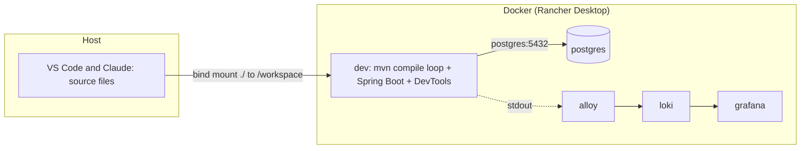

# 1. Dev environment

> [!NOTE]
> Reference for how the learning workspace runs. The Spring code lives in `playground/hello-boot`; infrastructure and configs live in `compose.yaml` and `infra/`. Facts here were verified on this machine (Windows 11, Rancher Desktop, JDK 17 on the host, no host Maven).

## What runs

| Service | Role | Where to reach it |
|---------|------|-------------------|
| `dev` | Build and run container (`maven:3.9-eclipse-temurin-17-alpine`), runs the Spring Boot app | `http://localhost:8080` |
| `postgres` | PostgreSQL 16, database `hello_db`, user `app` | `localhost:5433` from the host, `postgres:5432` from containers |
| `loki` | Log store | `localhost:3100` |
| `alloy` | Log collector (internal) | not published |
| `grafana` | Log UI | `http://localhost:3000` |



## The edit-run loop

- Source stays on the host and is **bind-mounted** into `dev`, so the editor and tools work as usual.
- A background loop in the container runs `mvn -q compile` when a `.java` file or anything under `src/main/**/resources/` changes. Spring DevTools then restarts the application context (about 1 to 4 seconds).
- DevTools reloads **classes**, not libraries: a new dependency in `pom.xml` needs `docker compose restart dev`.
- Run tests in the container: `docker compose exec dev mvn test` (`-Dtest=Class` for one class).

```bash
docker compose up -d          # start everything
docker compose logs -f dev    # follow the app
docker compose down           # stop (keeps the pgdata volume)
```

## Gotchas that cost time

> [!WARNING]
> After editing `compose.yaml`, run `docker compose config --quiet` first. A broken edit makes `up` fail while the old container keeps running with the old settings. Environment and port changes need `docker compose up -d --force-recreate dev`.

> [!CAUTION]
> Do not run `mvn clean`: it deletes `target/.last-build`, which the compile loop uses, and the loop silently stops recompiling.

| Problem | Cause and fix |
|---------|---------------|
| Containers show `Exited (255)` after a restart | The Docker daemon was stopped. Run `docker compose up -d` |
| Properties-only edits did nothing | The loop used to watch only `.java`; it now also watches `src/main/**/resources/**` |
| `docker compose exec ... sh -c '...|...'` prints wrong or empty output | PowerShell mangles the quoting. Use Git Bash with `MSYS_NO_PATHCONV=1` |
| Tests see the `dev` profile | The container sets `SPRING_PROFILES_ACTIVE=dev`. Pin profiles in tests |
| Odd test or runtime behaviour right after edits | Two compilers write `target/` (Maven's `javac` and, probably, VS Code's Eclipse compiler). Suspect stale or ECJ-compiled classes first |
| Spring Initializr gave a `SNAPSHOT` parent | Pin the released version (4.1.1 here) and remove the snapshot repositories |
| Boot 4 renamed starters | `spring-boot-starter-webmvc`; `spring-boot-starter-aop` no longer exists in 4.1.1, use `spring-boot-starter-aspectj` (verified on Maven Central) |

## VS Code and the Java extension

You use plain VS Code with the multi-root workspace file `E:\workspace\system-design-projects.code-workspace` (project root and the notes folder). Nested Maven projects are discovered automatically.

> [!IMPORTANT]
> If a file shows "non-project file" or the Spring Boot panels are empty, the Java language server has a stale project registration (it happened after the folder move). The Maven tab can still show the project because it reads `pom.xml` itself. **Java: Clean Java Language Server Workspace** only affects the **window it is run in**, so run it in the multi-root workspace window. Verify by reading `...\workspaceStorage\<id>\redhat.java\jdt_ws\.metadata\.plugins\org.eclipse.core.resources\.projects\hello-boot\.location`: it should point at `playground/hello-boot` and list `javanature`.

Dev Containers were tried and removed: reopening in a container loses the Claude session, its memory and your host extensions.
