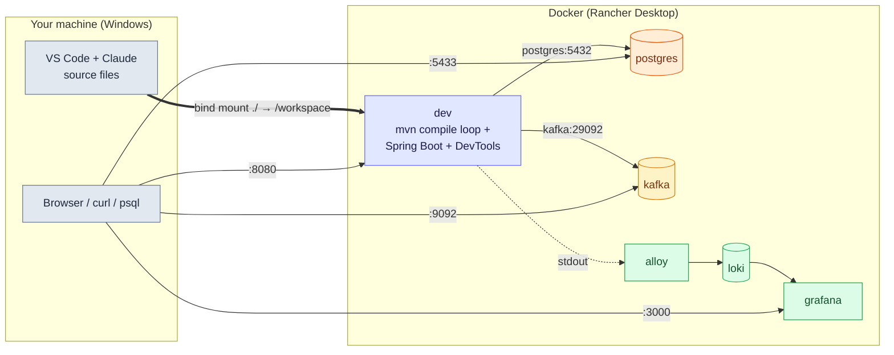
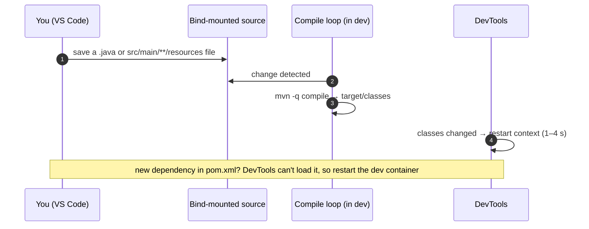

# 1. Dev Environment — How the Learning Workspace Runs

Source code stays on your machine; **everything that runs** (the JDK, Maven, the Spring app,
Postgres, the log stack) runs in Docker. A watch loop recompiles on save and DevTools restarts
the app in seconds. Most "it doesn't work" moments here are about that loop or about Docker,
not about Spring.

> [!TIP]
> **TL;DR**
> - `docker compose up -d` starts everything; the app is at `http://localhost:8080`, Grafana at `:3000`, Postgres at `localhost:5433`, Kafka at `localhost:9092`.
> - Save a `.java` or resource file → the loop runs `mvn -q compile` → DevTools restarts (1–4 s). **New dependency → `docker compose restart dev`.**
> - **Never `mvn clean`** (it kills the loop's marker file); after editing `compose.yaml`, validate, then **force-recreate**.

> [!NOTE]
> The Spring code lives in `playground/hello-boot`; infrastructure and configs live in
> `compose.yaml` and `infra/`. Facts here were verified on this machine (Windows 11, Rancher
> Desktop, JDK 17 on the host, no host Maven).

## What runs



| Service | Role | Where to reach it |
|---------|------|-------------------|
| `dev` | Build and run container (`maven:3.9-eclipse-temurin-17-alpine`), runs the Spring Boot app | `http://localhost:8080` |
| `postgres` | PostgreSQL 16, database `hello_db`, user `app` | `localhost:5433` from the host, `postgres:5432` from containers |
| `kafka` | Apache Kafka 4.2.2 in KRaft mode, one container as broker and controller. Two listeners; data in the named volume `kafka-data`; CLI scripts in `/opt/kafka/bin` | `localhost:9092` from the host, `kafka:29092` from containers |
| `loki` | Log store | `localhost:3100` |
| `alloy` | Log collector (internal) | not published |
| `grafana` | Log UI | `http://localhost:3000` |

## The edit-run loop



- Source stays on the host and is **bind-mounted** into `dev`, so the editor and tools work as usual.
- DevTools reloads **classes**, not libraries: a new dependency in `pom.xml` needs `docker compose restart dev`.
- Run tests in the container: `docker compose exec dev mvn test` (`-Dtest=Class` for one class).

```bash
docker compose up -d          # start everything
docker compose logs -f dev    # follow the app
docker compose down           # stop (keeps the pgdata volume)
```

## Gotchas that cost time

> [!WARNING]
> **Validate `compose.yaml` before applying it.** Run `docker compose config --quiet` first. A
> broken edit makes `up` fail while the old container keeps running with the old settings.
> Environment and port changes need `docker compose up -d --force-recreate dev`.

> [!CAUTION]
> **Don't run `mvn clean`.** It deletes `target/.last-build`, which the compile loop uses,
> and the loop silently stops recompiling.

| Problem | Cause and fix |
|---------|---------------|
| Containers show `Exited (255)` after a restart | The Docker daemon was stopped. Run `docker compose up -d` |
| Properties-only edits did nothing | The loop used to watch only `.java`; it now also watches `src/main/**/resources/**` |
| `docker compose exec ... sh -c '...\|...'` prints wrong or empty output | PowerShell mangles the quoting. Use Git Bash with `MSYS_NO_PATHCONV=1` |
| Tests see the `dev` profile | The container sets `SPRING_PROFILES_ACTIVE=dev`. Pin profiles in tests |
| Odd test or runtime behaviour right after edits | Two compilers write `target/` (Maven's `javac` and, probably, VS Code's Eclipse compiler). Suspect stale or ECJ-compiled classes first |
| Spring Initializr gave a `SNAPSHOT` parent | Pin the released version (4.1.1 here) and remove the snapshot repositories |
| Boot 4 renamed starters | `spring-boot-starter-webmvc`; `spring-boot-starter-aop` no longer exists in 4.1.1, use `spring-boot-starter-aspectj` (verified on Maven Central). The Kafka starter is `spring-boot-starter-kafka`. In Spring 7 `HttpStatus.UNPROCESSABLE_ENTITY` is deprecated, use `UNPROCESSABLE_CONTENT` (both constants verified in the jar) |
| Every endpoint returns 404 after several quick edits, with no error in the log | A **stale instance**: the app scanned `target/classes` while the watch loop was mid-compile and missed classes. `docker compose restart dev` fixes it (verified) |
| A start fails with `NoClassDefFoundError` or `FileNotFoundException` for a class that exists, then the next start is clean | The same compile race, seen many times. A clean `Started` line follows by itself. If every endpoint then returns 404, restart `dev` |
| A new Maven library or environment variable is not picked up | DevTools reloads classes only. A new dependency needs `docker compose restart dev`, and a changed `environment:` needs `up -d --force-recreate dev` |

## Writing notes for the Notebook

The Notebook serves these notes at `http://localhost:7373/notebook/<folder>/<file>` and reads the markdown live from disk. There is no browser automation here, so `curl` the page and read the rendered HTML to check a note. Problems found while writing:

| Problem | Cause and fix |
|---|---|
| An interview card shows a giant formula | `$$` inside a `<details>` `<summary>` line is read as KaTeX math. Rephrase the question. Inside backticks in the body it is safe |
| A summary looks different from the other notes | They use plain text in `<summary>`. Do not put `<code>` tags there |
| Card fields (Q, A, Why, Trap) run together | A single newline is not a line break. Put a blank line between fields |
| A diagram shows raw text | A Mermaid syntax error. Validate each block: in a scratch `.mjs` file, import `mermaid.core.mjs` and `purify.es.mjs` from the app's `node_modules` by file URL, stub `DOMPurify.addHook` and `sanitize`, then call `mermaid.parse(block)`. That checks syntax only, not layout |

## VS Code and the Java extension

You use plain VS Code with the multi-root workspace file
`E:\workspace\system-design-projects.code-workspace` (project root and the notes folder).
Nested Maven projects are discovered automatically.

> [!IMPORTANT]
> **A "non-project file" warning or empty Spring Boot panels mean a stale language-server
> registration** (it happened after the folder move). The Maven tab can still show the
> project because it reads `pom.xml` itself. **Java: Clean Java Language Server Workspace**
> only affects the **window it is run in**, so run it in the multi-root workspace window.
> Verify by reading
> `...\workspaceStorage\<id>\redhat.java\jdt_ws\.metadata\.plugins\org.eclipse.core.resources\.projects\hello-boot\.location`:
> it should point at `playground/hello-boot` and list `javanature`.

Dev Containers were tried and removed: reopening in a container loses the Claude session, its
memory and your host extensions.

## Troubleshooting quick checks

<details>
<summary>I saved a file and nothing restarted.</summary>

Check in order: was it under `src/main/java` or `src/main/**/resources`? Is the loop still
alive (`docker compose logs -f dev` shows compile activity)? Did someone run `mvn clean`
(missing `target/.last-build`)? Is it a `pom.xml` change (needs `docker compose restart dev`)?
</details>

<details>
<summary>I changed environment: in compose.yaml and the app still sees the old value.</summary>

A container's environment is fixed at creation. Run `docker compose config --quiet`, then
`docker compose up -d --force-recreate dev`.
</details>

<details>
<summary>The app can't reach Postgres, but psql from my laptop can.</summary>

From inside `dev` the address is `postgres:5432` (service name). `localhost` inside a
container is the container itself; `5433` is only the host-side port.
</details>

<details>
<summary>Behaviour doesn't match the code I just wrote.</summary>

Suspect stale classes: two compilers write to `target/` (Maven and probably VS Code's ECJ),
and moved classes can leave old `.class` files behind. Delete the specific stale file under
`target/classes` (not the whole `target/`), and let the loop recompile.
</details>

<details>
<summary>My app container cannot reach Kafka, but the console tools on my laptop can.</summary>

The broker answers the first connection with its advertised listener. `localhost:9092` is only right for the host. From inside `dev` the address is `kafka:29092`, set through `SPRING_KAFKA_BOOTSTRAP_SERVERS` on the `dev` service. Check reachability with `docker compose exec dev sh -c 'nc -z -w 3 kafka 29092'`.
</details>

<details>
<summary>The app started but every endpoint returns 404.</summary>

Check the log for a recent `Started` line and for a `NoClassDefFoundError` just before it. The running instance probably scanned an incomplete `target/classes` during a compile. Run `docker compose restart dev` and probe `/messages` until it returns 200.
</details>

**Next:** [01 Spring Boot basics overview](/notebook/spring-boot-system-design/01-spring-boot-basics/overview)