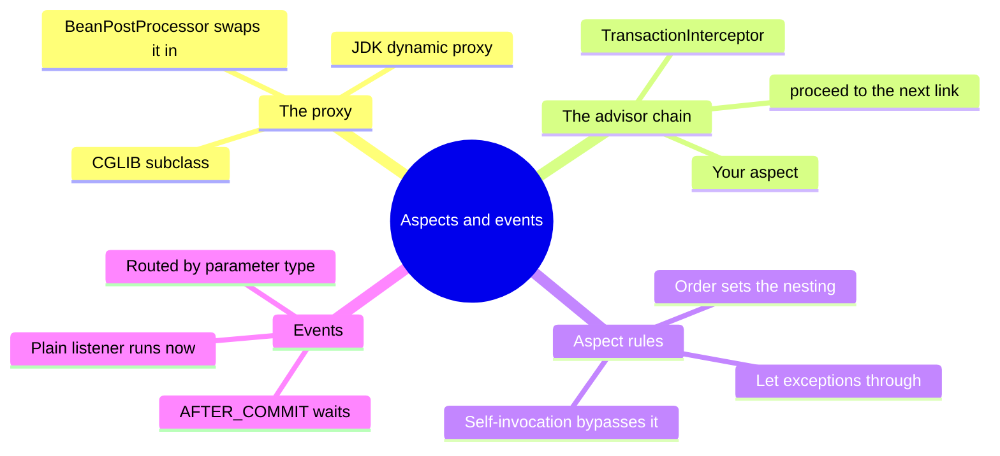
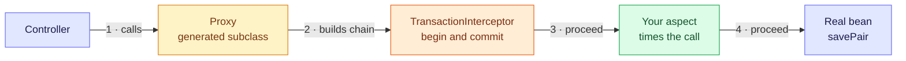
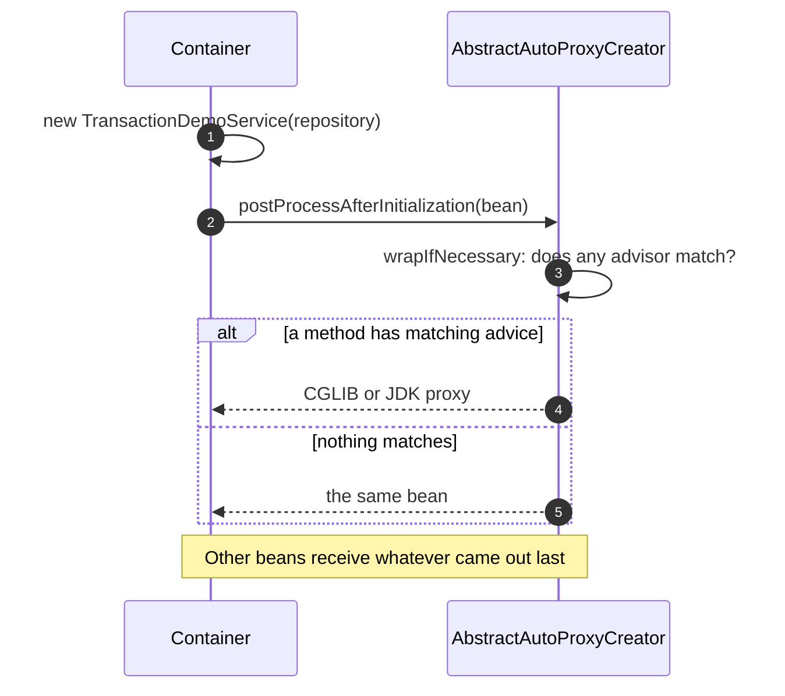
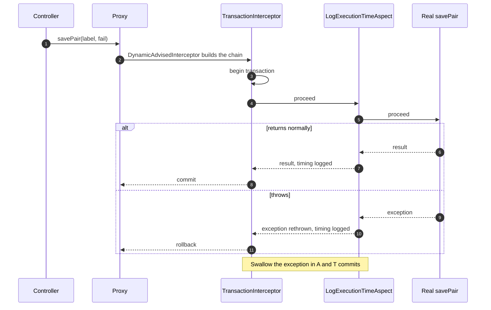
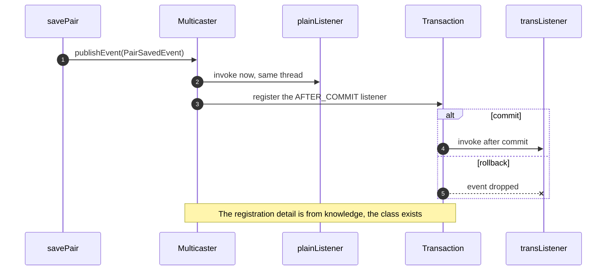
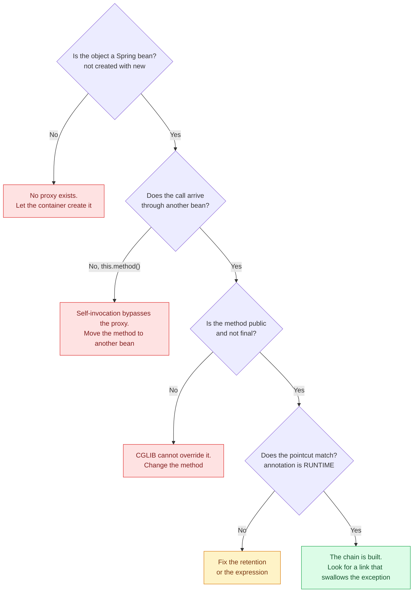

# 7. AOP Aspects and Transactional Events — The Chain Behind the Magic

Spring never hands you your object. It hands you a **generated wrapper**, and every piece of "magic" (`@Transactional`, your own `@Around`, `@TransactionalEventListener`) is a link in the chain that wrapper walks. Everything below was reproduced on the running `hello-boot` app (Spring Framework 7.0.9, Boot 4.1.1).

> [!TIP]
> **TL;DR: the 30-second interview answer**
> - A **proxy** is a generated subclass (CGLIB) or interface implementation (JDK) that a `BeanPostProcessor` swaps in after your bean is initialised. A call goes proxy, then the **advisor chain**, then your real method.
> - Every link must call `proceed()` and **let exceptions through**. An aspect that swallows an exception makes the transaction link commit.
> - Events are routed **by parameter type** at runtime. A plain `@EventListener` runs inside the transaction; `AFTER_COMMIT` waits for the commit and is dropped on rollback.

## Aspects and events at a glance



Proxy basics (JDK vs CGLIB, self-invocation) are in [1. Overview](/notebook/spring-boot-system-design/01-spring-boot-basics/overview). This note is about what happens **inside** the proxy.

## Mental model: a call walks a chain



Blue is your code, amber is generated, orange is the transaction, green is your own advice. The transaction link sits **outside** your aspect, so your timer measures only the method body, not begin or commit. Each link hands over with `proceed()` (in the code it is `ReflectiveMethodInvocation.proceed()`).

## How it works

### 1. Startup: who builds the proxy



`javap` on the real jar shows `AbstractAutoProxyCreator` implements `SmartInstantiationAwareBeanPostProcessor` and has `postProcessAfterInitialization`, `wrapIfNecessary` and `createProxy` *(verified)*. The order in which they call each other is from knowledge of the source.

### 2. A request: the chain, from a real stack trace



### 3. Events: type-based routing



## What we reproduced *(verified)*

| Check | Real output | What it proves |
|---|---|---|
| `GET /demo/tx/class` | `TransactionDemoService$$SpringCGLIB$$0 extends TransactionDemoService` | The controller holds a generated subclass, not your object |
| Startup log, `org.springframework.aop.framework=TRACE` | 4 CGLIB proxies (`JdbcDemoRepository`, `MessageService`, `TransactionDemoService`, `MessageRepository`), JDK proxies for the Spring Data repository (target `SimpleJpaRepository`) | Proxies exist before `Started`; classes get CGLIB, interfaces get JDK |
| Failing call with a swallowing `catch` | HTTP **200**, row `swallow-test / first` committed | The aspect hid the exception from `TransactionInterceptor` |
| Same call after `catch` rethrows | HTTP **500**, no rows, ERROR line plus a timing line | Rollback restored, timing still logged via `finally` |
| Listener log, `fail=false` then `fail=true` | `plain listener: evt-ok`, `savePair: 14 ms`, `after-commit listener: evt-ok`, `plain listener: evt-fail` and **no** after-commit line | Plain runs before commit and leaks on rollback; after-commit runs only after a commit |

The real call chain, read bottom to top from a stack trace taken **inside** the listener: `TransactionDemoController.pair`, then `...$$SpringCGLIB$$0.savePair`, `CglibAopProxy$DynamicAdvisedInterceptor.intercept`, `TransactionInterceptor.invoke`, `LogExecutionTimeAspect.time`, `TransactionDemoService.savePair`, `AbstractApplicationContext.publishEvent`, `SimpleApplicationEventMulticaster.multicastEvent`, `ApplicationListenerMethodAdapter.onApplicationEvent`, `PairSavedListener.plainListener`.

> [!NOTE]
> **Classes with only `@Repository` were proxied too** (`MessageRepository`, `JdbcDemoRepository`, no `@Transactional`). The likely cause is exception translation to `DataAccessException`. That cause is from knowledge, only the proxying is verified.

## Listeners compared

| Listener | Runs when | Sees a rollback? | Risk | Use when |
|---|---|---|---|---|
| **`@EventListener`** | At the `publishEvent` line, inside the transaction | Too late, already ran | ⚠️ Side effect for data that is then rolled back | In-process reactions that are safe to repeat |
| **`@TransactionalEventListener(AFTER_COMMIT)`** | After a successful commit | Dropped | ⚠️ Skipped with no active transaction, lost if the app dies after commit | ✅ Side effects that need committed data |

`TransactionPhase` also has `BEFORE_COMMIT`, `AFTER_ROLLBACK` and `AFTER_COMPLETION` *(from knowledge)*.

## Debugging: why did my advice not run?



To see which beans got a proxy at startup, set `logging.level.org.springframework.aop.framework=TRACE` and look for `Creating CGLIB proxy` and `Creating JDK dynamic proxy` *(verified, but noisy: turn it off afterwards)*.

## In Spring Boot

In Boot 4 the AOP dependency is `spring-boot-starter-aspectj` *(verified in the pom)*. The marker annotation needs `RUNTIME` retention because the proxy reads it by reflection while the app runs.

```java
@Target(ElementType.METHOD)
@Retention(RetentionPolicy.RUNTIME)
public @interface LogExecutionTime {}

@Aspect
@Component
public class LogExecutionTimeAspect {
    private static final Logger log = LoggerFactory.getLogger(LogExecutionTimeAspect.class);

    @Around("@annotation(com.learn.hello_boot.config.LogExecutionTime)")
    public Object time(ProceedingJoinPoint joinPoint) throws Throwable {
        long start = System.nanoTime();
        try {
            return joinPoint.proceed();   // exceptions travel up to TransactionInterceptor
        } finally {
            log.info("{}: {} ms", joinPoint.getSignature().toShortString(),
                    (System.nanoTime() - start) / 1_000_000);
        }
    }
}
```

We ran a `catch` plus rethrow plus `finally` version of this. The plain `try`/`finally` above has the same chain behaviour but was not run as written.

```java
public record PairSavedEvent(String label) {}

// in the @Transactional method, after the first save:
publisher.publishEvent(new PairSavedEvent(label));

@Component
public class PairSavedListener {
    @EventListener                                              // runs at the publish line
    public void plainListener(PairSavedEvent event) { /* ... */ }

    @TransactionalEventListener(phase = TransactionPhase.AFTER_COMMIT)   // runs after commit
    public void transListener(PairSavedEvent event) { /* ... */ }
}
```

Nothing in `savePair` mentions the listener. `EventListenerMethodProcessor`, `DefaultEventListenerFactory` and `ApplicationListenerMethodAdapter` exist in spring-context *(verified)*; that the processor scans for `@EventListener` methods after the singletons exist and registers one adapter per method is from knowledge. The stack trace above shows the multicaster calling the adapter, which calls your method by reflection.

> [!WARNING]
> **Never swallow an exception inside an advice or inside a `@Transactional` method.** The link outside you only learns about a failure through the exception. Swallow it and `TransactionInterceptor` sees a normal return and commits, which we reproduced as HTTP 200 with a half-saved pair.

> [!WARNING]
> **A plain `@EventListener` is not "after save".** It runs at the publish line, inside the transaction. If a rollback follows, the announcement already went out.

> [!CAUTION]
> **`AFTER_COMMIT` is not a delivery guarantee.** If the process dies between the commit and the listener, the event is gone because it only lived in memory. That gap is what the transactional outbox closes. With no active transaction the listener is skipped unless `fallbackExecution = true` (the attribute exists, *verified*; the behaviour is from knowledge).

## Failure modes

| Problem | Symptom | Fix |
|---|---|---|
| **Aspect swallows the exception** | HTTP 200, half-saved data, no rollback | `try`/`finally`, or rethrow |
| **Self-invocation, `private`, `final`, `new`** | Advice or transaction silently missing | Call through another bean, change the method, let the container create the bean |
| **Plain listener for a side effect** | Notification for a row that was rolled back | `AFTER_COMMIT` (or an outbox) |
| **No active transaction** | `AFTER_COMMIT` listener never fires | Publish inside a transaction or set `fallbackExecution` |
| **Annotation order on the method** | Expected the chain to flip, nothing changed | Order comes from `@Order` / `Ordered`, not from where you write the annotation |

## Interview questions

<details>
<summary>Your controller injects TransactionDemoService, and service.getClass().getName() prints a name containing SpringCGLIB. Who created that class, and when?</summary>

A `BeanPostProcessor` (`AbstractAutoProxyCreator`) created it right after your bean was initialised, during startup and before `Started` appeared in the log. `wrapIfNecessary` found a matching advisor (`@Transactional`) and `createProxy` returned a generated subclass. Other beans are injected with that wrapper, never with the raw object.
</details>

<details>
<summary>A colleague adds @Transactional to a private helper and to a method on an object created with new. Neither starts a transaction. Why?</summary>

A CGLIB proxy works by overriding methods, and it cannot override `private` or `final` ones. An object created with `new` never passes through the container, so no post-processor ever wraps it. In both cases there is no proxy link in the call path *(from knowledge, consistent with the self-invocation result)*. The fix is to make the method public and non-final on a container-managed bean, or to call it through another bean.
</details>

<details>
<summary>Your @Around aspect logs exceptions in a catch and does not rethrow. A failing request returns 200 and one of two rows is committed. Explain.</summary>

The aspect sits inside the `TransactionInterceptor` link. Its `catch` ate the `IllegalStateException`, so `proceed()` returned normally to the transaction link, which committed. We reproduced it: HTTP 200 and a committed `swallow-test / first` row. The fix is `try`/`finally` or rethrowing, and the same rule applies to a `catch` in a `@Transactional` method.
</details>

<details>
<summary>One publishEvent(new PairSavedEvent(...)) and two beans each have a method taking PairSavedEvent. What runs, on which thread?</summary>

Both, synchronously on the request thread. The log showed the plain listener, then the method's own timing line, then the after-commit listener for a successful call, and only the plain listener for a rolled-back call. Routing is by the parameter type, so it does not matter which class published the event.
</details>

<details>
<summary>Nothing in savePair references PairSavedListener. How does the listener get called?</summary>

At startup Spring wraps each `@EventListener` method in an `ApplicationListenerMethodAdapter` that remembers the parameter type. `publishEvent` goes to the multicaster, which asks every listener whether it supports `PairSavedEvent` and calls the matching adapters, which call your method by reflection. The stack trace showed `multicastEvent`, `onApplicationEvent` and `plainListener` in that order. Nothing is linked at compile time.
</details>

<details>
<summary>A scheduled job publishes an event inside no transaction, and your AFTER_COMMIT listener never fires. Why, and what are the options?</summary>

`@TransactionalEventListener` attaches to an active transaction. With none, the event is skipped unless `fallbackExecution = true` *(attribute verified, behaviour from knowledge)*. Either open a transaction around the publish, or set `fallbackExecution`, accepting that the listener then runs immediately with no commit to wait for.
</details>

<details>
<summary>An AFTER_COMMIT listener sends a Kafka message and the pod is killed one millisecond after the commit. What is lost, and how do you fix it?</summary>

The message. The row is committed, but the event only existed in memory, so nothing will ever publish it. The fix is the transactional outbox: write the event as a row in the **same** transaction as the data, and let a relay publish it later, which gives at-least-once delivery.
</details>

## Key takeaways

| Remember | Because |
|---|---|
| The controller holds a generated wrapper, not your bean | A `BeanPostProcessor` swaps it in after initialisation |
| Advice is a chain, and each link calls `proceed()` | Exceptions travelling back up are how outer links learn about failure |
| Swallowing an exception inside the chain commits | `TransactionInterceptor` only sees a normal return *(verified)* |
| Events route by parameter type, at runtime | Nothing is linked at compile time *(verified in the stack trace)* |
| Plain listeners run before commit | They leak side effects on rollback *(verified)* |
| `AFTER_COMMIT` is not durable | A crash after commit loses the event, hence the outbox |

**Related:** [1. Overview](/notebook/spring-boot-system-design/01-spring-boot-basics/overview) · [Transactions in Spring](/notebook/spring-boot-system-design/02-persistence/transactions-in-spring) · [Sprint plan](/notebook/spring-boot-system-design/quick-sessions/core-patterns-spring-maven/plan) · [Recall cards](/notebook/spring-boot-system-design/quick-sessions/core-patterns-spring-maven/cards)
