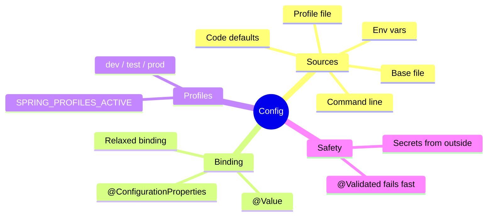
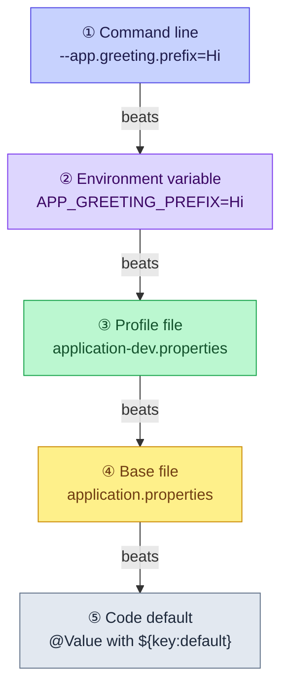
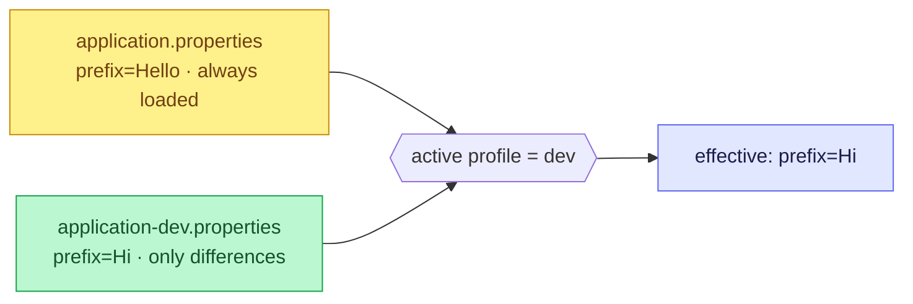

# 5. Configuration and Profiles — One JAR, Every Environment

Values that change per environment (a database URL, a password, a Kafka address) stay
**out of the code**, so the same JAR runs on your laptop, in CI and in production. Boot
collects them from many sources and **the higher source wins**.

> [!TIP]
> **TL;DR: the 30-second interview answer**
> - Precedence (high → low): **command line > env vars > profile file > base file > code defaults**.
> - Groups of settings → **`@ConfigurationProperties` record + `@Validated`**, so bad config fails at **startup**, not at 3 a.m.
> - A **profile** file (`application-dev.properties`) overlays only the **differences**. Secrets come from **env vars / a secret store**, never committed files.

## At a glance



## Where Boot reads configuration from



The same property can be set in several places and **the higher one wins**. Boot lists more
sources than these five, but these are the ones that matter day to day.

**Relaxed binding** maps names between styles. These are all the *same* property:

| Where | Spelling |
|---|---|
| Properties / YAML file | `app.greeting.default-name` |
| Record component | `defaultName` |
| Environment variable | `APP_GREETING_DEFAULTNAME` |

## `@Value` vs `@ConfigurationProperties`

| | `@Value` | `@ConfigurationProperties` |
|---|----------|----------------------------|
| Shape | One property: `@Value("${app.greeting.prefix}")` | A group of properties bound into one typed object (a record works) |
| Type safety | A string key | Typed fields, all settings in one place |
| Validation | Manual | `@Validated` plus constraints, so bad config fails at **startup** |
| Missing key | Startup fails unless `${key:default}` | Field is `null` → caught by `@NotBlank` |
| Best for | One quick value | ✅ Anything with related settings |

```java
@Validated
@ConfigurationProperties(prefix = "app.greeting")
public record GreetingProperties(@NotBlank String prefix, @NotBlank String defaultName) {}
// registered with @ConfigurationPropertiesScan on the main class
```

## Profiles

A **profile** is a named set of configuration layered on top of the base file.



Activate with `spring.profiles.active=dev` or `SPRING_PROFILES_ACTIVE=dev`. In our setup the
variable is set under `environment:` in `compose.yaml`.

## What we saw *(verified)*

Same property, three sources:

| Source | Value | Result |
|--------|-------|--------|
| `application.properties` | `Hello` | Used with no profile |
| `application-dev.properties` (profile `dev` active) | `Hi` | Beat the base file |
| Env var `APP_GREETING_PREFIX` | `Hey` | Beat both |

A missing required value in a validated `@ConfigurationProperties` record stops the app at startup:

```text
Binding to target com.learn.hello_boot.config.GreetingProperties failed:

Property: app.greeting.defaultName
Value: "null"
Reason: must not be blank
```

The log tells which profile is active: `No active profile set, falling back to 1 default
profile: "default"` versus `The following 1 profile is active: "dev"`.

> [!IMPORTANT]
> **Secrets are injected from outside and outrank the files.** Our datasource settings come
> from environment variables on the `dev` container (`SPRING_DATASOURCE_URL`,
> `SPRING_DATASOURCE_USERNAME`, `SPRING_DATASOURCE_PASSWORD`), not from a committed file.

## Our setup (Docker and DevTools)

> [!WARNING]
> **A container's environment is fixed at creation.** After editing `environment:` in
> `compose.yaml`, run `docker compose config --quiet`, then
> `docker compose up -d --force-recreate dev`. A broken edit makes `up` fail while the old
> container keeps serving the old settings.

> [!WARNING]
> **Spring reads the copy in `target/classes`.** The watch loop must watch
> `src/main/**/resources/**`, otherwise a properties-only edit never restarts the app.

## Interview questions

<details>
<summary>application-prod.properties sets prefix=Hi, the env var APP_GREETING_PREFIX=Hey is set, and someone starts the JAR with --app.greeting.prefix=Yo. Which value wins? And without the flag?</summary>

**Yo**: command-line arguments beat everything else here. Without the flag, **Hey**:
environment variables beat profile files. `Hi` only wins if neither is set. Relaxed binding
is what makes `APP_GREETING_PREFIX` the same property as `app.greeting.prefix`.
</details>

<details>
<summary>A required setting is missing in production. When do you find out with @Value, plain @ConfigurationProperties, and validated @ConfigurationProperties?</summary>

- `@Value("${key}")`: startup fails (unresolvable placeholder), unless you wrote
  `${key:default}`, in which case the default is used **silently**.
- `@ConfigurationProperties` without validation: the field is just `null`, and you find out
  as an NPE on some later request.
- `@Validated` + `@NotBlank`: startup fails with a clear binding report naming the property
  *(verified)*. That's the one you want.
</details>

<details>
<summary>How do you get the database password to the app without it ever being in git?</summary>

Inject it from outside at deploy time: an environment variable (`SPRING_DATASOURCE_PASSWORD`),
a mounted Kubernetes Secret, or a secret manager integration. These sources outrank the
property files, so the committed file can hold a harmless placeholder or nothing at all.
</details>

<details>
<summary>You edited environment: in compose.yaml, but the app still uses the old value after a restart. Why?</summary>

A container's environment is fixed when the container is **created**. Restarting reuses it.
Validate with `docker compose config --quiet`, then recreate with
`docker compose up -d --force-recreate dev`.
</details>

<details>
<summary>A config test expects "Hello" from the base file and passes on your laptop, but gets "Hi" inside the container. What's going on?</summary>

The container sets `SPRING_PROFILES_ACTIVE=dev`, and test JVMs inherit the environment, so
`application-dev.properties` overrides the base value *(verified)*. Pin the profile in the
test with `@ActiveProfiles("test")`.
</details>

<details>
<summary>Should profiles switch values or switch beans?</summary>

Mostly **values** (URLs, log levels, flags) in profile files. Use `@Profile` on beans
sparingly, e.g. a fake email sender in `dev`. Every profile-only bean is a code path that may
never run in your tests, so prod-only beans are the riskiest kind.
</details>

## Key takeaways

| Remember | Because |
|---|---|
| CLI > env > profile file > base file > default | The higher source wins |
| `@ConfigurationProperties` + `@Validated` | Bad config fails at startup |
| Profile files hold only differences | Base file stays the single source of defaults |
| Secrets via env vars / secret store | Never in git; they outrank files |
| Recreate containers after env changes | Their environment is fixed at creation |

**Next:** [6. Testing](/notebook/spring-boot-system-design/01-spring-boot-basics/testing-spring-boot)
