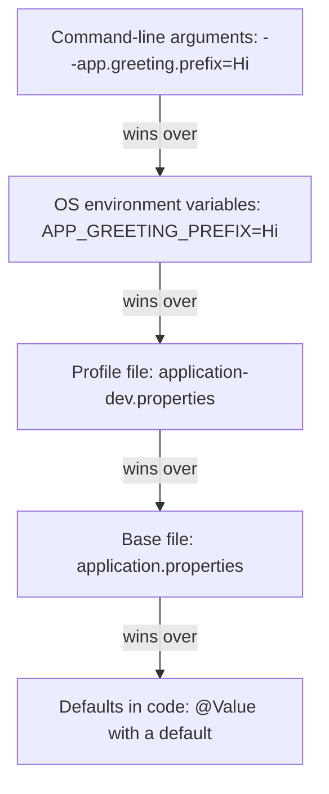

# 5. Configuration and profiles

## Where Boot reads configuration from

Values that change per environment (a database URL, a password, a Kafka address) stay out of the Java code so one JAR runs everywhere.



The same property can be set in several places and **the higher one wins**. *Relaxed binding* maps names between styles: `app.greeting.default-name` in a file, `defaultName` in a record, and `APP_GREETING_DEFAULTNAME` as an environment variable are the same property.

## `@Value` vs `@ConfigurationProperties`

| | `@Value` | `@ConfigurationProperties` |
|---|----------|----------------------------|
| Shape | One property: `@Value("${app.greeting.prefix}")` | A group of properties bound into one typed object (a record works) |
| Type safety | A string key | Typed fields, all settings in one place |
| Validation | Manual | `@Validated` plus constraints, so bad config fails at **startup** |
| Best for | One quick value | Anything with related settings |

```java
@Validated
@ConfigurationProperties(prefix = "app.greeting")
public record GreetingProperties(@NotBlank String prefix, @NotBlank String defaultName) {}
// registered with @ConfigurationPropertiesScan on the main class
```

## Profiles

A **profile** is a named set of configuration.

| File | Used when |
|------|-----------|
| `application.properties` | Always (base values) |
| `application-dev.properties` | Profile `dev` is active, overrides the base file |

Activate with `spring.profiles.active=dev` or the environment variable `SPRING_PROFILES_ACTIVE=dev`. A profile file holds only the **differences**. In our setup the variable is set under `environment:` in `compose.yaml`.

## What we saw *(verified)*

Same property, three sources:

| Source | Value | Result |
|--------|-------|--------|
| `application.properties` | `Hello` | Used with no profile |
| `application-dev.properties` (profile `dev` active) | `Hi` | Beat the base file |
| Env var `APP_GREETING_PREFIX` | `Hey` | Beat both |

A missing required value in a validated `@ConfigurationProperties` record stops the app at startup:

```text
Binding to target com.learn.hello_boot.config.GreetingProperties failed:

Property: app.greeting.defaultName
Value: "null"
Reason: must not be blank
```

The log tells which profile is active: `No active profile set, falling back to 1 default profile: "default"` versus `The following 1 profile is active: "dev"`.

> [!IMPORTANT]
> Our datasource settings come from environment variables on the `dev` container (`SPRING_DATASOURCE_URL`, `SPRING_DATASOURCE_USERNAME`, `SPRING_DATASOURCE_PASSWORD`), not from a committed file. Secrets are injected from outside and outrank the property files.

## Our setup (Docker and DevTools)

> [!WARNING]
> A container's environment is fixed at creation: after editing `environment:` in `compose.yaml`, run `docker compose config --quiet`, then `docker compose up -d --force-recreate dev`. A broken edit makes `up` fail while the old container keeps serving the old settings. Also, Spring reads the copy of the file in `target/classes`, so the watch loop has to watch `src/main/**/resources/**`, otherwise a properties-only edit never restarts the app.

## Interview questions

**In what order does Boot resolve a property?**
Highest to lowest: command-line arguments, environment variables, profile-specific files, the base `application` file, then defaults. (Boot lists more sources, but these are the ones that matter day to day.)

**`@Value` vs `@ConfigurationProperties`?**
`@Value` injects a single value by key. `@ConfigurationProperties` binds a prefix into a typed object, supports relaxed binding, nested types and validation, and is the better choice for groups of settings.

**How do you keep secrets out of the repository?**
Do not put them in committed property files. Inject them through environment variables, a secret store, or externalised config at deploy time. They outrank the files.

**What does `@Value("${key}")` do when the key is missing?**
Startup fails. Supply a fallback with `${key:default}`.

**How do profiles work, and how would you use them?**
`application-{profile}.properties` is loaded on top of the base file only when that profile is active. Use `dev`/`prod` differences for logging, database URLs and feature flags; keep the shared defaults in the base file.
