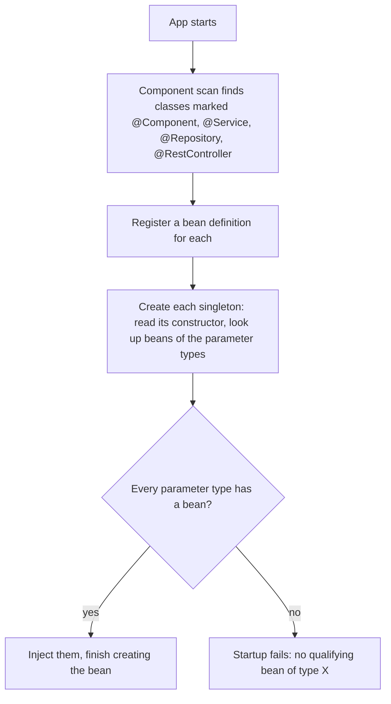
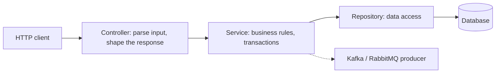

# 2. Dependency injection and layers

## The idea

A class declares what it **needs** through its constructor, and the container supplies it. The class never calls `new` on its collaborators.

```java
@RestController
public class HelloController {
    private final GreetingService service;

    public HelloController(GreetingService service) {   // "I need one of these"
        this.service = service;
    }
}
```

Without this, a controller would be hard-wired to one concrete class, could not be tested with a fake, and would have to know how to build the service's own dependencies (a database connection, a Kafka producer).

## How the container wires beans



| Term | Meaning |
|------|---------|
| Bean | An object created and managed by the container |
| `@Component`, `@Service`, `@Repository`, `@RestController` | Mark a class for component scan. Same registration; the name states the layer. `@Repository` also enables exception translation |
| Constructor injection | Dependencies arrive through the constructor. With a single constructor, `@Autowired` is not needed |
| Singleton scope | Default: one shared instance per bean, not one per request |

## `@Component` vs `@Bean`

| | `@Component` family | `@Bean` method |
|---|---------------------|----------------|
| Where | On **your own** class, found by scanning | In a `@Configuration` class, returning an object |
| Use for | Your services, controllers, repositories | Third-party classes you cannot annotate, or objects needing custom construction |

`@Configuration` classes are CGLIB-proxied so that calling one `@Bean` method from another still returns the same singleton instead of creating a second object.

## What we saw *(verified)*

A controller constructor required `GreetingService`, but the class had no `@Service`:

```text
APPLICATION FAILED TO START

Parameter 0 of constructor in HelloController required a bean of type
'GreetingService' that could not be found.
```

- It fails at **startup**, not at the first request, because the container checks every constructor while building the context.
- The **whole app** goes down, even `/hello`, which does not use the service.
- Adding `@Service` fixed it, and DevTools restarted by itself.

## Layers



| Layer | Job | Capstone example |
|-------|-----|------------------|
| Controller | HTTP only | `OrderController` |
| Service | Rules and orchestration, the transaction boundary | `OrderService`: check stock, create order, publish event |
| Repository | Data access | `OrderRepository` |

Because `OrderService` receives its repository and producer through the constructor, tests can pass fakes.

> [!WARNING]
> The class must live in or below the `@SpringBootApplication` package, otherwise component scan never sees it. Beans are singletons shared by every request, so do not keep per-request state in fields.

## Interview questions

**Constructor injection vs field injection?**
Constructor injection makes dependencies explicit and lets fields be `final`. The object can never exist half-built, and a unit test can create it with `new`. Field injection (`@Autowired` on a field) hides dependencies and needs reflection or a Spring context in tests.

**What happens with a circular dependency?**
Since Boot 2.6 circular references are prohibited by default, so startup fails (`BeanCurrentlyInCreationException`). The real fix is to redesign (extract a third bean). Setter injection or `@Lazy` are escape hatches.

**Two beans of the same type?**
Injection becomes ambiguous and fails. Mark one `@Primary`, or select with `@Qualifier("name")`. Injecting a `List<Interface>` collects all of them.

**Is a singleton bean thread-safe?**
No. One instance serves all request threads, so it must be stateless or protect its state.

**Difference between `@Component` and `@Bean`?**
`@Component` is for your own classes and is discovered by scanning. `@Bean` is a factory method, used for classes you do not own or that need custom construction.
