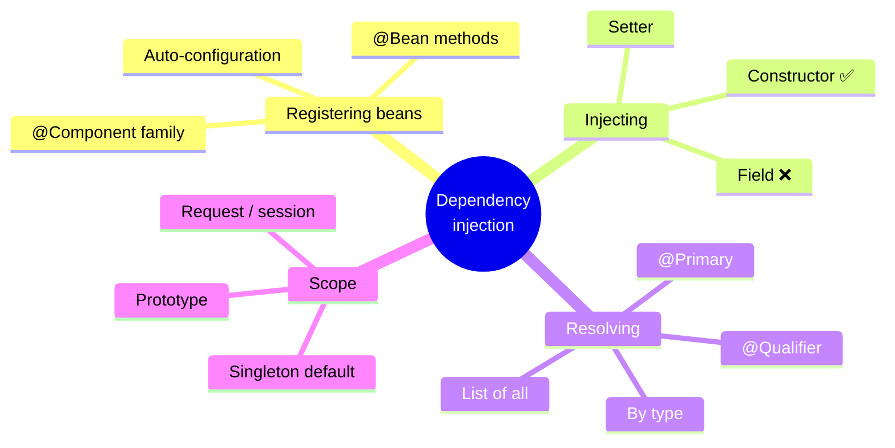
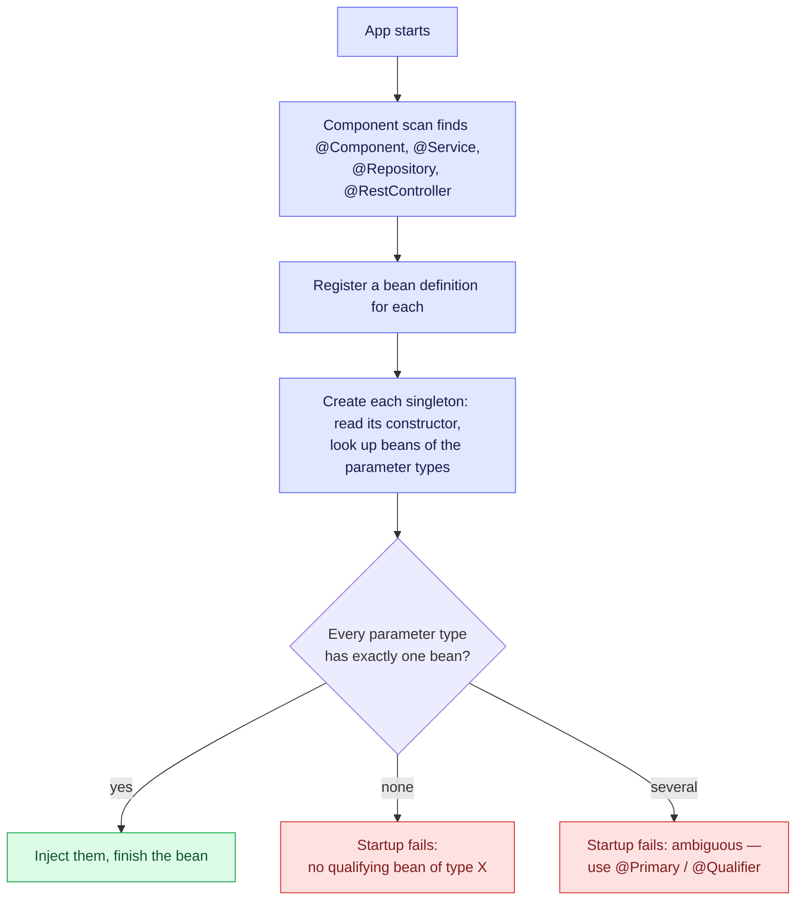
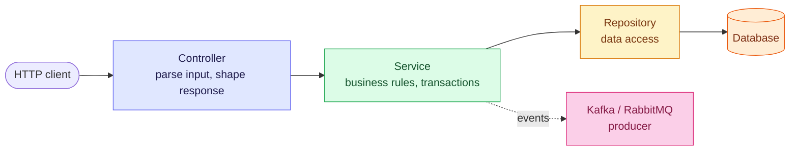

# 2. Dependency Injection and Layers

A class declares what it **needs** through its constructor, and the container supplies it.
The class never calls `new` on its collaborators. Once you see that, every Spring
annotation is just a way of telling the container *what to build* or *how to wire it*.

> [!TIP]
> **TL;DR: the 30-second interview answer**
> - **Constructor injection**: dependencies are explicit, fields can be `final`, tests can use `new` with fakes.
> - The container wires beans **at startup**. A missing bean fails the *whole app* before any request.
> - Beans are **singletons** shared by all request threads, so keep them **stateless**.
> - Layers: **Controller** (HTTP) → **Service** (rules + transaction boundary) → **Repository** (data).

## DI at a glance



## The idea in code

```java
@RestController
public class HelloController {
    private final GreetingService service;

    public HelloController(GreetingService service) {   // "I need one of these"
        this.service = service;                          // single constructor → no @Autowired needed
    }
}
```

Without this, a controller would be hard-wired to one concrete class, could not be tested
with a fake, and would have to know how to build the service's own dependencies (a database
connection, a Kafka producer).

## How the container wires beans



| Term | Meaning |
|------|---------|
| Bean | An object created and managed by the container |
| `@Component`, `@Service`, `@Repository`, `@RestController` | Mark a class for component scan. Same registration; the name states the layer. `@Repository` also enables exception translation |
| Constructor injection | Dependencies arrive through the constructor. With a single constructor, `@Autowired` is not needed |
| Singleton scope | Default: one shared instance per bean, not one per request |

## Injection styles compared

| Style | Dependencies visible? | `final` fields? | Unit test without Spring? | Verdict |
|---|---|---|---|---|
| **Constructor** | ✅ In the signature | ✅ | ✅ `new Service(fake)` | ✅ Default |
| Setter | Partly | ❌ | ✅ | Optional dependencies only |
| Field (`@Autowired` on a field) | ❌ Hidden | ❌ | ❌ Needs reflection or a context | ⚠️ Avoid |

## `@Component` vs `@Bean`

| | `@Component` family | `@Bean` method |
|---|---------------------|----------------|
| Where | On **your own** class, found by scanning | In a `@Configuration` class, returning an object |
| Use for | Your services, controllers, repositories | Third-party classes you cannot annotate, or objects needing custom construction |

```java
@Configuration
class ClockConfig {
    @Bean
    Clock clock() {                 // a JDK class you can't annotate with @Component
        return Clock.systemUTC();
    }
}
```

`@Configuration` classes are CGLIB-proxied so that calling one `@Bean` method from another
still returns the same singleton instead of creating a second object.

## What we saw *(verified)*

A controller constructor required `GreetingService`, but the class had no `@Service`:

```text
APPLICATION FAILED TO START

Parameter 0 of constructor in HelloController required a bean of type
'GreetingService' that could not be found.
```

- It fails at **startup**, not at the first request, because the container checks every constructor while building the context.
- The **whole app** goes down, even `/hello`, which does not use the service.
- Adding `@Service` fixed it, and DevTools restarted by itself.

## Layers



Dependencies point **one way**: a controller may call a service, never the other way round.

| Layer | Job | Capstone example |
|-------|-----|------------------|
| Controller | HTTP only | `OrderController` |
| Service | Rules and orchestration, the transaction boundary | `OrderService`: check stock, create order, publish event |
| Repository | Data access | `OrderRepository` |

Because `OrderService` receives its repository and producer through the constructor, tests
can pass fakes.

> [!WARNING]
> **Classes outside the `@SpringBootApplication` package are never scanned.** Put them in
> or below that package, or the bean silently doesn't exist and startup fails.

> [!CAUTION]
> **Beans are singletons shared by every request thread.** A mutable field (a counter, the
> "current user") becomes a data race across users. Keep per-request state in local
> variables or method parameters.

## Interview questions

<details>
<summary>StripeGateway and PaypalGateway both implement PaymentGateway and are @Components. OrderService injects PaymentGateway. What happens, and how do you fix it for different intents?</summary>

Startup fails with `NoUniqueBeanDefinitionException`: two candidates for one type. The fix
depends on what you mean:
- **One default, rarely overridden** → `@Primary` on Stripe.
- **This class needs a specific one** → `@Qualifier("paypalGateway")` on the parameter.
- **Choose per request** → inject `Map<String, PaymentGateway>` (bean name → bean) or
  `List<PaymentGateway>` and pick at runtime: the strategy pattern, free from the container.
</details>

<details>
<summary>A teammate stores currentUserId in a field of a @Service to avoid passing it around. Under load, users see each other's orders. Explain.</summary>

A `@Service` is a **singleton**: one instance shared by every request thread. Thread A writes
the field, thread B overwrites it, and thread A then reads B's user. It's a race, not a
caching bug. Pass the id as a parameter, or read it from a thread-bound context
(`SecurityContextHolder`) at the point of use.
</details>

<details>
<summary>OrderService needs InventoryService and InventoryService needs OrderService. What happens on Boot 3/4, and what's the right fix?</summary>

Circular references are prohibited by default since Boot 2.6, so startup fails with
`BeanCurrentlyInCreationException`. Constructor injection can't create either bean first.
The right fix is design: extract the shared logic into a third bean both depend on, or
decouple with an application event. `@Lazy` on one parameter works, but only hides the cycle.
</details>

<details>
<summary>Show why constructor injection makes OrderService easy to unit test.</summary>

`new OrderService(fakeRepository, fakePublisher)`: no Spring, no reflection, millisecond
tests. Fields are `final`, so the object can't exist half-wired. With field injection you'd
need `@InjectMocks`/reflection or a Spring context just to set the dependencies.
</details>

<details>
<summary>You need a RestClient with a base URL and timeouts. @Component or @Bean, and why?</summary>

A `@Bean` method in a `@Configuration` class. You don't own `RestClient`, so you can't
annotate it, and it needs builder-based construction. Inject Boot's auto-configured
`RestClient.Builder` into the method so you inherit its defaults and message converters.
</details>

<details>
<summary>In a @Configuration class, beans a() and c() both call b(). How many B instances exist? What if the class were a plain @Component?</summary>

**One.** `@Configuration` classes are CGLIB-proxied (`proxyBeanMethods = true`), so a call to
`b()` is intercepted and returns the container's singleton. In a `@Component` class ("lite
mode", or `proxyBeanMethods = false`) `b()` is a plain Java call, so each call builds a new
`B` alongside the container's own.
</details>

## Key takeaways

| Remember | Because |
|---|---|
| Constructor injection by default | Explicit, `final`, testable with `new` |
| Wiring errors fail at startup, for the whole app | The context is built before serving requests |
| Singletons are shared across threads | No per-request state in fields |
| `@Component` = your class, `@Bean` = factory method | Third-party classes can't be annotated |
| Dependencies flow controller → service → repository | Keeps HTTP, rules and data separable |

**Next:** [3. Request input and JSON](/notebook/spring-boot-system-design/01-spring-boot-basics/request-input-and-json)
