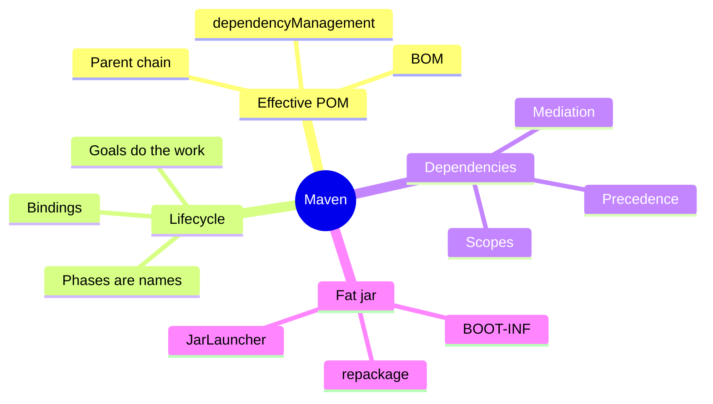
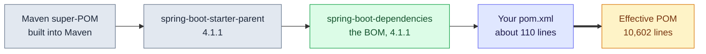

# 8. Maven in Depth — Effective POM, Lifecycle and the Fat Jar

Maven is not a package manager with a few extra commands. It is a build tool with a fixed pipeline, and your `pom.xml` is a short diff laid on top of a 10,000-line parent chain. Everything below was reproduced in the `dev` container (Maven 3.9, Spring Boot 4.1.1).

> [!TIP]
> **TL;DR: the 30-second interview answer**
> - The **effective POM** is the Maven super-POM, `spring-boot-starter-parent`, `spring-boot-dependencies` (the BOM) and your pom merged. A dependency with no `<version>` gets it from `<dependencyManagement>`.
> - Lifecycle **phases** are just ordered names. Plugin **goals** do the work, and `mvn package` runs every phase up to `package`, ending with `spring-boot:repackage`.
> - The Boot **fat jar** has a launcher (`JarLauncher`), your classes in `BOOT-INF/classes` and libraries in `BOOT-INF/lib`. Compile and runtime scopes go in, test scope and devtools stay out.

## Maven at a glance



## Mental model: your pom is the last layer



Maven never builds from your pom alone. It merges this chain first, and the build uses the merged result. The `<parent>` link from the starter-parent to `spring-boot-dependencies` is verified in the `.pom` file in the local repository. The built-in super-POM at the start is from knowledge.

### What the effective POM looked like *(verified)*

| Lines | Section | What it is |
|---|---|---|
| 243 to 9900 | `<dependencyManagement>` | A version lookup table. `spring-boot-starter-webmvc` is in it at 4.1.1 (line 2891) |
| 9901 to 9975 | `<dependencies>` | Your real dependencies, with the missing versions and scopes filled in (webmvc: `4.1.1`, `compile`) |

> [!IMPORTANT]
> **`<dependencyManagement>` adds nothing to the classpath.** It only says which version and scope to use if a dependency is requested. `<dependencies>` is the shopping cart, and a dependency without a version is looked up in the price list. `spring-boot-starter-parent` is what gives you that price list for free.

## How it works: phases are names, goals do the work

`mvn package` printed exactly these goals, in order *(verified)*:


`mvn test` stops at `surefire:test`, so `jar:jar` and `repackage` never run. Both compile goals also printed `Nothing to compile - all classes are up to date`, so the compiler plugin skips unchanged code and does not rebuild the whole project each time *(verified)*.

| Idea | Detail |
|---|---|
| Phase | A name in an ordered list (validate, compile, test, package, verify, install, deploy). Running one runs every earlier phase in its lifecycle |
| Goal | A unit of work inside a plugin, such as `compiler:compile`. It is bound to a phase |
| Where bindings come from | `jar` packaging binds the first six goals (the ids `default-compile` and `default-test` in the log). `spring-boot:repackage` has its own id `repackage`, from the Boot plugin and the parent's plugin config *(that source is from knowledge)* |
| Other lifecycles | `clean` and `site` are separate lifecycles, so `mvn package` never cleans. `install` copies the artifact into your local `~/.m2` and `deploy` pushes it to a remote repository *(from knowledge)* |
| `-DskipTests` | Skips only the `surefire:test` goal, not the compile goals |

## Which version wins

Dependency versions follow a ranking, not "my pom always wins":

| Order | Source | Verified how |
|---|---|---|
| 1 | A `<version>` written on the dependency itself | Set the PostgreSQL driver to 42.7.4: `dependency:tree` resolved 42.7.4 while the managed table still said 42.7.13 |
| 2 | Your own `<dependencyManagement>` | From knowledge |
| 3 | The parent BOM | Webmvc starter got 4.1.1 with no version in the pom |
| 4 | The version a transitive dependency asks for | `logback-classic` asked for `slf4j-api` 2.0.17, the BOM said 2.0.18 and won |

Without any management, the nearest definition to your pom wins, and ties go to the first one declared. That last rule is from knowledge and cannot be shown here, because the BOM leaves no conflicts: the verbose tree showed **0** `omitted for conflict`, **240** `version managed from`, and **145** `omitted for duplicate` (the same artifact reachable by several paths, resolved once).

### Two ways to override a managed version

| Way | What it changes | Trade-off |
|---|---|---|
| `<version>` on the dependency | Only that one dependency | Pinned and invisible. A Boot upgrade will not touch it and Maven will not warn |
| The BOM's property, for example `<postgresql.version>` | The table itself | Boot still manages it, with one place to change |

The property route works because the BOM declares the entry as `<version>${postgresql.version}</version>` *(verified in the BOM)*. From knowledge, not tested: it works when the BOM arrives through a parent, but not when it is imported with `<scope>import</scope>`.

> [!WARNING]
> **A pinned driver version fails at runtime, not at compile time.** The driver is `runtime` scope, so it is not on the compile classpath. If a later Boot upgrade needs a newer driver, you would see `NoSuchMethodError` or `ClassNotFoundException` at startup. The quieter risk is missing the fixes in the managed version.

## The fat jar

`spring-boot:repackage` replaced the thin jar from `jar:jar`. *(All verified.)*

| Check | Result |
|---|---|
| Size | Fat jar 54 MB; the thin original is kept as `.original`, 33 KB (your classes only) |
| Manifest | `Main-Class: org.springframework.boot.loader.launch.JarLauncher`, `Start-Class: com.learn.hello_boot.HelloBootApplication` |
| Layout | Launcher classes at the jar root, your classes under `BOOT-INF/classes`, 85 jars under `BOOT-INF/lib` |

| Dependency | Scope in the pom | In the fat jar |
|---|---|---|
| `postgresql` | `runtime` | yes |
| `spring-boot-webmvc`, `spring-webmvc` (through the starter) | `compile` | yes |
| `spring-boot-starter-webmvc-test` | `test` | no |
| `spring-boot-devtools` | `runtime` and `optional` | no |

A plain jar cannot load classes from jars nested inside it, so `java -jar` starts `JarLauncher`, which builds a classloader over the nested layout and then calls the start class *(the launcher's behaviour beyond the manifest values is from knowledge)*. Devtools is excluded even though its scope is `runtime`; that is the Boot plugin's default exclusion *(from knowledge; the absence is verified)*.

> [!NOTE]
> **Starter jars are empty.** `spring-boot-starter-webmvc-4.1.1.jar` holds only a manifest, a license and a notice, and none of the `spring-boot-starter-*` jars are inside the fat jar. A starter is a pom that lists dependencies; the real libraries (`spring-boot-webmvc`, `spring-webmvc`) arrive transitively. Why the plugin leaves the empty jars out was not checked.

## Names that matter, and names that do not

Maven is convention over configuration, so some names are the contract:

| Name | Why it matters |
|---|---|
| `pom.xml`, `src/main/java`, `src/main/resources` | The build looks for exactly these |
| `application-dev.properties` | Boot loads `application-{profile}` for the active profile. Verified: a logger line put there took effect because the file name matched the `dev` profile |
| `V3__create_idempotency_keys.sql` | Flyway parses the version prefix and the double underscore, and it applied V3 and V4 at startup |
| A public Java class in a same-named file | A compiler rule |
| `PairSavedListener`, `LogOutboxPublisher` | **No.** Spring finds beans by annotation and wires them by type. A class outside the `@SpringBootApplication` package is the exception, because it is not scanned |

## Commands used (lookup, not memorised)

```bash
# the host has no Maven, so everything runs in the dev container
docker compose exec dev mvn help:effective-pom -Doutput=/tmp/eff.xml
docker compose exec dev mvn dependency:tree -Dverbose
docker compose exec dev mvn -DskipTests package
docker compose exec dev mvn -DskipTests test
```

## Failure modes

| You see | Likely cause |
|---|---|
| A version you never wrote | The BOM supplied it. Check the effective POM |
| A dependency you pinned stays old after a Boot upgrade | The version on the dependency beats the managed one |
| `NoSuchMethodError` at startup after pinning a library | A pinned runtime-scope library is older than the stack expects |
| Tests were skipped and the jar still built | `-DskipTests` skips only `surefire:test` |
| A library is missing from the fat jar | It is `test` scope, or it is devtools |

## Interview questions

<details>
<summary>Your pom lists spring-boot-starter-webmvc with no version, yet the build uses 4.1.1. Where does the version come from, and how would you prove it?</summary>

From the parent chain: `spring-boot-starter-parent` inherits `spring-boot-dependencies`, whose `<dependencyManagement>` is a version table. Maven fills in the missing version when it builds the effective POM. Prove it with `mvn help:effective-pom`: the table entry is at line 2891 and your `<dependencies>` entry has the version filled in at line 9905.
</details>

<details>
<summary>You run mvn test after changing one test class. Which goals run, and does spring-boot:repackage run?</summary>

Five goals, in order: `resources:resources`, `compiler:compile`, `resources:testResources`, `compiler:testCompile`, `surefire:test`. `repackage` is bound to `package`, which comes after `test`, so it does not run. The compile goals recompile only what changed, and print `Nothing to compile` otherwise.
</details>

<details>
<summary>A teammate left a version of 42.7.4 on the PostgreSQL driver, then Boot was upgraded to a release whose BOM says 42.7.15. Which version is used, and what is the risk?</summary>

42.7.4, because a version on the dependency beats the managed one. The risk is silent staleness: Maven does not warn, and the driver may miss fixes or be incompatible with the new stack. Because the driver has `runtime` scope, an incompatibility appears at startup or runtime, not at compile time. The safer override is the BOM property.
</details>

<details>
<summary>Why can java -jar run a Spring Boot jar whose libraries are jars inside the jar?</summary>

A normal classloader cannot read nested jars. The repackaged jar has `Main-Class: JarLauncher`, so the JVM starts the launcher first. It builds a classloader over `BOOT-INF/classes` and the 85 jars in `BOOT-INF/lib` and then calls `Start-Class`. The thin jar is kept as `.original`.
</details>

<details>
<summary>Two libraries ask for different versions of the same dependency. Which one wins in a Boot project?</summary>

The version managed by the BOM wins over whatever a transitive dependency requests, which is why Boot projects almost never see conflicts (0 in our tree, 240 managed entries). Without management, Maven takes the nearest definition and, on a tie, the first declared. A version written on your own dependency beats all of them.
</details>

<details>
<summary>Is Maven a package manager like npm?</summary>

Only partly. Dependency resolution into a shared cache (`~/.m2`) is one of its jobs. Its core is a build lifecycle: ordered phases, with plugin goals bound to them. A closer comparison is npm plus a built-in, fixed build pipeline.
</details>

## Key takeaways

| Remember | Because |
|---|---|
| The effective POM is the real pom | Versions and plugins come from the parent chain and the BOM |
| `dependencyManagement` is a price list | It adds nothing to the classpath, `dependencies` does |
| Phases are names, goals do the work | `mvn package` ran 7 goals, `mvn test` only 5 |
| Version precedence is a ranking | Dependency, then your management, then the BOM, then transitive requests |
| A pinned version is invisible | Boot upgrades will not update it and Maven will not warn |
| The fat jar needs a launcher | Nested jars cannot be read by a normal classloader |

**Related:** [1. Overview](/notebook/spring-boot-system-design/01-spring-boot-basics/overview) · [5. Configuration and profiles](/notebook/spring-boot-system-design/01-spring-boot-basics/configuration-and-profiles) · [Dev environment](/notebook/spring-boot-system-design/00-workspace/dev-environment) · [Sprint cheat sheet](/notebook/spring-boot-system-design/quick-sessions/core-patterns-spring-maven/cheatsheet)
