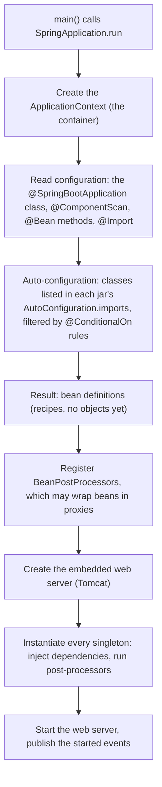

# 1. Overview

> [!NOTE]
> Module 1 explains how a Spring Boot web app is assembled and why it behaves the way it does: the container, dependency injection, the request path, configuration and tests. Items marked *(verified)* were reproduced in `playground/hello-boot`.

## Notes in this module

| # | Note | Question it answers |
|---|------|---------------------|
| 2 | Dependency injection and layers | Who creates my objects and wires them together? |
| 3 | Request input and JSON | How does a request reach my method, and how does the result become JSON? |
| 4 | Validation and error handling | How is bad input rejected in one consistent format? |
| 5 | Configuration and profiles | How does one build run in many environments? |
| 6 | Testing | How do I test without starting everything? |

## What Spring is

Spring is a **container** that creates your objects (called **beans**), wires their dependencies together, and can hand out a **proxy** instead of the real object. Spring MVC, Spring Data, Spring Kafka and the rest are libraries built on that container.

**Spring Boot** does not replace Spring. It configures it for you:

| Boot feature | What it does |
|--------------|--------------|
| Starters | One dependency pulls in a compatible bundle (e.g. Spring MVC + Tomcat + Jackson) |
| Auto-configuration | Config classes inside the jars create beans only if their `@ConditionalOn...` rules match (classpath, existing beans, properties) |
| Externalised configuration | Properties, YAML, environment variables, profiles |
| Executable JAR | Embedded web server, started with `java -jar` |

## What happens at startup

Order of the log lines in our own app *(verified)* matches this:

| Log line | Phase |
|----------|-------|
| `Bootstrapping Spring Data JPA repositories`, `Found 1 JPA repository interface` | Repository scanning while bean definitions are registered |
| `Tomcat initialized with port 8080` | Web server created before the singletons |
| `HikariPool-1 - Start completed`, Flyway lines, `Initialized JPA EntityManagerFactory` | Singleton instantiation (DataSource, Flyway, Hibernate) |
| `Tomcat started on port 8080`, `Started HelloBootApplication in N seconds` | Web server started, startup finished |

> [!IMPORTANT]
> Annotations are **not compiled into beans**. `javac` keeps them as metadata in the `.class` files (runtime retention), and Spring reads them by reflection **at startup**. Nothing is generated at compile time. The exceptions are annotation processors such as Lombok, and Spring AOT for native images.

## Bean lifecycle

Simplified, standard Spring (not exercised in our project):

1. Instantiate the bean (constructor injection happens here)
2. Inject remaining dependencies (setter and field injection)
3. `Aware` callbacks (`BeanNameAware`, `ApplicationContextAware`)
4. `BeanPostProcessor` before-initialisation
5. Init callbacks: `@PostConstruct`, `InitializingBean`
6. `BeanPostProcessor` after-initialisation. **Proxies for `@Transactional`, `@Async`, `@Cacheable` are created here**
7. Bean is in use
8. On shutdown: `@PreDestroy`, `DisposableBean`

## Proxies

The container can return a different object than the one it built. A JDK dynamic proxy needs an interface; a CGLIB proxy subclasses the class, and Boot uses CGLIB by default. Seen in our project *(verified)*: the `@Transactional` self-invocation bug (see `02-persistence`, note 5) and the generated Spring Data repository.

> [!NOTE]
> Boot 4 split the auto-configuration into per-technology modules. Our stack traces showed `org.springframework.boot.flyway.autoconfigure.FlywayAutoConfiguration` and `org.springframework.boot.hibernate.autoconfigure.HibernateJpaConfiguration`. Starter names changed too (for example `spring-boot-starter-webmvc`, and `spring-boot-starter-aop` is now `spring-boot-starter-aspectj`), so old tutorials may not compile.

## Interview questions

**What does `@SpringBootApplication` do?**
It is a meta-annotation: `@SpringBootConfiguration` (marks a configuration class), `@EnableAutoConfiguration` (turns auto-configuration on) and `@ComponentScan` (scans the annotated class's package and sub-packages).

**How does auto-configuration decide what to create?**
Each starter jar lists configuration classes in `META-INF/spring/org.springframework.boot.autoconfigure.AutoConfiguration.imports`. Boot evaluates their `@ConditionalOnClass`, `@ConditionalOnMissingBean` and `@ConditionalOnProperty` rules at startup. Your own bean wins because of `@ConditionalOnMissingBean`. Run with `--debug` to print the conditions report.

**What is a starter?**
A dependency descriptor with no code of its own that pulls in a curated, version-compatible set of libraries, plus the auto-configuration that uses them.

**Spring vs Spring Boot?**
Spring is the container and the libraries. Boot adds starters, auto-configuration, externalised config and the executable JAR, so you stop writing the infrastructure configuration by hand.

**Why do annotations like `@Transactional` work at all?**
A `BeanPostProcessor` wraps the bean in a proxy after initialisation. The proxy adds behaviour (begin and commit a transaction) before and after calling the real method.
