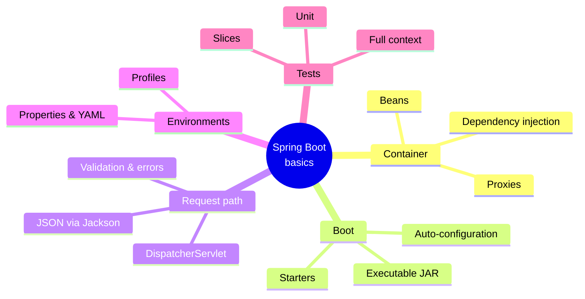
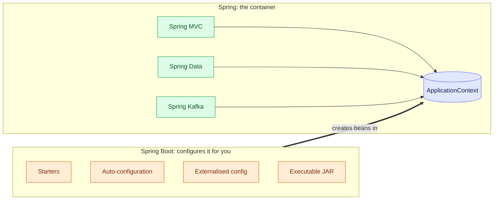
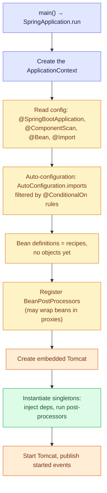

# 1. Overview — How a Spring Boot App Is Assembled

Spring is a **container** that builds your objects, wires them together and may hand out a
**proxy** instead of the real thing. Boot is the layer that configures that container for you.
Nearly every "why does Spring do X?" question comes back to those three ideas.

> [!TIP]
> **TL;DR: the 30-second interview answer**
> - **Spring** = the container (beans + dependency injection + proxies). Web, Data, Kafka are libraries on top.
> - **Boot** = starters + **auto-configuration** (`@ConditionalOn…` rules) + externalised config + an executable JAR.
> - Annotations are read **by reflection at startup**. Behaviour like `@Transactional` comes from a **proxy** a `BeanPostProcessor` wraps around your bean.

> [!NOTE]
> Module 1 covers the container, dependency injection, the request path, configuration and
> tests. Items marked *(verified)* were reproduced in `playground/hello-boot`.

## The module at a glance

| # | Note | Question it answers |
|---|------|---------------------|
| 2 | Dependency injection and layers | Who creates my objects and wires them together? |
| 3 | Request input and JSON | How does a request reach my method, and how does the result become JSON? |
| 4 | Validation and error handling | How is bad input rejected in one consistent format? |
| 5 | Configuration and profiles | How does one build run in many environments? |
| 6 | Testing | How do I test without starting everything? |

## Spring vs Spring Boot

| Boot feature | What it does |
|--------------|--------------|
| Starters | One dependency pulls in a compatible bundle (e.g. Spring MVC + Tomcat + Jackson) |
| Auto-configuration | Config classes inside the jars create beans only if their `@ConditionalOn...` rules match (classpath, existing beans, properties) |
| Externalised configuration | Properties, YAML, environment variables, profiles |
| Executable JAR | Embedded web server, started with `java -jar` |

## What happens at startup

Yellow = **definitions** (recipes), green = **objects** being created, orange = the web server.
The order of the log lines in our own app *(verified)* matches this:

| Log line | Phase |
|----------|-------|
| `Bootstrapping Spring Data JPA repositories`, `Found 1 JPA repository interface` | Repository scanning while bean definitions are registered |
| `Tomcat initialized with port 8080` | Web server created before the singletons |
| `HikariPool-1 - Start completed`, Flyway lines, `Initialized JPA EntityManagerFactory` | Singleton instantiation (DataSource, Flyway, Hibernate) |
| `Tomcat started on port 8080`, `Started HelloBootApplication in N seconds` | Web server started, startup finished |

> [!IMPORTANT]
> **Annotations are not compiled into beans.** `javac` keeps them as metadata in the
> `.class` files (runtime retention), and Spring reads them by reflection **at startup**.
> Nothing is generated at compile time. The exceptions are annotation processors such as
> Lombok, and Spring AOT for native images.

## Bean lifecycle

```mermaid
stateDiagram-v2
    direction LR
    [*] --> Instantiated: constructor<br/>(constructor injection)
    Instantiated --> Populated: setter / field injection
    Populated --> Aware: BeanNameAware,<br/>ApplicationContextAware
    Aware --> Initialised: BPP before-init →<br/>@PostConstruct
    Initialised --> Proxied: BPP after-init<br/>wraps @Transactional,<br/>@Async, @Cacheable
    Proxied --> InUse
    InUse --> Destroyed: @PreDestroy<br/>on shutdown
    Destroyed --> [*]
```

Standard Spring, not exercised directly in our project. The step that matters most in
interviews is **after-initialisation**: that's where proxies are created, which is why a
proxied bean's own constructor and `@PostConstruct` run on the *real* object.

## Proxies

The container can return a different object than the one it built.

| Proxy type | How | Needs | Used by Boot |
|---|---|---|---|
| JDK dynamic proxy | Implements the bean's interfaces | An interface | Only if configured |
| CGLIB | Generates a subclass at runtime | A non-final class, non-final methods | ✅ Default |

Seen in our project *(verified)*: the `@Transactional` self-invocation bug (see
`02-persistence`, note 5) and the generated Spring Data repository.

> [!WARNING]
> **A `final` class or `final` method can't be proxied by CGLIB.** The advice silently
> doesn't apply. Kotlin classes are final by default, which is why the `kotlin-spring`
> plugin opens them.

> [!NOTE]
> **Boot 4 split auto-configuration into per-technology modules.** Our stack traces showed
> `org.springframework.boot.flyway.autoconfigure.FlywayAutoConfiguration` and
> `org.springframework.boot.hibernate.autoconfigure.HibernateJpaConfiguration`. Starter names
> changed too (`spring-boot-starter-webmvc`; `spring-boot-starter-aop` is now
> `spring-boot-starter-aspectj`), so old tutorials may not compile.

## Interview questions

You add the JPA starter but also declare your own DataSource @Bean. Which DataSource does the app use, and how would you prove it?

Yours. Boot's `DataSourceAutoConfiguration` creates its pool only under
`@ConditionalOnMissingBean(DataSource.class)`. Your bean exists by the time auto-configuration
is evaluated, so Boot backs off. Prove it with `--debug` (or `debug=true`): the conditions
evaluation report lists the data-source pool configuration under *negative matches* with
the reason "found bean 'dataSource'".

A @Transactional method is called from another method of the same bean and never rolls back. Explain it using the container's lifecycle.

The transaction lives in a **proxy** that a `BeanPostProcessor` wraps around the bean after
initialisation. Other beans receive the proxy, so their calls go through it. A call via
`this.method()` runs on the **target** object directly, bypassing the proxy, so no
transaction starts. Fix: move the method to another bean (or inject the proxy / use
`TransactionTemplate`).

A @PostConstruct method in a @Transactional service writes to the DB, but there's no transaction. Why?

`@PostConstruct` runs during initialisation, on the raw target object, before the proxy is
wrapped around it (after-init post-processing comes later). Nothing transactional sits in
that call path. Do the work in an `ApplicationReadyEvent` listener that calls the bean via
its proxy, or use `TransactionTemplate` explicitly.

Only one endpoint uses GreetingService, yet a missing GreetingService bean takes the whole app down at startup. Why so drastic?

Singletons are created **eagerly** during context refresh, and constructor injection
resolves dependencies at creation time. A missing dependency fails the refresh, and a
context that fails to refresh never starts the web server. It's fail-fast by design: better
at deploy time than on the first request in production.

The main class moved to com.app.boot, and suddenly controllers in com.app.web return 404. What happened?

`@SpringBootApplication` includes `@ComponentScan` with the **annotated class's package as the
base**. `com.app.web` is no longer under `com.app.boot`, so those controllers were never
registered. Keep the main class in the root package, or set `scanBasePackages`.

How do you find out why a particular auto-configuration did or didn't apply?

Run with `--debug` to print the conditions evaluation report (positive and negative matches,
each with the condition that decided it). With Actuator, `/actuator/conditions` exposes the
same report at runtime.

## Key takeaways

| Remember | Because |
|---|---|
| Spring = container, Boot = configures it | Boot never replaces Spring |
| Auto-config is conditional; your bean wins | `@ConditionalOnMissingBean` backs off |
| Definitions first, objects second | Startup fails before any request if wiring is broken |
| Proxies are created after initialisation | `@Transactional`/`@Async`/`@Cacheable` all rely on them |
| CGLIB is the default proxy | Final classes/methods break advice |

**Next:** [2. Dependency injection and layers](/notebook/spring-boot-system-design/01-spring-boot-basics/dependency-injection-and-layers)
