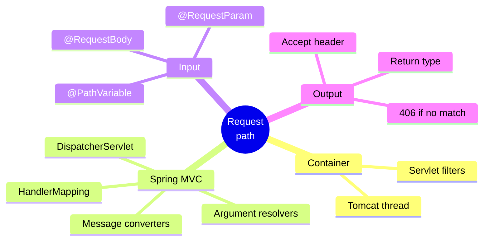
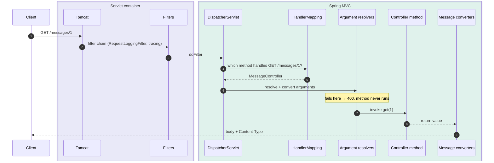
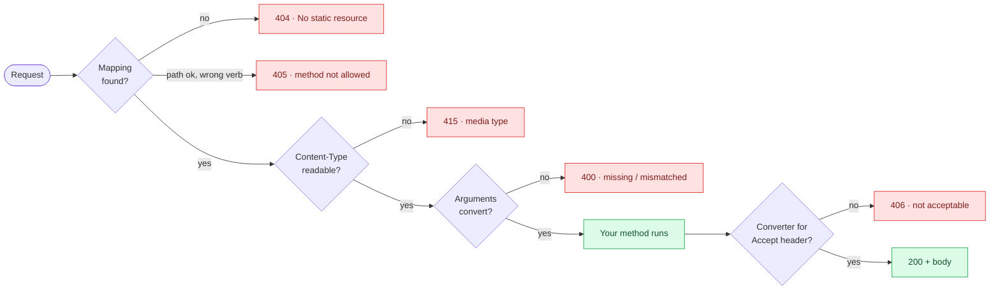

# 3. Request Input and JSON — The Path Through Spring MVC

Every request walks the same corridor: **Tomcat → filters → `DispatcherServlet` → your
method → a message converter**. If you can draw that corridor, you can explain any 400,
404, 406 or 415 Spring returns, because each one is a specific step that refused.

> [!TIP]
> **TL;DR: the 30-second interview answer**
> - `DispatcherServlet` is the **front controller**: `HandlerMapping` picks the method, argument resolvers build its parameters, a `HttpMessageConverter` writes the result.
> - Arguments are resolved **before your code runs**: bad input gets a 400 from Spring, your method never executes.
> - Response format = **return type + `Accept` header** → converter. No converter that fits → **406**.

## At a glance



## The request path



With `logging.level.web=DEBUG` the same path showed up in our log *(verified)*:

```text
DispatcherServlet : GET "/messages/1", parameters={}
RequestMappingHandlerMapping : Mapped to MessageController#get(long)
DispatcherServlet : Completed 200 OK
```

> [!NOTE]
> Boot creates the `DispatcherServlet` lazily: the log shows `Initializing Spring
> DispatcherServlet` on the first request's thread (`nio-8080-exec-1`). Headers and bodies
> are masked by default (`enableLoggingRequestDetails='false'`).

## Where input comes from

| Source | Example | Annotation | Notes |
|--------|---------|------------|-------|
| Path | `/hello/42` | `@PathVariable` | The name in `{id}` must match the parameter, or use `@PathVariable("x")` |
| Query string | `/greet?name=Sri` | `@RequestParam` | `required=true` by default. `defaultValue` also covers an empty value |
| Body | `POST` + JSON | `@RequestBody` | Jackson deserialises it. See note 4 |

## Which step refused? Status codes at a glance



## Bad input *(verified)*

| Call | Result | Why |
|------|--------|-----|
| `/greet` with a required param missing | 400 `MissingServletRequestParameterException` | The resolver found no value |
| `/hello/abc` with `int id` | 400 `MethodArgumentTypeMismatchException` | Conversion `"abc"` to `int` failed |
| No mapping matches | 404 `No static resource ...` | Spring falls through to the static-resource handler |
| Mapping variable name differs from the parameter | **500** `MissingPathVariableException` | Variable `d` exists, `id` does not: a *server* bug, not bad input |

## Objects to JSON

```java
public record Greeting(String message, int id) {}

@GetMapping("/greeting/{id}")
public Greeting greeting(@PathVariable int id,
                         @RequestParam(defaultValue = "World") String name) {
    return new Greeting("Hello, " + name, id);
}
// GET /greeting/7?name=Sri  ->  {"message":"Hello, Sri","id":7}
```

- The **return type** selects the `HttpMessageConverter`: `String` gives `text/plain`, an object goes through Jackson to `application/json`.
- `@RestController` is `@Controller` plus `@ResponseBody`: "write the return value to the body". It does **not** mean "always JSON".
- A record needs no Jackson annotations.

> [!IMPORTANT]
> **Return DTOs (records), never JPA entities.** An entity leaks columns you didn't mean
> to expose, couples the API to the schema, and can trigger lazy-loading or infinite
> recursion during serialisation.

## Content negotiation *(verified)*

The server picks a converter that can write the type **and** matches the `Accept` header.

| `Accept` | Result |
|----------|--------|
| `application/json` or `*/*` | 200 JSON |
| `application/xml`, no XML converter installed | **406 Not Acceptable**, empty body |

Adding an XML library adds a converter, and the same call then returns 200:
auto-configuration reacting to the classpath.

## Filter vs interceptor

| | Servlet filter | `HandlerInterceptor` |
|---|---------------|----------------------|
| Level | Servlet container, before `DispatcherServlet` | Spring MVC, after the handler is chosen |
| Knows the handler method | No | Yes |
| Sees non-Spring requests (static files, errors) | Yes | No |
| Examples | Our `RequestLoggingFilter` (`OncePerRequestFilter`), Spring Security, tracing | Auth checks, timing per controller |

> [!WARNING]
> **Stale `.class` files after moving packages cause duplicate beans or ambiguous
> mappings.** Check `target/classes` and delete the specific file, not `target/` (the watch
> loop needs `target/.last-build`).

## Interview questions

<details>
<summary>Walk me through what happens between Tomcat receiving POST /messages and your controller method running.</summary>

1. A Tomcat worker thread (`nio-8080-exec-N`) takes the request and runs the **servlet filter
   chain** (logging, tracing, Spring Security).
2. `DispatcherServlet.doDispatch` asks the **`RequestMappingHandlerMapping`** for a handler
   and gets the method plus any **interceptors** (`preHandle` runs now).
3. The **`RequestMappingHandlerAdapter`** resolves each parameter. For `@RequestBody` an
   `HttpMessageConverter` (Jackson) reads the body, then `@Valid` runs the validator.
4. Your method runs. Its return value goes back through a converter chosen by return type +
   `Accept`, which writes the body and `Content-Type`.

Any failure in steps 2–3 is answered by Spring (404/405/415/400) and your method never runs.
</details>

<details>
<summary>GET /orders/abc hits @GetMapping("/orders/{id}") with a long id parameter. What does the client get, and does your method run?</summary>

**400**, and the method never runs. The handler *was* found; the failure is in argument
resolution: converting `"abc"` to `long` throws `MethodArgumentTypeMismatchException`, which
`DefaultHandlerExceptionResolver` maps to 400. Resolution happens before invocation, so no
`try/catch` inside your method can see it. Handle it in a `@RestControllerAdvice` if you want
your own error shape.
</details>

<details>
<summary>@GetMapping("/hello/{d}") with @PathVariable int id returns 500, not 400. Why is that the right status?</summary>

The URL template has no variable called `id`, so Spring throws `MissingPathVariableException`.
That isn't bad client input: no URL the client could send would ever fill `id`. It's a
**developer bug**, so it's a 5xx. Fix it with matching names or `@PathVariable("d") int id`.
</details>

<details>
<summary>A client sends Accept: application/xml and gets 406 with an empty body. Why, and how would you fix it?</summary>

Spring picks an `HttpMessageConverter` that can write the return type **and** produce a type
in `Accept`. Only Jackson's JSON converter is registered, so nothing matches and Spring
answers 406 before writing a body. Fix: add the Jackson XML dataformat dependency. Boot's
auto-configuration sees it on the classpath and registers an XML converter. We saw the same
call flip to 200 *(verified)*. Or decide XML isn't supported and keep the 406.
</details>

<details>
<summary>A @RestController method returns a String. What Content-Type does the client get, and why not JSON?</summary>

`text/plain`. Converters are tried in order and `StringHttpMessageConverter` comes before
Jackson, so a `String` is written as-is. `@RestController` only means "write the return
value to the body", not "serialise to JSON". Return a record if you want JSON.
</details>

<details>
<summary>You must log every request with its final status and duration, including 404s and requests Spring Security rejects. Filter or HandlerInterceptor?</summary>

A **filter** (`OncePerRequestFilter`), ordered before Spring Security. An interceptor only
runs for requests that reach a handler, so it never sees a 404 that fell to the static
resource handler or a request Security rejected in its own filter chain. Measure in a
`try/finally` around `chain.doFilter` to capture the final status even when an exception
propagates.
</details>

<details>
<summary>Why return a DTO instead of the JPA entity? Name concrete things that break.</summary>

- **Lazy relations**: serialising triggers `LazyInitializationException` (open-in-view off)
  or a burst of N+1 queries (open-in-view on).
- **Bidirectional mappings** (`Order` ↔ `OrderLine`) recurse forever in Jackson.
- **Leaks**: every field goes out, including ones like `passwordHash` or internal flags.
- **Coupling**: renaming a column now breaks API clients.

A record DTO fixes all four, because you decide exactly what crosses the boundary.
</details>

<details>
<summary>Two controller methods map GET /messages. When do you find out, and what happens?</summary>

At **startup**: `RequestMappingHandlerMapping` registers every mapping and throws
`IllegalStateException: Ambiguous mapping`, so the context fails to start. In our setup the
classic cause is a stale `.class` of a moved controller left in `target/classes` (see the
warning above).
</details>

## Key takeaways

| Remember | Because |
|---|---|
| Tomcat → filters → DispatcherServlet → method → converter | Every status code maps to one step |
| Argument resolution runs before your code | Bad input is a 400 from Spring |
| Format = return type + `Accept` | No fitting converter → 406 |
| `@RestController` = write to body, not "JSON" | The converter decides the format |
| DTOs out, never entities | Stable API, no lazy-loading surprises |

**Next:** [4. Validation and error handling](/notebook/spring-boot-system-design/01-spring-boot-basics/validation-and-error-handling)
