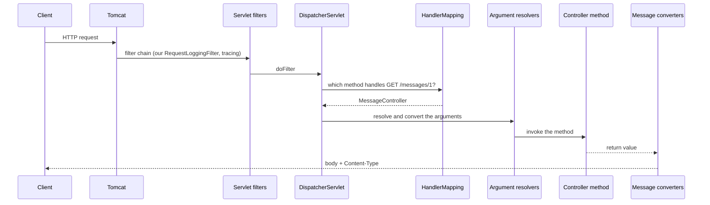

# 3. Request input and JSON

## The request path



With `logging.level.web=DEBUG` the same path showed up in our log *(verified)*:

```text
DispatcherServlet : GET "/messages/1", parameters={}
RequestMappingHandlerMapping : Mapped to MessageController#get(long)
DispatcherServlet : Completed 200 OK
```

> [!NOTE]
> Boot creates the `DispatcherServlet` lazily: the log shows `Initializing Spring DispatcherServlet` on the first request's thread (`nio-8080-exec-1`). Headers and bodies are masked by default (`enableLoggingRequestDetails='false'`).

Arguments are resolved and converted **before your method runs**. If that fails, Spring answers 400 itself and your code never executes.

## Where input comes from

| Source | Example | Annotation | Notes |
|--------|---------|------------|-------|
| Query string | `/greet?name=Sri` | `@RequestParam` | `required=true` by default. `defaultValue` also covers an empty value |
| Path | `/hello/42` | `@PathVariable` | The name in `{id}` must match the parameter, or use `@PathVariable("x")` |
| Body | `POST` + JSON | `@RequestBody` | See note 4 |

## Bad input *(verified)*

| Call | Result | Why |
|------|--------|-----|
| `/greet` with a required param missing | 400 `MissingServletRequestParameterException` | The resolver found no value |
| `/hello/abc` with `int id` | 400 `MethodArgumentTypeMismatchException` | Conversion `"abc"` to `int` failed |
| No mapping matches | 404 `No static resource ...` | Spring falls through to the static-resource handler |
| Mapping variable name differs from the parameter | 500 `MissingPathVariableException` | Variable `d` exists, `id` does not |

## Objects to JSON

```java
public record Greeting(String message, int id) {}

@GetMapping("/greeting/{id}")
public Greeting greeting(@PathVariable int id,
                         @RequestParam(defaultValue = "World") String name) {
    return new Greeting("Hello, " + name, id);
}
// GET /greeting/7?name=Sri  ->  {"message":"Hello, Sri","id":7}
```

- The **return type** selects the `HttpMessageConverter`: `String` gives `text/plain`, an object goes through Jackson to `application/json`.
- `@RestController` is `@Controller` plus `@ResponseBody`: "write the return value to the body". It does not mean "always JSON".
- A record needs no Jackson annotations. Use records as DTOs at the API boundary, never return entities.

## Content negotiation *(verified)*

The server picks a converter that can write the type **and** matches the `Accept` header.

| `Accept` | Result |
|----------|--------|
| `application/json` or `*/*` | 200 JSON |
| `application/xml`, no XML converter installed | **406 Not Acceptable**, empty body |

Adding an XML library adds a converter, and the same call then returns 200: auto-configuration reacting to the classpath.

## Filter vs interceptor

| | Servlet filter | `HandlerInterceptor` |
|---|---------------|----------------------|
| Level | Servlet container, before `DispatcherServlet` | Spring MVC, after the handler is chosen |
| Knows the handler method | No | Yes |
| Examples | Our `RequestLoggingFilter` (`OncePerRequestFilter`), Spring Security, tracing | Auth checks, timing per controller |

> [!WARNING]
> After moving classes between packages, check `target/classes` for stale `.class` files. A stale controller means duplicate beans or ambiguous mappings. Delete the specific file, not `target/` (the watch loop needs `target/.last-build`).

## Interview questions

**What is the `DispatcherServlet`?**
Spring MVC's front controller. Every request goes through it: it asks the `HandlerMapping` for the method, uses a `HandlerAdapter` to resolve arguments and invoke it, then writes the result with a message converter or view resolver.

**`@RequestParam` vs `@PathVariable`?**
`@PathVariable` reads a segment of the URL path (`/orders/42`). `@RequestParam` reads the query string or form field (`?status=open`).

**How does Spring choose how to serialise the return value?**
By the return type and the request's `Accept` header, through the list of registered `HttpMessageConverter`s. No match gives 406.

**Filter vs interceptor?**
Filters belong to the Servlet API and wrap the whole request, including non-Spring resources. Interceptors belong to Spring MVC and run around the controller invocation with access to the handler.

**Why can a missing mapping say "No static resource"?**
When no controller matches, the request falls to the resource handler, which reports the missing file.
