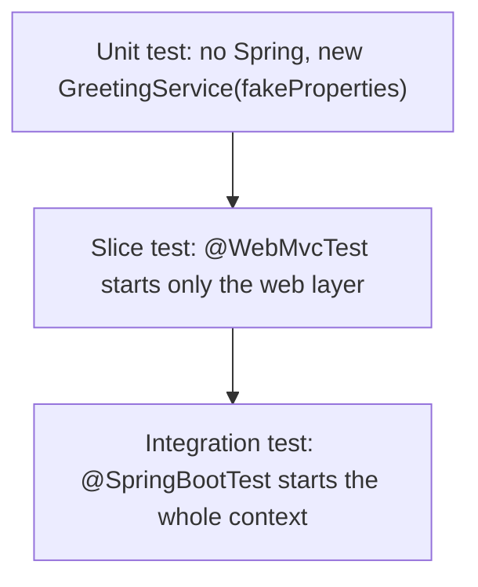

# 6. Testing

## Three levels



| Level | What starts | Real | Faked | Speed |
|-------|-------------|------|-------|-------|
| Unit | Nothing (plain Java) | The class under test | Its collaborators | Milliseconds |
| Slice, `@WebMvcTest` | Controllers, `@RestControllerAdvice`, JSON converters, validation | Routing, binding, `@Valid`, error handler | The service (a mock bean) | Seconds (5.4 s for the first start here, then fast) |
| Integration, `@SpringBootTest` | Everything: all beans, config, profiles | The full wiring | Nothing, or external systems | Slowest |

Many unit tests, a moderate number of slice tests, few integration tests.

## Which test catches what

| Behaviour | Best test |
|-----------|-----------|
| `MessageService` strips whitespace, throws not-found | Unit with a Mockito mock of the repository |
| Blank input returns 400 in our `ErrorResponse` | `@WebMvcTest` |
| Wrong `Content-Type` returns 415 in our format | `@WebMvcTest` |
| `@Valid` is actually present (the silent-200 trap) | `@WebMvcTest` |
| Lost update returns 409 | `@WebMvcTest` with the service throwing `ObjectOptimisticLockingFailureException` |
| Config binds and the app starts | `@SpringBootTest` |

## What we wrote

```java
// Unit test: no Spring. Constructor injection lets us hand over our own values.
private final GreetingService service = new GreetingService(new GreetingProperties("Yo", "Friend"));

// Slice test: web layer only, the service replaced by a mock bean.
@WebMvcTest(MessageController.class)
class MessageControllerTest {
    @Autowired MockMvc mockMvc;
    @MockitoBean MessageService service;
    // mockMvc.perform(post("/messages")...).andExpect(status().isBadRequest())
    //        .andExpect(jsonPath("$.fieldErrors.text").value("must not be blank"));
}

// Integration test with the profile pinned so it does not depend on the environment.
@SpringBootTest
@ActiveProfiles("test")
class GreetingPropertiesTest { ... }
```

Suite: **20 tests** green (`GreetingServiceTest` 3, `MessageServiceTest` 4, `HelloControllerTest` 4, `MessageControllerTest` 7, context-loads 1, config binding 1).

> [!NOTE]
> Boot 4 moved the test annotations *(verified in the jars)*: `org.springframework.boot.webmvc.test.autoconfigure.WebMvcTest` (new `spring-boot-webmvc-test` module) and `org.springframework.test.context.bean.override.mockito.MockitoBean`. Old tutorials use `@MockBean` and the old package; whether those still compile on Boot 4 was not tested.

## What we saw *(verified)*

- **A test must be able to fail.** Removing `@Valid` made exactly one test fail: `Status expected:<400> but was:<200>`. Removing `@ResponseStatus(CREATED)` failed exactly the 201 test.
- **The container's `SPRING_PROFILES_ACTIVE=dev` leaks into every test.** A config test expecting the base value failed with `expected: <Hello> but was: <Hi>`. `@ActiveProfiles("test")` fixed it.
- `@SpringBootTest` tests start Hikari and run Flyway against the **dev database**. `@WebMvcTest` slices never touch it. Fix planned: a throwaway Postgres (see `02-persistence`, note 6).

> [!WARNING]
> A test that passes on a clean machine and fails in the container is usually an environment leak (profile, environment variable). Pin anything environment-dependent inside the test.

## Commands

```bash
docker compose exec dev mvn test                              # all tests
docker compose exec dev mvn test -Dtest=MessageControllerTest # one class
```

Use the Git Bash tool with `MSYS_NO_PATHCONV=1` for `docker compose exec` commands containing pipes or paths: PowerShell mangles the quoting.

## Interview questions

**`@WebMvcTest` vs `@SpringBootTest`?**
`@WebMvcTest` starts only the web layer (controllers, advice, converters, validation) and needs the other beans mocked. `@SpringBootTest` starts the whole application context. The slice is much faster and enough for request/response behaviour.

**How do you replace a bean in a test?**
`@MockitoBean` (Spring Framework 6.2+, replacing Boot's older `@MockBean`) registers a Mockito mock in the test context in place of the real bean.

**What is MockMvc?**
A test client that drives `DispatcherServlet` in memory, with no real server or port, and asserts on status, headers and JSON.

**How do you keep tests independent of the environment?**
Pin the profile with `@ActiveProfiles`, set explicit test properties, and use a disposable database rather than a shared one.

**Why is constructor injection good for testing?**
The class can be created with `new` and handed fakes, so unit tests need no Spring context at all.
